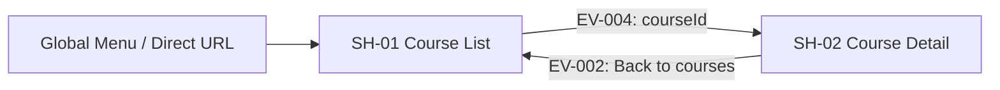

# SH-01 — Navigation

## 1. Current Route
- Path: `/courses`; public; không có path param.
- Trong demo filter/page chỉ giữ trong component state (không serialize query ra URL). Refresh quay về default.

## 2. Entry / Exit
| Direction | Source / destination | Trigger | Params | Guard |
|---|---|---|---|---|
| Entry | Direct URL `/courses` | Browser load | none | Public |
| Entry | Global menu | Click `Khóa học` | none | Public |
| Exit | [SH-02 — Chi tiết khóa học](../SH-02-CourseDetail/06-navigation.md) | `SH-01-EV-004` | `courseId` string | ID non-empty |

## 3. Back/refresh/deep link
- Khi trở lại SH-01 qua browser Back: có thể mount lại với filter/page mặc định trong demo; không cam kết giữ scroll nếu router chưa hỗ trợ.
- Direct `/courses` luôn tải danh sách qua API-001.
- Không có login guard; lỗi API không redirect.

