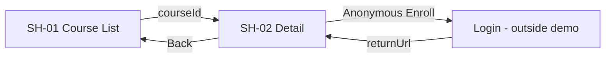

# SH-02 — Navigation

## 1. Current route
- `/courses/:courseId` where `courseId: string` nonempty <=64 chars.
- `courseId` comes from [SH-01 event EV-004](../SH-01-CourseList/02-events.md) or direct URL.

## 2. Entry / Exit
| Direction | Source/destination | Trigger | Parameter | Guard |
|---|---|---|---|---|
| Entry | [SH-01](../SH-01-CourseList/06-navigation.md) | SH-01-EV-004 | courseId (path) | nonempty |
| Entry | deep link | browser navigation | courseId (path) | BR-005 |
| Exit | SH-01 `/courses` | SH-02-EV-002 | none | none |
| Exit | Login `/login` (**ngoài demo**) | SH-02-EV-004/401 | returnUrl encoded | anonymous / invalid session |

## 3. Back, invalid links, auth
- Back link always returns `/courses`; không giả định browser history.
- Direct link valid ID → GET detail; missing/invalid/404 → not-found UI + về danh sách.
- Anonymous được xem published detail. Enroll bắt buộc auth; redirect same-origin relative returnUrl.
- Login complete returns to detail and re-fetches; user **bấm lại** CTA mới POST, tránh hành động mutate ngoài ý muốn.
- Nếu navigate giữa course IDs trên một component, reset state và ignore stale response.

