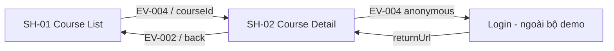

# Screen Index — Examples (Demo)

| Screen | Tên | Route | Module | Trạng thái | Liên kết |
|---|---|---|---|---|---|
| `SH-01` | Danh sách khóa học | `/courses` | Study | Đầy đủ minh họa, chưa xác minh sản phẩm | [Overview](SH-01-CourseList/00-overview.md) |
| `SH-02` | Chi tiết khóa học | `/courses/:courseId` | Study | Đầy đủ minh họa, chưa xác minh sản phẩm | [Overview](SH-02-CourseDetail/00-overview.md) |

## Quan hệ

**Chú ý:** bộ 2 screen demo minh họa cách viết DD, **không phải** thiết kế đã xác nhận từ code/base sản phẩm thật.
