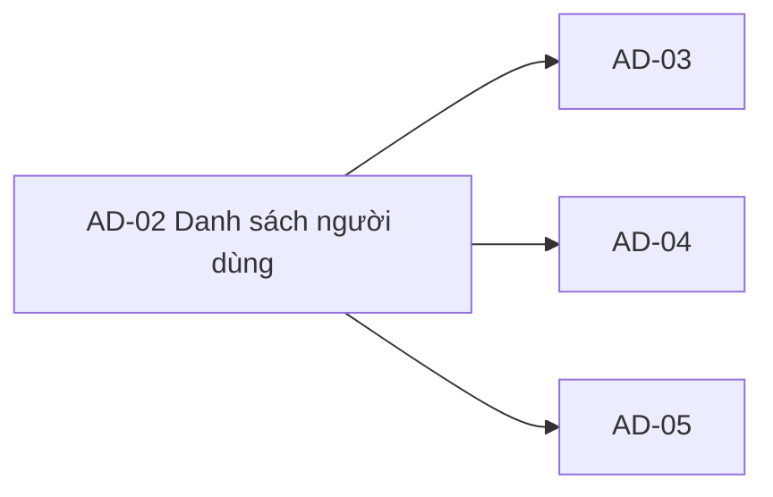

# AD-02 — Navigation

## 1. Route definition
- Current route in inventory: `/admin/users`
- Status: local source route is wired; browser reached the Admin login gate, while authenticated AD-02 runtime is `NOT VERIFIED`.
- Route params/types: Không có route param được biểu diễn trong inventory string; route runtime vẫn chưa xác minh.
- Query params/defaults: preserve the inventory route string; detailed parsing rules only from source DD.
- Route guards: see source DD/API contract; do not create role policy.

## 2. Điểm vào
| From screen/route | Trigger | Params | Guard / fallback |
|---|---|---|---|
| [AD-01](../AD-01-DashboardQuanTri/00-overview.md), [AD-05](../AD-05-KhoaMoKhoaXoaTaiKhoan/00-overview.md) | Theo DD nguồn/inventory | Theo source; không suy diễn | Xem source DD; route chưa xác nhận runtime |

## 3. Điểm ra
| Destination | Trigger | Params | Điều kiện |
|---|---|---|---|
| [AD-03](../AD-03-ChiTietNguoiDung/00-overview.md), [AD-04](../AD-04-ChinhSuaNguoiDung/00-overview.md), [AD-05](../AD-05-KhoaMoKhoaXoaTaiKhoan/00-overview.md) | ID link, edit action, or account-action handoff | Positive JavaScript safe-integer user ID only | Local routes are registered; authenticated runtime/permission remains unverified |

## 4. Back / refresh / deep link
- Back behavior: xem source DD; không mặc định browser history.
- Preserve filters/scroll/form state: chỉ nếu source có nêu, nếu không `CẦN_XÁC_NHẬN`.
- Refresh/direct URL: Angular source defines `/admin/users`; direct browser request returned the app/login gate, not an authenticated AD-02 list.
- Invalid/missing ID: theo source DD/backend contract; không tự tạo validation.
- Not authenticated/authorized: theo source role guard; xem [Business Rules](05-business-rules.md).

## 5. Diagram


## Source navigation and flow detail

### Trích từ DD nguồn: E. Trạng thái và điều hướng

### Screen states và API mapping

| State | Entry condition | Expected UI | Current evidence |
|---|---|---|---|
| `loading` | Route load hoặc query thay đổi; #68 pending. | Giữ filter context, báo đang tải và tránh submit lặp. | Local page renders separate `role=status`; panel exposes `aria-busy`. |
| `ready` | HTTP 200, `items.length > 0`. | Render các row/metadata; actions điều hướng theo quyền/contract. | Local page renders response-backed rows and pagination; focused spec passes. |
| `empty` | HTTP 200, `items=[]`; có thể do chưa có user hoặc filter không match. | Nói rõ không có kết quả; không kết luận sync lỗi hoặc đang chạy. | Local loaded-empty state is separate from loading/error; does not claim sync status. |
| `filter-error` | #68 trả 422 cho `page` parse/range. | Giữ filter; liên kết lỗi với page state; cho phép sửa/đặt lại. Filter role/status unknown hiện không gây 422. | Local 422 alert offers page 1 recovery and preserves current filters/unrelated query; focused spec passes. |
| `unauthenticated` | #68 trả 401. | Dùng auth shell/session handling đã được duyệt. | Existing Admin layout shows login gate without a session; shared 401 UX/API response not browser-tested. |
| `forbidden` | #68 trả 403 khi token không có ADMIN claim. | Hiển thị access denied theo shared auth UX; không render danh sách cũ như mới. | API contract/source identifies 403; authenticated UI handling not verified. |
| `error` | #68 trả 500 hoặc network không xác định. | Thông báo an toàn và nút thử lại khi khả dụng; không lộ query/PII/raw SQL. | Local safe alert offers retry for retryable errors; focused spec passes. |

**Empty pagination:** API trả `page=1,size=20,total=0,total_pages=0`; mockup `0/0` chưa xác định có nghĩa current page hay record count. Chốt copy/UI representation trước implement.

### Navigation / data handoff

| Từ AD-02 | Đích | Handoff | Ranh giới |
|---|---|---|---|
| Chọn user | AD-03 `/admin/users/:userId` | `id` từ `items[]` → #69. | Không đưa email/PII vào URL. |
| Edit | AD-04 `/admin/users/:userId/edit` | `id` → destination reads #69 and may submit #70 under its own gates. | AD-02 only navigates; no write is made here. |
| Status/delete action | AD-05 `/admin/users/:userId/actions` | `id` → destination reads #69; #71/#72 remain controlled by AD-05. | Policy/token/lifecycle còn mở; AD-02 only hands off. |
| Add user | Dialog tại AD-02 → POST #105. | Validated 201 closes the dialog, announces success, and refetches the same #68 query; errors preserve the dialog and draft. | Không điều hướng và không thay đổi filter/page URL. |
| Primary navigation | AD-01 hoặc các screen quản trị tương ứng | Dùng route catalog của từng Screen ID. | Prototype anchors hiện là `#`; không khẳng định destination đang chạy. |

### Trích từ DD nguồn: B. Luồng hoạt động tổng thể

### Expected flow — sau khi các blocker được giải quyết

1. Admin mở route được phê duyệt. App xác thực session và quyền user-management theo auth/RBAC contract; không xem badge “RBAC V2.4” trong mockup là bằng chứng quyền đã được kiểm tra.
2. Screen đọc `role`, `status`, `keyword`, `page` từ URL query theo yêu cầu inventory. Gọi `GET #68` với Bearer token và đúng query. Debounce hay nút submit, page reset khi filter thay đổi, và canonical hóa URL cần được chốt ở client design.
3. Khi thành công, map `data.items` vào các cột ID, họ tên, email, role, status, ngày tạo; dùng pagination metadata để render tổng số và page controls. Không hiển thị field ngoài cột được duyệt.
4. `items=[]` là empty Page HTTP 200, không phải lỗi hoặc trạng thái đồng bộ. Không suy ra “chưa đồng bộ auth server” từ response rỗng.
5. Admin chọn một user để mở AD-03 và API #69; edit mở AD-04 và API #70. Nhánh status/delete thuộc AD-05 với #71/#72. Sau mutation thành công, flow AC-31 yêu cầu reload list/detail; AD-02 không tự thực hiện mutation qua #68.

### Prototype HTML behavior (`screen_stitch/code.html`)

- Header/footer links dùng `href="#"`; không có app router hoặc client API call.
- Search và hai select chỉ là controls tĩnh. Listener duy nhất là Reset: clear keyword/role/status và focus search; URL không đổi.
- Refresh và hai nút pagination disabled. Add, Export và “Xem hướng dẫn nhập liệu” không có listener.
- Empty state nói dữ liệu đang chờ đồng bộ từ auth server, nhưng API #68 không trả sync state. “System Normal”, “RBAC V2.4”, “Bảo mật cấp 3” và cam kết mọi truy xuất được audit đều là static copy; API #68 không cung cấp health/audit fields hay audit side effect.

### Current server source trace

```text
admin.routes.ts users child → AD02Page → AD02ApiService → AdminApiService/API_068 → StudyApiService →
GET /api/v1/admin/users → apps/study-server/app/api/v1.py:get_admin_users_endpoint
→ get_admin_users(raw Authorization/role/status/keyword/page, Session, trace)
→ shared validate_current_user_request(role="ADMIN") before DB
→ validate page + normalize keyword
→ COUNT_ADMIN_USERS and LIST_ADMIN_USERS over legacy users candidate
→ safe UserProfile projection + Page metadata + success envelope
→ 401/403/422/500 safe envelopes; query/projection failures rollback; no commit/write
```

COUNT và LIST dùng cùng role/status/keyword predicates; page query dùng `LIMIT 20`, offset từ page và `ORDER BY users.id ASC`. Keyword là lowercase literal substring trên `full_name` hoặc `email`; `%`/`_` không phải wildcard. Unknown role/status strings không bị enum validator chặn và có thể cho empty Page. API #68 không tìm theo ID. Catalog/AC response shape khớp current local response; filter, paging, schema target và permission policy vẫn có trạng thái `DERIVED`/Draft.

### Current create-flow navigation — 2026-11-22

```text
AD-02 Add → create dialog → POST API #105 → valid HTTP 201 → close + announce → same AD-02 query → GET API #68
```

The flow remains on `/admin/users`; it preserves the current keyword, role, status and page query. Safe HTTP errors and malformed create-success projections keep the dialog/draft available for correction. The focused AD-02 suite passes 11/11. Authenticated browser, live API/DB and deployment remain `NOT VERIFIED`.
