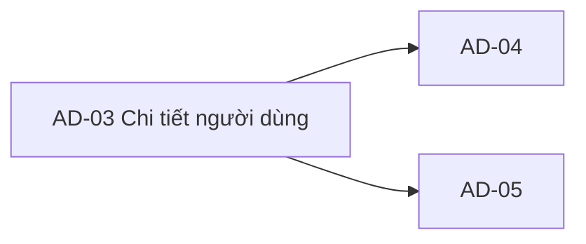

# AD-03 — Navigation

## 1. Route definition
- Current route in inventory: `/admin/users/:userId`
- Status: candidate/design route; Study Web `UNWIRED` unless source code proves otherwise.
- Route params/types: `userId` (type/validation: see source DD; CẦN_XÁC_NHẬN if absent)
- Query params/defaults: preserve the inventory route string; detailed parsing rules only from source DD.
- Route guards: see source DD/API contract; do not create role policy.

## 2. Điểm vào
| From screen/route | Trigger | Params | Guard / fallback |
|---|---|---|---|
| [AD-02](../AD-02-DanhSachNguoiDung/00-overview.md), [AD-04](../AD-04-ChinhSuaNguoiDung/00-overview.md), [AD-05](../AD-05-KhoaMoKhoaXoaTaiKhoan/00-overview.md) | Theo DD nguồn/inventory | Theo source; không suy diễn | Xem source DD; route chưa xác nhận runtime |

## 3. Điểm ra
| Destination | Trigger | Params | Điều kiện |
|---|---|---|---|
| [AD-04](../AD-04-ChinhSuaNguoiDung/00-overview.md), [AD-05](../AD-05-KhoaMoKhoaXoaTaiKhoan/00-overview.md) | Source event/inventory navigation | Theo source DD | Expected links; runtime chưa verify |

## 4. Back / refresh / deep link
- Back behavior: xem source DD; không mặc định browser history.
- Preserve filters/scroll/form state: chỉ nếu source có nêu, nếu không `CẦN_XÁC_NHẬN`.
- Refresh/direct URL: route trong inventory không chứng minh runtime.
- Invalid/missing ID: theo source DD/backend contract; không tự tạo validation.
- Not authenticated/authorized: theo source role guard; xem [Business Rules](05-business-rules.md).

## 5. Diagram

## Source navigation and flow detail

### Trích từ DD nguồn: E. Ma trận trạng thái và điều hướng

### Trạng thái màn hình

| State | Điều kiện vào | UI/behavior yêu cầu | Bằng chứng hiện tại |
|---|---|---|---|
| `loading` | Route hợp lệ; GET #69 đang chờ. | Skeleton/loader và chặn thao tác phụ thuộc dữ liệu; thiết kế hiển thị cụ thể chưa có trong screenshot. | Không có loading implementation. |
| `ready` | HTTP 200, `DESIGN_RESOURCE_RETRIEVED`, `data` là UserProfile hợp lệ. | Map field profile vào element; PII/masking và enum labels vẫn cần policy. | API source-backed cục bộ; Study Web chưa wire. |
| `unauthenticated` | HTTP 401 hoặc token/session thiếu/sai. | Dùng auth shell/session UX đã được duyệt; không hiển thị placeholder như thành công. | API error trực tiếp; Study Web shell chưa có. |
| `forbidden` | HTTP 403. | Báo không có quyền; không retry tự động bằng role khác. | API error trực tiếp; mapping `ADMIN` ↔ permission AC-31 còn DERIVED. |
| `not-found` | HTTP 404 cho path ID sai/out-of-range hoặc user không tồn tại theo local source. | Hiển thị not-found và điều hướng về AD-02 theo contract. | Catalog status/code trực tiếp; phân loại path/no-row là local DERIVED mapping. |
| `error` | HTTP 500 hoặc network failure. | Thông báo an toàn; retry chỉ khi shared client convention xác định. Không lộ DB/PII. | 500 source-backed; network UI/retry chưa được định nghĩa. |
| `audit-blocked` | Không có audit source/policy. | Không hiển thị count/empty history/retention như dữ liệu thực. | Current prototype có static empty state và retention; #69 không hỗ trợ. |
| `actions-disabled` | Chưa đủ permission/contract/route cho AD-04/AD-05. | Giữ #15/#17 disabled và không gửi mutation. | Đúng với HTML hiện tại. |
| `empty` | Không có successful empty response trong #69. | Không dùng `204`, `NULL_PAYLOAD` hoặc “đang đồng bộ” làm empty success. 404 là not-found. | API route trả 200 UserProfile hoặc error; prototype empty state không khớp. |

### Điều hướng / handoff data

| Từ | Đến | Dữ liệu truyền | Ranh giới |
|---|---|---|---|
| AD-02 | AD-03 | `items[].id` từ #68 → `user_id` path của #69. | Chỉ truyền ID; không đưa email/phone vào URL. Role/permission policy còn mở. |
| AD-03 back/breadcrumb | AD-02 | Không yêu cầu dữ liệu; giữ filter/page nếu shared navigation contract quy định. | Link prototype là fragment; route thực chưa có. |
| AD-03 edit | AD-04 | `userId` path. | #15 đang disabled; #70 body và field rules chưa được xử lý tại màn này. |
| AD-03 status/delete | AD-05 | `userId` path. | #17 đang disabled; #71/#72 policy và confirmation là màn hình đích. |
| Header/footer | Các trang admin/policy/support | Không có handoff data đã xác nhận. | `href="#"`; không suy ra route hoặc API. |

### Bảo mật và dữ liệu

- Không render profile nếu API trả 401/403/404/500; không dùng static RBAC badge làm authorization.
- Email và phone là PII trong response. Ai được xem đầy đủ, masking và audit requirement phải được owner quyết định trước triển khai.
- Không đưa token, email, phone hoặc toàn bộ profile vào URL/log. API source hiện không chọn `password_hash` và model allowlist loại các field khác.
- Trạng thái xóa/ẩn danh sau #72 và quan hệ với #69 chưa rõ; không giả định user luôn còn đọc được sau mutation.
- Local legacy BIGINT query không chứng minh production schema/grants. V1-PILOT UUID identity/profile không map trực tiếp vào `UserProfile.id:int64`.

### Trích từ DD nguồn: B. Luồng hoạt động tổng thể

### Expected flow — sau khi route, policy và blockers được giải quyết

1. Admin mở AD-03 từ AD-02 bằng `id` của user đã chọn. Route nhận ID dạng path; không truyền email/phone.
2. Client xác định session/token theo auth shell đã được duyệt. API #69 nhận Bearer JWT. Catalog không khai báo query hoặc body; `X-Trace-Id` là header correlation tùy chọn theo API DD/middleware.
3. Hiển thị trạng thái `loading` trong khi gọi `GET /api/v1/admin/users/{user_id}`. Không gọi API audit/sync vì chưa có contract nguồn.
4. API xác thực JWT và quyền trước khi parse ID hoặc đọc user data. Local source cụ thể yêu cầu claim `ADMIN`; chính sách này chưa được duyệt như mapping đầy đủ cho AC-31.
5. Nếu HTTP 200 và `businessCode=DESIGN_RESOURCE_RETRIEVED`, kiểm tra envelope rồi map `data.full_name`, `data.email`, `data.id`, `data.phone`, `data.role`, `data.status` vào các row tương ứng. `phone`/`avatar_url` có thể null; các field bắt buộc của `UserProfile` phải có mặt.
6. Không map profile response thành nhật ký hoạt động. `created_at`/`updated_at` có trong response nhưng không có vị trí trong screenshot; không tự thêm UI hoặc diễn giải thành audit event.
7. Hiển thị kết quả thành `ready`. Nếu trả 401/403/404/500 hoặc lỗi mạng, chuyển sang trạng thái tương ứng, không giữ placeholder “đang đồng bộ” làm dữ liệu.
8. Quay về AD-02 qua điều hướng được duyệt. Chỉ bật handoff edit/status khi AD-04/AD-05, permission và API tương ứng sẵn sàng; AD-03 không thực hiện mutation.

### Current source flow

1. FastAPI route nhận raw path `user_id`, Authorization và trace ID rồi gọi view API #69.
2. `validate_admin_request` gọi shared JWT guard với `role="ADMIN"`; lỗi auth/role trả về trước khi parse path hoặc query user.
3. `parse_admin_user_id` chấp nhận signed integer dạng chuỗi trong miền int64; malformed/out-of-range trả 404 `DESIGN_RESOURCE_NOT_FOUND`, không phát sinh 422.
4. Query chỉ chọn `id`, `full_name`, `email`, `role`, `avatar_url`, `phone`, `status`, `created_at`, `updated_at` từ candidate legacy `users` bằng bind parameter. Không chọn password hash; không ghi dữ liệu.
5. Không có row trả 404 `DESIGN_RESOURCE_NOT_FOUND`. Query/mapping failure trả 500 `DESIGN_INTERNAL_ERROR`; error message không lộ chi tiết DB. Shared response helper trả `data:null` trên lỗi và envelope có `traceId`.
6. Profile hợp lệ được serialize qua shared `UserProfile`; success code `DESIGN_RESOURCE_RETRIEVED`, message `User retrieved.`. `meta` rỗng.
7. Focused tests hiện có bao phủ các nhánh trên bằng fake DB/session. Source đã được đọc nhưng tests không chạy trong phiên này; chúng không chứng minh schema/deployment live.
