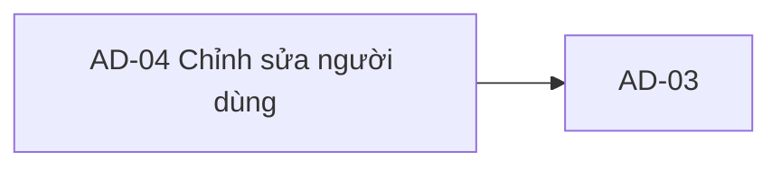

# AD-04 — Navigation

## 1. Route definition
- Current route in inventory: `/admin/users/:userId/edit`
- Status: candidate/design route; Study Web `UNWIRED` unless source code proves otherwise.
- Route params/types: `userId` (type/validation: see source DD; CẦN_XÁC_NHẬN if absent)
- Query params/defaults: preserve the inventory route string; detailed parsing rules only from source DD.
- Route guards: see source DD/API contract; do not create role policy.

## 2. Điểm vào
| From screen/route | Trigger | Params | Guard / fallback |
|---|---|---|---|
| [AD-02](../AD-02-DanhSachNguoiDung/00-overview.md), [AD-03](../AD-03-ChiTietNguoiDung/00-overview.md) | Theo DD nguồn/inventory | Theo source; không suy diễn | Xem source DD; route chưa xác nhận runtime |

## 3. Điểm ra
| Destination | Trigger | Params | Điều kiện |
|---|---|---|---|
| [AD-03](../AD-03-ChiTietNguoiDung/00-overview.md) | Source event/inventory navigation | Theo source DD | Expected links; runtime chưa verify |

## 4. Back / refresh / deep link
- Back behavior: xem source DD; không mặc định browser history.
- Preserve filters/scroll/form state: chỉ nếu source có nêu, nếu không `CẦN_XÁC_NHẬN`.
- Refresh/direct URL: route trong inventory không chứng minh runtime.
- Invalid/missing ID: theo source DD/backend contract; không tự tạo validation.
- Not authenticated/authorized: theo source role guard; xem [Business Rules](05-business-rules.md).

## 5. Diagram

## Source navigation and flow detail

### Trích từ DD nguồn: E. Ma trận trạng thái và điều hướng

### Trạng thái màn hình

| State | Điều kiện vào | UI/action | Chuyển tiếp |
|---|---|---|---|
| `locked-prototype` | Trạng thái hiện tại của HTML/screenshot. | Controls và Save disabled; static badges không đáng tin như runtime. | Chỉ chuyển sang implementation states khi Study Web, contract và policy sẵn sàng. |
| `loading` | EV-01 bắt đầu GET #69. | Loading shell; không edit/save. | 200 valid → `ready`; 401/403/404 → state tương ứng; 500/network/invalid response → `load-error`. |
| `ready` | GET #69 success, actor permission/field policy cho phép xem. | Hiển thị allowed profile; edit có thể vẫn disabled nếu mutation blocker chưa giải quyết. | Change hợp lệ → `dirty`; route leave → EV-04. |
| `dirty` | Draft khác baseline. | Có thay đổi chưa lưu; Save chỉ khả dụng khi body/policy đã duyệt. | Invalid → `validation-error`; submit hợp lệ → `saving`; cancel → EV-04. |
| `validation-error` | Client validation hoặc PUT 422. | Giữ draft; hiển thị lỗi theo field/message; không tự clear input. | Sửa input → `dirty`/`ready`; retry submit sau khi hợp đồng xác định. |
| `saving` | PUT #70 đang xử lý. | Disable Save/duplicate submit; giữ draft. | 200 hợp lệ → `saved-refreshing`; 401/403/404/422/500/network → lỗi phù hợp. |
| `saved-refreshing` | PUT trả 200 `DESIGN_RESOURCE_UPDATED`. | Mutation được xác nhận; GET #69 revalidation đang chạy. | GET 200 → navigate AD-03; GET lỗi → `saved-refresh-error`. |
| `saved-refresh-error` | PUT success, GET sau lưu lỗi. | Thông báo rõ mutation đã lưu nhưng dữ liệu chưa refresh; không retry PUT. | Retry GET/return to AD-03 theo policy; giữ user ID và trạng thái đã lưu. |
| `unauthenticated` | #69/#70 trả 401. | Auth shell xử lý; không cho mutation tiếp tục. | Đăng nhập lại theo auth workflow ngoài scope; destination/return URL cần contract. |
| `forbidden` | #69/#70 trả 403. | Không hiển thị/mutate dữ liệu bị cấm; auth/permission message theo shell. | Rời page hoặc reload sau khi quyền thay đổi theo policy. |
| `not-found` | #69/#70 trả 404. | Target user không tồn tại/không khả dụng; không giả làm empty profile. | Quay về AD-02 hoặc AD-03 parent theo route policy; không có policy tự redirect hiện tại. |
| `load-error` / `save-error` | GET/PUT 500, network, parse/envelope mismatch; riêng PUT timeout có thể không xác định commit. | Giữ dữ liệu hiện có; không tiết lộ lỗi nội bộ. Retry/reconciliation cần policy; không retry PUT mù. | Retry GET an toàn hơn; PUT chỉ sau khi kết quả trước được xác định. |

### Điều hướng và dữ liệu handoff

| Nguồn → đích | Handoff / API | Current discrepancy / rule |
|---|---|---|
| AD-02 → AD-03 | API #68 `items[].id` numeric. | Không dùng email hoặc mã `USR-*`. |
| AD-03 → AD-04 | Cùng numeric `user_id` trên route `/admin/users/:userId/edit`; EV-01 gọi GET #69. | Route chỉ là inventory proposal; screenshot Back path dùng string ID và suffix `/details`. |
| AD-04 cancel/back → AD-03 | Cùng numeric ID; không có API. | Cancel hiện đi `/admin/users`; Back dùng `/details`. Dirty confirmation/cache policy chưa rõ. |
| AD-04 save → GET #69 → AD-03 | PUT #70 success rồi revalidate profile bằng #69; same numeric ID. | GET failure sau PUT không làm PUT thất bại; không gửi mutation lần hai. |
| AD-04 → AD-05 | Chỉ thông qua luồng quản lý riêng. | Không đổi status bằng #70; status/delete thuộc #71/#72 và AD-05. |
| API docs/help/footer | Chỉ điều hướng khi destination/support contract được xác nhận. | `href="#"`/button no-op hiện tại; không có ticket/unlock workflow. |

### Ràng buộc dữ liệu và bảo mật

- Path `user_id` candidate là signed int64; live schema/deployment chưa được xác minh. Không tự nối V1-PILOT UUID model hoặc chuyển `USR-*` bằng suy đoán.
- API #70 local body là full-replacement, strict `extra=forbid`, bốn key bắt buộc. Catalog/AC không khai báo body, nên client không thể triển khai payload từ catalog hiện tại.
- Local #70 giữ email/status; không có adminNotes/audit side effect; không thu hồi JWT hiện hữu khi role đổi. Cần policy cho self-admin, last-admin, role transitions, tenant, step-up/MFA và hiệu lực token.
- Email/phone là PII. Visibility, masking, logging, audit retention, status lifecycle và deleted/anonymized record semantics chưa được chốt.
- API route có typed body trong khi auth guard ở view; thứ tự với invalid body chưa được test/characterize. Không ghi nhận auth-before-body là verified.

### Trích từ DD nguồn: B. Luồng hoạt động tổng thể

### Luồng dự kiến sau khi các blocker được duyệt

1. **Nhận handoff:** AD-03 cung cấp numeric `user_id` từ item/profile #68/#69. Router của Study Web chưa có trong source; route `/admin/users/:userId/edit` mới là inventory proposal. Không đưa email/phone vào URL.
2. **Kiểm tra session/quyền:** client áp dụng auth/navigation policy đã được chốt. Local API catalog yêu cầu Bearer JWT/Admin; local source dùng claim `ADMIN`. Không coi nhãn RBAC trong screenshot là bằng chứng quyền. Permission mapping/tenant/MFA chưa được duyệt.
3. **Tải profile:** gọi duy nhất `GET /api/v1/admin/users/{user_id}` (#69), không query/body. Chuyển page sang `loading`. Local #69 kiểm tra Bearer/claim trước parse ID/query; lỗi ID malformed/out-of-range của #69 có fallback 404. Không gọi API audit/sync.
4. **Kiểm tra response và map:** chỉ chấp nhận HTTP 200 + `DESIGN_RESOURCE_RETRIEVED` và `data: UserProfile`. Lưu bản gốc làm baseline cho dirty compare; map field theo PII/role policy. `phone`/`avatar_url` có thể null. Nếu field thiếu/sai kiểu, xử lý như response không hợp lệ; API response contract không quy định fallback UI.
5. **Cho phép chỉnh sửa:** chỉ bật input được contract duyệt. Screenshot hiện có name/email/role/status/adminNotes nhưng #70 local chỉ cập nhật name/phone/avatar_url/role. Email/status không được gửi; adminNotes không có API. Role label `lecturer` chưa có mapping. Phone/avatar_url cần được giữ nguyên nếu request full-replacement được duyệt.
6. **Validate và lưu:** khi #70 body được duyệt, tạo đúng request body đã xác nhận, kiểm tra local fields, khóa nút Save trong lúc gửi và gửi một lần `PUT`. Không thêm key `email`, `status`, `adminNotes`, ID hay timestamps. Không tự retry mutation sau timeout/response không xác định; chính sách retry/idempotency chưa có contract.
7. **Xử lý PUT success:** HTTP 200 + `DESIGN_RESOURCE_UPDATED` + `UserProfile` xác nhận mutation. Theo inventory, gọi tiếp GET #69 để revalidate, sau đó quay về AD-03 với cùng ID. Nếu PUT thành công nhưng GET sau đó lỗi, giữ trạng thái “mutation đã thành công, refresh thất bại”; không gửi lại PUT.
8. **Rời màn hình:** Cancel/back quay về AD-03 sau khi dùng route được thống nhất; dirty-value confirmation/persistence chưa được xác định. Nếu chưa có quyết định/contract, giữ edit/save disabled.

### Hiện trạng

- Trong HTML, full name, email, role, status, adminNotes và Save đều disabled. Cancel và Back là hai anchor có đích không nhất quán. “Tra cứu tài liệu API” và “Gửi yêu cầu” là button không handler.
- Form `onsubmit` chỉ gọi `preventDefault()`; không có fetch/XHR/API client hoặc handler để đọc/ghi dữ liệu. Header, API reference, gate, audit, sync, SSO, compliance và RBAC claims đều hard-coded.
- Study Web root không có editable source, package manifest, route hoặc API client; runtime screen là `NOT VERIFIED`.

### Response và lỗi API

| API | Thành công | HTTP/business error theo catalog/source | UI mapping cần thiết |
|---|---|---|---|
| #69 GET | 200 `DESIGN_RESOURCE_RETRIEVED`; `ApiEnvelope<UserProfile>`. | 401 `DESIGN_AUTHENTICATION_REQUIRED`; 403 `DESIGN_ACCESS_DENIED`; 404 `DESIGN_RESOURCE_NOT_FOUND`; 500 `DESIGN_INTERNAL_ERROR`. | loading → ready; 401/403 auth states; 404 not-found; 500/network error. Error envelope `data:null`; không hiển thị fake empty profile. |
| #70 PUT | 200 `DESIGN_RESOURCE_UPDATED`; `ApiEnvelope<UserProfile>`. | 401 `DESIGN_AUTHENTICATION_REQUIRED`; 403 `DESIGN_ACCESS_DENIED`; 404 `DESIGN_RESOURCE_NOT_FOUND`; 422 `DESIGN_VALIDATION_ERROR`; 500 `DESIGN_INTERNAL_ERROR`. | 422 giữ form và gắn lỗi theo field/message nếu response có thông tin; schema lỗi cụ thể cần đồng bộ. 401/403 xử lý theo auth shell; 404 user không còn tồn tại; 500/network giữ input. Error envelope `data:null`. |
