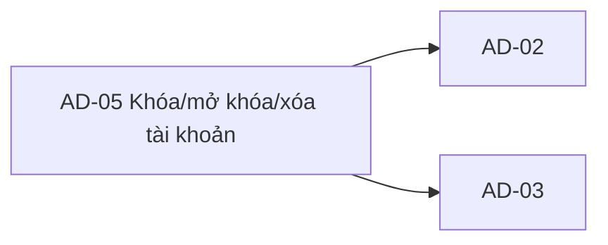

# AD-05 — Navigation

## 1. Route definition
- Current route in inventory: `/admin/users/:userId/actions`
- Status: candidate/design route; Study Web `UNWIRED` unless source code proves otherwise.
- Route params/types: `userId` (type/validation: see source DD; CẦN_XÁC_NHẬN if absent)
- Query params/defaults: preserve the inventory route string; detailed parsing rules only from source DD.
- Route guards: see source DD/API contract; do not create role policy.

## 2. Điểm vào
| From screen/route | Trigger | Params | Guard / fallback |
|---|---|---|---|
| [AD-03](../AD-03-ChiTietNguoiDung/00-overview.md) | Theo DD nguồn/inventory | Theo source; không suy diễn | Xem source DD; route chưa xác nhận runtime |

## 3. Điểm ra
| Destination | Trigger | Params | Điều kiện |
|---|---|---|---|
| [AD-02](../AD-02-DanhSachNguoiDung/00-overview.md), [AD-03](../AD-03-ChiTietNguoiDung/00-overview.md) | Source event/inventory navigation | Theo source DD | Expected links; runtime chưa verify |

## 4. Back / refresh / deep link
- Back behavior: xem source DD; không mặc định browser history.
- Preserve filters/scroll/form state: chỉ nếu source có nêu, nếu không `CẦN_XÁC_NHẬN`.
- Refresh/direct URL: route trong inventory không chứng minh runtime.
- Invalid/missing ID: theo source DD/backend contract; không tự tạo validation.
- Not authenticated/authorized: theo source role guard; xem [Business Rules](05-business-rules.md).

## 5. Diagram

## Source navigation and flow detail

### Trích từ DD nguồn: E. Ma trận trạng thái và điều hướng

### Candidate screen states

Các state dưới đây là states cần thiết cho DD/UI planning, không phải states đã được triển khai. `dependency-conflict` trong inventory trước đây không có status/code/source tương ứng ở #72, nên không giữ làm API state.

| State | Entry condition | UI behavior / allowed transition |
|---|---|---|
| `initial` | Route mounted, request not started. | Keep mutations disabled; start EV-01 only with a valid route/handoff ID and auth shell. |
| `loading` | #69 request in progress. | Show loading shell; no mode confirmation or duplicate load mutation. |
| `no-selection` | Prototype/direct entry has no selected ID. | Keep target profile/actions unavailable. Resolve via AD-02/AD-03; do not use mock ID. |
| `invalid-id` | Route ID absent or invalid for signed-int64 path. | Do not call mutation; route/error presentation policy needs agreement. |
| `ready-read-only` | #69 returns a valid profile and page auth succeeds, while action policies are pending. | Display source-backed profile fields; tabs/Confirm disabled. This is the safe current design target. |
| `mode-selected` | User chooses an action after all enabling policies are approved. | Store draft mode only; confirm waits for action-specific validation. No API call. |
| `submitting-status` | Approved #71 request in flight. | Prevent repeated submit; no optimistic status/session claim. |
| `submitting-delete` | Approved #72 request in flight. | Prevent repeated submit; no optimistic deletion claim. |
| `unauthenticated` | API returns 401 or client session policy blocks entry. | Use shared auth/session response policy; AD-05 does not define refresh or redirect destination. |
| `forbidden` | API returns 403 or approved permission evaluation denies access. | Do not show enabled actions; keep denial distinct from no selection. |
| `not-found` | #69/#71 target missing; #72 missing or already DELETED. | Show resource-not-found according to shell policy. Do not convert to conflict. |
| `validation-error` | API returns 422 or approved client validation fails. | Keep safe read data where valid; identify only source-backed validation. No invented reason length/error fields. |
| `mutation-success` | #71/#72 returns 200 with expected business code and shape. | Show response-backed result then follow approved refresh/route. #72 visibility is unresolved. |
| `error` | 500, network failure, malformed envelope or unknown mutation outcome. | Keep sensitive/action controls disabled; preserve safe context; do not auto-retry mutation. |

### Navigation and data handoff

| From → to | Data / guard | Current status |
|---|---|---|
| AD-02 → AD-05 | Selected numeric `user_id`; Admin user-management permission. | AC-31 and inventory relationship; client handoff/route not implemented. |
| AD-03 → AD-05 | Same numeric `user_id`; profile status context may be refetched via #69. | AD-03 is linked in plan; no current route/client. |
| AD-05 → AD-02 | Return to list; preserve approved filter/page state if defined. | Screenshot has `/admin/users`; query/selection retention not defined. |
| AD-05 → AD-03 | Return to same numeric user detail after cancel or status change if approved. | Route/navigation after action is not settled. |
| After #71 success → AD-02/AD-03 | Refetch #68/#69 per AC-31/inventory; current profile can include new status. | Refresh is target behavior; exact destination and cache invalidation need approval. |
| After #72 success → AD-02/AD-03 | Refresh or leave view according to deletion policy. | Blocked: #68/#69 continue to expose local DELETED row; no hide/redirect rule is approved. |

Authentication expiry, refresh retry, route guard and selected-user context belong to the Study Web auth/router contract; that source is currently absent. Do not derive them from the static RBAC/read-only badges.

### Trích từ DD nguồn: B. Luồng hoạt động tổng thể

### Luồng mục tiêu sau khi các policy và API contract được duyệt

1. **Nhận handoff:** AD-02/AD-03 chuyển numeric `user_id` sang route AD-05. Route là đề xuất; không ánh xạ `USR-*`, email hoặc phone sang path ID.
2. **Kiểm tra đầu vào và phiên:** kiểm tra `userId` theo signed-int64 path contract trước khi gọi API. Client áp dụng auth/session/navigation policy đã duyệt. Không dùng các badge RBAC hoặc “Read-Only” trên ảnh làm bằng chứng quyền.
3. **Tải hồ sơ:** gọi `GET /api/v1/admin/users/{user_id}` (#69), Bearer JWT/Admin, không body/query. Local #69 kiểm tra shared ADMIN guard, parse path và đọc safe UserProfile từ legacy `users` candidate. Chuyển UI sang loading rồi ready khi nhận HTTP 200 + `DESIGN_RESOURCE_RETRIEVED` và payload hợp lệ.
4. **Ánh xạ dữ liệu:** map ID/status/profile chỉ theo API #69 và field/PII policy đã duyệt. `status` hiện là string; không đổi lowercase aliases thành API status hoặc tự tạo allowlist. `DELETED` hiện vẫn có thể xuất hiện trong #68/#69 local source.
5. **Chọn action:** lock/unlock/delete tabs chỉ ghi nhận local draft action. Không gọi API khi chỉ đổi tab. Chỉ cho phép Confirm sau khi status transition, delete policy, permission/safeguards và audit/session behavior được duyệt. Hiện prototype giữ reason và confirm disabled.
6. **Mutation trạng thái:** nếu #71 body được duyệt, gửi đúng body/status đã thống nhất. Local candidate hiện là `{status: "SUSPENDED"}` cho khóa hoặc `{status: "ACTIVE"}` cho mở khóa, nhưng không được dùng trước khi body/state policy được duyệt. Không đưa reason vào body vì source/catalog hiện không có field đó.
7. **Mutation xóa:** nếu #72 semantics được duyệt, gửi bodyless DELETE. Local source đang đặt marker `DELETED`, không xóa vật lý/anonymize, không audit hoặc revoke token. Không diễn đạt action là “vĩnh viễn” nếu policy chưa xác nhận.
8. **Xử lý response:** xác nhận HTTP status, `businessCode`, envelope và response shape trước khi cập nhật. #71 success trả `UserProfile`; #72 success trả `DeleteResult`. Error envelope dùng `data:null`; không biến 404/422 thành success hoặc dependency conflict. Không retry mutation tự động sau timeout/response không rõ kết quả vì retry/idempotency policy chưa có contract.
9. **Sau mutation:** theo inventory/AC-31, refetch #68/#69 khi action được duyệt. Cần chốt trước cách #72 xử lý khi #68/#69 tiếp tục hiển thị user có `DELETED` status, và route/detail/list đích sau thành công. Không giả định redirect, undo hoặc hide row.
10. **Rời màn hình:** back/return điều hướng tới AD-02 hoặc AD-03 bằng numeric ID theo route policy. Prototype hiện tại chỉ có link về `/admin/users`; selected row/profile không được giữ bởi handler nào.

### Hiện trạng prototype

- Không có user được chọn; ID hiển thị bị cắt, status “Không xác định”, quyền can thiệp “Bị khóa bởi chính sách”.
- Tab khóa đang selected trong markup; unlock/delete là tab khác nhưng cả ba không có handler.
- Copy dự đoán dừng toàn bộ phiên và quyền đăng nhập không khớp với side effect local #71/#72.
- Reason textarea và Confirm disabled. Các nhãn audit bắt buộc, policy, RBAC, `Read-Only protocol`, `Enforced Gate`, ISO và API handlers là static copy.
- HTML có 10 anchors, 5 buttons và một textarea disabled; không có input/select/form hoặc request/listener. Nav/footer anchors trỏ `#`; hai back links trỏ `/admin/users`.
- Study Web root không có editable source, package manifest, router hoặc API client: `UNWIRED`. Runtime không được xác minh.

### Response/error xử lý ở mức màn hình

| Kết quả | Ý nghĩa theo catalog/source | Candidate UI state |
|---|---|---|
| 200 + success code + payload hợp lệ | #69 `DESIGN_RESOURCE_RETRIEVED`; #71 `DESIGN_RESOURCE_UPDATED`; #72 `DESIGN_RESOURCE_DELETED`. | ready hoặc mutation-success; chỉ update cache/refetch theo policy đã duyệt. |
| 401 `DESIGN_AUTHENTICATION_REQUIRED` | Auth/session không hợp lệ hoặc thiếu. | unauthenticated/session handling theo shared auth policy; destination/refresh chưa được AD-05 chốt. |
| 403 `DESIGN_ACCESS_DENIED` | Role/permission không cho phép. | forbidden; không render action enabled. |
| 404 `DESIGN_RESOURCE_NOT_FOUND` | #69/#71 target không tồn tại theo catalog; #72 local source cũng map missing/already `DELETED` thành 404. | not-found; không suy ra “dependency conflict”. |
| 422 `DESIGN_VALIDATION_ERROR` | Catalog có ở #71/#72. Local #71 candidate dùng cho path/body/unsupported current status; local #72 dùng cho invalid signed-int64 path. | validation/action-not-allowed state; giữ dữ liệu đọc được, không retry tự động. |
| 500 `DESIGN_INTERNAL_ERROR` | Server/internal transaction failure. | error; không lộ exception/SQL; giữ dữ liệu an toàn. |
| Network/timeout/invalid envelope | Không phải business code riêng trong API catalog. | error/unknown-outcome. Với mutation, không auto retry; cần cách reconcile được duyệt. |
