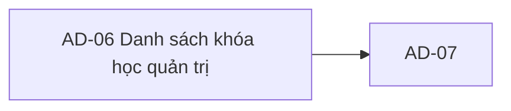

# AD-06 — Navigation

## 1. Route definition
- Current route in inventory: `/admin/courses`
- Status: candidate/design route; Study Web `UNWIRED` unless source code proves otherwise.
- Route params/types: Không có route param được biểu diễn trong inventory string; route runtime vẫn chưa xác minh.
- Query params/defaults: preserve the inventory route string; detailed parsing rules only from source DD.
- Route guards: see source DD/API contract; do not create role policy.

## 2. Điểm vào
| From screen/route | Trigger | Params | Guard / fallback |
|---|---|---|---|
| [AD-01](../AD-01-DashboardQuanTri/00-overview.md), [AD-09](../AD-09-ThayDoiTrangThaiXoaKhoa/00-overview.md) | Theo DD nguồn/inventory | Theo source; không suy diễn | Xem source DD; route chưa xác nhận runtime |

## 3. Điểm ra
| Destination | Trigger | Params | Điều kiện |
|---|---|---|---|
| [AD-07](../AD-07-ChiTietKhoaHocQuanTri/00-overview.md) | Source event/inventory navigation | Theo source DD | Expected links; runtime chưa verify |

## 4. Back / refresh / deep link
- Back behavior: xem source DD; không mặc định browser history.
- Preserve filters/scroll/form state: chỉ nếu source có nêu, nếu không `CẦN_XÁC_NHẬN`.
- Refresh/direct URL: route trong inventory không chứng minh runtime.
- Invalid/missing ID: theo source DD/backend contract; không tự tạo validation.
- Not authenticated/authorized: theo source role guard; xem [Business Rules](05-business-rules.md).

## 5. Diagram

## Source navigation and flow detail

### Trích từ DD nguồn: E. Ma trận trạng thái và điều hướng

### Candidate screen states

| State | Điều kiện vào | UI / element liên quan | Thoát state |
|---|---|---|---|
| `UNWIRED` | Current Study Web source/router/client vắng mặt; đây là status triển khai, không phải server response. | Prototype assets tĩnh; không gọi API. | Khi app route/client được triển khai và xác minh. |
| `INITIAL` | Entry target trước request. | Khởi tạo page=1, no filter theo contract; giữ controls không supported disabled. | Gửi #73 → `LOADING`. |
| `LOADING` | #73 request đang chờ. | Skeleton/indicator cần theo approved design system; prototype pulse icon không phải loading contract. | 200 → `READY`/`EMPTY`; lỗi → state tương ứng. |
| `READY` | HTTP 200, `items.length>0`, envelope/model hợp lệ. | Hiển thị row field có API mapping; pagination metadata từ response. | Filter/page change → `LOADING`; chọn row → AD-07. |
| `EMPTY` | HTTP 200, `items=[]`, `total=0`. | Empty-for-query state; không nói rằng server đang sync. | Filter/page change → `LOADING`. |
| `OUT_OF_RANGE_EMPTY` | HTTP 200, `items=[]`, `total>0` (page ngoài phạm vi). | Giữ total; cần copy/recovery choice được duyệt. | Chọn page hợp lệ → `LOADING`. |
| `UNAUTHORIZED` | 401 `DESIGN_AUTHENTICATION_REQUIRED`. | Ẩn dữ liệu; shared session-expiry flow. | Auth flow theo shared contract rồi entry lại. |
| `FORBIDDEN` | 403 `DESIGN_ACCESS_DENIED`. | Access denied; không coi RBAC badge là quyền. | Điều hướng theo policy đã duyệt hoặc giữ trang lỗi. |
| `VALIDATION_ERROR` | 422 query/filter lỗi, bao gồm category. | Chỉ ra filter hợp lệ sau khi copy/rules được chốt; category hiện không bật. | Sửa filter hoặc bỏ query rồi tải lại. |
| `SERVICE_ERROR` | 500 hoặc lỗi mạng/invalid envelope. | Safe error; không render empty như thành công. | Retry action/policy chưa xác định. |
| `FILTERED_EMPTY` | 200 với filter có hiệu lực và không có items/total. | Chỉ dùng khi filter semantics/search được approved; API #73 hiện không có search. | Bỏ/đổi filter → `LOADING`. |

Không có mutation state ở AD-06. `REFRESHING` chưa có vì prototype refresh disabled; chỉ thêm khi có event/network behavior được duyệt.

### Navigation và data handoff

| Từ | Hành động | Đích / dữ liệu truyền | Hiện trạng |
|---|---|---|---|
| AD-01/Admin shell | Mở mục Khóa học & Nội dung | AD-06, không có data ID. | Inventory link; route source không có. |
| AD-06 | Chọn course row/action | AD-07 route `/admin/courses/:courseId`, `courseId = Course.id` (int64). | Không có rows/handler trong prototype; downstream API #74 thuộc AD-07. |
| AD-07 | Chỉnh sửa course | AD-08; ID giữ nguyên. #75 mutation/reload sau approval. | AC-32 target flow; không xử lý trong DD này. |
| AD-07 | Đổi status/xóa | AD-09; ID giữ nguyên; #76/#77 theo confirmation/policy. | AC-32 target flow; reload #73 sau action theo policy; status/delete policy chưa khép kín. |
| AD-06 | Quay lại từ AD-07 | Khôi phục filter/page query nếu routing policy yêu cầu. | Chưa có URL/cache/back-state contract; cần quyết định chung. |
| Header/footer | Các anchor/CTA tĩnh | Destination chưa xác định. | Current `#`; không điều hướng thật. |

### Bảo mật phiên và navigation

Bearer token chỉ được cấp qua shared auth client; không lưu token trong URL. Server-side #73 guard vẫn có thẩm quyền. 401/403 không được biến thành empty data. AC-32 permission mapping, session-expiry recovery, return URL, selected-page retention, route guard, and direct-entry behavior are unresolved cross-screen decisions. Direct status-action entry from the AD-06 row is also unresolved; AC sequence passes through AD-07 before AD-09. No mutation in this screen, so no optimistic update, duplicate-submit lock, or mutation retry behavior is defined.

### Trích từ DD nguồn: B. Luồng hoạt động tổng thể

### Luồng mục tiêu theo contract (sau khi blockers được giải quyết)

1. Admin mở `/admin/courses` từ Admin shell. Guard phía client có thể cải thiện UX nhưng không thay server authorization. Contract AC-32 yêu cầu course-management permission; owner phải xác nhận nó tương đương claim `ADMIN` hiện dùng ở #73.
2. Client tạo GET #73 với `Authorization: Bearer <token>`. Mặc định bỏ filter status/mentor/category và gửi `page=1` hoặc để server áp default. Không có API search. Không gửi `size`/`sort`.
3. Server kiểm tra JWT/role `ADMIN` trước khi parse raw query và truy cập DB. Query invalid trả 422; category có giá trị dù hợp lệ cũng bị 422 ở source hiện tại.
4. Khi được phép truy vấn, server đếm và lấy page với cùng predicates status/mentor. Local source dùng trang cố định 20, thứ tự `courses.id ASC`, join mentor, và chỉ đọc.
5. Với HTTP 200, client kiểm tra envelope/business code, đọc `data.items`/`data.pagination`, ánh xạ các field có contract, cập nhật table/pagination. `items=[]` là empty page; nếu `total>0` nhưng page ngoài phạm vi, vẫn giữ total để hiển thị trạng thái page-invalid/out-of-range thay vì kết luận không có dữ liệu.
6. Từ row chọn course, client truyền `Course.id` (int64) sang AD-07 để #74 tải detail. Không dùng field course code do response không có.
7. API 401/403/422/500 được hiển thị theo nhóm lỗi. Hành vi refresh session, retry, toast/copy và destination sau hết phiên cần theo shared auth/error contract đang có; không tự đặt.

### Hiện trạng prototype

`screen.png` là empty-state mockup với bốn KPI 0, bộ lọc chưa áp dụng, table 0 dòng, các nút phân trang/refresh disabled và footer source path `/admin/v1/courses/catalog`. `code.html` không fetch API. Chỉ Reset có listener: xóa search và đặt status/mentor thành `all`; không request và không cập nhật URL. Các links dùng `#`; export/add/sync/manual/governance/notifications không có handler. Không có trạng thái loading/error thực tế dù ảnh có một pulse decoration trong icon empty-state.

### API #73 response/error handling

| HTTP / business code | Ý nghĩa hiện tại | Hành vi màn hình mục tiêu |
|---|---|---|
| 200 / `DESIGN_RESOURCE_RETRIEVED` | Có items hoặc `items=[]`; message có thể là “Courses retrieved.” hoặc “No courses found.” | Map allowlisted fields; phân biệt empty result và page out-of-range khi `pagination.total>0`. |
| 401 / `DESIGN_AUTHENTICATION_REQUIRED` | Thiếu/không hợp lệ Bearer/JWT theo shared guard. | Dừng render dữ liệu riêng tư; session-expired flow theo shared auth contract. |
| 403 / `DESIGN_ACCESS_DENIED` | Role không được phép. | Hiển thị forbidden theo shared error/access policy; retry policy chưa được định nghĩa. |
| 422 / `DESIGN_VALIDATION_ERROR` | Query int/page sai hoặc category filter bị từ chối. | Hiển thị lỗi gắn filter nếu có; category không được bật trong UI khi source hiện tại từ chối. |
| 500 / `DESIGN_INTERNAL_ERROR` | DB, count, orphan mentor, projection hoặc mapping lỗi. | Không hiển thị dữ liệu từng phần như thành công; báo lỗi an toàn. Retry/backoff/copy chưa được API contract xác định. |
| Network/timeout/invalid envelope | Không có business code từ response. | Giữ state theo client error policy được duyệt; không suy ra success. Retry behavior chưa được định nghĩa. |

API #73 catalog không liệt kê 404. Không có mutation, idempotency key hoặc client cache invalidation ở AD-06 list request. AC-32 yêu cầu reload list sau thao tác #75/#76/#77 ở flow liên màn hình; mutation và conflict policy thuộc AD-08/AD-09, không được đặc tả thành hành vi của nút trên mockup.
