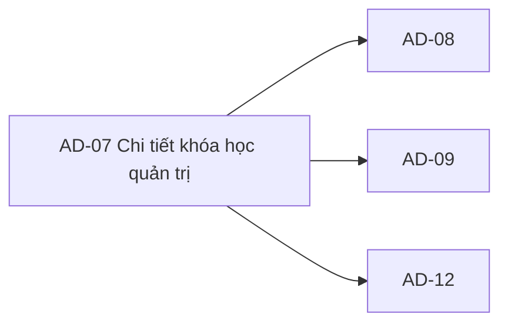

# AD-07 — Navigation

## 1. Route definition
- Current route in inventory: `/admin/courses/:courseId`
- Status: candidate/design route; Study Web `UNWIRED` unless source code proves otherwise.
- Route params/types: `courseId` (type/validation: see source DD; CẦN_XÁC_NHẬN if absent)
- Query params/defaults: preserve the inventory route string; detailed parsing rules only from source DD.
- Route guards: see source DD/API contract; do not create role policy.

## 2. Điểm vào
| From screen/route | Trigger | Params | Guard / fallback |
|---|---|---|---|
| [AD-06](../AD-06-DanhSachKhoaHocQuanTri/00-overview.md), [AD-08](../AD-08-ChinhSuaKhoaHoc/00-overview.md), [AD-09](../AD-09-ThayDoiTrangThaiXoaKhoa/00-overview.md) | Theo DD nguồn/inventory | Theo source; không suy diễn | Xem source DD; route chưa xác nhận runtime |

## 3. Điểm ra
| Destination | Trigger | Params | Điều kiện |
|---|---|---|---|
| [AD-08](../AD-08-ChinhSuaKhoaHoc/00-overview.md), [AD-09](../AD-09-ThayDoiTrangThaiXoaKhoa/00-overview.md), [AD-12](../AD-12-DanhSachBaiHocQuanTri/00-overview.md) | Source event/inventory navigation | Theo source DD | Expected links; runtime chưa verify |

## 4. Back / refresh / deep link
- Back behavior: xem source DD; không mặc định browser history.
- Preserve filters/scroll/form state: chỉ nếu source có nêu, nếu không `CẦN_XÁC_NHẬN`.
- Refresh/direct URL: route trong inventory không chứng minh runtime.
- Invalid/missing ID: theo source DD/backend contract; không tự tạo validation.
- Not authenticated/authorized: theo source role guard; xem [Business Rules](05-business-rules.md).

## 5. Diagram

## Source navigation and flow detail

### Trích từ DD nguồn: E. Ma trận trạng thái và điều hướng

| Trạng thái | Điều kiện vào | Hiển thị / xử lý | Chuyển tiếp và lưu ý |
|---|---|---|---|
| `UNWIRED` prototype | Current checkout has assets but no Study Web app/router. | Screenshot/HTML only; no request or actual screen state. | Becomes runtime states only after route/client implementation and separate verification. |
| `initial` | Proposed route matched; no request started yet. | No approved loading copy beyond static mockup. | EV-01 begins when a real client request is wired. |
| `loading` | #74 request in flight. | Render a real request-bound loading state; static “waiting for courseId” is not evidence. | 200 → `ready`; API/network failure → matching error state. Cancellation/timeout handling unspecified. |
| `ready` | #74 returns 200 and response validates. | Local source returns one Course; show only supported data. No success-empty behavior is established. | EV-02/03/04/05 navigation when routes/policies are confirmed. |
| `not-found` | #74 returns 404 for malformed/out-of-range ID or missing row. | Dedicated unavailable-resource state; do not display the mockup's “no course selected” as equivalent. | Back to AD-06 may be offered after route behavior is wired. |
| `unauthorized` | #74 returns 401. | Authentication required/session invalid state; static RBAC badge is not a substitute. | Refresh/re-auth/redirect policy is shared and unresolved. |
| `forbidden` | #74 returns 403. | Access-denied state distinct from 404 and empty. | Permission display/remediation route unresolved. |
| `service-error` | #74 returns 500. | Service failure state; do not render as empty course. | Retry and support copy are not specified. |
| `network-error` | Client cannot obtain an API response. | Future client state; current API catalog cannot define its UI. | Retry/backoff/timeout policy remains open. |
| `route-param-missing` | Direct route has no usable `courseId`. | No API request can be formed; route fallback behavior is unspecified. | Router-level error or return navigation requires a shared route decision. |

### Navigation/data handoff

| Destination | Handoff | Current evidence and blocker |
|---|---|---|
| AD-06 `/admin/courses` | Back/list breadcrumb; retain current Course ID only as browser history if applicable. | Current anchors are inert; list state retention is not specified. |
| AD-08 `/admin/courses/:courseId/edit` | Numeric `Course.id`; AC-32 #75 branch follows detail read. | Button disabled in prototype; update body and route behavior are AD-08 blockers. |
| AD-09 `/admin/courses/:courseId/actions` | Numeric `Course.id`; choose #76 or #77 under approved policy. | Button disabled; status vocabulary, delete semantics and permission are open. |
| AD-12 `/admin/lessons?course=<Course.id>` candidate | Pass numeric ID as catalog/source query `course:int64`; AD-12 would call #82. | Technically supported by #82 local query/view and catalog. Query route needs inventory/owner confirmation; #82 response cardinality still differs from catalog. |

### Trích từ DD nguồn: B. Mô tả luồng hoạt động tổng thể

### EV-01 — Vào màn hình và tải course detail

- **Trigger/type:** Enter proposed route directly or select a course in AD-06; route/load event.
- **Input:** `:courseId` as a path string, originating from numeric `Course.id`. No query params or body. The UI route camelCase name maps to API snake_case `{course_id}`; no display code is used as a key.
- **Target request:** `GET /api/v1/admin/courses/{course_id}` with `Authorization: Bearer <JWT>`. See the API matrix below. The prototype does not issue it.
- **Current API processing order:**
  1. Server receives raw path/header/session/trace context at registered #74 route.
  2. Shared auth guard checks JWT and role `ADMIN` before parsing path or querying DB. The AC-32 course-management permission is not independently checked by local code.
  3. Parser accepts signed int64 text in range. Malformed or out-of-range values return 404 `DESIGN_RESOURCE_NOT_FOUND` before DB. Negative signed-int64 parses successfully; no local positive-ID check is applied at path stage.
  4. Bound read queries `courses c LEFT JOIN users m`, filtered only by `c.id = :course_id`, no status restriction. It reads a single row. No counter/lesson/category/enrollment query occurs.
  5. Returned ID must be a positive signed-int64 and match the requested ID. Shared `map_course` requires mentor ID/name and a valid non-null price; it maps nullable description, thumbnail and mentor avatar. A missing row returns 404; invalid/incomplete projection or SQL failure returns safe 500 with rollback.
  6. Local source wraps the mapped Course in `Page<Course>` with `items=[course]` and pagination `{page:1,size:1,total:1,total_pages:1}`. This singleton shape is source behavior, not owner-approved API DD.
  7. On local success, response uses HTTP 200, `businessCode=DESIGN_RESOURCE_RETRIEVED`, `message="Course retrieved."`, and read-only data. No commit or API-side cache update occurs.
  8. A future wired client may map the returned item to visible fields only. It must not fill course code, counters, curriculum, lessons, conversion/enrollment values or quality badges from guessed data.
- **Success output:** Ready state with one Course under current local source. API catalog is generic `Page<Course>`; whether a successful empty/multi-item page is allowed for a detail contract remains open.
- **Errors:** 401 authentication required; 403 access denied; 404 malformed/out-of-range path or missing row; 500 internal error. Catalog has no 422 for this endpoint. Network/timeout, retry and error-copy policy are not set by these sources.
- **Session expiry:** A 401 is observable from API, but refresh/redirect/re-auth policy belongs to shared auth handling and is not specified here. Do not treat static “Chuẩn xác thực RBAC” badge as authorization result.

### EV-02 — Quay lại AD-06

- **Trigger/type:** Click local breadcrumb link or “Quay lại danh mục khóa học (AD-06)” (#13/#15); click/navigation.
- **Current behavior:** Both anchors have `href="#"`; no navigation listener exists.
- **Target input/result:** Return to proposed AD-06 route `/admin/courses`. Current filter/page/scroll restoration is unspecified. No API mutation occurs. AD-06 may load its own #73 data after navigation; that behavior is defined by AD-06 and router lifecycle, not this link.
- **Failure/edge:** If the session expired, destination access should be handled by the shared auth boundary; no redirect or list-state retention rule is established by AD-07 sources.

### EV-03 — Mở AD-08 để sửa khóa học

- **Trigger/type:** Click disabled “Chỉnh sửa thông tin khóa học (AD-08)” (#40); target click only after a course is loaded and action is authorized.
- **Current behavior:** HTML button has `disabled`; it does not navigate or call an API.
- **Target handoff:** Pass the loaded numeric Course ID to proposed `/admin/courses/:courseId/edit`. AC-32 sequence reads #74 before PUT #75. Request body, editable fields, save validation and return behavior belong to AD-08 and are not specified by this screen.
- **Guard/result:** Do not enable from prototype alone; permission mapping and edit contract remain open. #74 remains read-only.

### EV-04 — Mở AD-09 để đổi trạng thái hoặc xóa

- **Trigger/type:** Click disabled status/delete control (#41); target click only after a course is loaded and policy is approved.
- **Current behavior:** HTML button has `disabled`; it does not navigate or call an API.
- **Target handoff:** Pass numeric Course ID to proposed `/admin/courses/:courseId/actions`. AC-32 names separate PATCH #76 and DELETE #77 branches. Which action/status is allowed, confirmation copy, enrollment/content checks, soft-delete semantics and post-action refresh are unresolved; do not infer them from this detail page.
- **Guard/result:** The local #74 query has no status filter and can read rows across statuses if they exist. API #76/#77 behavior belongs to AD-09; this screen causes no mutation.

### EV-05 — Mở AD-12 danh sách bài học

- **Trigger/type:** Click disabled “Xem danh sách bài học liên kết (AD-12)” (#42); target click only after route/query handoff is defined.
- **Current behavior:** HTML button is disabled. It does not navigate.
- **Target handoff:** API #82 catalog declares optional `course:int64`; local #82 route/view validates it and binds it to `lessons.course_id`. Thus `/admin/lessons?course=<Course.id>` is a source-supported route/query candidate. Inventory lists only `/admin/lessons`, so whether AD-07 should append this query still needs route approval. API #82 DD is Draft because catalog response `ApiEnvelope<Lesson>` conflicts with local list response `ApiEnvelope<Lesson[]>`.
- **Result:** Current button remains disabled. If the candidate handoff is approved, AD-12 calls #82 with the selected ID; AD-07 itself does not call #82. No #82 request is made by #74.

### EV-06 — Ánh xạ các trường Course

- **Trigger/type:** Valid #74 response; internal render/state update.
- **Input/output mapping:** Map `data.items[0].title` → course title (#26); `mentor.full_name` → owner (#28); `price` exact decimal string → price value (#29); `status` string → status value (#30). Retain `id` in route/screen state for actions. `description`, `thumbnail_url`, and `mentor.avatar_url` are nullable in model; no visible dedicated field/image mapping is evidenced in this screenshot. Do not format price with a currency symbol or locale rule unless separately approved.
- **Unsupported prototype fields:** “Mã khóa học” (#27) has no Course field; do not substitute ID. Metrics (#31–33), curriculum/lessons (#34–38), and standards/manual claims (#44–52) have no #74 data and are not derived from it.
- **Missing/null behavior:** Local mapper permits nullable description, thumbnail, avatar; mentor ID/name and price are required for its projection. A null optional value may be represented as no value in a future UI, but copy/placeholder is not defined. A required mapping failure is a 500 source behavior, not a successful blank field.

### EV-07 — Render metrics, curriculum and quality claims

- **Trigger/type:** #74 success; render.
- **Current behavior:** HTML displays hard-coded “0 khóa”, empty module/lesson copy and static ISO, copyright, outcomes and recruitment claims. No data source or event is attached.
- **Target behavior:** Do not calculate/show metric values, course curriculum, lessons, compliance or outcome assurances from #74. AC-32 counter names/definitions are open; #74 query/model lack those fields. No metric/curriculum empty-state rule can be finalized until its data contract and owner are supplied.

### EV-08 — Shell navigation, notification, manual and PDF controls

- **Trigger/type:** Click header/footer/navigation/breadcrumb/notification/manual/PDF links (#2–15, #51–56).
- **Current behavior:** Anchors have `href="#"`; notification is a button without a handler; no destination, download resource or request is wired. “SYSTEM NORMAL” and “RBAC” labels are static.
- **Target behavior:** Destinations and assets require their own route/resource contracts. No event in this prototype may be treated as a health check, permission check, PDF download, or API call.

### API request/response matrix

| Thuộc tính | API #74 |
|---|---|
| Method / endpoint | `GET /api/v1/admin/courses/{course_id}` |
| Authentication / authorization | Header `Authorization: Bearer <JWT>`; catalog says role Admin. Local route uses shared JWT role `ADMIN`. AC-32 fine-grained course-management permission is not separately enforced in local #74; mapping is open. |
| Path params | `course_id:int64!`; no query params, request body, or other API-specific header is listed. Client route name `courseId` is only a route variable. |
| Success schema | Catalog: `ApiEnvelope<Page<Course>>`. Local envelope fields: `success`, `businessCode`, `message`, `data`, `meta`, `traceId`. Local `data.items` contains one Course and pagination page/size/total/total_pages are all `1`. Singleton cardinality remains `DERIVED` pending API DD confirmation. |
| Course mapping | `id:int`; `title:string`; `description:string|null`; `thumbnail_url:string|null`; `price:string` exact decimal; `status:string`; `mentor:{id:int,full_name:string,avatar_url:string|null}`. No `course_code`, counters, category in local #74 model/query, curriculum, lesson count, enrollment or conversion field. |
| Query/effects | Read-only bound SQL: `courses` LEFT JOIN `users`, predicate `c.id = :course_id`, `LIMIT 1`; no status filter. No insert/update/delete, commit, audit or cache mutation. Legacy DDL is candidate only; live schema not verified. |
| Success | HTTP 200 `DESIGN_RESOURCE_RETRIEVED`, “Course retrieved.” according to local source/catalog. |
| Errors | 401 `DESIGN_AUTHENTICATION_REQUIRED`; 403 `DESIGN_ACCESS_DENIED`; 404 `DESIGN_RESOURCE_NOT_FOUND`; 500 `DESIGN_INTERNAL_ERROR`. API catalog does not declare 422. Local malformed/out-of-range path → 404 before query; missing row → 404; query/mapping failure → safe 500 and rollback. |
| Ordering | One #74 call per detail load in target; no dependent request is defined. AC-32 places #74 after #73 and before its #75/#76/#77 branches. |
| Retry / timeout / cache | Not specified by API catalog/DD or UI source. Do not select a client policy in this DD. GET has no mutation/idempotency body; any cache freshness remains open. |
| Test/runtime evidence | Local route/module/test source exists. Existing tests use fake session/query doubles. A historical verification report used a temporary schema; neither proves current live DB/deployment. No tests or runtime were run in this session. |
