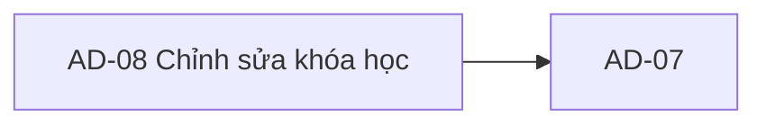

# AD-08 — Navigation

## 1. Route definition
- Current route in inventory: `/admin/courses/:courseId/edit`
- Status: candidate/design route; Study Web `UNWIRED` unless source code proves otherwise.
- Route params/types: `courseId` (type/validation: see source DD; CẦN_XÁC_NHẬN if absent)
- Query params/defaults: preserve the inventory route string; detailed parsing rules only from source DD.
- Route guards: see source DD/API contract; do not create role policy.

## 2. Điểm vào
| From screen/route | Trigger | Params | Guard / fallback |
|---|---|---|---|
| [AD-07](../AD-07-ChiTietKhoaHocQuanTri/00-overview.md) | Theo DD nguồn/inventory | Theo source; không suy diễn | Xem source DD; route chưa xác nhận runtime |

## 3. Điểm ra
| Destination | Trigger | Params | Điều kiện |
|---|---|---|---|
| [AD-07](../AD-07-ChiTietKhoaHocQuanTri/00-overview.md) | Source event/inventory navigation | Theo source DD | Expected links; runtime chưa verify |

## 4. Back / refresh / deep link
- Back behavior: xem source DD; không mặc định browser history.
- Preserve filters/scroll/form state: chỉ nếu source có nêu, nếu không `CẦN_XÁC_NHẬN`.
- Refresh/direct URL: route trong inventory không chứng minh runtime.
- Invalid/missing ID: theo source DD/backend contract; không tự tạo validation.
- Not authenticated/authorized: theo source role guard; xem [Business Rules](05-business-rules.md).

## 5. Diagram


## Source navigation and flow detail

### Trích từ DD nguồn: E. Ma trận trạng thái và điều hướng

| State | Entry condition | Display/data rule | Exit / navigation | Evidence/status |
|---|---|---|---|---|
| `UNWIRED` | Current checkout | Static prototype only; controls disabled and source app/router absent. | None available. | Current status. |
| `initial` | Proposed route created before GET | No Course data; do not show static mock values as loaded data. | Start EV-01. | Target state, not implemented. |
| `loading` | GET #74 pending | Show loading affordance only when request is active. | 200 → `ready`; API/network error → matching state. | No current behavior; loading copy static if present. |
| `ready` | GET #74 validated | Render only mapped contract fields; candidate form disabled until field policy approved. | Approved field change → `dirty`; back → approved route. | Target state, not implemented. |
| `dirty` | At least one approved field differs from loaded value | Exact dirty comparison, draft retention and confirmation policy are unspecified. | Save → `saving`; cancel/back behavior needs decision. | `OPEN`; not in source. |
| `saving` | Approved body submitted to #75 | Prevent duplicate UI submission only under approved interaction policy; request idempotency/retry is unspecified. | 200 → success/application policy; 422 → validation error; 401/403/404/500 → corresponding states. | Target state, not implemented. |
| `validation_error` | Client-approved validation or API 422 | Show field/general errors only when message mapping is defined. Current source candidate has body/path/title/price validation. | User edit → candidate `dirty`; resubmit only after correction. | Local API 422 exists; UI copy/placement open. |
| `unauthorized` | #74/#75 returns 401 | Do not treat as empty Course. Session renewal/redirect behavior belongs shared auth contract. | Shared auth flow, not defined here. | Catalog status; UI policy open. |
| `forbidden` | #74/#75 returns 403 | Preserve authorization boundary; don't use static RBAC badge as access proof. | Shared forbidden flow, not defined here. | Catalog status; permission mapping open. |
| `not_found` | #74/#75 returns 404 | Course missing/unavailable; don't keep mock preview. | Approved AD-06/list route or error page; exact destination open. | API status source-backed. |
| `service_error` | API returns 500 | Display safe service-error state; no DB/provider details. | Retry policy/route open. | API status source-backed; UI handling open. |
| `network_error` | Request cannot reach API | Distinct from 500; no retry, offline cache or stale-data policy specified. | User recovery policy open. | Client-side target state only. |
| `save_success` | PUT #75 returns valid 200 | Use updated Course response, issue #74 re-read, or invalidate cache per approved decision. | Stay on form or go to AD-07 after route decision. | Response strategy open. |

**Transition notes:** GET #74 is a read. PUT #75 current source mutates metadata, then internally reads its projection and returns it. Inventory's phrase “revalidate #74” may imply another request but local #75 response already contains data; these must not be reconciled by assumption. Back-to-detail candidate carries the same numeric ID. Current prototype's two relevant anchors point to AD-06 list instead. Session-expiry handling, route guards, list filter/page restoration, unsaved-change warning, cache lifetime, retry and timeout are not specified.

### Trích từ DD nguồn: B. Mô tả luồng hoạt động tổng thể

### EV-01 — Vào route và tải Course (#74)

- **Trigger/type:** Vào route đề xuất hoặc điều hướng từ AD-07; route/load event. Đây là luồng mục tiêu, chưa có Study Web handler.
- **Điều kiện:** Router được wire; `courseId` lấy từ numeric `Course.id`; client có Bearer token. Permission AC-32 cần được đối chiếu với role guard trước khi bật route.
- **Đầu vào:** Path string `:courseId`; không query/body. Không dùng mã học phần `IS-SYS-402-2025` làm key.
- **Xử lý:** Client gửi GET #74 `GET /api/v1/admin/courses/{course_id}`. Server #74 kiểm tra shared Admin auth, parse path và truy vấn detail; local response là một Course trong `Page<Course>`. Thứ tự auth/body của #75 không được áp ngược cho #74.
- **Response/UI:** 200 → map Course theo EV-02; 401 → authentication/session state; 403 → forbidden; 404 → not found; 500 → service error. Network error là client-side state chưa có policy. Không biến lỗi thành Course rỗng.
- **Current result:** Prototype chỉ render HTML hard-coded; không gửi GET. Empty, loading và lỗi không có behavior chạy được.

### EV-02 — Ánh xạ dữ liệu vào form/preview

- **Trigger/type:** Internal render sau khi GET #74 thành công.
- **Đầu vào:** Candidate `data.items[0]` theo current local singleton page; fields được #74 trả gồm ID, title, description, thumbnail URL, price, status và mentor. Response shape cuối vẫn cần API DD confirmation.
- **Xử lý:** Giữ numeric `id` làm route/path state. Có thể map title, nullable description, nullable thumbnail URL và exact decimal-string price vào candidate inputs sau khi field contract được duyệt. Status/mentor chỉ là read-only context nếu UI cần; #75 không nhận chúng làm body. Không dựng `course_code`, batch code, counts, category, chapters, enrollment, conversion hoặc quality status.
- **Kết quả:** Target `ready` state chỉ dùng dữ liệu API đã kiểm tra. Giá hiển thị cần currency/decimal formatting rule; prototype string `4.850.000` không phải response mapping rule.
- **Current result:** Prototype values và preview là static literals; không có mapping hoặc empty/error state.

### EV-03 — Thay đổi field

- **Trigger/type:** `input`/`change` trên field được contract duyệt; target behavior.
- **Đầu vào:** Giá trị người dùng nhập. API #75 candidate body có bốn key `title`, `description`, `thumbnail_url`, `price`; không có course code, mentor, status hay upload binary.
- **Xử lý và kết quả:** UI phải áp dụng validation/dirty-state/persistence chỉ sau khi owner chốt body, draft retention, title/price presentation và null/clear semantics. Local API candidate giữ whitespace của title, giới hạn 200 ký tự, nhận description/thumbnail là string hoặc null, và parse price từ decimal string. Không biến các rule candidate này thành approved client validation.
- **Current result:** Title, code, select, price, textarea, thumbnail area đang disabled. Chưa có change handler, dirty state hay file input.
- **Thumbnail:** Chỉ có thể gửi `thumbnail_url` nếu một URL đã được cấp qua workflow được duyệt. `PNG/JPG`, 1280×720, 16:9, 5MB/S3/multipart không có API contract được tìm thấy trong #75; không thiết kế upload event từ mockup.

### EV-04 — Lưu thay đổi (#75)

- **Trigger/type:** Submit/click Save; target behavior. Current Save button là `disabled`, `aria-disabled=true`, `type=button`, không có handler.
- **Điều kiện:** Route và permission đã được xác nhận; form body, validation, thumbnail policy, response/revalidation policy được phê duyệt; không có request đang chạy theo UI policy sẽ được định nghĩa khi triển khai.
- **Đầu vào API:** `PUT /api/v1/admin/courses/{course_id}`, `Authorization: Bearer <JWT>`. `Content-Type: application/json` cần cho body candidate nhưng chưa được catalog khai báo. Candidate body strict hiện tại (chưa duyệt):

```json
{
  "title": "Tên khóa học",
  "description": "Mô tả hoặc null",
  "thumbnail_url": "https://... hoặc null",
  "price": "4850000.00"
}
```

Body key/semantics là `DERIVED`: cả bốn key đều bắt buộc; description/thumbnail cho phép JSON null; extra keys bị từ chối. Không gửi `mentor`, mã học phần, status, counters hoặc multipart file trong contract local hiện tại.

- **Trình tự current local API:**
  1. Framework parse body/model `AdminCourseUpdateRequest` (`strict`, `extra="forbid"`); body parse error có thể bị trả 422 trước khi handler gọi shared guard.
  2. View gọi shared auth guard cho role `ADMIN`; thiếu/sai token trả 401, role không đạt trả 403. Đây chưa phải bằng chứng cho fine-grained permission AC-32.
  3. Parse `course_id` thành signed int64; sai định dạng/out-of-range trả 422 `DESIGN_VALIDATION_ERROR`. Không có positive-only check tại bước này.
  4. Kiểm tra title dài tối đa 200 ký tự; không trim/nonblank validation. Parse price từ chuỗi decimal, không exponent/rounding, tối đa 2 số thập phân và 10 chữ số nguyên; giá âm được chấp nhận bởi code hiện tại. Thumbnail không được validate scheme/host/length.
  5. Chạy bound `UPDATE courses SET name, description, thumbnail_url, price, updated_at=CURRENT_TIMESTAMP WHERE id=:course_id RETURNING id` trong local legacy mapping. Status và mentor không bị cập nhật.
  6. Không có row → rollback và 404 `DESIGN_RESOURCE_NOT_FOUND`. SQL/malformed returned identity lỗi → rollback và safe 500.
  7. Đọc lại projection bằng query #74 trong cùng Session; map Course và tạo singleton `Page<Course>` (pagination 1/1/1/1). Projection/query/map/page lỗi → rollback, 500.
  8. Commit chỉ sau projection hợp lệ; commit lỗi → rollback, 500. Thành công trả 200, `DESIGN_RESOURCE_UPDATED`, `Course updated.`, Course page, meta và trace ID.
  9. Quyết định dùng response, gọi GET #74 thêm lần nữa, invalidate cache, hiển thị success, điều hướng/giữ form và retry chưa được client contract chốt.

- **Kết quả/lỗi:** Catalog khai báo 200/401/403/404/422/500. Mapping current local: 401 authentication, 403 role, 404 missing Course, 422 body/path/title/price validation, 500 query/readback/projection/commit. Không có 409/conflict contract hoặc optimistic version field trong #75. Không tự đặt timeout/retry/idempotency; PUT lặp lại còn đổi `updated_at`.
- **Current result:** Save disabled, không request nào được gửi. API source locally wired nhưng API DD Draft; fake DB tests không xác nhận live table/deployment.

### EV-05 — Hủy / quay lại

- **Trigger/type:** Click Back-to-detail (#15) hoặc Cancel (#42).
- **Current behavior:** Cả hai anchor có `href="/admin/courses"`; #15 copy ghi “quay lại chi tiết AD-07” nhưng thực tế là route danh sách AD-06. Browser link Cancel cũng quay về danh sách. Không có unsaved-change guard.
- **Expected candidate:** Handoff về AD-07 với cùng numeric `Course.id` phù hợp với tên link/dependency; nhưng inventory chỉ xác định AD-07 là màn hình liên quan, chưa chốt destination, browser history hoặc restore list state. Ghi route return và dirty-confirmation là blocker, không tự dựng query/path khác.
- **API:** Không gọi API chỉ vì cancel/back. Nếu AD-07 được mở lại, tải/revalidate bằng #74 theo policy được duyệt.

### EV-06 — Shell, preview, diagnostics, footer

- **Trigger/type:** Click/hover/focus trên nav, notification, breadcrumbs, preview/support/footer; static render.
- **Current behavior:** Header/footer anchors và breadcrumb dùng `href="#"`; notification không có handler. Preview, API gate diagnostics, badges, RBAC/system status, “Production Ready”, version/time, integrity/audit/gateway claims là static HTML. Không có request, modal, download, toast hoặc monitoring check.
- **Expected behavior:** Chỉ gắn route, telemetry/status hoặc support resource khi có contract riêng; #74/#75 không cung cấp các hành vi này. Shell dùng Study2Work design system khi Study Web được wire.
