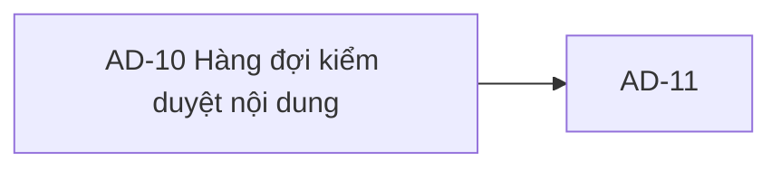

# AD-10 — Navigation

## 1. Route definition
- Current route in inventory: `/admin/content/pending`
- Status: candidate/design route; Study Web `UNWIRED` unless source code proves otherwise.
- Route params/types: Không có route param được biểu diễn trong inventory string; route runtime vẫn chưa xác minh.
- Query params/defaults: preserve the inventory route string; detailed parsing rules only from source DD.
- Route guards: see source DD/API contract; do not create role policy.

## 2. Điểm vào
| From screen/route | Trigger | Params | Guard / fallback |
|---|---|---|---|
| [AD-11](../AD-11-DuyetTuChoiNoiDung/00-overview.md) | Theo DD nguồn/inventory | Theo source; không suy diễn | Xem source DD; route chưa xác nhận runtime |

## 3. Điểm ra
| Destination | Trigger | Params | Điều kiện |
|---|---|---|---|
| [AD-11](../AD-11-DuyetTuChoiNoiDung/00-overview.md) | Source event/inventory navigation | Theo source DD | Expected links; runtime chưa verify |

## 4. Back / refresh / deep link
- Back behavior: xem source DD; không mặc định browser history.
- Preserve filters/scroll/form state: chỉ nếu source có nêu, nếu không `CẦN_XÁC_NHẬN`.
- Refresh/direct URL: route trong inventory không chứng minh runtime.
- Invalid/missing ID: theo source DD/backend contract; không tự tạo validation.
- Not authenticated/authorized: theo source role guard; xem [Business Rules](05-business-rules.md).

## 5. Diagram

## Source navigation and flow detail

### Trích từ DD nguồn: E. Ma trận trạng thái và điều hướng

| Trạng thái | Điều kiện vào | Hành vi/UI hiện được xác nhận | Chuyển tiếp |
|---|---|---|---|
| `UNWIRED` | Current Study Web checkout thiếu editable source/router/client. | Không có runtime AD-10; ảnh/HTML là prototype. | Chỉ chuyển sang runtime state sau implementation và verification riêng. |
| `loading` | Target state khi route client được wire và GET #78 đang chạy. | Không tồn tại trong current app source; spinner #21 chỉ local 700 ms. | Success→`ready`/`empty`; auth/validation/server/network failure→`error` (client policy cần chốt). |
| `empty` | Local response có `items=[]` (contract cardinality cần đồng bộ). | Screenshot hiện static empty illustration/copy, count 0/0; chưa bind API. | Refresh/filter/page theo contract; không có row để đi AD-11. |
| `ready` | Response hợp lệ có item sau khi response contract và các cột được chốt. | Prototype không có row; API projection hiện thiếu course title/author/time. | Chọn item→AD-11 với candidate `content_id`; #80/#81 xong thì AC-33 reload queue. |
| `error-auth` | 401 từ API. | Không có error UI source. | Session/login handling chưa được quy định cho Study Web. |
| `error-forbidden` | 403 từ shared role guard hoặc permission policy. | Không có error UI source; ADMIN vs moderation permission open. | Chặn route/action; redirect/inline behavior chưa quyết định. |
| `error-validation` | 422 numeric query từ local current source. | Catalog chưa liệt kê; không có error UI source. | Không gửi request lặp lại nếu query chưa sửa; field feedback convention chưa chốt. |
| `error-service/network` | 500 hoặc lỗi transport/timeout. | Server local trả safe 500; client behavior chưa wire. | Retry thủ công/policy, timeout và retained data chưa được xác định. |
| `stale-item` | Content thay đổi/xóa/không còn pending giữa queue và #79/#80/#81. | Không có revision token trong #78; stale policy open. | #79–#81 conflict/reload behavior cần owner quyết định. |

### Điều hướng và dữ liệu handoff

| Từ | Hành động | Đến | Dữ liệu | Trạng thái |
|---|---|---|---|---|
| Admin workspace | Mở kiểm duyệt | AD-10 `/admin/content/pending` | Bearer/session; route đề xuất. | Study Web `UNWIRED`; nav anchors hiện `#`. |
| AD-10 | Chọn Content | AD-11 `/admin/content/:contentId/review` | Candidate numeric `Content.id` → `content_id`; revision/version không có. | AC-33 expected; local Page-vs-catalog mismatch và stale policy open. |
| AD-11 | Hoàn tất #80/#81, reload queue | AD-10 | Candidate reload list/filter/page; preservation chưa quy định. | AC-33 reload expected; exact route/cache/ordering chưa approved. |

Back/browser history, query persistence, focus restoration, session-expiry route, authorization redirect và cache invalidation chưa được xác định bởi Study Web source. Không tự thêm behavior.

### Trích từ DD nguồn: B. Mô tả luồng hoạt động tổng thể

1. Admin mở route đề xuất từ vùng kiểm duyệt. Route, shell navigation và auth integration chưa được triển khai trong Study Web.
2. Khi có client, gửi Bearer token theo API #78. Current server guard kiểm tra authentication và role `ADMIN` trước query validation/DB; điều kiện AC-33 về permission moderation riêng vẫn cần quyết định.
3. Khởi tạo queue bằng GET `/api/v1/admin/content/pending`; query ban đầu có thể bỏ `type`/`course` và dùng `page=1` theo local fallback. Không có body. Mapping các giá trị `all`/slug của prototype sang query chưa được duyệt.
4. Current #78 parse raw `type` như chuỗi exact-match; parse `course` signed int64 và `page` positive int32. Local default page là 1. Invalid numeric value trả local 422 `DESIGN_VALIDATION_ERROR`, dù catalog hiện chỉ nêu 401/403/500.
5. Local query đếm và lấy cùng predicate trên active `contents` (`deleted_at IS NULL`, `status='PENDING_REVIEW'`), filters tùy chọn, order `id ASC`, limit 20 và offset theo page. Đây là source hiện tại với một số lựa chọn DERIVED trong API DD; không chứng minh schema live.
6. Local success response là envelope với `data.items` và `data.pagination` (`page`, `size`, `total`, `total_pages`). Map tám field Content có sẵn; không tạo dữ liệu cho course title, author, submitted time hoặc version. Catalog/AC vẫn quy định singular Content nên client contract cần được owner đồng bộ trước khi wire.
7. `items=[]` biểu diễn empty/no-match/out-of-range page trong local source. `items` có dữ liệu không đủ để render toàn bộ cột mockup hoặc xác nhận version còn pending tại thời điểm chuyển sang AD-11.
8. Chọn row theo AC-33 sẽ chuyển `content_id` đến AD-11/#79. Khi DD/API revision contract chưa được giải quyết, chỉ `Content.id` là candidate identity; không tự đính kèm version/author.
9. Sau #80/#81, AC-33 yêu cầu reload queue; quyết định đó được thực hiện từ flow AD-11. Điều hướng quay lại, giữ filter/page, cache invalidation và stale-row conflict chưa có client policy.
10. Lỗi auth/role/query/DB/network hiển thị theo trạng thái; không tự retry request GET hoặc tạo thông báo nghiệp vụ khi chưa có client convention. Local 500 dùng envelope an toàn, không lộ SQL/stack.

**Quan hệ màn hình:** AD-10 là queue trước AD-11. AD-11 đọc #79, ra quyết định bằng #80/#81, rồi AC-33 quay lại/refresh AD-10. Route/history và payload duy trì filter chưa được wire hoặc chốt. AD-10 không thực hiện approve/reject.
