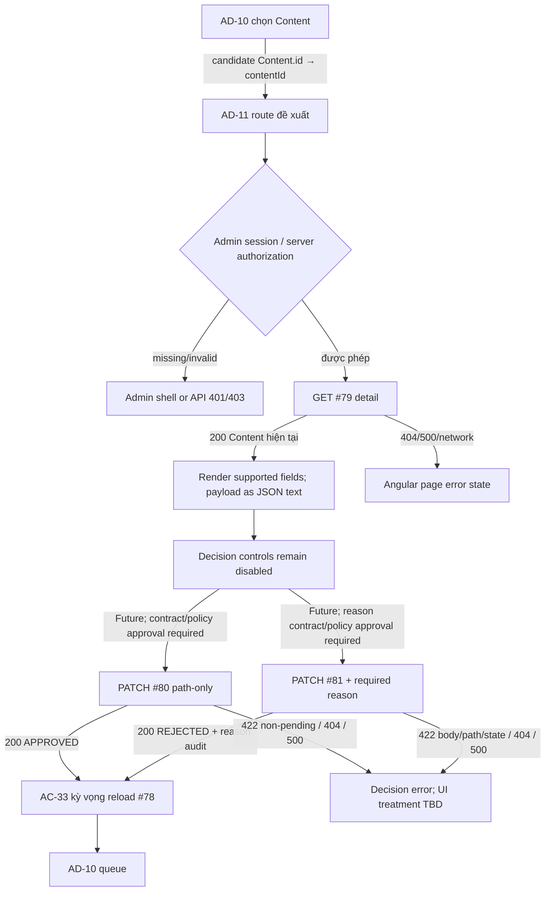

# AD-11 — Data Flow & State

## 1. Nguồn dữ liệu
| Field / object | Type | Source | Destination | Cập nhật khi |
|---|---|---|---|---|
| Chỉ liệt kê theo bằng chứng trong excerpt bên dưới | Theo DD/API source | API/inventory/design; status phải giữ nguyên | UI/state nêu ở DD nguồn | Theo event source |

## 2. State model

> Không tạo DTO/ViewModel mới khi chưa có contract. State, DTO và mapping được trích nguyên ngữ cảnh từ DD nguồn bên dưới.

## 3. API DTO → ViewModel mapping

### Trích từ DD nguồn: B. Luồng tổng quát



Luồng trên tách **expected navigation** khỏi **current endpoint evidence**. Angular source implements the AD-10 link, AD-11 route, GET #79, loading/error/presentation states and a direct queue link. Decision form/actions, disabled-state release, success notification, query preservation, cache invalidation and queue refresh are not implemented; browser runtime is unverified.

### Source trace

```text
Expected: AD-10 #78 item → Content.id → AD-11 contentId → GET #79
          → PATCH #80 OR PATCH #81(reason) → reload AD-10/#78 (AC-33)
Current Web: AD-10 link → Angular AD-11 route/page → GET #79; supported Content
             fields render and payload is JSON text. #80/#81 have no Web caller;
             their buttons and reason field remain disabled.
Current Server: #79 reads active Content → direct Content;
                #80 PENDING_REVIEW→APPROVED + audit; #81 PENDING_REVIEW→REJECTED
                + reason-bearing audit row. No revision token joins read and write.
```

Nguồn chính: [inventory](../../list_screen.md), [API catalog](../../../../../docs/lists/list_api.md), [AC-33 diagram](../../../../study-server/docs/diagrams/AC_UNICA/AC_04_ADMIN_MANAGEMENT.drawio), [router #79–#81](../../../../study-server/app/api/v1.py), [#79 module](../../../../study-server/app/modules/admin/api_79_admin_content_detail), [#80 module](../../../../study-server/app/modules/admin/api_80_admin_content_approve), [#81 module](../../../../study-server/app/modules/admin/api_81_admin_content_reject).

### Trích từ DD nguồn: E. Ma trận trạng thái và điều hướng

| State | Điều kiện | UI/data cần biểu diễn | Chuyển tiếp / giới hạn |
|---|---|---|---|
| `wired-detail` | Current checkout có Angular AD-11 route/page và #79 GET caller. | Source được xác minh; browser/runtime vẫn chưa verify. | Actions remain disabled; no mutation caller. |
| `loading-detail` | Route có Content ID và GET #79 đang chờ. | Loading status được render; không hiển thị field cũ từ item khác. | 200→`ready`; error→page error state. |
| `ready` | #79 trả Content shape hợp lệ. | Hiển thị 8 field được hỗ trợ; `payload` là JSON text; author/version/media preview unavailable. | Back link tới queue; approve/reject vẫn khóa. |
| `preview-unavailable` | Không có payload media/rendering contract. | JSON text có thể xem; không có secure video/document renderer. | Decoder/preview behavior cần contract. |
| `approving` | Future state nếu mutation #80 được duyệt và UI được wire. | Không reachable: control hiện disabled. | Success/error treatment, retry và queue refresh còn TBD. |
| `rejecting` | Future state nếu #81 được duyệt và UI được wire. | Không reachable: reason/control hiện disabled. | Required/blank/length policy và error treatment còn TBD. |
| `decision-success` | Future response #80 APPROVED hoặc #81 REJECTED. | Chưa có Web transition để render success. | AC-33 expects queue reload; route/cache behavior TBD. |
| `not-found/deleted` | #79 404 for invalid/missing/soft-deleted Content. | `adminDataError` shows “Không tìm thấy dữ liệu được yêu cầu.”; direct queue link exists. | Missing vs deleted is not distinguished; browser runtime unverified. |
| `stale-or-not-pending` | #80/#81 422 non-pending, or resource was deleted. | Could represent changed/previously reviewed Content; exact cause/status payload is not guaranteed by screen contract. | Reload detail/queue vs conflict message TBD; no stale revision 409 exists. |
| `unauthorized` | Admin session absent/expired or API #79 returns 401. | `AdminLayout` gates the page on in-memory Admin session; shared error mapping asks the user to sign in again; API client ends the local session on 401. | Browser redirect/runtime is not verified; no mutation retry. |
| `forbidden` | API #79 returns 403 for the current principal. | Shared error mapping shows that the account cannot view this data. | No moderation-specific permission policy is inferred. |
| `validation-error` | Invalid #79 path is mapped by the server to 404; #80/#81 may return 422 but have no Web caller. | No decision-form field mapping is implemented. | Do not classify a mutation error until a contract-backed caller exists. |
| `service/network-error` | #79 returns 500 or transport fails. | Shared mapping displays a generic Study Server message; status 0 displays a connection message. | No trace-ID display/retry policy; browser runtime unverified. |

### Điều hướng và dữ liệu handoff

| Từ | Hành động | Đến | Data | Bằng chứng |
|---|---|---|---|---|
| AD-10 | Chọn một pending Content | AD-11 `/admin/content/:contentId/review` | `Content.id` an toàn → `contentId`; không version | Current AD-10 renderer creates the route for safe integer IDs; Angular route exists. |
| AD-11 | Load detail | #79 | `content_id` path | Catalog + local route; local detail does not require pending status. |
| AD-11 | Approve | #80 | `content_id`; bodyless | Catalog/source. Local result `APPROVED`; not publish. |
| AD-11 | Reject | #81 | `content_id`, `reason:string` | Catalog/source. Local result `REJECTED`; no revision-request distinction. |
| AD-11 | Decision success | Reload AD-10/#78 | Filter/page preservation undecided | AC-33 expected only; no #80/#81 Web caller or success flow exists. |
| AD-11 | Back link / browser history | AD-10 candidate | Direct `/admin/content/pending`; no filter/page state | Angular router link exists; browser history/filter preservation is not implemented or verified. |

Browser deep-link/runtime, queue filter preservation, scroll/focus restoration, unsaved reason confirmation, action duplication, decision success navigation and moderation-permission redirect remain unresolved. The detail route and #79 read source exist; do not wire writes until response/revision identity, permission and decision-state rules are resolved.

## 4. Luồng đọc (Read)
- Orchestration từ inventory: Candidate `Content.id` từ AD-10 → GET #79 → PATCH #80 hoặc PATCH #81 với `{reason}` → reload #78. #80 local đặt `APPROVED`, không publish; #79 không trả author/version.
- Chi tiết current/source mapping: xem [API Integration](04-api-integration.md) và DD nguồn.

## 5. Luồng ghi (Write)
- Chỉ mô tả mutation được DD/API source nêu; không thêm endpoint hoặc side effect.
- Source trace: [AD-11](../../screen_stitch/05_admin/AD-11_duyet-tu-choi-noi-dung/AD-11.md)

## 6. Cache / concurrency / lifecycle
- Cache, race, cleanup, pagination: xem các section source bên dưới; nếu không có bằng chứng thì để `CẦN_XÁC_NHẬN`.

## 7. Data errors & security
- Theo error/security/source-status section của DD nguồn; không coi state trong mockup là runtime behavior.

## 8. Trace
[Events](02-events.md) · [API](04-api-integration.md) · [Rules](05-business-rules.md)
