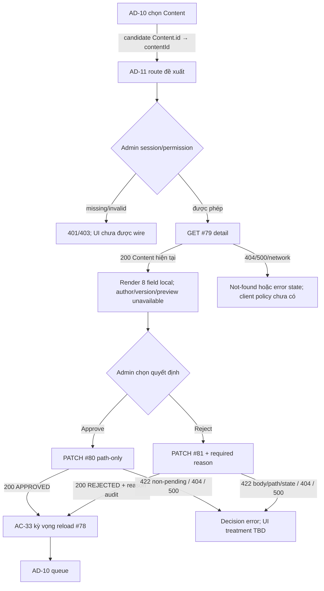

# AD-11 — Data Flow & State

## 1. Nguồn dữ liệu
| Field / object | Type | Source | Destination | Cập nhật khi |
|---|---|---|---|---|
| Chỉ liệt kê theo bằng chứng trong excerpt bên dưới | Theo DD/API source | API/inventory/design; status phải giữ nguyên | UI/state nêu ở DD nguồn | Theo event source |

## 2. State model

> Không tạo DTO/ViewModel mới khi chưa có contract. State, DTO và mapping được trích nguyên ngữ cảnh từ DD nguồn bên dưới.

## 3. API DTO → ViewModel mapping

### Trích từ DD nguồn: B. Luồng tổng quát



Luồng trên tách **expected navigation** khỏi **current endpoint evidence**. Chưa có client để xác minh route guards, selection handoff, form state, disabled-state release, success notification, query preservation, cache invalidation hay queue refresh.

### Source trace

```text
Expected: AD-10 #78 item → Content.id → AD-11 contentId → GET #79
          → PATCH #80 OR PATCH #81(reason) → reload AD-10/#78 (AC-33)
Current: no Study Web caller; #79 reads active Content row → direct Content;
         #80 PENDING_REVIEW→APPROVED + audit; #81 PENDING_REVIEW→REJECTED
         + reason-bearing audit row. No revision token connects read to mutation.
```

Nguồn chính: [inventory](../../list_screen.md), [API catalog](../../../../../docs/lists/list_api.md), [AC-33 diagram](../../../../study-server/docs/diagrams/AC_UNICA/AC_04_ADMIN_MANAGEMENT.drawio), [router #79–#81](../../../../study-server/app/api/v1.py), [#79 module](../../../../study-server/app/modules/admin/api_79_admin_content_detail), [#80 module](../../../../study-server/app/modules/admin/api_80_admin_content_approve), [#81 module](../../../../study-server/app/modules/admin/api_81_admin_content_reject).

### Trích từ DD nguồn: E. Ma trận trạng thái và điều hướng

| State | Điều kiện | UI/data cần biểu diễn | Chuyển tiếp / giới hạn |
|---|---|---|---|
| `UNWIRED` | Current checkout thiếu Study Web source/router/client. | Chỉ có prototype static; không có request/runtime. | Current status. Runtime state chỉ được xác nhận sau khi frontend wire và verify riêng. |
| `loading-detail` | Route hợp lệ, GET #79 pending (target). | Loading shell/content; không hiển thị metadata cũ của Content khác. | 200→`ready`; auth/not-found/service error→error state. Client chưa wire. |
| `ready` | #79 trả Content shape hợp lệ. | Hiển thị field được hỗ trợ; author/version/preview unavailable cho tới khi có contract. | Approve→`approving`; reject form→`rejecting`; back action chưa route. |
| `preview-unavailable` | Payload không có schema/asset access contract. | Giữ placeholder/error có thông tin; không khẳng định secure renderer đã chạy. | Recovery behavior/content-type copy cần chốt. |
| `approving` | mutation action đang gọi PATCH #80 (bodyless). | Disable duplicate submit; preserve current item context. | 200→`decision-success`; 401/403/404/422/500/network→error state. Pending UI chưa có. |
| `rejecting` | Required reason đã nhập và PATCH #81 đang chạy. | Disable duplicate submit; body string exact; không clear reason khi lỗi nếu policy duyệt. | 200→`decision-success`; body/path/status 422, 401/403,404,500/network→error state. |
| `decision-success` | #80 200 status APPROVED hoặc #81 200 status REJECTED. | Show returned Content/status accurately; do not call #80 “published”. | AC-33 expects queue reload; route/cache behavior TBD. |
| `not-found/deleted` | #79 404; current source treats missing/tombstone alike. | Message and return path TBD; do not reveal deleted-row details. | Return AD-10/history semantics TBD. |
| `stale-or-not-pending` | #80/#81 422 non-pending, or resource was deleted. | Could represent changed/previously reviewed Content; exact cause/status payload is not guaranteed by screen contract. | Reload detail/queue vs conflict message TBD; no stale revision 409 exists. |
| `unauthorized` | 401 from auth helper. | Session/login flow not specified here. | Do not retry mutations automatically; auth-interceptor behavior not verified for Study Web. |
| `forbidden` | 403 shared role or future moderation authorization. | Access denied state; details must not expose policy internals. | Route/back behavior TBD. |
| `validation-error` | 422 #80 path/state, #81 body/path/state. | Correct field only for known #81 body validation; state/path cause is not reliably classified by current UI contract. | Preserve input where safe; exact mapping/codes require contract review. |
| `service/network-error` | 500 or transport failure. | Safe message; trace ID policy belongs to app-wide client convention. | Manual retry and mutation-uncertain handling TBD; no idempotency key. |

### Điều hướng và dữ liệu handoff

| Từ | Hành động | Đến | Data | Bằng chứng |
|---|---|---|---|---|
| AD-10 | Chọn một pending Content | AD-11 `/admin/content/:contentId/review` | Candidate `Content.id:int64` → `contentId`; không version | Inventory + AC-33 expected; current route/click absent. |
| AD-11 | Load detail | #79 | `content_id` path | Catalog + local route; local detail does not require pending status. |
| AD-11 | Approve | #80 | `content_id`; bodyless | Catalog/source. Local result `APPROVED`; not publish. |
| AD-11 | Reject | #81 | `content_id`, `reason:string` | Catalog/source. Local result `REJECTED`; no revision-request distinction. |
| AD-11 | Decision success | Reload AD-10/#78 | Current filters/page should be considered; no approved preservation rule | AC-33 expected; client not wired. |
| AD-11 | Back/browser history | AD-10 candidate | Potential Content ID, prior queue URL/filter/page | Mock link is `#`; no behavior source. |

Deep link with malformed/missing route param, empty detail, reload, queue return state, scroll/focus restoration, unsaved reason confirmation, action duplication, and permission redirect remain implementation decisions. Do not add a frontend flow until response cardinality, revision identity, permission and decision-state rules are resolved.

## 4. Luồng đọc (Read)
- Orchestration từ inventory: Candidate `Content.id` từ AD-10 → GET #79 → PATCH #80 hoặc PATCH #81 với `{reason}` → reload #78. #80 local đặt `APPROVED`, không publish; #79 không trả author/version.
- Chi tiết current/source mapping: xem [API Integration](04-api-integration.md) và DD nguồn.

## 5. Luồng ghi (Write)
- Chỉ mô tả mutation được DD/API source nêu; không thêm endpoint hoặc side effect.
- Source trace: [AD-11](../../screen_stitch/05_admin/AD-11_duyet-tu-choi-noi-dung/AD-11.md)

## 6. Cache / concurrency / lifecycle
- Cache, race, cleanup, pagination: xem các section source bên dưới; nếu không có bằng chứng thì để `CẦN_XÁC_NHẬN`.

## 7. Data errors & security
- Theo error/security/source-status section của DD nguồn; không coi state trong mockup là runtime behavior.

## 8. Trace
[Events](02-events.md) · [API](04-api-integration.md) · [Rules](05-business-rules.md)
