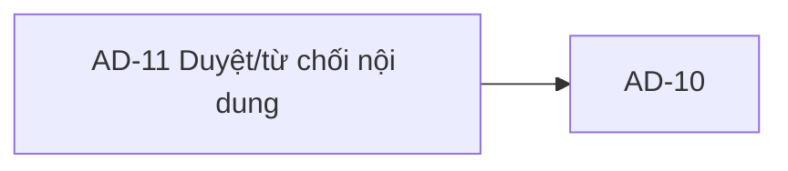
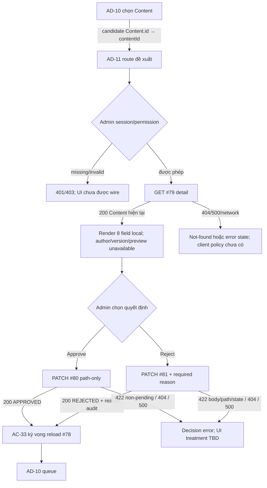

# AD-11 — Navigation

## 1. Route definition
- Current route in inventory: `/admin/content/:contentId/review`
- Status: current Angular route is registered and maps to `AD11Page`; browser/runtime remains `NOT VERIFIED`.
- Route params/types: `contentId` stays a raw string; the page validates the complete optional-sign signed-int64 value before GET #79 and does not coerce it. Missing/malformed/out-of-range IDs show a page error without a request; direct backend malformed/out-of-range paths map to 404.
- Query params/defaults: preserve the inventory route string; detailed parsing rules only from source DD.
- Route guards: see source DD/API contract; do not create role policy.

## 2. Điểm vào
| From screen/route | Trigger | Params | Guard / fallback |
|---|---|---|---|
| [AD-10](../AD-10-HangDoiKiemDuyetNoiDung/00-overview.md) | Link từ Content row có ID an toàn | `Content.id` → `contentId` | Current Angular source; runtime not verified |

## 3. Điểm ra
| Destination | Trigger | Params | Điều kiện |
|---|---|---|---|
| [AD-10](../AD-10-HangDoiKiemDuyetNoiDung/00-overview.md) | Current back link | `/admin/content/pending` | Direct router link exists; filter/page preservation is not implemented or specified |

## 4. Back / refresh / deep link
- Back behavior: xem source DD; không mặc định browser history.
- Preserve filters/scroll/form state: chỉ nếu source có nêu, nếu không `CẦN_XÁC_NHẬN`.
- Refresh/direct URL: route/page source exists; browser/deep-link runtime has not been verified.
- Invalid/missing ID: missing param shows the current “Thiếu mã tham chiếu trên đường dẫn.” page error without calling #79; invalid path values are mapped by #79 and displayed through the shared 404 message.
- Not authenticated/authorized: `AdminLayout` gates on the in-memory Admin session; #79 server guard remains authoritative. Shared mapping handles 401/403 messages; runtime has not been browser-verified.

## 5. Diagram


## Source navigation and flow detail

### Trích từ DD nguồn: E. Ma trận trạng thái và điều hướng

| State | Điều kiện | UI/data cần biểu diễn | Chuyển tiếp / giới hạn |
|---|---|---|---|
| `wired-detail` | Angular route/page, signed-int64 route guard and GET #79 caller exist. | Invalid IDs skip the request; browser/runtime remains unverified; #80/#81 controls are disabled. | Current source status. |
| `loading-detail` | Complete raw `contentId` passes signed-int64 validation and GET #79 is pending. | Loading state được render; invalid IDs stop before request; không hiển thị metadata cũ của Content khác. | 200→`ready`; request failure→error state. |
| `ready` | #79 trả Content shape hợp lệ. | Hiển thị field được hỗ trợ; payload là JSON text; author/version/media preview unavailable. | Back link đi tới queue; approve/reject vẫn khóa. |
| `preview-unavailable` | Không có payload media/rendering contract. | JSON text hiển thị; secure renderer không tồn tại. | Decoder/preview behavior cần contract. |
| `approving` | mutation action đang gọi PATCH #80 (bodyless). | Disable duplicate submit; preserve current item context. | 200→`decision-success`; 401/403/404/422/500/network→error state. Pending UI chưa có. |
| `rejecting` | Required reason đã nhập và PATCH #81 đang chạy. | Disable duplicate submit; body string exact; không clear reason khi lỗi nếu policy duyệt. | 200→`decision-success`; body/path/status 422, 401/403,404,500/network→error state. |
| `decision-success` | #80 200 status APPROVED hoặc #81 200 status REJECTED. | Show returned Content/status accurately; do not call #80 “published”. | AC-33 expects queue reload; route/cache behavior TBD. |
| `not-found/deleted` | #79 404 for invalid/missing/soft-deleted Content. | Shared error mapping shows a not-found message; direct queue link exists. | Missing vs deleted is not distinguished; browser runtime unverified. |
| `stale-or-not-pending` | #80/#81 422 non-pending, or resource was deleted. | Could represent changed/previously reviewed Content; exact cause/status payload is not guaranteed by screen contract. | Reload detail/queue vs conflict message TBD; no stale revision 409 exists. |
| `unauthorized` | Admin session absent/expired or API #79 returns 401. | Layout gates on in-memory Admin session; #79 401 ends local session and shared mapping asks for re-login. | Browser navigation behavior is unverified; no mutation retry. |
| `forbidden` | API #79 returns 403 for current principal. | Shared mapping shows that the account cannot view this data. | No moderation-specific policy is inferred. |
| `validation-error` | Invalid #79 path maps to 404; #80/#81 may return 422 but have no Web caller. | No decision-form field mapping exists. | Do not classify mutation errors without a contract-backed caller. |
| `service/network-error` | #79 returns 500 or transport fails. | Shared mapping displays generic server/connection errors. | No trace-ID/retry policy; browser runtime unverified. |

### Điều hướng và dữ liệu handoff

| Từ | Hành động | Đến | Data | Bằng chứng |
|---|---|---|---|---|
| AD-10 | Chọn một pending Content | AD-11 `/admin/content/:contentId/review` | `Content.id` an toàn → `contentId`; không version | Angular row renderer creates the route; current router/page exists. |
| AD-11 | Load detail | #79 | `content_id` path | Catalog + local route; local detail does not require pending status. |
| AD-11 | Approve | #80 | `content_id`; bodyless | Catalog/source. Local result `APPROVED`; not publish. |
| AD-11 | Reject | #81 | `content_id`, `reason:string` | Catalog/source. Local result `REJECTED`; no revision-request distinction. |
| AD-11 | Decision success | Reload AD-10/#78 | Filter/page preservation undecided | AC-33 expected; current UI has no decision caller or success transition. |
| AD-11 | Back link / browser history | AD-10 candidate | Direct `/admin/content/pending`; no filter/page state | Angular router link exists; browser history/filter preservation is not implemented or verified. |

Deep link with malformed/missing route param, empty detail, reload, queue return state, scroll/focus restoration, unsaved reason confirmation, action duplication, and permission redirect remain implementation decisions. Do not add a frontend flow until response cardinality, revision identity, permission and decision-state rules are resolved.

### Trích từ DD nguồn: B. Luồng tổng quát



Luồng trên tách **expected navigation** khỏi **current endpoint evidence**. Angular source implements the AD-10 link, AD-11 route, GET #79 and direct queue link. Decision writes, success navigation, query preservation, cache invalidation and queue refresh are not implemented; browser runtime is unverified.

### Source trace

```text
Expected: AD-10 #78 item → Content.id → AD-11 contentId → GET #79
          → PATCH #80 OR PATCH #81(reason) → reload AD-10/#78 (AC-33)
Current Web: AD-10 row link → Angular AD-11 route/page → GET #79; payload is
             shown as JSON text, and decision controls remain disabled.
Current Server: #79 reads active Content → direct Content;
                #80 PENDING_REVIEW→APPROVED + audit; #81 PENDING_REVIEW→REJECTED
                + reason-bearing audit row. No revision token connects read to mutation.
```

Nguồn chính: [inventory](../../list_screen.md), [API catalog](../../../../../docs/lists/list_api.md), [AC-33 diagram](../../../../study-server/docs/diagrams/AC_UNICA/AC_04_ADMIN_MANAGEMENT.drawio), [router #79–#81](../../../../study-server/app/api/v1.py), [#79 module](../../../../study-server/app/modules/admin/api_79_admin_content_detail), [#80 module](../../../../study-server/app/modules/admin/api_80_admin_content_approve), [#81 module](../../../../study-server/app/modules/admin/api_81_admin_content_reject).
