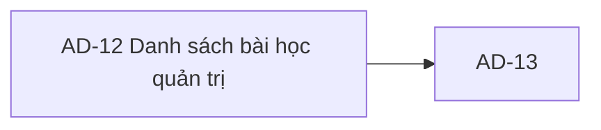

# AD-12 — Navigation

## 1. Route definition
- Current route in inventory: `/admin/lessons`
- Status: candidate/design route; Study Web `UNWIRED` unless source code proves otherwise.
- Route params/types: Không có route param được biểu diễn trong inventory string; route runtime vẫn chưa xác minh.
- Query params/defaults: preserve the inventory route string; detailed parsing rules only from source DD.
- Route guards: see source DD/API contract; do not create role policy.

## 2. Điểm vào
| From screen/route | Trigger | Params | Guard / fallback |
|---|---|---|---|
| [AD-07](../AD-07-ChiTietKhoaHocQuanTri/00-overview.md), [AD-14](../AD-14-SuaDoiTrangThaiXoaBaiHoc/00-overview.md) | Theo DD nguồn/inventory | Theo source; không suy diễn | Xem source DD; route chưa xác nhận runtime |

## 3. Điểm ra
| Destination | Trigger | Params | Điều kiện |
|---|---|---|---|
| [AD-13](../AD-13-ChiTietBaiHocQuanTri/00-overview.md) | Source event/inventory navigation | Theo source DD | Expected links; runtime chưa verify |

## 4. Back / refresh / deep link
- Back behavior: xem source DD; không mặc định browser history.
- Preserve filters/scroll/form state: chỉ nếu source có nêu, nếu không `CẦN_XÁC_NHẬN`.
- Refresh/direct URL: route trong inventory không chứng minh runtime.
- Invalid/missing ID: theo source DD/backend contract; không tự tạo validation.
- Not authenticated/authorized: theo source role guard; xem [Business Rules](05-business-rules.md).

## 5. Diagram

## Source navigation and flow detail

### Trích từ DD nguồn: E. Ma trận trạng thái và điều hướng

| Trạng thái | Điều kiện vào | Nội dung/kết quả | Chuyển tiếp / giới hạn |
|---|---|---|---|
| `UNWIRED` | Checkout hiện không có Study Web source/router/client | Prototype tĩnh; không có runtime state | Chỉ rời trạng thái khi client được implement; hiện runtime `NOT VERIFIED`. |
| `loading` | Target gửi #82 sau auth/query chuẩn bị | Loading state cần được thiết kế; không có trong runtime | Success→`ready`/`empty`; server errors→error states. |
| `ready` | Local #82 trả 200 có Lesson rows sau khi cardinality được chốt | Map `id/course_id/title/content/video_url/order/status`; một số cột mockup không có nguồn | Row detail→AD-13/#83 bằng numeric `id`; detail route/permission còn phải xác nhận. |
| `empty` | Local response `data: []` | Empty result; không đồng nghĩa chờ đồng bộ | Filter update/refresh có thể gọi lại #82 sau khi mapping được duyệt. |
| `validation-error` | Current `course` sai/overflow hoặc có `type` | Local 422; catalog hiện không liệt kê 422 | Sửa query theo contract; type cần API/source change trước khi retry. |
| `unauthorized` | Token/authentication lỗi | Local/catalog 401 | Session/login recovery policy không được xác định trong Study Web. |
| `forbidden` | Role `ADMIN` không thỏa guard | Local/catalog 403 | AC-34 permission chi tiết còn mở; không bypass bằng client check. |
| `service/network-error` | DB/projection lỗi (500) hoặc transport failure | Backend safe 500 + rollback; network UX chưa có client evidence | Retry/timeout/cancel policy cần contract; không hiện stale success không nguồn. |
| `pagination` (prototype-only) | Mockup hiển thị Previous/`0/0`/Next | Không có page/total từ API | Không thể chuyển thành API paging state trước khi contract thay đổi. |

**Navigation:** expected AD-01/Admin shell → AD-12 → AD-13/#83 → AD-14/#84/#85/#86 → reload #82 theo AC-34. Các route/action là design linkage. Không có current frontend route. Browser back, query preservation, post-mutation refresh, duplicate-row handling và stale list policy chưa được quy định.

**Responsive/accessibility:** áp dụng target `.agents/web-study/design.md` khi implementation design được triển khai; prototype sizing/type/tokens không đồng nhất. Tài liệu không khẳng định đã kiểm tra keyboard, screen reader, responsive layout, focus, hover hay contrast trong app runtime.

### Trích từ DD nguồn: B. Luồng hoạt động tổng thể

1. **Vào màn hình:** expected Admin mở route `/admin/lessons`, có thể từ vùng Admin hoặc sau khi quay lại từ AD-13/AD-14. Route/client chưa tồn tại trong checkout; HTML preview không xử lý navigation.
2. **Authentication/authorization:** client target cần session hợp lệ. Với request #82 hiện tại, shared Bearer/JWT `ADMIN` guard chạy trước parse query và DB. 401/403 là server outcomes; AC-34 permission riêng chưa được kiểm tra bởi source đã rà soát.
3. **Khởi tạo filter:** mockup trình bày keyword, course, type và status. Không có default/query state client source. Chỉ `course`/`status` có đường xử lý local; `type` hiện bị từ chối. Không giả định UI slug/alias hoặc giá trị mặc định.
4. **Gọi API:** API contract dự kiến #82 `GET /api/v1/admin/lessons`; gửi Bearer token và chỉ query đã được xác nhận. Catalog cho phép `course`, `status`, `type`; current source không nhận được một `type` hợp lệ nào. Không có body. Không có retry/timeout/idempotency/cache policy từ client source.
5. **Xử lý query:** backend parse `course` thành signed int64; bind exact optional `course_id`/`status`; SQL loại `DELETED` và áp dụng thứ tự xác định. Không pagination/count/type/search/join.
6. **Xử lý response:** local success là 200 `ApiEnvelope<Lesson[]>` với list trong `data`; map `name→title`, `sort_order→order`. Empty list là `[]`. Catalog singleton khác local response. Required projection có thể fail nếu legacy row chứa NULL ở `course_id/order/status`, tạo safe 500 + rollback.
7. **Render UI:** current HTML luôn là empty-state prototype; không bind API. Tương lai chỉ có thể render fields response-backed sau khi owner giải quyết cardinality, filter mapping, nullability, access và pagination. Empty server result không chứng minh dữ liệu đang chờ đồng bộ.
8. **Tương tác:** refresh/reset cần gọi lại #82 sau khi filter contract rõ; search/type/status mapping hiện bị chặn. CTA Add không có API. Khi có row, `Lesson.id` là dữ liệu handoff candidate tới AD-13/#83; không mô tả action ngoài contract.
9. **Rời màn hình:** expected AD-13 detail → AD-14 actions → reload #82 theo AC-34. Lịch sử, giữ filter, stale data, row action placement, back behavior và reload strategy chưa được xác nhận.

### Request/response và lỗi #82

- **Request:** `GET /api/v1/admin/lessons`; `Authorization: Bearer <token>`; query `course?: int64`, `status?: string`, `type?: string`; không body. Catalog định nghĩa các query nhưng chưa giải quyết local behavior `type`.
- **Success theo catalog:** `200 ApiEnvelope<Lesson>` (singular).
- **Success theo local source:** `200 ApiEnvelope<Lesson[]>`, direct array `data`; không metadata phân trang.
- **Local error behavior:** 401 unauthenticated, 403 role không hợp lệ; `course` sai/overflow hoặc `type` supplied → 422 `DESIGN_VALIDATION_ERROR`; query/row mapping/projection lỗi → safe 500 và rollback. Không có path param nên #82 không có 404.
- **Retry/timeout/dedup/cache:** chưa có Study Web caller hoặc policy source; để mở, không khẳng định.
