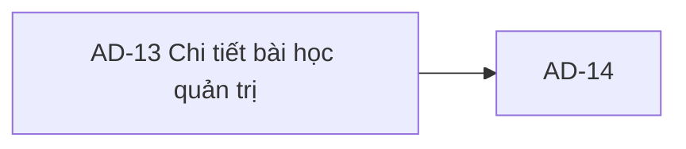

# AD-13 — Navigation

## 1. Route definition
- Current route in inventory: `/admin/lessons/:lessonId`
- Status: candidate/design route; Study Web `UNWIRED` unless source code proves otherwise.
- Route params/types: `lessonId` (type/validation: see source DD; CẦN_XÁC_NHẬN if absent)
- Query params/defaults: preserve the inventory route string; detailed parsing rules only from source DD.
- Route guards: see source DD/API contract; do not create role policy.

## 2. Điểm vào
| From screen/route | Trigger | Params | Guard / fallback |
|---|---|---|---|
| [AD-12](../AD-12-DanhSachBaiHocQuanTri/00-overview.md), [AD-14](../AD-14-SuaDoiTrangThaiXoaBaiHoc/00-overview.md) | Theo DD nguồn/inventory | Theo source; không suy diễn | Xem source DD; route chưa xác nhận runtime |

## 3. Điểm ra
| Destination | Trigger | Params | Điều kiện |
|---|---|---|---|
| [AD-14](../AD-14-SuaDoiTrangThaiXoaBaiHoc/00-overview.md) | Source event/inventory navigation | Theo source DD | Expected links; runtime chưa verify |

## 4. Back / refresh / deep link
- Back behavior: xem source DD; không mặc định browser history.
- Preserve filters/scroll/form state: chỉ nếu source có nêu, nếu không `CẦN_XÁC_NHẬN`.
- Refresh/direct URL: route trong inventory không chứng minh runtime.
- Invalid/missing ID: theo source DD/backend contract; không tự tạo validation.
- Not authenticated/authorized: theo source role guard; xem [Business Rules](05-business-rules.md).

## 5. Diagram

## Source navigation and flow detail

### Trích từ DD nguồn: E. Ma trận trạng thái và điều hướng

| Trạng thái | Điều kiện vào | Dữ liệu/UI | Chuyển tiếp và giới hạn |
|---|---|---|---|
| `UNWIRED` | Current checkout lacks editable Study Web source/router/client | Static prototype only | Runtime remains `NOT VERIFIED`; current state is not API-driven. |
| `loading` | Target client sends #83 | Loading state required for future UI | 200→`ready`; 404/401/403/500 map to explicit errors. |
| `ready` | #83 returns valid `Lesson` | Seven API fields only; optional content/video may be null | AD-14 handoff uses same numeric `id`; no dependency/metric counts. |
| `selection-required` | Prototype no-selection state or absent route param | Static empty prompt | Route behavior for missing param is unresolved; a valid detail request requires `lesson_id`. |
| `not-found` | Invalid/overflow/overlength ID, no matching row or `DELETED` tombstone | 404 `DESIGN_RESOURCE_NOT_FOUND` | Return-to-list behavior is a client policy; API does not redirect. |
| `unauthorized` | Missing/invalid/expired Bearer token | 401 `DESIGN_AUTHENTICATION_REQUIRED` | Session recovery/login route is not defined for Study Web. |
| `forbidden` | Authenticated principal lacks `ADMIN` | 403 `DESIGN_ACCESS_DENIED` | AC-34 fine-grained lesson permission is not enforced by current source. |
| `service-error` | Query/required-field/mapping failure or transport issue | Safe 500 for backend failures; network UX unspecified | Source rolls back read transaction; retry policy is absent. |
| `dependencies-unknown` | #83 returns Lesson with no dependency projection | Do not infer 0 references | #86 performs its own current dependency check at delete time; 422 conflict maps in AD-14. |
| `metrics-unavailable` | No #83 metrics/SSE payload | Screenshot values are static placeholders | No subscription/refresh transition exists. |

**Navigation:** AD-12 row selection → `/admin/lessons/{numeric lessonId}` → GET #83 → AD-14 with the same ID → #84/#85/#86 branch → reload AD-12 per AC-34. Back to AD-12 is expected, but current links are placeholders. Browser history, filter preservation, stale detail, dependency refresh and route guard wiring remain open.

**Accessibility/design:** `.agents/web-study/design.md` is the intended design target, not runtime evidence. On implementation, controls need semantic links/buttons, keyboard operation, focus-visible, explicit disabled/loading/error semantics and responsive reflow. Current screenshot/code do not prove these properties.

### Trích từ DD nguồn: B. Luồng hoạt động tổng thể

1. **Đi vào từ AD-12:** expected flow chọn lesson trong AD-12 rồi truyền `Lesson.id` số nguyên vào `/admin/lessons/:lessonId`. Inventory và API #83 xác nhận path numeric; current AD-12 table/action chưa có row data và client route chưa tồn tại. Không truyền course slug/title thay lesson ID.
2. **Kiểm tra phiên/quyền:** target client cần session Admin. Request #83 hiện xác thực Bearer/JWT + claim `ADMIN` trước khi parse raw path hay truy vấn DB. AC-34 yêu cầu lesson-management permission riêng nhưng source chỉ có role guard; không để UI badge thay quyền server.
3. **Chuẩn bị request:** tạo `GET /api/v1/admin/lessons/{lesson_id}` với Bearer token; không body/query. Giữ numeric ID; client không tự đặt positive constraint ngoài nguồn. API raw parser chấp nhận signed int64 text và leading zero trong giới hạn parser.
4. **Lookup:** server bind ID vào `FIND_ADMIN_LESSON_DETAIL`; đọc một row từ candidate legacy `lessons`; loại `status='DELETED'`; không lọc `PUBLISHED`, không join course/resources/progress và không gọi metric API.
5. **Xử lý response:** success trả `ApiEnvelope<Lesson>` trực tiếp; map `id`, `course_id`, `title`, `content`, `video_url`, `order`, `status`. `content` và `video_url` có thể null. `course_id/order/status` required ở model nhưng legacy DDL có thể NULL; lỗi map hiện thành 500 + rollback.
6. **Render:** prototype hiện luôn hiển thị no-selection placeholders. Target UI chỉ render fields response-backed sau khi contract/schema được giải quyết; `course_id` là ID, không phải course title; status cần giữ raw hoặc chờ enum mapping. No resource/progress/metrics fields are present in #83.
7. **Media/resources:** `content` là nullable string, không có HTML sanitization/rendering contract trong #83; `video_url` là nullable string, không có signed URL/player policy. Resources/quiz/discussion cards và số liệu không thể bind từ response.
8. **Hành động:** button tới AD-14 hiện disabled. Khi workflow được wire, chuyển cùng `lessonId` đến AD-14; không gọi #84/#85/#86 từ AD-13. API #86 tự kiểm tra progress/resources/uploads khi thực hiện delete.
9. **Rời màn hình:** expected back-to-AD-12 link. Current anchors là `#`; browser history, query preservation, refetch sau AD-14 và chọn lại row chưa được định nghĩa.

### Response và lỗi

- **Request:** `GET /api/v1/admin/lessons/{lesson_id}`, `Authorization: Bearer <token>`; optional `X-Trace-Id` theo middleware; no query/body.
- **Success:** HTTP 200; `success`, `businessCode=DESIGN_RESOURCE_RETRIEVED`, message, `data: Lesson`, `meta:{}`, `traceId`. Local message hiện là “Lesson retrieved.”.
- **Errors:** 401 `DESIGN_AUTHENTICATION_REQUIRED`; 403 `DESIGN_ACCESS_DENIED`; 404 `DESIGN_RESOURCE_NOT_FOUND` cho invalid/overflow/overlength ID hoặc missing/DELETED row; 500 `DESIGN_INTERNAL_ERROR` cho DB/mapping/required projection error.
- **Rollback/commit:** no commit on success. Missing row and error projection/query paths call rollback. Test source checks safe envelope and no raw database details.
- **Retry/cache/timeouts:** không có Study Web client policy; chưa được thiết kế. Không khẳng định stale response, request cancellation, retry hoặc cache invalidation.
