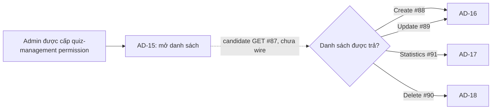

# AD-15 — Data Flow & State

## 1. Nguồn dữ liệu
| Field / object | Type | Source | Destination | Cập nhật khi |
|---|---|---|---|---|
| Chỉ liệt kê theo bằng chứng trong excerpt bên dưới | Theo DD/API source | API/inventory/design; status phải giữ nguyên | UI/state nêu ở DD nguồn | Theo event source |

## 2. State model

> Không tạo DTO/ViewModel mới khi chưa có contract. State, DTO và mapping được trích nguyên ngữ cảnh từ DD nguồn bên dưới.

## 3. API DTO → ViewModel mapping

### Trích từ DD nguồn: B. Luồng hoạt động tổng thể

### Luồng AC-35 và ranh giới

Sơ đồ thể hiện expected handoff theo AC-35. Route, quyền chi tiết, data mapping và các click hiện chưa có UI implementation evidence. Không gọi các mutation/statistics API từ màn hình danh sách khi chưa chuyển sang màn hình/luồng tương ứng.

### EV-01 — Mở màn hình và tải danh sách (Load, candidate)

1. **Điều kiện/input:** entry candidate từ Admin shell vào `/admin/quizzes`; session phải có Bearer JWT. AC-35 yêu cầu quiz-management permission. Route guard và cách biểu diễn permission chưa có source.
2. **Khởi tạo:** nếu owner duyệt contract và client được wire, tạo trạng thái loading. Chỉ tạo query từ filter có mapping đã duyệt. API hiện không khai báo search, size hay sort.
3. **Request candidate:** `GET /api/v1/admin/quizzes`; headers `Authorization: Bearer <JWT>`; không body. Query trực tiếp catalog: `course?:int64`, `status?:string`, `page?:int32`. Không gửi course slug hoặc giá trị search; không gửi `page=0`.
4. **Server current behavior:** shared guard kiểm tra `ADMIN` trước validate query/DB; `course` parse signed int64; `page` parse signed int32 >=1/default 1; `status` không trim/normalize/enum-check. Local count/list sử dụng exact filters, bỏ `DELETED`, size 20, `id ASC`.
5. **Success mapping:** HTTP 200 common envelope có `data.items` và `data.pagination` ở local source. Catalog lại mô tả `data: Quiz`; cho đến khi được giải quyết, không chốt DTO/state table row. Source item gồm `id`, `course_id`, `title`, `duration_minutes?`, `passing_score`, `questions=[]`.
6. **State:** request thành công với item → candidate ready; `items=[]` → empty; `total_pages=0` được local source khi không có kết quả. Prototype `0/0` không phân biệt empty và not-synced.
7. **Lỗi:** 401 yêu cầu xử lý phiên theo auth flow chung; 403 access denied; 422 có thể phát sinh từ local parser dù catalog không khai báo; 500 safe internal error; lỗi mạng/timeout chưa có policy. Không tự retry.
8. **Output:** chỉ sau contract/route approval mới render các field có nguồn. Không tạo fallback course title/code/count/status từ mockup. Runtime hiện: `UNWIRED`.

### EV-02 — Nhập tên/mã tìm kiếm (Input, chưa được hỗ trợ)

- **Trigger/input:** marker #22; chuỗi do Admin nhập. HTML hiện không gắn listener hoặc API request.
- **Validation/processing:** không có giới hạn/trim/debounce contract được tìm thấy. Không suy ra quy tắc từ placeholder.
- **API:** #87 không có query `q`, `name` hay `code`; không gửi giá trị tìm kiếm trong request.
- **Kết quả:** không đổi danh sách. Control hiện chỉ là static prototype input; muốn bật tìm kiếm cần API/query contract và UI state design được phê duyệt.

### EV-03 — Chọn khóa học (Change, mapping bị chặn)

- **Trigger/input:** marker #23; prototype option values là slug như `cs-foundations`, `frontend-eng`.
- **Validation:** #87 nhận `course` signed int64, nhưng không có source map từ slug sang numeric `course_id` hoặc options loader. Không parse slug thành ID.
- **Request/state:** không gửi request cho đến có option source/mapping; filter update/page reset/cache behavior chưa xác định.
- **Kết quả:** không lọc theo slug. Khi được wire, chỉ dùng numeric ID và response mapping đã duyệt.

### EV-04 — Chọn trạng thái (Change, enum chưa được chốt)

- **Trigger/input:** marker #24; prototype values `draft`, `active`, `closed`.
- **Current backend:** giữ raw `status` và so khớp exact text; không trim, case-normalize hoặc validate enum ở module #87.
- **Xử lý:** không tự đổi `active` thành một giá trị khác hoặc thêm mapping từ giao diện. Không gọi API cho đến khi status enum/casing và option source được duyệt.
- **Kết quả:** behavior filter hiện không hoạt động. Quy tắc reset trang/cache sau đổi filter chưa được xác nhận.

### EV-05 — Refresh danh sách (Click, hiện chỉ là animation)

- **Trigger:** marker #25 hoặc #37. Hai control trong `code.html` chỉ xoay icon trong 800 ms; không có fetch.
- **Candidate khi wire:** có thể yêu cầu GET #87 với query hiện hành đã được duyệt. API không quy định retry, deduplication, timeout, cache hay giữ trang/filter khi refresh.
- **Success/error:** phải dùng response/error mapping được owner chốt; hiện không có UI handler để cập nhật bảng/empty/error.
- **Kết quả hiện tại:** animation cục bộ, không chứng minh dữ liệu đã được đồng bộ.

### EV-06 — Mở bộ lọc nâng cao (Click, disabled)

- Marker #26 hiện disabled; không có event handler, panel/modal hoặc query parameter tương ứng trong #87.
- Click không thực hiện hành động. Không tạo filter field hoặc endpoint bổ sung từ biểu tượng/copy trong mockup.

### EV-07 — Tạo bài kiểm tra (Click/handoff AD-16)

- Marker #21 hiện disabled, không có handler. AC-35 mô tả Create qua API #88 và builder thuộc AD-16.
- Khi route/permission/API #88 và handoff được duyệt, điều hướng candidate tới AD-16. AD-15 không gửi POST #88.
- Request body, success destination, validation và cache invalidation thuộc DD/API #88/AD-16; không được suy ra ở đây. Hiện click không đổi route.

### EV-08 — Phân trang (Click, local source có page nhưng UI chưa wire)

- **Input:** marker #40 previous, #41 next; prototype hiển thị `Trang 0 / 0` và hai nút disabled.
- **Contract/local:** catalog có `page?:int32`; source dùng page 1-based, mặc định 1, size cố định 20, `total_pages=0` khi total rỗng. Không có `size` query.
- **Validation:** không gửi page <1 hoặc vượt int32. Quy tắc cho late page là response 200 với `items=[]`, không tự lùi trang.
- **Kết quả:** hiện không có hành động. UI page indicator format và reset page sau filter chưa được quyết định.

### EV-09 — Mở quiz để cập nhật (Row action/handoff AD-16)

- AC-35 tham chiếu Update #89 → AD-16. Ảnh hiện là empty state, không có row/action button quan sát được.
- Chỉ khi có row data và action contract được duyệt mới truyền ID quiz lấy từ response đã xác nhận. Không suy ra numeric/string route ID trước khi response contract được thống nhất.
- AD-15 không gọi PUT #89; thiếu route/GET detail, request body và mapping là trách nhiệm DD AD-16/API #89.

### EV-10 — Mở xác nhận xóa (Row action/handoff AD-18)

- AC-35 tham chiếu Delete #90 → AD-18. Không có row action hoặc dialog trong ảnh empty state.
- Khi được duyệt, truyền ID từ row contract sang AD-18; việc xác nhận, dependency/attempt impact và DELETE #90 thuộc AD-18.
- Không gọi DELETE tại danh sách và không dự đoán optimistic removal, conflict behavior hoặc restore.

### EV-11 — Mở thống kê (Row action/handoff AD-17)

- AC-35 tham chiếu Statistics #91 → AD-17; không có action hiện tại trong empty state.
- Candidate handoff dùng ID quiz từ row contract. AD-15 không tính analytics từ `questions=[]` hay Quiz metadata.
- API #91 catalog/source response chưa đủ để khẳng định các KPI trong inventory; không tạo thống kê tại danh sách.

### EV-12 — Điều hướng Admin shell/breadcrumb/footer

- **Trigger:** marker #2–#6, #8, #10–#15 và #48–#50. Trong HTML, anchor destinations dùng `#`; notification control không có listener. #7/#9/#13/#16 và #45–#47 là nội dung tĩnh.
- **Processing:** không có route, profile, health, RBAC, privacy, support hay security API được nối vào các phần tử này.
- **Kết quả:** click không chuyển màn hình/không tải dữ liệu theo source hiện tại. Route đích và session-expiry/back policy cần tuân theo app shell contract khi Study Web được wire; chưa được suy diễn ở AD-15.

### Trích từ DD nguồn: D. Đặc tả sự kiện và xử lý dữ liệu

| Event | Trigger / loại | Tiền điều kiện | Input → xử lý → output | API / lỗi / cập nhật |
|---|---|---|---|---|
| EV-01 | Mở danh sách / Load | Route, auth và permission đã được owner duyệt; UI/client được wire. | Session + filter đã được duyệt → gọi GET → đọc envelope → chỉ map fields theo response contract đã chốt → chọn ready/empty/error. | Candidate #87. 200 local `Page<Quiz>` khác catalog `Quiz`; 401/403/500 catalog, local có thêm 422. Không retry/cache policy. |
| EV-02 | Nhập tìm kiếm / Input | Search contract và query parameter được bổ sung/phê duyệt. Hiện chưa đạt. | Chuỗi input → hiện không chuẩn hóa/gửi đi vì chưa có validation/query definition → không đổi data. | Không có search trong #87; không gọi API. |
| EV-03 | Đổi khóa học / Change | Có options source và slug→numeric ID mapping đã duyệt. Hiện chưa đạt. | Slug UI → không thể chuyển thành `course:int64` bằng chứng hiện có → không gửi request. | #87 không có course-list API dependency được xác nhận tại AD-15; không gọi với slug. |
| EV-04 | Đổi status / Change | Status vocabulary/casing được owner chốt. Hiện chưa đạt. | `draft/active/closed` → không có mapping → không gửi request. | Source #87 giữ exact raw status, không enum-check; không tự normalize. |
| EV-05 | Refresh / Click | Client wired; query được duyệt. | Filter/page state → candidate GET #87 → process response theo contract → cập nhật list state. | Hiện chỉ animation 800 ms. Retry, timeout, dedupe, cache policy chưa định nghĩa; không retry tự động. |
| EV-06 | Advanced filters / Click | Control hiện disabled; chưa có filter model/design. | Click không được thực hiện → state không đổi. | Không có handler/API/query. |
| EV-07 | Tạo quiz / Click + navigation | CTA được enable sau khi route, permission và AD-16 contract duyệt. | Không có request body ở AD-15 → điều hướng candidate AD-16. | #88 thuộc AD-16; không POST từ AD-15. Current CTA disabled. |
| EV-08 | Previous/next / Click | Paginator được wire và page contract được duyệt. | Current page + direction → tính candidate page; chỉ gửi page int32 >=1. Local fallback 1-based, size 20. | Candidate GET #87; empty late page là 200 với `items=[]`; chưa có quy tắc auto-correct. Current buttons disabled. |
| EV-09 | Edit row / Click + navigation | Row/quiz ID hợp lệ từ response contract và action được duyệt. | Quiz ID → chuyển candidate sang AD-16; không dựng update body ở list. | #89 thuộc AD-16. Ảnh empty không có action; GET detail/edit data contract còn thiếu. |
| EV-10 | Delete row / Click + navigation | Row/action và policy attempts được AD-18 phê duyệt. | Quiz ID → chuyển candidate AD-18; không mutation tại list. | #90 thuộc AD-18; không DELETE tại AD-15. Confirmation/conflict behavior chưa chốt. |
| EV-11 | Statistics row / Click + navigation | Quiz ID và #91 response được thống nhất với AD-17. | Quiz ID → mở candidate AD-17; không tính KPI từ Quiz list. | #91 thuộc AD-17; analytics fields chưa xác nhận. |
| EV-12 | Shell/breadcrumb/footer / Click | Destination/session shell contract có thật. | Click anchor/button → hiện không có route/handler; không làm thay đổi data. | Không có API. Current anchors `#`; notification không có listener; identity/RBAC/system copy tĩnh. |

### Response/error mapping cho EV-01, EV-05 và EV-08

| Kết quả | Bằng chứng local #87 | Xử lý target có thể ghi nhận | Giới hạn |
|---|---|---|---|
| 200 có items | `success=true`, `businessCode=DESIGN_RESOURCE_RETRIEVED`, local `data.items`, `data.pagination`; quiz item metadata-only. | Candidate ready state khi client được wire và response contract được thống nhất. | Catalog chỉ khai báo `ApiEnvelope<Quiz>`; không map bốn cột thiếu. |
| 200 rỗng | Message `No quizzes found.`; `items=[]`, `total=0`, `total_pages=0`. | Candidate empty state. | Không đồng nghĩa chưa đồng bộ hoặc API lỗi. |
| 401 | `DESIGN_AUTHENTICATION_REQUIRED` theo shared auth contract. | Giao cho auth/session flow đã được xác nhận. | Recovery route/session refresh chưa thuộc AD-15. |
| 403 | `DESIGN_ACCESS_DENIED`. | Hiển thị access-denied state theo shared shell khi có implementation. | Fine-grained permission mapping chưa có; local gate là role `ADMIN`. |
| 422 | Local derived parser cho course/page sai định dạng hoặc ngoài range. | Validation error state nếu contract sau này giữ 422. | Catalog #87 không liệt kê 422; response mapping chưa được owner duyệt. |
| 500 | `DESIGN_INTERNAL_ERROR`; local query/count/projection failure rollback và trả safe error. | Candidate service-error state, giữ dữ liệu chỉ theo policy app chung. | Không có retry rule; nullable legacy fields có thể làm projection fail. |
| Network/timeout | Không có UI client source/policy. | Chưa chốt. | Không tự đặt retry, stale fallback hay toast copy. |

### Trích từ DD nguồn: E. Ma trận trạng thái và điều hướng

### Trạng thái

| State | Điều kiện | Hiện tại / đích |
|---|---|---|
| `static-prototype` | Mở `code.html` như hiện có. | Có thật trong asset; không fetch. Controls có thể disabled hoặc chỉ là static. |
| `loading` | Client candidate bắt đầu #87 sau khi route/quyền/contract được duyệt. | Target; chưa có source Study Web. |
| `ready` | API trả collection có item theo response contract đã thống nhất. | Target; không được render field chưa có mapping. |
| `empty` | API trả collection rỗng hợp lệ. | Local candidate #87 trả 200/`items=[]`; không gắn nhãn sync failure. |
| `filtered-empty` | Filter được duyệt, request hợp lệ nhưng không có item. | Chưa phân biệt trong prototype/API; UI copy cần được chốt. |
| `unauthenticated` | API 401. | Error source-backed; recovery theo auth shell contract, chưa mô tả thêm. |
| `forbidden` | API 403. | Error source-backed; quyền quiz-management chưa được map vào source. |
| `validation-error` | Local parser 422 với course/page invalid. | Local behavior; catalog chưa liệt kê 422. |
| `service-error` | API 500 hoặc lỗi query/projection. | Source-backed local; retry/retention policy chưa có. |
| `network-error` | Request không có response. | Không có client source/policy; hành vi chờ contract chung. |

### Điều hướng và dữ liệu trao đổi

| Từ | Sự kiện/điều kiện | Đích | Dữ liệu candidate | Trạng thái xác minh |
|---|---|---|---|---|
| Admin shell | Mở `/admin/quizzes` | AD-15 | Session/Admin identity; route và permission guard | Route chưa tồn tại trong Study Web checkout. |
| AD-15 | Create #88 | AD-16 | Chưa có quiz ID; query/filter carry-over chưa chốt. | Expected theo AC-35, CTA hiện disabled. |
| AD-15 row | Update #89 | AD-16 | Quiz ID theo response contract đã duyệt. | Row action không hiện ở empty screenshot; GET detail/schema thiếu. |
| AD-15 row | Statistics #91 | AD-17 | Quiz ID theo response contract đã duyệt. | Expected; #91 response chưa chứng minh analytics fields. |
| AD-15 row | Delete #90 | AD-18 | Quiz ID theo response contract đã duyệt. | Expected; delete/attempt policy thuộc AD-18. |
| AD-16/17/18 | Quay lại danh sách | AD-15 | Filter/page/history preservation chưa được quy định. | Không tự đặt cache invalidation hoặc success reload. |

Phiên hết hạn, back behavior, deep-link authorization, query-string persistence, duplicate click prevention và concurrent refresh behavior cần kế thừa hoặc chờ app-level contract; không có evidence để chỉ định riêng tại AD-15.

## 4. Luồng đọc (Read)
- Orchestration từ inventory: Candidate GET #87; catalog `ApiEnvelope<Quiz>` khác local `ApiEnvelope<Page<Quiz>>`; local fields thiếu code/course title/question count/status, không có search, course cần int64, status exact raw.
- Chi tiết current/source mapping: xem [API Integration](04-api-integration.md) và DD nguồn.

## 5. Luồng ghi (Write)
- Chỉ mô tả mutation được DD/API source nêu; không thêm endpoint hoặc side effect.
- Source trace: [AD-15](../../screen_stitch/05_admin/AD-15_danh-sach-bai-kiem-tra/AD-15.md)

## 6. Cache / concurrency / lifecycle
- Cache, race, cleanup, pagination: xem các section source bên dưới; nếu không có bằng chứng thì để `CẦN_XÁC_NHẬN`.

## 7. Data errors & security
- Theo error/security/source-status section của DD nguồn; không coi state trong mockup là runtime behavior.

## 8. Trace
[Events](02-events.md) · [API](04-api-integration.md) · [Rules](05-business-rules.md)
