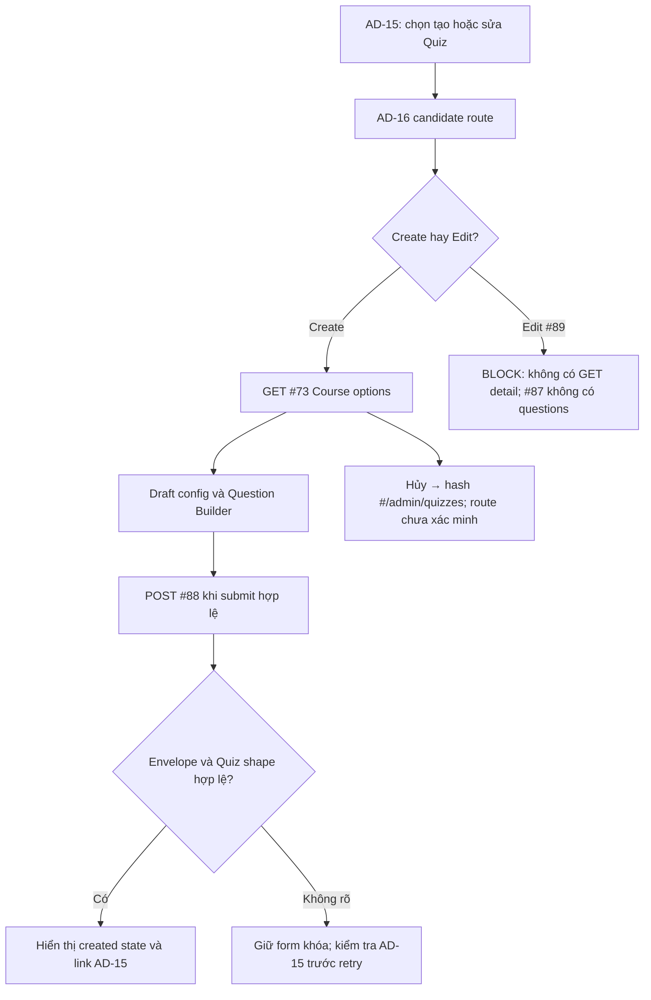

# AD-16 — Data Flow & State

## 1. Nguồn dữ liệu
| Field / object | Type | Source | Destination | Cập nhật khi |
|---|---|---|---|---|
| Chỉ liệt kê theo bằng chứng trong excerpt bên dưới | Theo DD/API source | API/inventory/design; status phải giữ nguyên | UI/state nêu ở DD nguồn | Theo event source |

## 2. State model

> Không tạo DTO/ViewModel mới khi chưa có contract. State, DTO và mapping được trích nguyên ngữ cảnh từ DD nguồn bên dưới.

## 3. API DTO → ViewModel mapping

### Trích từ DD nguồn: B. Luồng hoạt động tổng thể

1. **Entry:** AD-15 là luồng trước theo AC-35. Angular source đăng ký create/edit routes dưới `/admin`; runtime chưa xác minh.
2. **Authentication/authorization:** API catalog yêu cầu Bearer JWT/Admin. AC-35 dùng `quiz management permission`; source local chỉ kiểm tra shared `ADMIN`. Admin API transport dùng phiên Admin và xóa local session với 401; fine-grained permission chưa có source. Khi thiếu quyền, catalog liệt kê 403.
3. **Khởi tạo:** Create gọi #73 để tải Course options theo page; response mapper yêu cầu `pagination.page` bằng page đã gửi. Backend #73 source echo page đã validate và cho phép page ngoài cuối với `items=[]`, vì vậy response này vẫn tới page recovery hiện có. Chỉ ID biểu diễn chính xác được đưa vào lựa chọn. Edit không gọi #73; thiếu Quiz detail nên giữ locked state, không dựng dữ liệu từ URL hoặc #87.
4. **Nhập liệu:** Create page giữ config/questions trong component memory. Editor Question/Choice theo current #88 validator (`text`, `type`, `choices`, `is_correct`), và UI kiểm tra title max 200, duration int32, passing score NUMERIC(5,2). Embedded shape/type values vẫn `DERIVED`.
5. **Mutation:** Create gọi #88 với direct outer catalog body `{config:string,questions:string}` và nested JSON theo local validator. Update không gọi #89 vì catalog không khai báo body; local fallback yêu cầu replacement body.
6. **Response:** Catalog thành công trả `ApiEnvelope<Quiz>`. Client chỉ chấp nhận `success=true`, `DESIGN_RESOURCE_CREATED` và Quiz response shape, sau đó khóa form và hướng người dùng sang AD-15; không tự route/refetch. Không gửi answer key qua Student API.
7. **Lỗi và trạng thái:** Catalog #88/#89 nêu 401/403/422/500; #89 thêm 404. Local #89 dùng 422 cho history conflict. Create có loading/error/success feedback; response/network không xác định yêu cầu kiểm tra AD-15 trước khi gửi lại.
8. **Rời màn hình:** Hủy có hash `#/admin/quizzes`; hash đích không chứng minh route có runtime. AD-17 được mở từ nhánh statistics của AD-15, không có nút/điều hướng trực tiếp từ prototype AD-16. Bảo toàn draft/filter/page hoặc cảnh báo thay đổi chưa lưu không được xác nhận.

### Trích từ DD nguồn: D. Đặc tả sự kiện và xử lý dữ liệu

### EV-01 — Khởi tạo mode tạo (Load)

- **Element/kích hoạt:** Route `/admin/quizzes/new` có trong Angular source; runtime chưa xác minh.
- **Đầu vào:** URL, session/auth state và permission cần có theo AC-35; form values ban đầu không nhận từ màn trước ngoài mode create.
- **Quy trình:** (1) Angular router đăng ký create/edit route; runtime chưa xác minh. (2) Admin session được xác minh trong transport; fine-grained permission chưa có source. (3) Create gọi #73 cho Course options; edit không gọi #73 và khóa do thiếu GET detail. (4) Draft config/questions nằm trong trang đến khi submit.
- **API/output:** GET #73 tải trang hiện tại; POST #88 chỉ chạy khi người dùng submit hợp lệ. Success hiển thị thông báo và link AD-15; không tự điều hướng.
- **Ngoại lệ/trạng thái:** Course loading/error/empty, save loading/error/success đã có trong source; runtime chưa xác minh. Embedded schema vẫn `DERIVED`.

### EV-02 — Khởi tạo mode chỉnh sửa (Load)

- **Element/kích hoạt:** Candidate `/admin/quizzes/:quizId/edit`, truy cập từ action của một Quiz trong AD-15.
- **Đầu vào:** `quizId` route param. Catalog #89 khai báo `int64!`; format/positive check phía UI chưa được contract hóa.
- **Quy trình:** (1) Parse route ID theo contract đã chốt; (2) kiểm tra auth/permission; (3) cần GET admin Quiz detail để lấy config, Questions, Choices; (4) endpoint này không tồn tại. #87 list không phải detail và source local trả `questions=[]`; (5) không render dữ liệu giả, không gửi PUT, giữ edit state `blocked` và yêu cầu contract detail + question schema.
- **API/output:** Không có GET detail. #89 là mutation, không thể dùng làm read. Không tự dùng #87 để prefill.
- **Ngoại lệ/trạng thái:** Quiz missing/deleted và permission response chỉ có thể xác định sau khi có endpoint/load flow; catalog #89 404 chỉ áp dụng lúc mutation. Current screenshot không có ID/value.

### EV-03 — Thay đổi cấu hình chung (Input/Change)

- **Element:** #17–#20. Angular create page nhận cấu hình; course selector đọc #73; edit fields bị khóa.
- **Đầu vào:** `title` string; selected Course ID từ #73; duration optional signed int32; passing score decimal string. Các embedded field/range shape của #88 vẫn `DERIVED`.
- **Quy trình:** Validate theo current #88 validator; giữ title nguyên văn, chuẩn hóa integer trong miền backend và không thêm whitespace/minimum rule. Không autosave; POST chỉ khi submit.
- **Kết quả/ngoại lệ:** Draft values nằm trong component memory cho đến khi #88 trả success. Lỗi validation hiển thị trong form.

### EV-04 — Thêm câu hỏi (Click)

- **Element:** #27 Add Question; mỗi Question có các action thêm/xóa Choice.
- **Tiền điều kiện:** Editor theo current #88 fallback schema `questions[{text,type,choices[{text,is_correct}]}]`; schema/type values vẫn `DERIVED`.
- **Quy trình hiện tại:** Thay đổi Question/Choice chỉ cập nhật local state; không áp đặt số lượng tối thiểu hoặc quy tắc answer-key chưa có trong validator. Submit #88 chỉ chạy từ create mode.
- **Kết quả:** Questions được serialize vào chuỗi `questions` của POST #88; edit mode vẫn khóa.

### EV-05 — Lưu Quiz mới (#88)

- **Element/kích hoạt:** #31 Save; Stitch prototype giữ button disabled. Angular create route có submit handler; edit mode vẫn disabled.
- **Tiền điều kiện current:** Create mode, Admin session, Course option đã tải từ #73, config hợp lệ theo current #88 validator. Fine-grained quiz-management permission chưa có source.
- **Đầu vào/candidate request:** Direct catalog quy định body top-level `{config:string!, questions:string!}`. Catalog không định nghĩa JSON fields bên trong. Local #88 fallback yêu cầu hai chuỗi JSON và nested shape trong §A.2; shape này `DERIVED`.
- **Quy trình hiện tại:** Validate theo current #88 validator, serialize `config` và `questions` thành đúng hai string của catalog, rồi POST với Admin Bearer token. Client chỉ nhận success khi envelope có `success=true`, `DESIGN_RESOURCE_CREATED` và Quiz response shape; không gửi thêm field/header hoặc tự retry.
- **Lỗi:** Catalog liệt kê 401/403/422/500. Current UI có loading/error feedback; khi kết quả mạng không rõ, form giữ khóa và hướng người dùng kiểm tra AD-15 trước khi gửi lại. Runtime chưa xác minh.
- **Đầu ra hiện tại:** Create mode gửi POST #88; edit vẫn disabled. Success link về AD-15, không tự đoán route đích sau lưu.

### EV-06 — Cập nhật Quiz hiện hữu (#89)

- **Element/kích hoạt:** #31 Save trong edit mode; disabled và edit mode không hydrate được.
- **Tiền điều kiện expected:** Edit route có ID đã xác minh, Quiz data/question set đã load, permission hợp lệ, dirty state có thay đổi và #89 body contract được phê duyệt. Hiện thiếu GET detail/body contract.
- **Đầu vào:** Direct catalog chỉ khai báo `quiz_id:int64!` trong path; không khai báo request body. Không thể xác định cập nhật config/question bằng API trực tiếp này.
- **Quy trình khi có thể triển khai:** (1) Validate ID/data theo contract đã duyệt. (2) Không gửi PUT cho tới khi body được thêm/chốt trong catalog/DD. (3) Local source fallback hiện parse positive int64 và reuse body #88; đây là `DERIVED`, không phải cách gọi được phê duyệt. (4) Local source lock quiz/child rows, kiểm tra attempt/answer history trước write, xác nhận target course, update Quiz, thay toàn bộ Choices/Questions theo request order, map response rồi commit. (5) Response local 200 mapping trả Quiz admin; giữ `status` và `created_at`. (6) UI/cache/route sau success cần owner quyết định; không tự invalidation/refetch.
- **Lỗi direct catalog:** 401/403/404/422/500 với business code tương ứng trong API catalog. Local fallback: 404 nếu Quiz không tồn tại/đã `DELETED`; 422 nếu path/body/Course invalid hoặc có attempt/answer history; 500 cho query/mapping/commit lỗi và rollback. History conflict hiện dùng HTTP 422, không phải 409.
- **Đầu ra hiện tại:** Không có edit data, body hoặc request; không có UI conflict/error state.

### EV-07 — Hủy/quay về AD-15 (Click)

- **Element:** #13 và #30; anchors trỏ `#/admin/quizzes`. #13 ở header, #30 ở footer action.
- **Đầu vào/quy trình:** (1) Stitch HTML độc lập dùng anchor hash; Angular template dùng `RouterLink` về `/admin/quizzes`. (2) Không gọi API. (3) Không có dirty-state check, draft restore hoặc query/page/filter preservation. (4) Route đích có trong source; runtime navigation chưa xác minh.
- **Kết quả/ngoại lệ:** Prototype hash đổi theo browser behavior; không khẳng định Study app render AD-15. Unsaved-change prompt và clear/preserve draft là open decision.

### EV-08 — Safe Mode, autosave, schema và builder gate copy

- **Element:** #15, #21, #23, #28. Đây là message regions, không phải action control.
- **Đầu vào/quy trình:** Không có event, API, timer, browser storage hoặc feature flag. Copy được render tĩnh từ HTML. “Autosave locally”, “schema đang chờ”, “SYSTEM NORMAL” và “Gate active” không phải server state.
- **Kết quả:** Không có dữ liệu được lưu/tải và không đổi trạng thái khi message hiển thị. Nếu cần autosave/gate, cần định nghĩa storage scope, lifecycle, recovery, schema version và security behavior trong contract riêng.

### EV-09 — Admin shell, breadcrumb và footer links (Click)

- **Element:** #2–#6, #8, #10–#12, #33–#35.
- **Đầu vào/quy trình:** Anchor/nav click. Top nav/footer dùng `href="#"`; breadcrumb phần lớn là spans; notification button không có handler. Không có route resolver, API call hoặc auth/session transition trong HTML.
- **Kết quả:** Chỉ browser fragment/default control behavior; destination thực tế không xác minh. Không suy ra route, logout, notification panel, role change hoặc help center.

### EV-10 — Validation, auth và API failure states

- **Nguồn:** API catalog #88/#89 và current local handlers. Angular create mode gọi #88; #89 chưa có caller.
- **Quy trình response candidate:** (1) Nhận HTTP status + envelope/businessCode. (2) 401 yêu cầu xử lý phiên; refresh/login/redirect policy chưa được quy định. (3) 403 hiển thị access denied; detail/masking policy chưa có. (4) 422 hiển thị field/business validation theo error payload đã thống nhất; #89 local history refusal cũng là 422. (5) 404 ở #89 biểu thị Quiz không tồn tại theo catalog/local source, local source cũng trả 404 cho tombstone. (6) 500 hiển thị lỗi tổng quát/trace ID nếu contract xác nhận; không lộ SQL/body. (7) Không retry, replay hoặc giữ form/cache nếu policy chưa có.
- **Current result:** Create mode có loading/error/success feedback cho #73/#88. Edit error/conflict và #89 vẫn chưa implement vì edit mutation gated.

### Trích từ DD nguồn: E. Ma trận trạng thái và điều hướng

### E.1. Trạng thái

| Trạng thái | Điều kiện chuyển vào | Hiển thị/đầu ra | Tình trạng chứng cứ |
|---|---|---|---|
| Prototype blank/draft | Mở ảnh hiện tại | Config trống, Questions rỗng, Save/Add disabled | `CURRENT` static screenshot; không phải persisted draft. |
| Loading | Route/API đang tải | Chưa có loading component | `EXPECTED_CANDIDATE`; chưa implement. |
| Ready/clean | Data/options tải thành công hoặc create defaults sẵn sàng | Chưa có xác định fields/options | `BLOCKER`; đặc biệt edit thiếu GET detail. |
| Dirty | User thay đổi config/question | Không có dirty tracker | `EXPECTED_CANDIDATE`; autosave claim không có source. |
| Invalid | Validation thất bại | Chưa có field-level errors | Ranges/required/precision unresolved; API local 422 is source fallback only. |
| Saving | Mutation đang gửi | Button vẫn disabled tĩnh, không loading state | `EXPECTED_CANDIDATE`; duplicate-submit policy open. |
| Created | #88 returns 201 success | Response/copy/navigation/cache undefined | `EXPECTED`; direct contract status only. |
| Updated | #89 returns 200 success | Response/copy/navigation/cache undefined | `EXPECTED`; direct body missing. |
| Not found | #89 returns 404 | No error panel | `EXPECTED` API response; local tombstone mapping derived. |
| Conflict/history blocked | Local #89 detects attempt/answer history | No conflict UI; source returns 422 | `DERIVED`; catalog does not define attempt policy. |
| Unauthorized/forbidden | 401/403 | No session/access UI | Catalog errors; client handling open. |
| Service error | 500 or network failure | No error/retry UI | API 500 catalog; network/timeout policy absent. |

Không đồng nhất `conflict` trong inventory với HTTP 409: catalog #89 không liệt kê 409 và local history rejection là 422. Cần owner/API contract chốt status và policy trước implementation.

### E.2. Điều hướng và dữ liệu trao đổi

| Từ | Điều kiện/event | Đích | Dữ liệu cần truyền | Trạng thái |
|---|---|---|---|---|
| AD-15 | Create action / #88 | AD-16 create route | Không có Quiz ID; course/filter state carry-over chưa quy định. | AD-15 create link and AD-16 route exist in Angular source; runtime chưa xác minh. |
| AD-15 row | Update action / #89 | AD-16 edit candidate | Quiz ID theo response đã duyệt; local/catalog candidate int64. | Detail GET/question set missing; không thể populate. |
| AD-16 | Cancel/back #13/#30 | AD-15 route `/admin/quizzes` | Không có form payload; dirty draft/filter/page retention chưa rõ. | Angular template dùng `RouterLink`; runtime chưa xác minh. |
| AD-16 create/update success | #88/#89 | Chưa xác định; có thể AD-15 theo quy trình list nhưng không được suy ra | `Quiz.id`/response nếu contract chuẩn hóa; update ID từ route. | Owner cần chốt success destination, refetch/cache và duplicate-submit policy. |
| AD-15 | Statistics action | AD-17 | Quiz ID theo API/list response đã duyệt. | Không có nút đi AD-17 trực tiếp từ AD-16; API #91 thuộc AD-17. |

## 4. Luồng đọc (Read)
- Orchestration từ inventory: POST #88 khi tạo; PUT #89 khi sửa. Không giả định GET admin quiz detail; #87 metadata-only và `questions=[]` local. #89 catalog không khai báo body; local fallback yêu cầu replacement body. Autosave copy trong prototype chưa có persistence source.
- Chi tiết current/source mapping: xem [API Integration](04-api-integration.md) và DD nguồn.

## 5. Luồng ghi (Write)
- Chỉ mô tả mutation được DD/API source nêu; không thêm endpoint hoặc side effect.
- Source trace: [AD-16](../../screen_stitch/05_admin/AD-16_tao-chinh-sua-quiz/AD-16.md)

## 6. Cache / concurrency / lifecycle
- Cache, race, cleanup, pagination: xem các section source bên dưới; nếu không có bằng chứng thì để `CẦN_XÁC_NHẬN`.

## 7. Data errors & security
- Theo error/security/source-status section của DD nguồn; không coi state trong mockup là runtime behavior.

## 8. Trace
[Events](02-events.md) · [API](04-api-integration.md) · [Rules](05-business-rules.md)
