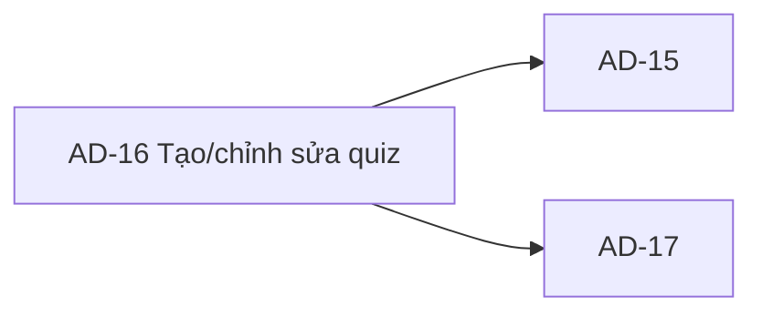
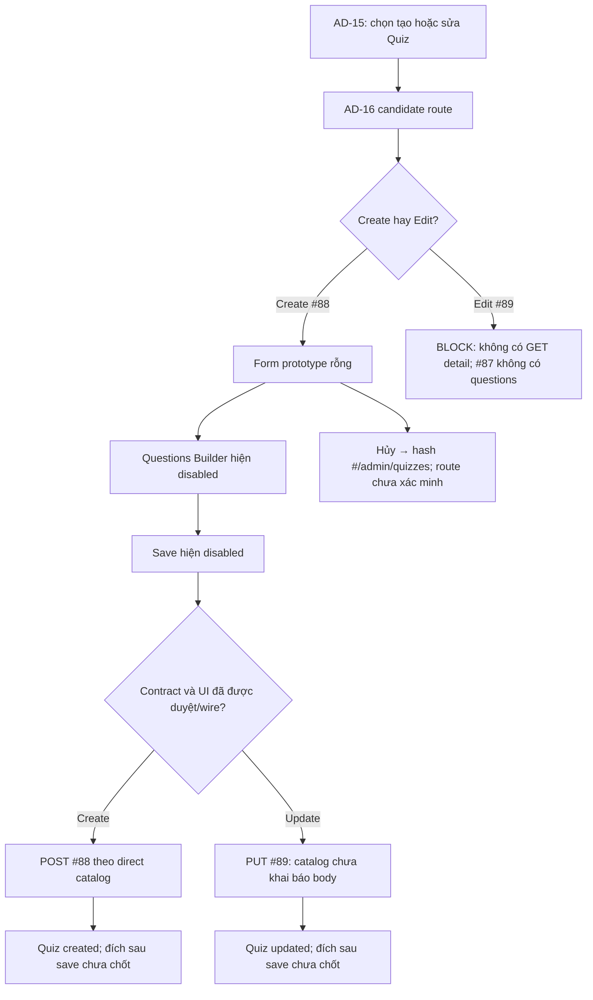

# AD-16 — Navigation

## 1. Route definition
- Current route in inventory: `/admin/quizzes/new hoặc /admin/quizzes/:quizId/edit`
- Status: candidate/design route; Study Web `UNWIRED` unless source code proves otherwise.
- Route params/types: `quizId` (type/validation: see source DD; CẦN_XÁC_NHẬN if absent)
- Query params/defaults: preserve the inventory route string; detailed parsing rules only from source DD.
- Route guards: see source DD/API contract; do not create role policy.

## 2. Điểm vào
| From screen/route | Trigger | Params | Guard / fallback |
|---|---|---|---|
| [AD-15](../AD-15-DanhSachBaiKiemTra/00-overview.md) | Theo DD nguồn/inventory | Theo source; không suy diễn | Xem source DD; route chưa xác nhận runtime |

## 3. Điểm ra
| Destination | Trigger | Params | Điều kiện |
|---|---|---|---|
| [AD-15](../AD-15-DanhSachBaiKiemTra/00-overview.md), [AD-17](../AD-17-ThongKeBaiKiemTra/00-overview.md) | Source event/inventory navigation | Theo source DD | Expected links; runtime chưa verify |

## 4. Back / refresh / deep link
- Back behavior: xem source DD; không mặc định browser history.
- Preserve filters/scroll/form state: chỉ nếu source có nêu, nếu không `CẦN_XÁC_NHẬN`.
- Refresh/direct URL: route trong inventory không chứng minh runtime.
- Invalid/missing ID: theo source DD/backend contract; không tự tạo validation.
- Not authenticated/authorized: theo source role guard; xem [Business Rules](05-business-rules.md).

## 5. Diagram

## Source navigation and flow detail

### Trích từ DD nguồn: E. Ma trận trạng thái và điều hướng

### E.1. Trạng thái

| Trạng thái | Điều kiện chuyển vào | Hiển thị/đầu ra | Tình trạng chứng cứ |
|---|---|---|---|
| Prototype blank/draft | Mở ảnh hiện tại | Config trống, Questions rỗng, Save/Add disabled | `CURRENT` static screenshot; không phải persisted draft. |
| Loading | Route/API đang tải | Chưa có loading component | `EXPECTED_CANDIDATE`; chưa implement. |
| Ready/clean | Data/options tải thành công hoặc create defaults sẵn sàng | Chưa có xác định fields/options | `BLOCKER`; đặc biệt edit thiếu GET detail. |
| Dirty | User thay đổi config/question | Không có dirty tracker | `EXPECTED_CANDIDATE`; autosave claim không có source. |
| Invalid | Validation thất bại | Chưa có field-level errors | Ranges/required/precision unresolved; API local 422 is source fallback only. |
| Saving | Mutation đang gửi | Button vẫn disabled tĩnh, không loading state | `EXPECTED_CANDIDATE`; duplicate-submit policy open. |
| Created | #88 returns 201 success | Response/copy/navigation/cache undefined | `EXPECTED`; direct contract status only. |
| Updated | #89 returns 200 success | Response/copy/navigation/cache undefined | `EXPECTED`; direct body missing. |
| Not found | #89 returns 404 | No error panel | `EXPECTED` API response; local tombstone mapping derived. |
| Conflict/history blocked | Local #89 detects attempt/answer history | No conflict UI; source returns 422 | `DERIVED`; catalog does not define attempt policy. |
| Unauthorized/forbidden | 401/403 | No session/access UI | Catalog errors; client handling open. |
| Service error | 500 or network failure | No error/retry UI | API 500 catalog; network/timeout policy absent. |

Không đồng nhất `conflict` trong inventory với HTTP 409: catalog #89 không liệt kê 409 và local history rejection là 422. Cần owner/API contract chốt status và policy trước implementation.

### E.2. Điều hướng và dữ liệu trao đổi

| Từ | Điều kiện/event | Đích | Dữ liệu cần truyền | Trạng thái |
|---|---|---|---|---|
| AD-15 | Create action / #88 | AD-16 create candidate | Không có Quiz ID; course/filter state carry-over chưa quy định. | AC-35 expected; AD-15 CTA hiện disabled và Study route chưa wire. |
| AD-15 row | Update action / #89 | AD-16 edit candidate | Quiz ID theo response đã duyệt; local/catalog candidate int64. | Detail GET/question set missing; không thể populate. |
| AD-16 | Cancel/back #13/#30 | AD-15 candidate `#/admin/quizzes` | Không có form payload; dirty draft/filter/page retention chưa rõ. | Hash hiện có trong HTML, router chưa xác minh. |
| AD-16 create/update success | #88/#89 | Chưa xác định; có thể AD-15 theo quy trình list nhưng không được suy ra | `Quiz.id`/response nếu contract chuẩn hóa; update ID từ route. | Owner cần chốt success destination, refetch/cache và duplicate-submit policy. |
| AD-15 | Statistics action | AD-17 | Quiz ID theo API/list response đã duyệt. | Không có nút đi AD-17 trực tiếp từ AD-16; API #91 thuộc AD-17. |

### Trích từ DD nguồn: B. Luồng hoạt động tổng thể

1. **Entry:** AD-15 là luồng trước theo AC-35. Inventory đề xuất create/edit route; hiện không có Study Web route để resolve hoặc kiểm tra session.
2. **Authentication/authorization:** API catalog yêu cầu Bearer JWT/Admin. AC-35 dùng `quiz management permission`; source local chỉ kiểm tra shared `ADMIN`. UI chưa có guard. Khi thiếu auth, catalog liệt kê 401; thiếu quyền, 403. Client response/navigation chưa được thiết kế.
3. **Khởi tạo:** Screenshot hiện render config rỗng và Questions rỗng. Không có API options/load. Course select chỉ có placeholder. Create default ngoài dữ liệu rỗng chưa được xác định. Edit cần Quiz detail nhưng endpoint không tồn tại; không được dựng data từ URL hoặc #87.
4. **Nhập liệu:** Các input không có event listener/validation. Question/Choice controls không tồn tại; Add Question và Save disabled. Giao diện không thể tạo request chứa Question set.
5. **Mutation:** Khi contract và UI được duyệt, create dùng #88; update cần chốt request body trước khi dùng #89. Direct catalog và current local handler có khác biệt; xem EV-05/EV-06. Hiện không có request được gửi.
6. **Response:** Catalog thành công trả `ApiEnvelope<Quiz>`. Local code sinh ID Quiz/Question/Choice và response Admin có `is_correct`; mapping frontend, cache, retry, idempotency, toast và route sau save chưa có. Không được gửi answer key qua Student API.
7. **Lỗi và trạng thái:** Catalog #88/#89 nêu 401/403/422/500; #89 thêm 404. Local #89 dùng 422 cho history conflict. Prototype không thể biểu diễn loading, field errors, permission errors, save success hoặc conflict hiện hành.
8. **Rời màn hình:** Hủy có hash `#/admin/quizzes`; hash đích không chứng minh route có runtime. AD-17 được mở từ nhánh statistics của AD-15, không có nút/điều hướng trực tiếp từ prototype AD-16. Bảo toàn draft/filter/page hoặc cảnh báo thay đổi chưa lưu không được xác nhận.
