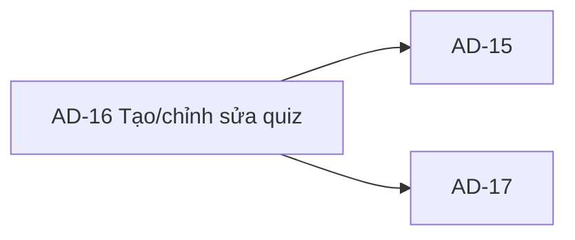
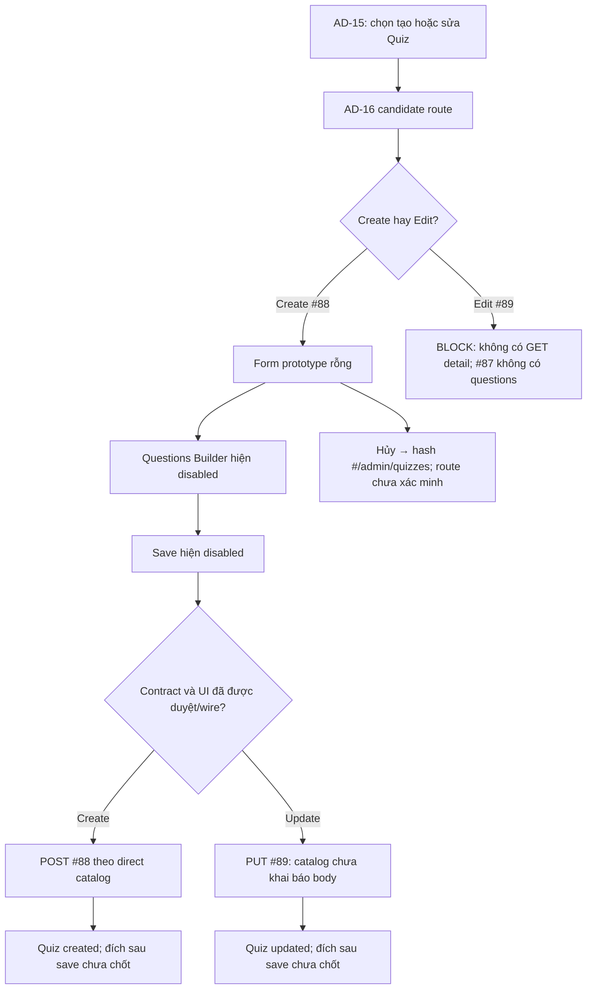

# AD-16 — Navigation

## 1. Route definition
- Current route in inventory: `/admin/quizzes/new hoặc /admin/quizzes/:quizId/edit`
- Status: `/admin/quizzes/new` và `/admin/quizzes/:quizId/edit` có trong Angular source; create mode loads #73 and submits #88, while edit remains locked; runtime chưa xác minh.
- Route params/types: `quizId` (type/validation: see source DD; CẦN_XÁC_NHẬN if absent)
- Query params/defaults: preserve the inventory route string; detailed parsing rules only from source DD.
- Route guards: see source DD/API contract; do not create role policy.

## 2. Điểm vào
| From screen/route | Trigger | Params | Guard / fallback |
|---|---|---|---|
| [AD-15](../AD-15-DanhSachBaiKiemTra/00-overview.md) | Theo DD nguồn/inventory | Theo source; không suy diễn | Xem source DD; route chưa xác nhận runtime |

## 3. Điểm ra
| Destination | Trigger | Params | Điều kiện |
|---|---|---|---|
| [AD-15](../AD-15-DanhSachBaiKiemTra/00-overview.md), [AD-17](../AD-17-ThongKeBaiKiemTra/00-overview.md) | Source event/inventory navigation | Theo source DD | Expected links; runtime chưa verify |

## 4. Back / refresh / deep link
- Back behavior: xem source DD; không mặc định browser history.
- Preserve filters/scroll/form state: chỉ nếu source có nêu, nếu không `CẦN_XÁC_NHẬN`.
- Refresh/direct URL: route trong inventory không chứng minh runtime.
- Invalid/missing ID: theo source DD/backend contract; không tự tạo validation.
- Not authenticated/authorized: theo source role guard; xem [Business Rules](05-business-rules.md).

## 5. Diagram

## Source navigation and flow detail

### Trích từ DD nguồn: E. Ma trận trạng thái và điều hướng

### E.1. Trạng thái

| Trạng thái | Điều kiện chuyển vào | Hiển thị/đầu ra | Tình trạng chứng cứ |
|---|---|---|---|
| Prototype blank/draft | Mở ảnh hiện tại | Config trống, Questions rỗng, Save/Add disabled | `CURRENT` static screenshot; không phải persisted draft. |
| Loading | GET #73 tải Course options hoặc POST #88 đang gửi | Spinner/status cho Course và Save | `CURRENT` Angular source; runtime chưa xác minh. |
| Ready/clean | #73 trả trang Course hợp lệ và chưa chọn khóa | Config và Question Builder có thể nhập; Save bật sau khi chọn Course | `CURRENT` create source; edit vẫn thiếu GET detail. |
| Dirty | User thay đổi config/question | Draft nằm trong component memory; không có dirty tracker/autosave | `CURRENT` draft behavior; dirty prompt chưa có. |
| Invalid | Client kiểm tra title length/duration/score hoặc #88 trả 422 | Hiển thị thông báo lỗi tổng quát; chưa có field-level errors | `CURRENT` theo validator local; embedded rules vẫn `DERIVED`. |
| Saving | POST #88 đang gửi | Inputs và Save bị khóa; spinner hiển thị | `CURRENT` Angular source; runtime chưa xác minh. |
| Created | #88 trả `success=true`, `DESIGN_RESOURCE_CREATED` và Quiz shape hợp lệ | Form khóa; thông báo và link quay về AD-15 | `CURRENT` source; không tự route/refetch. |
| Updated | #89 returns 200 success | Không có UI response | `BLOCKED`; GET detail thiếu và #89 catalog không có body. |
| Not found | #89 returns 404 | Không có edit error view | `BLOCKED`; edit không gọi #89. |
| Conflict/history blocked | Local #89 detects attempt/answer history | Không có conflict UI | `DERIVED`; #89 chưa được gọi từ Web. |
| Unauthorized/forbidden | #73/#88 trả 401/403 | Hiển thị lỗi; Admin transport xóa local session khi 401 | `CURRENT` create source; fine-grained permission vẫn chưa có. |
| Service error | #73/#88 trả lỗi hoặc mạng không xác định | Lỗi tổng quát; status 0 giữ form khóa và yêu cầu kiểm tra AD-15 trước khi gửi lại | `CURRENT` create source; không tự retry. |

Không đồng nhất `conflict` trong inventory với HTTP 409: catalog #89 không liệt kê 409 và local history rejection là 422. Cần owner/API contract chốt status và policy trước implementation.

### E.2. Điều hướng và dữ liệu trao đổi

| Từ | Điều kiện/event | Đích | Dữ liệu cần truyền | Trạng thái |
|---|---|---|---|---|
| AD-15 | Create action / #88 | AD-16 create route | Không có Quiz ID; course/filter state carry-over chưa quy định. | AD-15 create link and AD-16 route exist in Angular source; runtime chưa xác minh. |
| AD-15 row | Update action / #89 | AD-16 edit candidate | Quiz ID theo response đã duyệt; local/catalog candidate int64. | Detail GET/question set missing; không thể populate. |
| AD-16 | Cancel/back #13/#30 | AD-15 route `/admin/quizzes` | Không có form payload; dirty draft/filter/page retention chưa rõ. | Angular template dùng `RouterLink`; runtime chưa xác minh. |
| AD-16 create/update success | #88/#89 | Chưa xác định; có thể AD-15 theo quy trình list nhưng không được suy ra | `Quiz.id`/response nếu contract chuẩn hóa; update ID từ route. | Owner cần chốt success destination, refetch/cache và duplicate-submit policy. |
| AD-15 | Statistics action | AD-17 | Quiz ID theo API/list response đã duyệt. | Không có nút đi AD-17 trực tiếp từ AD-16; API #91 thuộc AD-17. |

### Trích từ DD nguồn: B. Luồng hoạt động tổng thể

1. **Entry:** AD-15 là luồng trước theo AC-35. Angular source đăng ký create/edit routes dưới `/admin`; runtime chưa xác minh.
2. **Authentication/authorization:** API catalog yêu cầu Bearer JWT/Admin. `AdminLayout` điều khiển phiên; transport xử lý 401. Fine-grained `quiz management permission` chưa có source.
3. **Khởi tạo:** Create gọi #73 để tải Course options. Edit cần Quiz detail nhưng endpoint không tồn tại; không dựng data từ URL hoặc #87.
4. **Nhập liệu:** Create giữ config/questions trong page memory và hỗ trợ current #88 shape (`DERIVED`); không autosave. Edit fields stay locked.
5. **Mutation:** Create sends #88 with the two direct catalog strings and current local nested shape. Update remains gated because #89 catalog omits its body; see EV-05/EV-06.
6. **Response:** Client accepts `DESIGN_RESOURCE_CREATED` with a Quiz response shape, locks the form and links back to AD-15. It does not guess an ID route or retry an uncertain network result.
7. **Lỗi và trạng thái:** Create has loading/error/success feedback. Catalog #88/#89 lists 401/403/422/500 and #89 also 404; edit conflict/404 and #89 UI states remain gated.
8. **Rời màn hình:** Angular template có `RouterLink` về `/admin/quizzes`; runtime navigation chưa xác minh. AD-17 được mở từ nhánh statistics của AD-15, không có nút/điều hướng trực tiếp từ AD-16. Bảo toàn draft/filter/page hoặc cảnh báo thay đổi chưa lưu không được xác nhận.
