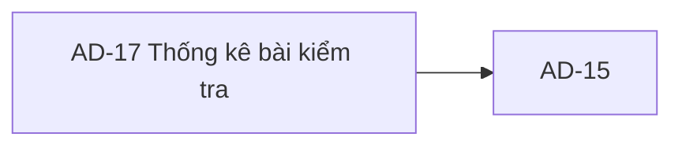

# AD-17 — Navigation

## 1. Route definition
- Current route: `/admin/quizzes/:quizId/statistics` is registered in Angular source and maps to `AD17Page`; browser/runtime is not verified.
- Status: route/page/API caller are source-wired; API contract and approved analytics semantics remain blocked.
- Route params/types: Angular reads `quizId` as a route string, validates full-string positive signed-int64 syntax/range before GET #91, then forwards valid text unchanged as `quiz_id`.
- Query params/defaults: preserve the inventory route string; detailed parsing rules only from source DD.
- Route guards: see source DD/API contract; do not create role policy.

## 2. Điểm vào
| From screen/route | Trigger | Params | Guard / fallback |
|---|---|---|---|
| [AD-15](../AD-15-DanhSachBaiKiemTra/00-overview.md), [AD-16](../AD-16-TaoChinhSuaQuiz/00-overview.md) | Theo DD nguồn/inventory | Theo source; không suy diễn | Route is registered in Angular source; entry action and browser runtime require their own verification |

## 3. Điểm ra
| Destination | Trigger | Params | Điều kiện |
|---|---|---|---|
| [AD-15](../AD-15-DanhSachBaiKiemTra/00-overview.md) | Breadcrumb, header return or footer return link | `/admin/quizzes` via Angular `RouterLink` | Source target exists; browser runtime not verified |

## 4. Back / refresh / deep link
- Back behavior: xem source DD; không mặc định browser history.
- Preserve filters/scroll/form state: chỉ nếu source có nêu, nếu không `CẦN_XÁC_NHẬN`.
- Refresh/direct URL: route trong inventory không chứng minh runtime.
- Invalid/missing ID: current page shows a local route error and skips #91; valid IDs follow the #91 parser contract.
- Not authenticated/authorized: theo source role guard; xem [Business Rules](05-business-rules.md).

## 5. Diagram


## Source navigation and flow detail

### Trích từ DD nguồn: E. Ma trận trạng thái và điều hướng

### Trạng thái

| State | Điều kiện vào | UI/output | Trạng thái bằng chứng |
|---|---|---|---|
| `prototype-placeholder` | Separate checked-in HTML loaded | Placeholder Quiz, empty state và CTA tĩnh | Prototype source only |
| `loading` | Angular page begins request #91 | “Đang tải thống kê” | Present in Angular source; runtime not verified |
| `loaded` | Local response resolves | Quiz ID plus six metric values and contract notice | Present in Angular source; local DTO is not approved by catalog |
| `error` | Missing route ID or request error | Shared error state and return link | Present in Angular source; runtime not verified |
| `no-data` | Approved response xác nhận zero attempts/metrics absent | Empty view với meaning phân biệt zero, unknown và unavailable | Blocked; semantics chưa có contract |
| `ready` | Approved response có metric fields | Render các metric đã được chốt; không thêm distribution/time/completion nếu response không trả | Blocked; direct `ApiEnvelope<Quiz>` không có metrics |
| `unauthorized` | 401 `DESIGN_AUTHENTICATION_REQUIRED` | Áp dụng auth/session flow chung | API code direct; UI flow chưa xác định |
| `forbidden` | 403 `DESIGN_ACCESS_DENIED` | Access denied; không render stats | API code direct; fine-grained permission chưa chốt |
| `not-found` | 404 `DESIGN_RESOURCE_NOT_FOUND` | Quiz/path unavailable theo message policy | API code direct; local malformed ID cũng map 404 |
| `service-error` | 500 `DESIGN_INTERNAL_ERROR` | Lỗi dịch vụ an toàn, trace ID nếu envelope/header cho phép | API code direct; local handler rollback; UI chưa có |
| `network-error` | Offline/timeout | Không có trạng thái HTTP/business code tương ứng | Cần thống nhất client networking convention |
| `connection-checking` | Click #27 | Spinner/disabled, label “Đang kiểm tra…” | Prototype timer 700 ms, không request |
| `connection-feedback` | Timer hết | Static “API hoạt động/Trống Analytics”; sau 3 s label reset | Prototype-only, không phải kết quả connectivity |

### Điều hướng / dữ liệu truyền

| Từ | Hành động | Đích / dữ liệu | Ghi chú |
|---|---|---|---|
| AD-15 | Chọn statistics cho Quiz | `/admin/quizzes/:quizId/statistics`; `quizId` maps to API `quiz_id` | Route and safe-ID link are present in Angular source; browser runtime not verified. |
| AD-17 | Click breadcrumb, header return or footer return link | `/admin/quizzes` → AD-15 | Angular `RouterLink` target is present; browser runtime and query/filter/page preservation are not verified/specified. |
| AD-17 | Click shell/footer placeholders | `#` hoặc no handler | Không có screen transition xác nhận. |

Không có quyền xác nhận để truyền dữ liệu thống kê từ client sang AD-15; ID route cần được xác nhận từ AD-15 response/selection source. API #91 là GET read-only; không invalidate/write cache từ prototype. Cache duration, retry, polling, auto-refresh và back-stack policy chưa có contract.

### Trích từ DD nguồn: B. Luồng hoạt động tổng thể

### Luồng dự kiến sau khi contract và frontend được wire

1. Từ AD-15, Admin chọn thao tác xem thống kê cho Quiz. Chỉ định danh Quiz nào được truyền sang route client vẫn cần đối chiếu ID thực tế; API #91 nhận `quiz_id:int64!`.
2. Client kiểm tra trạng thái phiên và quyền màn hình theo policy được duyệt. AC-35 nêu quiz-management permission; API local chỉ có shared `ADMIN`. Không được xem route-level/Admin shell copy là authorization.
3. Angular `AD17Page` reads and validates `quizId` as a full-string positive signed-int64; invalid/missing values stop locally. Valid raw text is passed as `quiz_id` to GET #91 through the shared Admin client, with no body/query.
4. Backend current source xác thực shared `ADMIN`, parse ID, query aggregate read-only trên legacy Quiz/QuizAttempt candidate. API DD đánh dấu metric/formula là DERIVED. Live schema và policy chưa được xác minh.
5. Current page renders the local DTO projection and a contract warning; the catalog's `ApiEnvelope<Quiz>` does not approve those analytics fields. The client does not compute analytics from Quiz metadata.
6. Current shared route state renders loading/error states and shared messages for auth, forbidden, not-found and network failures; retry is unspecified. Local source uses 404 for malformed path and missing Quiz.
7. Người dùng có thể quay lại AD-15 qua breadcrumb hoặc một trong hai link quay lại; cả ba anchor hiện trỏ tới `/admin/quizzes`. Param cần giữ lại hoặc không phải là quyết định route chưa được đặc tả.
8. Không có bằng chứng AD-17 được cập nhật push sau submit. AC-35 hiện mô tả GET aggregate; câu trong HTML nói tác vụ nền sau submit là static mockup copy.

### Current prototype flow

1. Tải HTML tĩnh, không đọc URL hoặc authentication.
2. Tên Quiz/ID/trạng thái đồng bộ đều là placeholder; không có fetch/XHR.
3. Empty state và hai note card luôn hiển thị như ảnh nguồn.
4. Link quay lại trỏ `/admin/quizzes`; không có client router xác nhận đích.
5. Click “Kiểm tra kết nối dữ liệu” disable nút, bật spinner và đổi label; sau 700 ms hiển thị feedback cố định nói API hoạt động và “Trống Analytics”; sau 3 giây đổi label về cũ và enable nút. Không có request mạng. `syncFeedback` được ẩn ban đầu; HTML không đặt lại nó ở lượt click sau.
6. Shell navigation, notification, footer links dùng `href="#"` hoặc không có handler; không gắn route AD-17.

### Luồng dữ liệu / API

```text
AD-15 (Quiz ID cần xác minh)
  → registered Angular route/page /admin/quizzes/:quizId/statistics
  → AD17ApiService → GET #91 (Bearer JWT, path quiz_id, không body/query)
  → DIRECT catalog: ApiEnvelope<Quiz> ── không có metric fields
  → LOCAL source: derived AdminQuizStatistics ── chưa được contract duyệt
  → current UI: loading → local projection/contract notice or error
  → approved no-data/ready/business semantics: BLOCKED until schema and metrics are agreed
```
