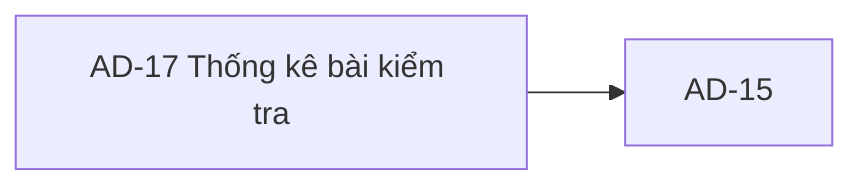

# AD-17 — Navigation

## 1. Route definition
- Current route in inventory: `/admin/quizzes/:quizId/statistics` (candidate; Study Web route chưa wired)`
- Status: candidate/design route; Study Web `UNWIRED` unless source code proves otherwise.
- Route params/types: `quizId` (type/validation: see source DD; CẦN_XÁC_NHẬN if absent)
- Query params/defaults: preserve the inventory route string; detailed parsing rules only from source DD.
- Route guards: see source DD/API contract; do not create role policy.

## 2. Điểm vào
| From screen/route | Trigger | Params | Guard / fallback |
|---|---|---|---|
| [AD-15](../AD-15-DanhSachBaiKiemTra/00-overview.md), [AD-16](../AD-16-TaoChinhSuaQuiz/00-overview.md) | Theo DD nguồn/inventory | Theo source; không suy diễn | Xem source DD; route chưa xác nhận runtime |

## 3. Điểm ra
| Destination | Trigger | Params | Điều kiện |
|---|---|---|---|
| [AD-15](../AD-15-DanhSachBaiKiemTra/00-overview.md) | Source event/inventory navigation | Theo source DD | Expected links; runtime chưa verify |

## 4. Back / refresh / deep link
- Back behavior: xem source DD; không mặc định browser history.
- Preserve filters/scroll/form state: chỉ nếu source có nêu, nếu không `CẦN_XÁC_NHẬN`.
- Refresh/direct URL: route trong inventory không chứng minh runtime.
- Invalid/missing ID: theo source DD/backend contract; không tự tạo validation.
- Not authenticated/authorized: theo source role guard; xem [Business Rules](05-business-rules.md).

## 5. Diagram


## Source navigation and flow detail

### Trích từ DD nguồn: E. Ma trận trạng thái và điều hướng

### Trạng thái

| State | Điều kiện vào | UI/output | Trạng thái bằng chứng |
|---|---|---|---|
| `unwired-prototype` | Current checked-in HTML loaded | Placeholder Quiz, empty state và CTA tĩnh | Current source |
| `loading` | Future valid route, auth và request #91 | Loading indicator; chưa có thiết kế/loading source cụ thể | Expected candidate; chưa implement |
| `no-data` | Approved response xác nhận zero attempts/metrics absent | Empty view với meaning phân biệt zero, unknown và unavailable | Blocked; semantics chưa có contract |
| `ready` | Approved response có metric fields | Render các metric đã được chốt; không thêm distribution/time/completion nếu response không trả | Blocked; direct `ApiEnvelope<Quiz>` không có metrics |
| `unauthorized` | 401 `DESIGN_AUTHENTICATION_REQUIRED` | Áp dụng auth/session flow chung | API code direct; UI flow chưa xác định |
| `forbidden` | 403 `DESIGN_ACCESS_DENIED` | Access denied; không render stats | API code direct; fine-grained permission chưa chốt |
| `not-found` | 404 `DESIGN_RESOURCE_NOT_FOUND` | Quiz/path unavailable theo message policy | API code direct; local malformed ID cũng map 404 |
| `service-error` | 500 `DESIGN_INTERNAL_ERROR` | Lỗi dịch vụ an toàn, trace ID nếu envelope/header cho phép | API code direct; local handler rollback; UI chưa có |
| `network-error` | Offline/timeout | Không có trạng thái HTTP/business code tương ứng | Cần thống nhất client networking convention |
| `connection-checking` | Click #27 | Spinner/disabled, label “Đang kiểm tra…” | Prototype timer 700 ms, không request |
| `connection-feedback` | Timer hết | Static “API hoạt động/Trống Analytics”; sau 3 s label reset | Prototype-only, không phải kết quả connectivity |

### Điều hướng / dữ liệu truyền

| Từ | Hành động | Đích / dữ liệu | Ghi chú |
|---|---|---|---|
| AD-15 | Chọn statistics cho Quiz | Candidate `/admin/quizzes/:quizId/statistics`; `quizId` cần map sang API `quiz_id:int64` | Inventory/AC-35 handoff; client route/row action chưa có source. |
| AD-17 | Click breadcrumb, top return hoặc primary CTA | `/admin/quizzes` → AD-15 candidate | HTML target verified; router runtime chưa có. Query/filter/page state preservation chưa xác định. |
| AD-17 | Click shell/footer placeholders | `#` hoặc no handler | Không có screen transition xác nhận. |

Không có quyền xác nhận để truyền dữ liệu thống kê từ client sang AD-15; ID route cần được xác nhận từ AD-15 response/selection source. API #91 là GET read-only; không invalidate/write cache từ prototype. Cache duration, retry, polling, auto-refresh và back-stack policy chưa có contract.

### Trích từ DD nguồn: B. Luồng hoạt động tổng thể

### Luồng dự kiến sau khi contract và frontend được wire

1. Từ AD-15, Admin chọn thao tác xem thống kê cho Quiz. Chỉ định danh Quiz nào được truyền sang route client vẫn cần đối chiếu ID thực tế; API #91 nhận `quiz_id:int64!`.
2. Client kiểm tra trạng thái phiên và quyền màn hình theo policy được duyệt. AC-35 nêu quiz-management permission; API local chỉ có shared `ADMIN`. Không được xem route-level/Admin shell copy là authorization.
3. Client lấy path `quizId`, chuẩn hóa theo contract numeric `int64`, sau đó gọi GET #91 với Bearer token. Direct catalog không khai báo body/query. Hiện không có router hoặc API caller trong Study Web.
4. Backend current source xác thực shared `ADMIN`, parse ID, query aggregate read-only trên legacy Quiz/QuizAttempt candidate. API DD đánh dấu metric/formula là DERIVED. Live schema và policy chưa được xác minh.
5. Với HTTP 200, direct response contract là `ApiEnvelope<Quiz>` nên client không có analytics fields được bảo đảm để ánh xạ. Không được tự tính analytics trên Quiz hoặc dùng local DTO như thể đã được duyệt. Chỉ sau khi response contract được owner chốt mới định nghĩa loading→no-data/ready và mapping.
6. Với 401/403/404/500, hiển thị trạng thái phù hợp theo business code; phần UI/auth-expiry/ retry hiện chưa có implementation hoặc approved interaction. Local source dùng 404 cả cho path malformed và Quiz vắng mặt.
7. Người dùng có thể quay lại AD-15 qua breadcrumb hoặc một trong hai link quay lại; cả ba anchor hiện trỏ tới `/admin/quizzes`. Param cần giữ lại hoặc không phải là quyết định route chưa được đặc tả.
8. Không có bằng chứng AD-17 được cập nhật push sau submit. AC-35 hiện mô tả GET aggregate; câu trong HTML nói tác vụ nền sau submit là static mockup copy.

### Current prototype flow

1. Tải HTML tĩnh, không đọc URL hoặc authentication.
2. Tên Quiz/ID/trạng thái đồng bộ đều là placeholder; không có fetch/XHR.
3. Empty state và hai note card luôn hiển thị như ảnh nguồn.
4. Link quay lại trỏ `/admin/quizzes`; không có client router xác nhận đích.
5. Click “Kiểm tra kết nối dữ liệu” disable nút, bật spinner và đổi label; sau 700 ms hiển thị feedback cố định nói API hoạt động và “Trống Analytics”; sau 3 giây đổi label về cũ và enable nút. Không có request mạng. `syncFeedback` được ẩn ban đầu; HTML không đặt lại nó ở lượt click sau.
6. Shell navigation, notification, footer links dùng `href="#"` hoặc không có handler; không gắn route AD-17.

### Luồng dữ liệu / API

```text
AD-15 (Quiz ID cần xác minh)
  → candidate route /admin/quizzes/:quizId/statistics
  → GET #91 (Bearer JWT, path quiz_id:int64!, không body/query)
  → DIRECT catalog: ApiEnvelope<Quiz> ── không có metric fields
  → LOCAL source: derived AdminQuizStatistics ── chưa được contract duyệt
  → UI no-data/ready mapping: BLOCKED đến khi thống nhất schema và metrics
```
