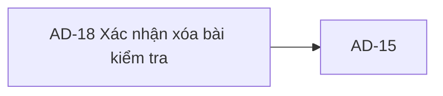
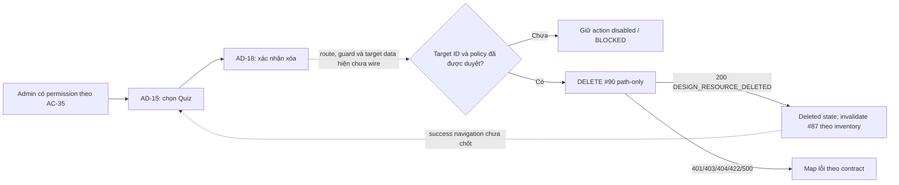

# AD-18 — Navigation

## 1. Route definition
- Current route in inventory: `/admin/quizzes/:quizId/delete` (candidate; Study Web chưa wired)`
- Status: candidate/design route; Study Web `UNWIRED` unless source code proves otherwise.
- Route params/types: `quizId` (type/validation: see source DD; CẦN_XÁC_NHẬN if absent)
- Query params/defaults: preserve the inventory route string; detailed parsing rules only from source DD.
- Route guards: see source DD/API contract; do not create role policy.

## 2. Điểm vào
| From screen/route | Trigger | Params | Guard / fallback |
|---|---|---|---|
| [AD-15](../AD-15-DanhSachBaiKiemTra/00-overview.md) | Theo DD nguồn/inventory | Theo source; không suy diễn | Xem source DD; route chưa xác nhận runtime |

## 3. Điểm ra
| Destination | Trigger | Params | Điều kiện |
|---|---|---|---|
| [AD-15](../AD-15-DanhSachBaiKiemTra/00-overview.md) | Source event/inventory navigation | Theo source DD | Expected links; runtime chưa verify |

## 4. Back / refresh / deep link
- Back behavior: xem source DD; không mặc định browser history.
- Preserve filters/scroll/form state: chỉ nếu source có nêu, nếu không `CẦN_XÁC_NHẬN`.
- Refresh/direct URL: route trong inventory không chứng minh runtime.
- Invalid/missing ID: theo source DD/backend contract; không tự tạo validation.
- Not authenticated/authorized: theo source role guard; xem [Business Rules](05-business-rules.md).

## 5. Diagram

## Source navigation and flow detail

### Trích từ DD nguồn: E. Ma trận trạng thái và điều hướng

### State matrix

| State | Entry condition | UI/action rule | Exit/next | Evidence/status |
|---|---|---|---|---|
| `confirm` (inventory) | Target resolved, Admin permission and policy approved | Show correct target/impact; enable confirm only under approved rule | Confirm → `deleting`; cancel → AD-15/previous approved page | Inventory expected; current mockup has no selected target and confirm disabled. |
| `deleting` (inventory) | One approved #90 request in flight | Prevent duplicate user submission; exact loading copy/button behavior not in source | Success/error response | Expected state only; no client handler. |
| `conflict` (inventory) | Inventory says conflict keeps screen | No API #90 409 exists; #90 local history branches do not return conflict | Requires contract decision | Unsupported/discrepant; do not implement from current contract. |
| `deleted` (inventory) | Valid HTTP 200 `DESIGN_RESOURCE_DELETED` and response ID matches | Show approved success result; invalidate/refetch #87 per inventory | Destination/cache behavior unresolved | Expected state; exact transition/copy not defined. |
| `unauthenticated` | #90 returns 401 | Follow shared auth/session flow | Sign-in/session recovery | Catalog + local source; UI transition not wired. |
| `forbidden` | #90 returns 403 | Show safe access denial | Remain/return per shared policy | Catalog + local role guard; fine-grained permission unresolved. |
| `not-found` | #90 returns 404 for an absent/hard-deleted Quiz, or approved route lookup cannot resolve target | Avoid showing success; approved recovery link needed | AD-15 or safe page TBD | Catalog/local source. A tombstoned Quiz returns 200 on repeated DELETE in local code, but this is DERIVED. |
| `validation-error` | #90 returns 422 | Present ID/path validation failure; never call it a history conflict | Correct route/selection | Current local 422 applies to invalid positive-int64 path. |
| `service-error` | #90 returns 500 | Safe error; no raw database details | Remain/retry only under approved retry policy | Catalog/local safe error mapping; retry policy open. |
| `unknown-outcome` | Network failure/timeout after possible request | Do not claim deleted/not deleted or automatically repeat | Reconciliation behavior needs owner decision | Not in catalog or inventory state list; design decision required before client implementation. |
| `unwired` | Current checkout | Prototype only; disabled confirm, placeholder record, anchors `#` | No verified transition | Current Study Web status. |

### Navigation/data matrix

| From | Action | To | Data passed | Current evidence |
|---|---|---|---|---|
| AD-15 | Delete a Quiz | AD-18 candidate | `quizId` and preferably selected #87 item only after handoff schema is approved | AC-35/inventory relation; no Study Web route/client. |
| AD-18 | Top return/list breadcrumb | AD-15 candidate | Preserve ID/filter/page only if approved | Static `href="#"`; no runtime navigation. |
| AD-18 | Safe cancel | AD-15 or prior route (decision pending) | None required by API | Static `href="#"`; destination unresolved. |
| AD-18 | Successful #90 | `deleted` then destination TBD | `DeleteResult`; invalidate #87 per inventory | Catalog response; no cache/router client. |
| AD-18 | #90 401/403/404/422/500 | Error/recovery UI TBD | Error envelope / trace ID | Status set known; exact shared UI recovery is outside current source. |

### Authorization and data-handling controls

- Do not make API calls from an unverified client route. Server #90 must remain the authority for auth/resource checks; client state alone is not authorization.
- AC-35 requires quiz-management permission while current source checks role `ADMIN`. Resolve policy before enabling the action.
- Use only path `quiz_id` and Bearer token for API #90; never send the disabled audit reason or static screenshot labels as request data.
- A successful mutation must not erase, hide or claim erasure of attempt/answer history beyond an approved policy. Local source soft-delete/hard-delete distinction is explicitly not yet accepted.
- Treat `deleted_at` timestamp timezone/normalization, repeated delete result and ambiguous network result as unresolved API contract questions.

### Trích từ DD nguồn: B. Luồng hoạt động tổng thể

Sơ đồ thể hiện expected flow và current blocker. Nét đứt biểu thị hành vi chưa có frontend evidence. `conflict` trong inventory không thể gắn vào #90 hiện tại vì direct catalog không có 409. Local code có soft/hard branches nhưng chưa được xem là policy đã duyệt.

### Trình tự vào và rời màn hình

1. **Entry:** AC-35/row 76 nối AD-15 tới AD-18 khi Admin chọn delete. Route là candidate; client router và permission guard hiện không có.
2. **Target:** route candidate chứa `quizId`. Cần quyết định handoff object từ #87 hay nguồn detail khác; ID phải map được sang `int64`. Không gọi một GET detail tự đặt ra. Với dữ liệu #87 hiện biết, chỉ map được ID, course ID, title và các trường response thực có; không thể khẳng định course title, question count hay attempt count.
3. **Preflight:** sau khi có route/auth/permission và target đã xác định, hiển thị xác nhận. Current mockup là trạng thái chưa chọn, không phải target loaded; confirm disabled.
4. **Confirm:** chỉ enable sau khi no-attempt/attempt/history policy, permission, data mapping và request contract được duyệt. Khi được phép, #90 chỉ nhận Bearer JWT và path `quiz_id`, không body/query.
5. **Response:** success 200 → `deleted` theo inventory và invalidate/refetch #87 theo inventory; exact cache mechanism/success navigation chưa có contract. Errors theo 401/403/404/422/500. Không có dependency conflict 409.
6. **Exit/cancel:** về AD-15 là expected relation; mockup anchors hiện `#`. Giữ filter/page/history state khi quay lại chưa được quy định.
