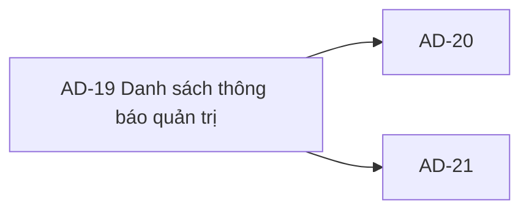

# AD-19 — Navigation

## 1. Route definition
- Current route in inventory: `/admin/notifications (candidate; Study Web route chưa wired)`
- Status: candidate/design route; Study Web `UNWIRED` unless source code proves otherwise.
- Route params/types: Không có route param được biểu diễn trong inventory string; route runtime vẫn chưa xác minh.
- Query params/defaults: preserve the inventory route string; detailed parsing rules only from source DD.
- Route guards: see source DD/API contract; do not create role policy.

## 2. Điểm vào
| From screen/route | Trigger | Params | Guard / fallback |
|---|---|---|---|
| [AD-21](../AD-21-SuaKiemSoatDoTrangThaiThongBao/00-overview.md) | Theo DD nguồn/inventory | Theo source; không suy diễn | Xem source DD; route chưa xác nhận runtime |

## 3. Điểm ra
| Destination | Trigger | Params | Điều kiện |
|---|---|---|---|
| [AD-20](../AD-20-SoanGuiThongBaoHeThong/00-overview.md), [AD-21](../AD-21-SuaKiemSoatDoTrangThaiThongBao/00-overview.md) | Source event/inventory navigation | Theo source DD | Expected links; runtime chưa verify |

## 4. Back / refresh / deep link
- Back behavior: xem source DD; không mặc định browser history.
- Preserve filters/scroll/form state: chỉ nếu source có nêu, nếu không `CẦN_XÁC_NHẬN`.
- Refresh/direct URL: route trong inventory không chứng minh runtime.
- Invalid/missing ID: theo source DD/backend contract; không tự tạo validation.
- Not authenticated/authorized: theo source role guard; xem [Business Rules](05-business-rules.md).

## 5. Diagram

## Source navigation and flow detail

### Trích từ DD nguồn: E. Ma trận trạng thái và điều hướng

| State | Điều kiện | Current / expected UI | Chuyển tiếp |
|---|---|---|---|
| UNWIRED | Không có Study Web editable source/router. | Trạng thái hiện tại của ứng dụng; candidate URL chưa được runtime xác nhận. | Chỉ chuyển loading sau khi route được triển khai và contract/auth được duyệt. |
| LOADING | Future state khi EV-01 gửi #92. | Inventory dự kiến loading; screenshot không chứa loading capture. | 200 hợp lệ → READY hoặc EMPTY; lỗi → AUTH/ACCESS/DEPENDENCY/SERVER. |
| READY | Có ít nhất một record theo một response contract được duyệt. | Chưa xuất hiện trong screenshot/current Study Web source. | Filter/page reload nếu các thao tác được duyệt; row chọn → AD-21 candidate. |
| EMPTY | API hợp lệ trả không item. | Screenshot có empty copy và 0/0 static; local source trả Page rỗng 200, catalog empty shape chưa chốt. | Refresh sau khi được wire; không gọi lại từ nút hiện tại. |
| SEARCH/FILTER DRAFT | User đổi control prototype. | Giá trị control đổi; không lọc, không query. | Reset cục bộ hoặc rời màn; API action blocked do contract mismatch. |
| REFRESH ANIMATION | EV-05 click. | Icon xoay, button disabled 800ms, rồi trở lại. Không có data reload. | Timer kết thúc → trạng thái control ban đầu. |
| UNAUTHORIZED | #92 trả 401 hoặc shared auth hết hạn. | Error/session-expired state theo shared auth design; chi tiết điều hướng chưa được xác minh ở Study Web. | Shared auth flow/SH-05 chỉ khi có session contract; không tự chọn route tại AD-19. |
| FORBIDDEN | #92 trả 403. | Access-denied state; không được render dữ liệu nếu quyền bị từ chối. | Giữ hoặc rời route theo shared auth policy chưa có ở nguồn Study Web. |
| VALIDATION ERROR | Local source trả 422 cho page invalid/non-positive. | DERIVED local behavior; API catalog không liệt kê 422 cho #92. | Không retry cùng query; hiển thị field/query error sau khi error UX được duyệt. |
| DEPENDENCY ERROR | Catalog 503; local source map một số DB connectivity failures. | Error state; không có auto-retry contract. | User retry chỉ sau khi refresh button thực sự gọi API. |
| SERVER / MAPPING ERROR | Catalog 500 hoặc local SQL/projection failure. | Error state; không expose raw DB error. | Không tự retry; preserve trace ID for support if available. |
| NAVIGATE AD-20 | CTA intent. | HTML target /create khác inventory /new; route chưa wire. | Block tới khi route owner reconcile; #93 chỉ ở AD-20. |
| NAVIGATE AD-21 | Chọn row/action dự kiến. | Không có row/action trong HTML; detail contract chưa đủ. | Cần positive notificationId và quyết định GET detail vs #96 status; không tự tạo detail. |
| NAVIGATE GUIDELINES | Policy link intent. | /admin/guidelines/notifications không có inventory/router target. | Block; không tạo screen/API ngoài phạm vi. |

### Navigation data contract

- AD-19 → AD-20: inventory relationship; current CTA uses a conflicting path. Không có payload được định nghĩa. #93 request body thuộc AD-20.
- AD-19 → AD-21: nếu owner duyệt row grain/response và có item.id:int64, candidate path parameter notificationId. Không truyền recipient ID, campaign ID hay operation UUID bằng suy luận.
- AD-21 → AD-19: filter/page preservation và refresh semantics chưa được định nghĩa. AC-36 chỉ yêu cầu reload management sau action.
- AD-19 → SH-07: chỉ nếu một API trả operation_id theo contract được duyệt. API #92 không trả operation; #93 bridge còn open.
- Back/session-expiry navigation, URL-state persistence và browser history chưa được Study Web source xác minh.

### Trích từ DD nguồn: B. Luồng hoạt động tổng thể

### Luồng truy cập và tải dự kiến

1. Route /admin/notifications hiện chỉ là candidate từ inventory. Study Web không có editable router, API client hoặc implementation source để chứng minh page này được phục vụ.
2. Khi route được wire, session/authentication và quyền phải được xác minh bằng shared auth flow. AC-36 yêu cầu notification-management permission. Local #92 hiện kiểm tra Bearer/JWT role ADMIN trước query/page validation và DB; mapping giữa hai quy tắc còn chặn.
3. Nếu owner duyệt contract, client tạo GET /api/v1/admin/notifications với Authorization: Bearer <JWT>. Không có path param hoặc body. Query chỉ có thể là status, channel, page theo catalog. Search title không được gửi vì contract không khai báo.
4. Theo direct catalog, success là HTTP 200, businessCode DESIGN_RESOURCE_RETRIEVED, data là một Notification. Notification có id, title, content, channels, status, optional read_at/scheduled_at và created_at. Catalog không giải thích cách một Notification đáp ứng màn hình list hay pagination.
5. Theo current local source, API kiểm tra quyền trước page; page không truyền thành 1, page phải int32 dương. Source thực hiện count rồi list bằng exact filters, 20 item mỗi page, mới nhất trước theo created_at/id. Response là ApiEnvelope<Page<Notification>>. Đây là fallback DERIVED, chưa được catalog/owner xác nhận.
6. Nếu Page được duyệt, chỉ map item fields có nguồn: id, title, content, channels, status, created_at; pagination.page/size/total/total_pages vào điều khiển tương ứng. Không thể map recipient, send time hay metric cards từ response hiện tại. Không gán read_at/scheduled_at nếu response omit.
7. Kết quả list đã có thể chuyển sang ready hoặc empty. Empty local source là HTTP 200 với items=[]; API catalog không xác định empty wrapper. Mockup đang hiển thị empty state tĩnh và 0/0, không phải API result.
8. Nếu request lỗi, UI cần trạng thái tương ứng HTTP 401/403/503/500 theo catalog. Local source còn có 422 derived khi page invalid/non-positive. Không tự động retry; không có retry/timeout/backoff/cache contract. Retry thủ công chỉ có thể được thiết kế sau khi refresh được wire với API.
9. Người dùng có thể tìm/lọc/reset/refresh hoặc điều hướng. HTML hiện không gọi API: search không có handler; reset chỉ xóa giá trị; refresh chỉ bật/tắt spinner 800 ms; pagination disabled.
10. CTA đi đến AD-20 theo ý nghĩa hiển thị nhưng href hiện là /admin/notifications/create, khác route inventory /admin/notifications/new. Dòng thông báo không có row/action handler. Không có chuyển màn hình runtime đã xác minh.
11. AC-36 mô tả nhánh Create/Update/Delete/Status rồi reload management. #93/#94/#95/#96 không được gọi bởi AD-19; #93 Operation handoff còn mâu thuẫn giữa API catalog/diagram và prose operation tracking. Không đưa operation_id vào AD-19 nếu backend chưa trả và owner chưa chốt.

### API #92 — request/response và lỗi

| Thành phần | Direct contract | Current local source |
|---|---|---|
| Method / URI | GET /api/v1/admin/notifications | Route GET được đăng ký cùng đường dẫn. |
| Auth | Bearer JWT; role=Admin theo catalog. AC-36 dùng notification-management permission. | Shared guard role ADMIN; chạy trước page parse/query. Fine-grained permission chưa có. |
| Query | status?:string, channel?:string, page?:int32; không có size/search. | status/channel nguyên văn; page mặc định 1 và >=1 signed int32. Không trim, lowercase/uppercase normalization hoặc enum validation cho filter. |
| Body | Không có. | Không đọc request body. |
| Success | HTTP 200, DESIGN_RESOURCE_RETRIEVED, ApiEnvelope<Notification>. | Envelope success/businessCode/message/data/meta/traceId; data là Page với items và pagination. Direct response shape mismatch. |
| Item | Notification fields theo reusable schema ở trên. | Pydantic model literal EMAIL/PUSH và FAILED/QUEUED/SENT; optional read_at/scheduled_at mặc định None và được serializer bỏ qua. |
| 401 / 403 | DESIGN_AUTHENTICATION_REQUIRED / DESIGN_ACCESS_DENIED. | Shared JWT/ADMIN guard trước truy vấn. HTTP 403 cho role thiếu; không chứng minh permission chi tiết AC-36. |
| 422 | Không nằm trong direct #92 catalog error list. | DERIVED local page error DESIGN_VALIDATION_ERROR; field page, INT_PARSING hoặc GREATER_THAN_EQUAL. Kiểm tra sau auth và trước DB. |
| 503 | DESIGN_DEPENDENCY_UNAVAILABLE. | Operational/connection-invalidated DB failures được map 503; owner chưa xác nhận trigger. |
| 500 | DESIGN_INTERNAL_ERROR. | SQL errors khác, lỗi projection/mapping hoặc response validation trả 500; lỗi mapping rollback an toàn. |
| Empty / page ngoài range | Không định nghĩa response cụ thể. | HTTP 200 Page rỗng; message “No notifications found.”, total_pages=0 khi total=0. |
| Side effect | GET/read. | Hai read queries; không commit, không gọi delivery provider. |

No application retry, request deduplication, local cache, timeout value or client-side refresh policy is present in the checked-in Study Web source. Do not add one based on the mockup.
