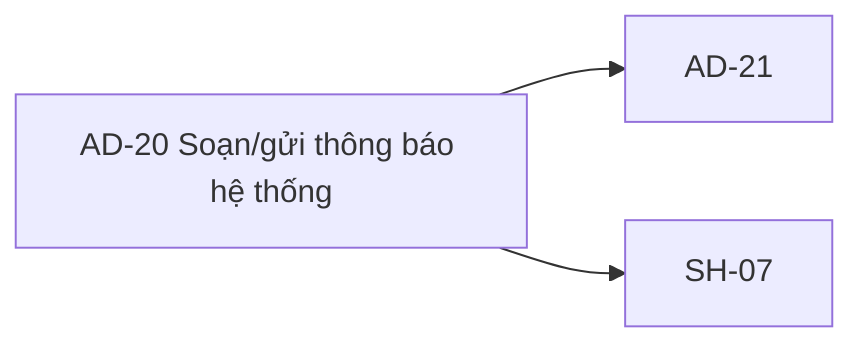

# AD-20 — Navigation

## 1. Route definition
- Current route in inventory: `/admin/notifications/new` (candidate; Study Web route chưa wired)`
- Status: candidate/design route; Study Web `UNWIRED` unless source code proves otherwise.
- Route params/types: Không có route param được biểu diễn trong inventory string; route runtime vẫn chưa xác minh.
- Query params/defaults: preserve the inventory route string; detailed parsing rules only from source DD.
- Route guards: see source DD/API contract; do not create role policy.

## 2. Điểm vào
| From screen/route | Trigger | Params | Guard / fallback |
|---|---|---|---|
| [AD-19](../AD-19-DanhSachThongBaoQuanTri/00-overview.md) | Theo DD nguồn/inventory | Theo source; không suy diễn | Xem source DD; route chưa xác nhận runtime |

## 3. Điểm ra
| Destination | Trigger | Params | Điều kiện |
|---|---|---|---|
| [AD-21](../AD-21-SuaKiemSoatDoTrangThaiThongBao/00-overview.md), [SH-07](../SH-07-TheoDoiTacVuBatDongBo/00-overview.md) | Source event/inventory navigation | Theo source DD | Expected links; runtime chưa verify |

## 4. Back / refresh / deep link
- Back behavior: xem source DD; không mặc định browser history.
- Preserve filters/scroll/form state: chỉ nếu source có nêu, nếu không `CẦN_XÁC_NHẬN`.
- Refresh/direct URL: route trong inventory không chứng minh runtime.
- Invalid/missing ID: theo source DD/backend contract; không tự tạo validation.
- Not authenticated/authorized: theo source role guard; xem [Business Rules](05-business-rules.md).

## 5. Diagram

## Source navigation and flow detail

### Trích từ DD nguồn: E. Ma trận trạng thái và điều hướng

| State | Điều kiện / UI | Hành động và next state | Trạng thái evidence |
|---|---|---|---|
| `UNWIRED` | Study Web không có source/router; route chỉ candidate. | Chưa thể mở screen qua ứng dụng. FE route/auth integration cần được cung cấp. | Current |
| `INITIAL_STATIC` | Artifact render; `all`, `app`, `normal` checked; title/body rỗng; preview sample; Send disabled. | Input title/body → `PREVIEW_EDITING`; radio/checkbox đổi native DOM state. | Prototype current, không phải runtime |
| `PREVIEW_EDITING` | Title/body listener chạy trong HTML. | Trim và thay preview text; blank → sample fallback; không gọi API. | Prototype current |
| `AUDIENCE_OR_CHANNEL_SELECTED` | Browser native selection đổi. | Không có recipient resolution, enum validation, count hay server request. | Prototype current |
| `DRAFT_BLOCKED` | Save Draft không có handler/API. | Không có persistence/confirmation; giữ page. | Blocked |
| `SEND_BLOCKED` | Send button disabled; request contract/mapping chưa được duyệt. | Không submit; không loading/202/error. | Blocked |
| `SUBMITTING` | Chỉ là state tương lai nếu #93 contract + UI được duyệt. | Chống double-submit, timeout, retry behavior chưa có nguồn; cần định nghĩa trước implementation. | Not implemented |
| `ACCEPTED` | Chỉ khi API approved contract trả 202 và body parse hợp lệ. | Hiển thị accepted, giữ `delivered=false`; route tiếp phụ thuộc approved operation bridge. | Catalog expected; current UI không gọi |
| `DELIVERED` | Cần delivery status response/provider evidence. | Không thể suy ra từ 202, `QUEUED` hay thời gian trôi qua. API #96/worker relationship cần xác nhận. | Not verified |
| `VALIDATION_ERROR` | API #93 422 theo contract/fallback. | Map field errors và giữ form values theo client policy; mapping cụ thể chưa có trong UI. | API source response exists; UI absent |
| `UNAUTHORIZED` / `FORBIDDEN` | API #93 401/403 hoặc future route guard. | Session/permission handling chưa có Study Web source; không tự chọn redirect/return URL. | API source; UI absent |
| `DEPENDENCY_ERROR` / `SERVER_ERROR` | API #93 503/500. | Hiển thị retry/manual recovery chỉ theo approved policy; không auto retry mutation. | API source fallback; client policy absent |
| `OPERATION_UNRESOLVED` | Response #93 shape/ID không thể map sang #18. | Không poll/route SH-07; giữ accepted result theo approved contract hoặc show blocked state. | Current design blocker |

### Navigation/data transfer

- **AD-19 → AD-20:** Inventory định nghĩa entry/return. AD-19 prototype CTA path `/admin/notifications/create` khác candidate `/admin/notifications/new`; cả hai chưa wired. AD-20 return anchor `#`.
- **AD-20 → AD-21:** Không mở AD-21 từ UUID metadata. API #94–#96 dùng notification-specific IDs/status contracts; direct notification ID field và response mapping cần được phê duyệt cho detail view.
- **AD-20 → SH-07:** Chỉ sau khi response `operation_id`, UUID/int64 path type, #18 runtime, ownership policy và lifecycle mapping thống nhất. Hiện không truyền operation ID hoặc tự chuyển trang.
- **Session/security:** Expected Admin permission từ AC-36; local #93 shared role `ADMIN`; route auth/session expiry behavior chưa được triển khai ở Study Web. Không trust role/owner từ client state.

### Trích từ DD nguồn: B. Luồng hoạt động tổng thể

### B.1 Luồng được thiết kế — chỉ triển khai sau khi blockers được duyệt

1. Từ AD-19, mở candidate route `/admin/notifications/new`. Kiểm tra phiên đăng nhập và permission notification-management theo contract được duyệt; route/session guard hiện không có source để xác nhận.
2. Khởi tạo form. Mockup đặt mặc định: segment “Toàn bộ người dùng”, channel In-app Feed checked, Email unchecked/disabled, priority Normal. Đây chỉ là trạng thái HTML. Chưa có API preload hoặc danh sách recipients.
3. Admin nhập title/content, chọn segment/channel và priority. Validate phía client chỉ được thêm khi Product/API xác nhận rule, đặc biệt recipient resolution, title/content limits, channel token và priority.
4. Admin chọn `Save draft` hoặc `Send now`. Contract hiện không có `action`, `status`, `scheduled_at` hay draft-create endpoint. Nút send đang disabled trong HTML. Chưa có luồng có thể chốt giữa lưu nháp và gửi.
5. Sau khi API/UX contract được duyệt, thao tác gửi có thể gọi #93 theo body đã thống nhất. Catalog hiện cho phép recipients? hoặc segment? nhưng không định nghĩa XOR/enum/predicate. Local runtime chỉ nhận recipients IDs và từ chối segment.
6. Xử lý response theo contract được duyệt. Catalog/AC-36 direct response là `ApiEnvelope<Notification>`; operation prose nói `Operation`; local source thêm UUID metadata. Không tự chọn response adapter hoặc tự chuyển `notification.id` thành operation ID.
7. Chỉ hiển thị trạng thái `accepted` nếu nhận được response 202 theo approved contract. Không đổi thành `sent/delivered` khi chưa có status từ backend.
8. Chỉ điều hướng sang SH-07 khi operation field/type, API #18 path, ownership, status lifecycle và Study runtime được đồng bộ. Hiện handoff bị block. AD-21 cũng chưa có detail GET riêng theo inventory.
9. Khi lỗi, giữ input để người dùng xử lý lại chỉ theo retry rule được duyệt. Không tự retry mutation; API #93 không khai báo idempotency key hoặc retry guarantee.

### B.2 Hành vi hiện tại của prototype

1. Trình duyệt tải design artifact HTML tĩnh; đây không phải Study Web route. Không có auth guard, API preload hay form state được xác minh.
2. `input` ở title/body được trim để cập nhật preview text. Nếu rỗng, script đặt lại sample copy; dữ liệu form không được gửi đi.
3. Các radio/checkbox chỉ đổi native selection. Toolbar buttons không format nội dung; textarea là plain text.
4. Save Draft không có handler. Send Now disabled và không có handler. Anchor điều hướng dùng `href="#"`.
5. Preview, Accepted/Correlation/Delivered, SMTP, RBAC, System Normal và operation-code copy đều là text tĩnh, không bind response/runtime state.
