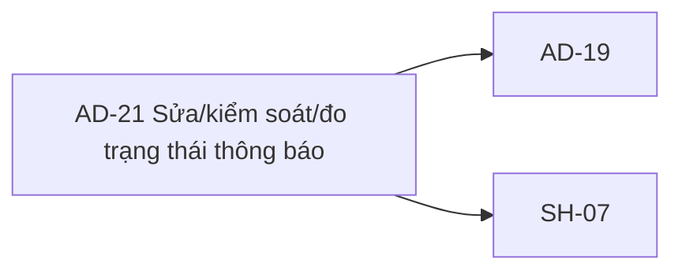

# AD-21 — Navigation

## 1. Route definition
- Current route: `/admin/notifications/:notificationId`, registered in `admin.routes.ts` and mapped to `AD21Page`.
- Status: Angular route/page source-wired; browser runtime and deployment not verified.
- Route params/types: `notificationId` is read as a string and passed to #96; catalog #96 declares `notification_id:int64`, while backend performs its own path validation.
- Query params/defaults: preserve the inventory route string; detailed parsing rules only from source DD.
- Route guards: see source DD/API contract; do not create role policy.

## 2. Điểm vào
| From screen/route | Trigger | Params | Guard / fallback |
|---|---|---|---|
| [SH-07](../SH-07-TheoDoiTacVuBatDongBo/00-overview.md), [AD-19](../AD-19-DanhSachThongBaoQuanTri/00-overview.md), [AD-20](../AD-20-SoanGuiThongBaoHeThong/00-overview.md) | Theo DD nguồn/inventory; AD-19 row links to a safe numeric notification ID | Param `notificationId` | Route is registered; runtime remains unverified |

## 3. Điểm ra
| Destination | Trigger | Params | Điều kiện |
|---|---|---|---|
| [AD-19](../AD-19-DanhSachThongBaoQuanTri/00-overview.md), [SH-07](../SH-07-TheoDoiTacVuBatDongBo/00-overview.md) | RouterLink back to list; conditional SH-07 handoff | No filter state; Operation ID only if an approved producer supplies it | AD-19 return link is wired; SH-07 remains disabled because AD-21 has no client handoff/poller |

## 4. Back / refresh / deep link
- Back behavior: xem source DD; không mặc định browser history.
- Preserve filters/scroll/form state: chỉ nếu source có nêu, nếu không `CẦN_XÁC_NHẬN`.
- Refresh/direct URL: Angular route is declared; browser runtime and refresh behavior are not verified.
- Invalid/missing ID: theo source DD/backend contract; không tự tạo validation.
- Not authenticated/authorized: theo source role guard; xem [Business Rules](05-business-rules.md).

## 5. Diagram

## Source navigation and flow detail

### Trích từ DD nguồn: E. Ma trận trạng thái và điều hướng

### State matrix

| State | Điều kiện / nguồn | UI hiện tại / xử lý được phép |
|---|---|---|
| `STITCH_STATIC` | Static Stitch HTML has no Angular router. | This state describes the design asset; Angular route/page are source-wired. |
| `ID_UNRESOLVED` | Mockup has no valid notification ID; caller contract not implemented. | Show “Chưa nạp tham số ID hợp lệ”; do not call #94/#95/#96. |
| `OPERATION_UNRESOLVED` | #96 returns no Operation ID; #18 contract type/result/owner conflicts remain open. | Show “Chưa liên kết”; keep SH-07 action disabled. |
| `DETAIL_UNAVAILABLE` | #96 response is limited to Notification fields and does not include recipient/count/schedule. | Angular page shows only returned fields and explicit unavailable values; no mock response or fabricated recipient/count. |
| `ACTIONS_LOCKED` | HTML disables update/cancel/SH-07 buttons. | No event/network request. Do not convert disabled state to an assumed business eligibility rule. |
| `#96 RESPONSE — QUEUED/FAILED/SENT` | Values are local source fallback over candidate tables, not approved canonical lifecycle. | A future UI must preserve raw value until mapping is approved; do not map `SENT` to `delivered` or `QUEUED` to `draft/scheduled`. |
| `AUTH / ACCESS / NOT_FOUND / VALIDATION / SERVER_ERROR` | Catalog errors per endpoint; #96 has no 422, #94/#95 do. | Future error presentation and SH-05/SH-06 navigation require shared client policy. Preserve HTTP/business code; do not turn network/500 into 404. |
| `DELETED` / `CANCELLED` | #95 local `DeleteResult` says `deleted`; AC wording includes mark cancelled. | No confirmed cancellation/soft-delete transition or post-delete route; wait for policy. |
| `OPERATION_ACTIVE / TERMINAL` | API #18 route exists in Study source, but its generic status/result mapping and terminal transitions are unresolved. | AD-21 has no client handoff/polling; do not add timer or SSE. |

Inventory expected states `draft/scheduled/sending/delivered/failed` are not mapped to local `QUEUED/SENT/FAILED`. Do not invent a transition graph or use delivery state to infer `is_read`/publication state.

### Navigation and data handoff

| From / to | Expected handoff | Current status |
|---|---|---|
| AD-19 → AD-21 | `notificationId` from selected row; API catalog path is int64. | Route is registered and AD-19 row renderer links safe integer IDs; runtime is not verified. |
| AD-21 → AD-19 | Return to notification list; filter/page preservation is unspecified. | Current Angular page links to `/admin/notifications`; no filter/context preservation is implemented. |
| AD-20 → AD-21 | Notification IDs may be created by #93; API response and batch-vs-recipient grain must be resolved. | #93 catalog returns Notification; local source adds UUID metadata and multiple notification IDs; no generic operation mapping. |
| AD-21 → SH-07 | Valid backend-issued Operation ID and compatible #18 route/owner contract. | Button disabled; #18 backend route exists, while AD-21 client handoff/poller is absent; UUID/int64 and producer conflicts remain. |
| AD-21 → SH-05/SH-06 | Shared auth/not-found route behavior if those screens are adopted. | Candidate screens are design artifacts; endpoint error-to-route policy is not defined here. |
| Browser back | Preserve caller/filter context only under approved router behavior. | Angular router exists; caller/filter preservation is unspecified. |

No route target, cache key, retry policy, polling frequency, confirmation dialog, history behavior or error-navigation path is inferred by this DD.

### Trích từ DD nguồn: B. Mô tả luồng hoạt động tổng thể

### B.1. Expected flow — chỉ khi contract và frontend được duyệt

1. AD-19 điều hướng tới candidate route và truyền `notificationId` lấy từ dữ liệu đã xác thực. Không tạo ID ở client. Hiện inventory chưa chốt cách serialize/filter ID; API #94–#96 catalog khai báo int64.
2. Router kiểm tra phiên và quyền theo shared Study policy. Backend phải áp dụng quyền; AC-36 notification-management permission và local shared role `ADMIN` chưa được chứng minh tương đương.
3. Nếu ID hợp lệ và API #96 được chọn làm read source, gửi một `GET /api/v1/admin/notifications/{notification_id}/status` với Bearer JWT, không query/body. Kiểm tra HTTP status, envelope (`success`, `businessCode`, `data`, `traceId`), rồi validate Notification fields trước khi render.
4. #96 có thể cung cấp `id`, `title`, `content`, `channels`, `status`, `created_at` trong current local projection. API không trả recipient, per-channel status, delivery count/progress, schedule hay Operation. Không thể dùng response này để lấp tất cả mockup fields.
5. Chỉ expose edit/delete controls sau khi policy và API contract được duyệt. #94 direct catalog chưa khai báo body; local handler lại yêu cầu `{title, content}` và chỉ sửa các delivery còn `QUEUED`. #95 direct contract là delete result; AC-36 cho phép delete/mark cancelled theo policy, còn local handler hard-delete row và không dừng provider.
6. Chỉ mở SH-07 khi một producer trả Operation ID mà type/field/owner contract tương thích API #18. Hiện AD-20 #93 local `meta.operation_id` là UUID, trong khi API #18 row khai báo int64; reusable schema/AC lại nói UUID và Study #18 chưa wired.
7. Theo từng HTTP/business error đã được contract công bố, render lỗi đã duyệt và không biến 500/network thành not-found. Không có retry, timeout, cache, polling cadence hay refresh policy được xác định trong các API này.

### B.2. Stitch prototype baseline trong checkout

1. Stitch `code.html` là asset HTML tĩnh; bản thân asset không có router, session manager hay API client. Trạng thái này chỉ mô tả prototype, không mô tả Angular app.
2. HTML render placeholder ID `--`/“Chưa nạp tham số ID hợp lệ”, Operation “Chưa liên kết”, status “Chờ xác thực”, static info banner và channel cards/counters.
3. Không có input hoặc dữ liệu động. No `fetch`, XHR, feature event handler, timer, polling, cache, API response mapping hoặc state transition được thực hiện.
4. “Cập nhật bản nháp”, “Hủy bỏ phát hành” và nút SH-07 đều có `disabled`; click handler không tồn tại. Header notification button không handler; navigation/return/footer anchors dùng `href="#"`.
5. Stitch asset không điều hướng tới AD-19/SH-07 hoặc thực hiện update/delete. Các mô tả về SMTP, “System Normal”, RBAC, completion `0/0`, lock và status là copy của mockup, không chứng minh hệ thống thực.

### Current Angular source flow

The Angular route is registered and calls GET #96 through the Admin API client. It renders only returned fields with loading/loaded/error states. The return link routes to AD-19; edit, delete and SH-07 actions remain disabled. This source evidence does not verify browser runtime or deployment.
