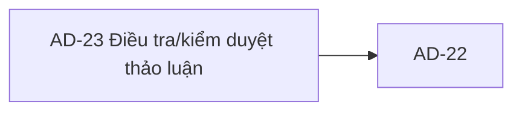

# AD-23 — Navigation

## 1. Route definition
- Current route in inventory: `/admin/discussions/:discussionId/moderate`
- Status: registered Angular route; browser/runtime chưa xác minh.
- Route params/types: `discussionId` is validated before #98 as 1–19 ASCII digits with a positive signed-int64 value; valid raw text is preserved.
- Query params/defaults: preserve the inventory route string; detailed parsing rules only from source DD.
- Route guards: see source DD/API contract; do not create role policy.

## 2. Điểm vào
| From screen/route | Trigger | Params | Guard / fallback |
|---|---|---|---|
| [AD-22](../AD-22-DanhSachThaoLuanBiBaoCao/00-overview.md) | Click row link | Safe-integer Discussion ID from #97 | Registered Angular route; #98 caller validates path before GET |

## 3. Điểm ra
| Destination | Trigger | Params | Điều kiện |
|---|---|---|---|
| [AD-22](../AD-22-DanhSachThaoLuanBiBaoCao/00-overview.md) | Header/breadcrumb link | No filter/page state | Angular router link returns to queue; runtime chưa verify |

## 4. Back / refresh / deep link
- Back behavior: xem source DD; không mặc định browser history.
- Preserve filters/scroll/form state: chỉ nếu source có nêu, nếu không `CẦN_XÁC_NHẬN`.
- Refresh/direct URL: Angular route/page source-wired; browser/runtime chưa xác minh.
- Invalid/missing ID: missing and invalid signed-int64 IDs stop locally before GET; a valid ID with no matching Discussion reaches the shared 404 error state.
- Not authenticated/authorized: theo source role guard; xem [Business Rules](05-business-rules.md).

## 5. Diagram

## Source navigation and flow detail

### Trích từ DD nguồn: E. Ma trận trạng thái và điều hướng

### State matrix

| State | Source/status | Entry/transition | UI treatment and next step |
|---|---|---|---|
| Static placeholder / unloaded | **Current prototype** | Initial HTML render. | ID invalid/unloaded message, summary placeholders, empty thread, safety banner and disabled controls. No network request. |
| Loading detail | **Current Angular source** | Valid route entry starts GET #98. | Shared loading state is rendered; timeout/retry contract is not defined. The static “Chờ nạp bản ghi” badge remains prototype-only. |
| Reviewing detail | **Partial current source / AC blocked by projection gap** | #98 success returns one Discussion and direct comments. | Angular renders these fields; report fields remain absent, so full report review cannot be shown. |
| Empty/missing target | **Current source + local #98 evidence** | Invalid route ID stops before HTTP; valid but missing Discussion returns local 404; zero comments is a loaded empty list. | Shared error state handles invalid/404 cases; the comments panel handles an empty array. No report-specific empty state exists. |
| Unauthorized / forbidden | **Catalog and local #98 guard evidence** | Catalog 401/403; local #98 checks `ADMIN`. | Shared error state shows login-required or access-denied copy; AC permission mapping remains open. |
| Decision selected / ready | **Not reachable in current prototype** | Radios and reason input would need an approved contract; controls are disabled. | Do not enable or infer values/validation. |
| Processing | **Inventory expected state; #99/#100 unwired** | Would follow an approved PATCH/DELETE submit. | No local mutation endpoint or processing UI. Duplicate-submit and retry behavior unresolved. |
| Resolved / updated | **AC/catalog expected only** | #99 200 `DESIGN_RESOURCE_UPDATED` or #100 200 `DESIGN_RESOURCE_DELETED`. | Response mapping, audit confirmation, destination and #97 refresh invalidation need approval. |
| Conflict / stale state | **Inventory expected state only** | Trigger and API code are not present; catalog #99/#100 do not list 409. | Do not claim conflict detection or design recovery behavior as implemented. |
| Server/network failure | **Current Angular state + catalog** | #98 server/network failure reaches shared error state; #99/#100 are not called. | Shared error copy is shown; retry is not wired. Catalog #99/#100 422 behavior remains conditional and unimplemented. |

### Navigation and data handoff

| From / to | Expected link | Data | Current status |
|---|---|---|---|
| AD-22 → AD-23 | Select a reported Discussion and open `/admin/discussions/:discussionId/moderate`. | Current row link passes a safe-integer Discussion ID; report ID/reason and root/reply semantics are not specified by #98. | Angular route/page/#98 caller are source-wired; report-context handoff remains incomplete. |
| AD-23 → AD-22 via header/breadcrumb | Return to the report queue; inventory links queue refresh to #97. | Filter/page/current row state is not passed. | Angular router link returns to AD-22 without restoring query/page or triggering #97; prototype fragment links are separate. |
| AD-23 → #99 | Submit approved moderation action and reason. | `discussion_id:int64`, `action:string`, `reason:string`. | Catalog/Draft only; no local route or action mapping. |
| AD-23 → #100 | Conditional separate delete after review. | `discussion_id:int64`; catalog declares no body/query. | Catalog/Draft only; no local route and no approved trigger/confirmation semantics. |

### Security, privacy and usability constraints

- Treat the page as Admin-only in the design, but do not equate AC permission with local `ADMIN` without an approved mapping. Current #98 source checks `ADMIN`; #99/#100 permissions remain absent.
- Current Angular displays only the Discussion/direct-comment projection returned by #98; no report data exists in that response. Do not fabricate report fields or visibility policy.
- Reason content may be sensitive and AC expects audit, but retention, actor identity, access to audit, masking and atomicity are not defined; avoid promising storage/security properties from static banner copy.
- Moderation controls are disabled in both the static prototype and Angular source. Angular shows errors through status/alert roles; reason/radio editing remains gated.
- Current Angular CSS stacks metadata/actions on narrow screens. Long-thread pagination and comment visibility beyond direct replies are not provided by #98.

### Trích từ DD nguồn: B. Mô tả luồng hoạt động tổng thể

### Luồng dự kiến theo AC/catalog

1. Admin chọn một Discussion từ AD-22. Expected handoff is a Discussion ID; exact URL/state transfer, selected report context and root-versus-reply target are not specified.
2. The registered Angular route validates raw `discussionId` as 1–19 ASCII digits with a positive signed-int64 value before #98; invalid/missing IDs produce a local route error. Valid text is preserved unchanged.
3. Expected API call #98 is `GET /api/v1/admin/discussions/{discussion_id}` with Bearer JWT and Admin role. Direct catalog response is `ApiEnvelope<Page<Discussion>>`. AC expects reports in addition to discussion/comments, but the catalog response shape does not identify report fields.
4. If #98 returns successfully, AC expects Admin to inspect thread and report context. Local source currently returns a Discussion plus direct comments only, with a one-item page; it cannot populate report reason/severity/reporter/count/timestamp. The current prototype does not render returned data.
5. AC-37 has a no-violation path saying dismiss report, but no API or action mapping is listed. This branch is blocked.
6. For a violation, AC describes hide, lock or warn. Candidate #99 is `PATCH /api/v1/admin/discussions/{discussion_id}/moderate` with required string fields `action` and `reason`, Bearer JWT/Admin, and `ApiEnvelope<Page<Discussion>>` response. Exact action values, status transitions, validation, audit storage and atomicity are unresolved. Do not fabricate request values or success UI.
7. AC allows conditional deletion after moderation using separate #100 `DELETE /api/v1/admin/discussions/{discussion_id}`. Catalog has no body/query and returns `ApiEnvelope<DeleteResult>`. AC says soft delete and preserve audit; deletion eligibility, physical state/timestamp, repeat behavior and audit linkage are unresolved. The prototype's delete radio is not a valid mapping to this separate endpoint.
8. Expected navigation returns to AD-22 and the inventory links describe refresh through #97. No cache invalidation, preserved filters/page, retry or redirect-on-error contract is specified. Prototype links are fragment-only and do not perform navigation.

### Current static behavior

1. Prototype opens with unresolved Discussion ID, unloaded summary fields, empty thread state and safety-lock banner.
2. All four radio options, reason textarea and apply button are disabled. No event handler or request runs.
3. Header button, empty-state CTA and cancel link point to fragment `#ad-22`; navigation shell/footer links are `#`; bell has no handler.
4. No success, processing, resolved, conflict, API error, session-expired or server-empty state is implemented in this HTML.
