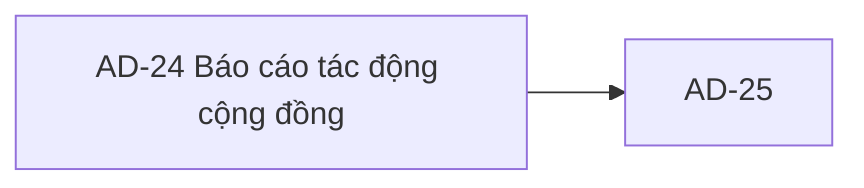

# AD-24 — Navigation

## 1. Route definition
- Current route in inventory: `/admin/reports/community-impact`
- Status: candidate/design route; Study Web `UNWIRED` unless source code proves otherwise.
- Route params/types: Không có route param được biểu diễn trong inventory string; route runtime vẫn chưa xác minh.
- Query params/defaults: preserve the inventory route string; detailed parsing rules only from source DD.
- Route guards: see source DD/API contract; do not create role policy.

## 2. Điểm vào
| From screen/route | Trigger | Params | Guard / fallback |
|---|---|---|---|
| [AD-01](../AD-01-DashboardQuanTri/00-overview.md), [AD-25](../AD-25-XuatBaoCaoVaTheoDoiTienTrinh/00-overview.md) | Theo DD nguồn/inventory | Theo source; không suy diễn | Xem source DD; route chưa xác nhận runtime |

## 3. Điểm ra
| Destination | Trigger | Params | Điều kiện |
|---|---|---|---|
| [AD-25](../AD-25-XuatBaoCaoVaTheoDoiTienTrinh/00-overview.md) | Source event/inventory navigation | Theo source DD | Expected links; runtime chưa verify |

## 4. Back / refresh / deep link
- Back behavior: xem source DD; không mặc định browser history.
- Preserve filters/scroll/form state: chỉ nếu source có nêu, nếu không `CẦN_XÁC_NHẬN`.
- Refresh/direct URL: route trong inventory không chứng minh runtime.
- Invalid/missing ID: theo source DD/backend contract; không tự tạo validation.
- Not authenticated/authorized: theo source role guard; xem [Business Rules](05-business-rules.md).

## 5. Diagram

## Source navigation and flow detail

### Trích từ DD nguồn: E. Ma trận trạng thái và điều hướng

### State matrix

| State | Source/status | Entry/transition | UI treatment and next step |
|---|---|---|---|
| Static placeholder | **Current prototype** | Initial HTML. | Fixed date/segment values, `--` KPI values, empty chart and draft metric cards. No report request. |
| Loading | **Expected by inventory; not implemented** | Would follow approved #101/#102 request. | Current “Loading” is not shown; refresh timer is not data loading. No spinner/timeout/duplicate-request policy defined. |
| Ready | **Expected by inventory; blocked** | Requires both report contract and approved card/chart mapping. | Generic `Report` cannot currently map to screenshot fields; don't render inferred values. |
| No-data | **Expected by inventory; not implemented** | API catalog does not specify empty result representation. | `--` and empty-chart copy are static; no zero/missing/empty-list rule is approved. |
| Partial | **Expected by inventory; not implemented** | Two APIs may be separate calls, but partial-success semantics are not defined. | No per-card error, source freshness or partial-state marker is present. |
| Validation error | **Open / no catalog mapping** | Invalid date or unsupported segment. | Catalog #101/#102 lists no 400/422; no client validation/error UI in source. |
| Unauthorized / forbidden | **Expected catalog codes; not implemented** | 401 or 403 from future report API. | API error codes exist in catalog, but no frontend message, reauthentication or access-denied route is wired. |
| Server/network error | **Catalog partially defines server failure** | 500; network timeout behavior unspecified. | No retry/offline/error visual. Current refresh timer always resets text without a request. |
| Filter reset | **Current local state change** | Click Reset. | Restores fixed 2025 dates and `all`; no request/URL change. |
| Export handoff | **Expected AD-25 link; current path only** | Click export CTA. | Navigates to candidate path without filters; API #103 acceptance/result/polling unresolved. |

### Navigation and data handoff

| From / to | Expected link | Data | Current status |
|---|---|---|---|
| AD-01 / reporting entry → AD-24 | Candidate `/admin/reports/community-impact`; AC-38 places #102 after #101. | Date range and optional segment; exact state source/initial values unapproved. | Inventory/AC only; no Study Web router. |
| AD-24 → #101 | `GET /api/v1/admin/reports/summary`. | Optional `from?:date`, `to?:date`. | Catalog + Draft DD; no route/module/query/model/test. |
| AD-24 → #102 | `GET /api/v1/admin/reports/community-impact`. | Optional `from?:string`, `to?:string`, `segment?:string`. | Catalog + Draft DD; date/segment/metric semantics unapproved; no route/module/query/model/test. |
| AD-24 → AD-25 | `/admin/reports/export`. | Inventory expects filters in URL; serialization not defined. | Current anchor drops current filters; destination is not wired. |
| AD-25 → #103 / operations | AC-38 optional export; inventory references #103 then #18 if operation ID exists. | #103 `filters`/`format`; operation ID/format/result contract unresolved. | Cross-screen blocker only; no export call occurs in AD-24. |

### Security, privacy and usability

- Treat report viewing as Admin/report-permission protected per AC-38, but keep report-specific claim/policy unresolved. A client role badge cannot replace server authorization.
- Do not expose person-level or discussion-level data from aggregate reports. #102 API DD proposals describe aggregate-only values, but those proposals are not the live response contract.
- Follow `.agents/web-study/design.md` for eventual implementation: ocean tokens, Inter/system typography, responsive content, accessible controls/focus and reduced motion. The screenshot is preserved evidence, not an approved design exception.
- The date controls have visible labels and 44px control height in the mockup; an implementation must still supply associated error text, focus/keyboard states and responsive reflow. Do not invent unknown-date or segment messages.
- “System Normal”, “RBAC”, “v2.4-draft”, and “4 items under validation” remain editorial static labels unless a source-backed field/service is later approved.

### Trích từ DD nguồn: B. Mô tả luồng hoạt động tổng thể

### Expected flow theo AC-38 và catalog

1. Admin có quyền report/analytics mở dashboard báo cáo. Candidate route `/admin/reports/community-impact` is not registered in Study Web today.
2. AC-38 draws `GET /api/v1/admin/reports/summary` (#101), then an aggregate KPI step, followed by `GET /api/v1/admin/reports/community-impact` (#102), range/report-permission validation, aggregate learning/community metrics, and dashboard/filter rendering. The diagram's validation node is after the #102 edge; exact client/server validation timing must be decided rather than silently reordered.
3. #101 accepts optional `from?:date`, `to?:date`; #102 accepts optional `from?:string`, `to?:string`, `segment?:string`. Both catalog rows specify Bearer JWT/Admin and `ApiEnvelope<Report>`, with 200 `DESIGN_RESOURCE_RETRIEVED` and 401/403/500. No 400/422 mapping is declared for invalid ranges/segments.
4. API DDs describe `Report` as `{period:{from,to}, metrics:[{key,value,label}], generated_at}`. They leave default date range, date parsing/timezone, metric keys/formulas, segment rules, empty/partial semantics, report permission and source selection unresolved. Their candidate metrics are `DERIVED`.
5. AC-38 branches after dashboard render: “view only” ends; an export request calls #103 and may generate a file/export job. The prototype CTA only links to AD-25. Inventory expects filters to persist through this handoff, but current anchor sends no query/state. #103 catalog response and Operation tracking are inconsistent, so do not describe a completed export/poll/download in this screen.

### Current static flow

1. HTML paints the fixed date values, default `all` select option, four placeholder KPI cards, empty chart, four draft metric-specification cards, and static status/identity badges.
2. Date/select edits remain native DOM values; no handler validates them or updates URL.
3. Apply temporarily adds opacity for 300 ms; Reset writes `2025-01-01`, `2025-03-31`, `all`; Refresh replaces label with “Đang đồng bộ máy chủ...” for 900 ms and disables pointer events. None issues a request.
4. Export follows `/admin/reports/export` with no query string. Main navigation/footer anchors use `#`; the notification bell has no listener.
5. There is no actual Loading, Ready, Partial, No-data, Unauthorized, Forbidden, Validation-error, Network-error or Export-accepted response state in the HTML. `--`, “v2.4-draft” and the “System Normal” badge are static copy.
