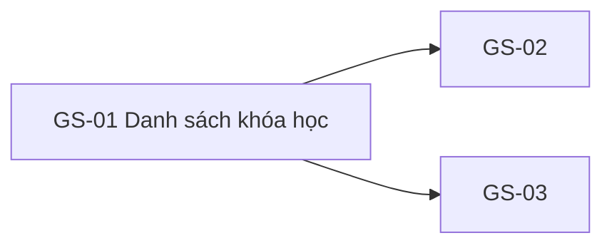

# GS-01 — Navigation

## 1. Route definition
- Current route in inventory: `/courses`
- Status: candidate/design route; Study Web `UNWIRED` unless source code proves otherwise.
- Route params/types: Không có route param được biểu diễn trong inventory string; route runtime vẫn chưa xác minh.
- Query params/defaults: preserve the inventory route string; detailed parsing rules only from source DD.
- Route guards: see source DD/API contract; do not create role policy.

## 2. Điểm vào
| From screen/route | Trigger | Params | Guard / fallback |
|---|---|---|---|
| [SH-01](../SH-01-TrangGioiThieuStudyVariant1/00-overview.md), [SH-06](../SH-06-TrangKhongTonTaiTaiNguyenKhongCon/00-overview.md), [GS-02](../GS-02-TimKiemKhoaHoc/00-overview.md) | Theo DD nguồn/inventory | Theo source; không suy diễn | Xem source DD; route chưa xác nhận runtime |

## 3. Điểm ra
| Destination | Trigger | Params | Điều kiện |
|---|---|---|---|
| [GS-02](../GS-02-TimKiemKhoaHoc/00-overview.md), [GS-03](../GS-03-ChiTietKhoaHoc/00-overview.md) | Source event/inventory navigation | Theo source DD | Expected links; runtime chưa verify |

## 4. Back / refresh / deep link
- Back behavior: xem source DD; không mặc định browser history.
- Preserve filters/scroll/form state: chỉ nếu source có nêu, nếu không `CẦN_XÁC_NHẬN`.
- Refresh/direct URL: route trong inventory không chứng minh runtime.
- Invalid/missing ID: theo source DD/backend contract; không tự tạo validation.
- Not authenticated/authorized: theo source role guard; xem [Business Rules](05-business-rules.md).

## 5. Diagram

## Source navigation and flow detail

### Trích từ DD nguồn: 6. Điều hướng và liên kết hệ thống

| Nguồn → đích | Dữ liệu truyền | Điều kiện / trạng thái |
|---|---|---|
| SH-01 → GS-01 | Không có dữ liệu bắt buộc được chỉ định. | Link inventory; route `/courses` vẫn chưa có trong frontend runtime. |
| GS-01 → GS-02 | `q` dự kiến từ search input; chính xác query/trim/encoding chưa được chốt. | Không bật handoff trước khi Product duyệt empty query, normalization, Enter/click và URL sync. API #07 thuộc GS-02. |
| GS-01 → GS-03 | `course.id` từ #06 response. | Chỉ sau khi có card layout và route đã được phê duyệt/wired. #08 downstream chỉ trả course PUBLISHED. |
| GS-01 → SH-02 / SH-03 | Không có payload nghiệp vụ. | Header/footer route proposal `/login` và `/register`; current anchors không điều hướng. |
| GS-01 → SH-01 | Không có payload nghiệp vụ. | Footer proposal `/`; không runtime proof. |

Browser Back, deep-link handling, URL restoration of page/sort, scroll restore, auth return route, token/session persistence và 404 handling không thể được xác định từ source hiện tại.

### Trích từ DD nguồn: 2. Luồng màn hình tổng thể

1. **Vào route đề xuất `/courses`.** Public Guest flow theo inventory/AC-03. Router chưa tồn tại trong checkout; không có current URL parsing, auth guard hoặc navigation history để đặc tả như chức năng đã chạy.
2. **Khởi tạo metadata danh mục.** Expected F02: xử lý #05 cache-first theo locale. Nếu client không gửi `locale`, server hiện mặc định `vi-VN`; locale được truyền được lọc chính xác, không tự chuẩn hóa. Cache key, TTL, invalidation, stale fallback và việc phải gọi mạng khi cache hit đều chưa có source.
3. **Khởi tạo catalog.** Expected: gọi #06 với `page=1&size=20`, không có `category`. Mặc định server cũng là page 1/size 20. `sort` không có mặc định ở client; khi bỏ trống server dùng `created_at DESC, id ASC`. Chính sách chạy #06 nếu #05 lỗi chưa được quyết định.
4. **Phân tích response.** Với API success, kiểm tra envelope và map `data.items` cùng `data.pagination`. Metadata count là tổng số row PUBLISHED; API không đưa currency, rating, duration, lesson count hoặc category vào model `Course` hiện tại. Quy tắc visual mapping/card chưa được duyệt.
5. **Chọn state.** Inventory nêu `loading`, `empty`, `ready`, `query-error`. Chỉ `items=[]` và `pagination.total=0` xác nhận catalog rỗng. `items=[]` với `total>0` có thể là page ngoài phạm vi; API hiện trả HTTP 200 và không chỉ dẫn UI recovery. Không ánh xạ lỗi mạng/HTTP thành empty.
6. **Tương tác.** Search input có mặt trong ảnh nhưng contract submit/handoff chưa rõ. Sort, paging, count và course card chỉ là requirement, không có element trên ảnh/DOM. Nếu sau này được duyệt, sort/paging gọi lại #06; card dùng `course.id` để mở GS-03. Không gửi category.
7. **Rời màn hình.** GS-02, GS-03, SH-01, SH-02, SH-03 và footer targets là route proposal. Không coi `data-path` hoặc `href="#"` trong HTML là navigation thật.
