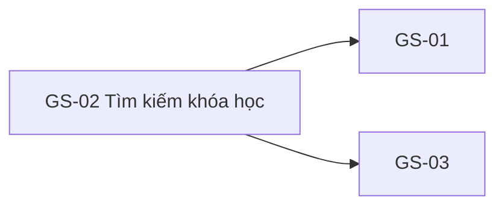

# GS-02 — Navigation

## 1. Route definition
- Current route in inventory: `/courses/search?q=`
- Status: candidate/design route; Study Web `UNWIRED` unless source code proves otherwise.
- Route params/types: Không có route param được biểu diễn trong inventory string; route runtime vẫn chưa xác minh.
- Query params/defaults: preserve the inventory route string; detailed parsing rules only from source DD.
- Route guards: see source DD/API contract; do not create role policy.

## 2. Điểm vào
| From screen/route | Trigger | Params | Guard / fallback |
|---|---|---|---|
| [GS-01](../GS-01-DanhSachKhoaHoc/00-overview.md) | Theo DD nguồn/inventory | Theo source; không suy diễn | Xem source DD; route chưa xác nhận runtime |

## 3. Điểm ra
| Destination | Trigger | Params | Điều kiện |
|---|---|---|---|
| [GS-01](../GS-01-DanhSachKhoaHoc/00-overview.md), [GS-03](../GS-03-ChiTietKhoaHoc/00-overview.md) | Source event/inventory navigation | Theo source DD | Expected links; runtime chưa verify |

## 4. Back / refresh / deep link
- Back behavior: xem source DD; không mặc định browser history.
- Preserve filters/scroll/form state: chỉ nếu source có nêu, nếu không `CẦN_XÁC_NHẬN`.
- Refresh/direct URL: route trong inventory không chứng minh runtime.
- Invalid/missing ID: theo source DD/backend contract; không tự tạo validation.
- Not authenticated/authorized: theo source role guard; xem [Business Rules](05-business-rules.md).

## 5. Diagram

## Source navigation and flow detail

### Trích từ DD nguồn: 7. Điều hướng, bảo mật và trải nghiệm

- **Screen flow:** GS-01 → GS-02 theo F02; GS-02 → GS-01 (quay lại danh sách) hoặc GS-03 khi mở course item. course.id là payload duy nhất đã được xác nhận từ #07 cho handoff. Các đường về/back-stack và URL preservation chưa được triển khai.
- **Public data:** #05/#07 là public endpoints. #07 giới hạn kết quả ở course PUBLISHED. Không thêm Bearer/session requirement vào API này từ screenshot account controls.
- **Data integrity:** dùng id và field từ response; không suy ra metadata chưa trả về. price là decimal string; currency formatting chưa có currency field trong response.
- **Input/query:** server dùng parameter binding; % và _ được giữ theo ngữ nghĩa LIKE hiện có do source không escape. Không thêm max length, client-side validation hay escaping policy không có trong contract.
- **Accessibility:** khi triển khai, input/select/checkbox/radio/button cần label và keyboard semantics tương ứng; trạng thái loading/error cần được công bố phù hợp. Source hiện tại không đủ để xác nhận WCAG/runtime implementation.
- **Responsive/design system:** annotation giữ nguyên bố cục nguồn. Responsive behavior và token mapping cần đối chiếu với [Study web design guide](../../../../../.agents/web-study/design.md); không tuyên bố prototype này phù hợp guide khi source đang lệch.
- **Runtime:** không có Study Web source/package/router/entrypoint. Chưa xác minh fetch, URL sync, debounce, cache, navigation, auth shell, responsive behavior hoặc accessibility khi chạy.

### Trích từ DD nguồn: 2. Luồng tổng thể

1. Người dùng mở route proposal /courses/search hoặc quay từ GS-01. Client hiện chưa có router để thực thi route này.
2. Client đọc q từ URL nếu có. Quy tắc trim/lowercase ở UI theo F02 là expected behavior; API cũng trim/lowercase độc lập. Cách giữ nguyên văn bản gõ để hiển thị cần quyết định.
3. Nếu q rỗng, chưa gọi API #07 cho đến khi Product xác nhận hiển thị prompt hay browse toàn bộ. Đây là điểm quan trọng vì #07 với q rỗng bỏ điều kiện tên khóa học và trả tất cả course PUBLISHED.
4. **Thứ tự API cần xác nhận:** inventory F02 nói #05 cache-first và cho phép #07 chạy song song nếu độc lập; AC-04 diagram lại nối #05 trước #07, và API #05 DD ghi cache hit thì bỏ request. #07 không phụ thuộc response #05 khi không gửi category, nhưng không có Study Web source để xác nhận thứ tự, cache hit/miss, TTL, invalidation, fallback hoặc partial-load. Không mô tả một phương án là runtime hiện hành.
5. Khi gọi #07, client gửi q đã chuẩn hóa cùng page/sort được hỗ trợ. Không gửi category: #07 trả 422 với category khác null; không gửi tham số skill, duration, rating, tuition hoặc size vì source không hỗ trợ chúng.
6. Client kiểm tra HTTP status, business code, envelope và pagination. HTTP 200 với items=[] là kết quả hợp lệ; nếu total=0 thì không có kết quả. Nếu total>0 nhưng trang hiện tại rỗng, đây là trang ngoài phạm vi chứ không phải danh mục rỗng.
7. Dữ liệu card chỉ được ánh xạ từ response #07. Không tự điền rating, tag, duration, currency, giảm giá hoặc giá cũ từ mockup.
8. Khi người dùng chọn một kết quả, route GS-03 dự kiến nhận course.id từ item. Không lấy ID từ nội dung mockup; ảnh mẫu không ánh xạ được với dữ liệu API.
9. Mọi lỗi mạng, lỗi API, lỗi danh mục và policy partial-load cần được thể hiện tách biệt. Copy, retry và khả năng tiếp tục khi #05 lỗi chưa được xác định.
