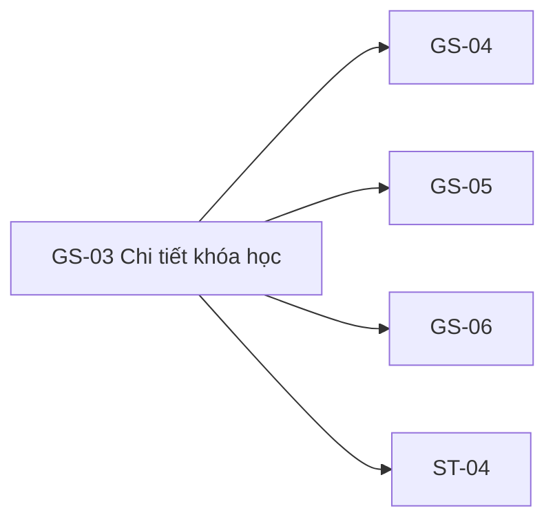

# GS-03 — Navigation

## 1. Route definition
- Current route in inventory: `/courses/:courseId`
- Status: candidate/design route; Study Web `UNWIRED` unless source code proves otherwise.
- Route params/types: `courseId` (type/validation: see source DD; CẦN_XÁC_NHẬN if absent)
- Query params/defaults: preserve the inventory route string; detailed parsing rules only from source DD.
- Route guards: see source DD/API contract; do not create role policy.

## 2. Điểm vào
| From screen/route | Trigger | Params | Guard / fallback |
|---|---|---|---|
| [GS-01](../GS-01-DanhSachKhoaHoc/00-overview.md), [GS-02](../GS-02-TimKiemKhoaHoc/00-overview.md), [GS-04](../GS-04-DeCuongKhoaHoc/00-overview.md), [GS-05](../GS-05-DanhGiaVaThaoLuanCongKhai/00-overview.md), [GS-06](../GS-06-TaiNguyenKhoaHoc/00-overview.md) | Theo DD nguồn/inventory | Theo source; không suy diễn | Xem source DD; route chưa xác nhận runtime |

## 3. Điểm ra
| Destination | Trigger | Params | Điều kiện |
|---|---|---|---|
| [GS-04](../GS-04-DeCuongKhoaHoc/00-overview.md), [GS-05](../GS-05-DanhGiaVaThaoLuanCongKhai/00-overview.md), [GS-06](../GS-06-TaiNguyenKhoaHoc/00-overview.md), [ST-04](../ST-04-KiemTraGhiDanhTruocDangKy/00-overview.md) | Source event/inventory navigation | Theo source DD | Expected links; runtime chưa verify |

## 4. Back / refresh / deep link
- Back behavior: xem source DD; không mặc định browser history.
- Preserve filters/scroll/form state: chỉ nếu source có nêu, nếu không `CẦN_XÁC_NHẬN`.
- Refresh/direct URL: route trong inventory không chứng minh runtime.
- Invalid/missing ID: theo source DD/backend contract; không tự tạo validation.
- Not authenticated/authorized: theo source role guard; xem [Business Rules](05-business-rules.md).

## 5. Diagram

## Source navigation and flow detail

### Trích từ DD nguồn: F. Ma trận trạng thái và điều hướng

| State | Trigger/guard | UI hiện có? | Expected output / transition |
|---|---|---:|---|
| Static unavailable | Browser mở `code.html`; đây là state duy nhất có trong tài sản | Có | Tab Tổng quan active, curriculum/reviews disabled, unavailable copy và return link. Không phản ánh API response cụ thể. |
| Initial/loading | Mở route `/courses/:courseId` và chờ #08 | Không | Inventory yêu cầu loading; cần thiết kế skeleton/feedback và request lifecycle. |
| Detail ready | #08 trả 200 PUBLISHED | Không | Cần bổ sung layout course/mentor/price; không có hình source. Từ đây quyết định tab calls theo orchestration được duyệt. |
| Course not found | #08 trả 404 | Không | Inventory gọi course-404; AC-05 còn nêu 403 nhưng current #08 dùng 404 cho invalid/missing/unpublished. Error page/content chưa chốt. |
| Detail service/network error | #08 trả 500 hoặc network failure | Không | Cần UI state, retry/timeout policy; không có behavior source. |
| Curriculum loading/ready | User chọn tab sau khi detail public, nếu lazy flow được duyệt | Không; tab disabled | #09 items map theo `order`. Không thể suy ra khả năng mở lesson. |
| Curriculum empty | #09 trả 200, `items=[]`, total=0 | Không | Tách empty curriculum khỏi failure; visual copy/action chưa có source. |
| Curriculum error | #09 404/500 | Không | Phân biệt stale course 404 và service error; UI fallback chưa được thiết kế. |
| Reviews loading/ready/empty/error | Chỉ sau khi API #10 được wired/contract xong | Không; tab disabled | Hiện không thể tải, dựng review card, rating average hoặc rating filter. |
| Enrollment handoff | Sau khi CTA/auth/identity policy được duyệt | Không | ST-04 route đề xuất `/student/enroll/:courseId`; enrollment status #15 đang G-01 blocked. |

### Điều hướng và giữ dữ liệu

- GS-01/GS-02 → GS-03: giữ `courseId` làm path segment; nguồn hiện tại không chứng minh card route/parameter mapping ở runtime.
- GS-03 → GS-04/GS-05: `list_screen.md` đề xuất query `?tab=curriculum`/`?tab=reviews`; AC-05 và F02 khác về thời điểm gọi API. Chưa có URL sync/handler trong HTML.
- GS-03 → GS-06: tab tài nguyên liên quan theo inventory/AC-06, không có tab resources trong source HTML GS-03 hiện tại; không thêm marker hoặc event cho đến khi thiết kế được xác nhận.
- GS-03 → ST-04: inventory đề xuất CTA enrollment và route ST-04 `/student/enroll/:courseId`; guest/auth transfer, return route, token behavior và #15 identity chưa chốt. Không khẳng định tự login/redirect.
- Header/footer links: href literals liệt kê ở `GS03-EV-05`; actual route resolution chưa được kiểm chứng.

### Trích từ DD nguồn: B. Luồng hoạt động tổng thể

### Luồng expected — chưa được UI runtime triển khai

1. User mở route đề xuất `/courses/:courseId` từ card/list ở GS-01 hoặc GS-02. Giá trị `courseId` phải giữ nguyên khi điều hướng sang detail và các tab liên quan.
2. Client cần đọc, parse và kiểm tra path value. API #08 source hiện nhận raw string; shared `parse_integer` kiểm tra cú pháp integer, nhưng không enforce signed int64 hay positive range. `parse_integer` thất bại thì trả 404; giá trị vượt int64 có thể đi tới truy vấn DB và đường lỗi cần được xác nhận trước khi triển khai. Contract `course_id:int64` và validator hiện hành chưa thống nhất.
3. Khi #08 được gọi, endpoint là public, GET không có body và không cần Bearer token. Current backend query chỉ chọn course `PUBLISHED` và LEFT JOIN summary mentor.
4. Với 200, client phải kiểm tra envelope, `businessCode = DESIGN_RESOURCE_RETRIEVED`, rồi đọc đúng phần tử duy nhất `data.items[0]`. Không lấy course từ một object `data` trực tiếp; source trả `CoursePage` với pagination singleton. API source không định nghĩa currency, rating, category, duration, tag hoặc old price.
5. Chỉ sau khi course đã được xác nhận public mới được tải tab data. Inventory F02 quy định #09/#10 lazy theo lần chọn tab. AC-05 mô tả cả ba GET tuần tự ngay trên page load; Product/BE phải xác nhận thứ tự trước khi implementation. DD chưa khẳng định orchestration đã được chốt.
6. Tab curriculum dùng #09 current source; response rỗng là success riêng, không phải lỗi. Tab reviews chưa thể gọi #10 vì endpoint chưa được nối và contract thiếu nguồn title/rating.
7. CTA ghi danh chưa tồn tại trong source HTML. Inventory chỉ liên kết ST-04. Guest/auth handoff và API #15 identity conflict phải được giải quyết trước khi xác định action thực tế; không hiển thị trạng thái đã ghi danh hoặc thành công dựa trên giá.
8. User có thể dùng các anchor static về `/`, `/courses`, `/login`, `/register`; HTML không chứng minh các URL này được Study Web router phục vụ.

### Luồng hiện tại có thể quan sát

`code.html` là document tĩnh. Khi browser mở file, nó trình bày nav, breadcrumb, H1, tab “Tổng quan” active, hai tab bị disable, thông báo unavailable và link quay lại `/courses`; không thực hiện bước lấy path, authentication, API, state update hay điều hướng JS. Browser render tạo ở phiên này chỉ xác minh HTML/CSS render được, không xác minh ứng dụng Study chạy.
