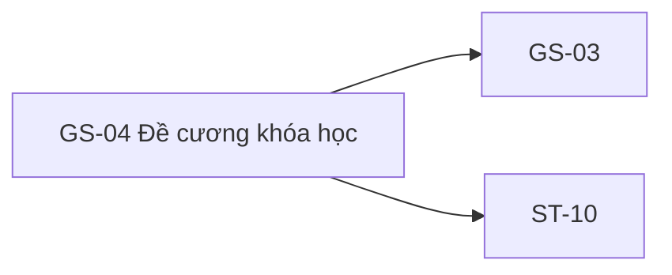

# GS-04 — Navigation

## 1. Route definition
- Current route in inventory: `/courses/:courseId?tab=curriculum`
- Status: candidate/design route; Study Web `UNWIRED` unless source code proves otherwise.
- Route params/types: `courseId` (type/validation: see source DD; CẦN_XÁC_NHẬN if absent)
- Query params/defaults: preserve the inventory route string; detailed parsing rules only from source DD.
- Route guards: see source DD/API contract; do not create role policy.

## 2. Điểm vào
| From screen/route | Trigger | Params | Guard / fallback |
|---|---|---|---|
| [GS-03](../GS-03-ChiTietKhoaHoc/00-overview.md) | Theo DD nguồn/inventory | Theo source; không suy diễn | Xem source DD; route chưa xác nhận runtime |

## 3. Điểm ra
| Destination | Trigger | Params | Điều kiện |
|---|---|---|---|
| [GS-03](../GS-03-ChiTietKhoaHoc/00-overview.md), [ST-10](../ST-10-KiemTraQuyenVaBatDauHoc/00-overview.md) | Source event/inventory navigation | Theo source DD | Expected links; runtime chưa verify |

## 4. Back / refresh / deep link
- Back behavior: xem source DD; không mặc định browser history.
- Preserve filters/scroll/form state: chỉ nếu source có nêu, nếu không `CẦN_XÁC_NHẬN`.
- Refresh/direct URL: route trong inventory không chứng minh runtime.
- Invalid/missing ID: theo source DD/backend contract; không tự tạo validation.
- Not authenticated/authorized: theo source role guard; xem [Business Rules](05-business-rules.md).

## 5. Diagram

## Source navigation and flow detail

### Trích từ DD nguồn: G. State và điều hướng

| State | Trigger / guard | Có trong HTML? | Expected handling |
|---|---|---:|---|
| Static empty-like | Mở `code.html` | Có | Chỉ là copy tĩnh; không chứng minh #09 response rỗng. |
| Initial/loading | Mở route và chờ prerequisite #08/cache + #09 theo orchestration được chốt | Không | Cần thiết kế loading/progress và chống stale response; chưa định nghĩa cache-miss. |
| Ready | #09 200, items > 0 | Không | Loaded lesson list design và field/access policy còn thiếu. |
| Empty | #09 200, items = 0 | Chưa xác nhận là API-linked | Tách rỗng khỏi lỗi; có thể tham khảo card tĩnh nhưng cần binding/copy approval. |
| Not found | #09 404 | Không | Resource/ID invalid hoặc course không public theo current source. Recovery/destination chưa chốt. |
| Service/network error | #09 500 hoặc transport error | Không | Cần error design; retry/timeout policy chưa có nguồn. |
| Access denied lesson | Không có Guest endpoint/state được xác minh | Không | Không tự tạo 403, preview action hoặc Student permission handoff. Private lesson không mở từ Guest. |

### Route/orchestration handoff

- GS-03 → GS-04: giữ `courseId`; inventory ghi reuse #08 cache, nhưng key/freshness/miss policy vắng mặt.
- Tab policy: F02 lazy-by-tab, AC-05 eager sequence; GS-04 inventory yêu cầu cache reuse rồi #09. Product/BE cần xác nhận source of truth và direct-entry behavior.
- GS-04 → GS-03: intended same-course route; current href `#` không chứa ID.
- GS-04 → ST-10: không phải Guest navigation. Chỉ Student flow được inventory nêu qua #22 lesson access → #23 start → #24 content.

### Trích từ DD nguồn: C. Luồng màn hình

### C.1 Expected flow — chưa được triển khai trong Study Web

1. Từ GS-03, mở route đề xuất `/courses/:courseId?tab=curriculum`, giữ nguyên `courseId`. Route direct-entry cũng cần có behavior, nhưng inventory chưa quy định cách lấy course detail khi không có cache.
2. Inventory yêu cầu reuse #08 từ cache rồi gọi #09. Chưa có cache key, freshness, invalidation, cache-miss, stale course hoặc refetch policy. AC-05 gọi #09 eager cùng #08/#10; F02 gọi #09 khi user chọn tab. Giữ cả hai nguồn như discrepancy, không tự chọn thứ tự. Contract khai báo `course_id:int64`, nhưng current route nhận `str` và parser không enforce signed int64/positive range.
3. #09 hiện là public GET không auth/body/query. Backend kiểm tra course PUBLISHED, sau đó trả danh sách lesson PUBLISHED theo `sort_order ASC, id ASC`. Client đọc common envelope và `data.items`.
4. Với 200 có items, về mặt API dữ liệu có thể map theo `order`. Tuy nhiên không hiển thị/play `content` hay `video_url` cho Guest và không thêm preview badge/CTA cho tới khi Product/BE xác nhận public projection và access policy. Current response không có cờ để quyết định quyền xem.
5. Với 200 rỗng (`items=[]`), hiển thị empty state riêng sau khi có thiết kế/approved copy. Card tĩnh hiện có thể dùng làm tham khảo trực quan nhưng không chứng minh API empty response đã xảy ra.
6. Với 404/500 từ #09, phân biệt resource không tồn tại/không public với lỗi server theo backend source. Network timeout/retry, lỗi cache và stale-response handling chưa có contract; không thêm behavior giả định.
7. Nếu một ngày có bài preview, Guest open/media behavior cần một contract được duyệt riêng. F04 nói public curriculum không phải permission-based learning tree; ST-10 dùng #22 lesson access → nếu cho phép thì #23 start → #24 content. Đây là Student flow, không được tái sử dụng như Guest flow.

### C.2 Current behavior có thể xác nhận

`code.html` là document tĩnh. Nó hiển thị header, breadcrumb, heading, card rỗng, link quay lại có `href="#"`, footer. Không có JavaScript, router, route parameter, API, event handler, list item, loading/error state hay data binding. Đích của các anchor trong header/footer chỉ là literal href; browser render không chứng minh các route tồn tại. Study Web app source/router/entrypoint hiện `UNWIRED`.
