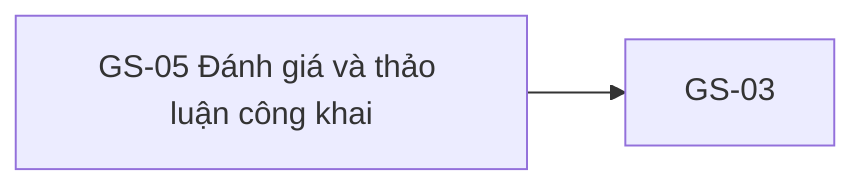

# GS-05 — Navigation

## 1. Route definition
- Current route in inventory: `/courses/:courseId?tab=reviews`
- Status: candidate/design route; Study Web `UNWIRED` unless source code proves otherwise.
- Route params/types: `courseId` (type/validation: see source DD; CẦN_XÁC_NHẬN if absent)
- Query params/defaults: preserve the inventory route string; detailed parsing rules only from source DD.
- Route guards: see source DD/API contract; do not create role policy.

## 2. Điểm vào
| From screen/route | Trigger | Params | Guard / fallback |
|---|---|---|---|
| [GS-03](../GS-03-ChiTietKhoaHoc/00-overview.md) | Theo DD nguồn/inventory | Theo source; không suy diễn | Xem source DD; route chưa xác nhận runtime |

## 3. Điểm ra
| Destination | Trigger | Params | Điều kiện |
|---|---|---|---|
| [GS-03](../GS-03-ChiTietKhoaHoc/00-overview.md) | Source event/inventory navigation | Theo source DD | Expected links; runtime chưa verify |

## 4. Back / refresh / deep link
- Back behavior: xem source DD; không mặc định browser history.
- Preserve filters/scroll/form state: chỉ nếu source có nêu, nếu không `CẦN_XÁC_NHẬN`.
- Refresh/direct URL: route trong inventory không chứng minh runtime.
- Invalid/missing ID: theo source DD/backend contract; không tự tạo validation.
- Not authenticated/authorized: theo source role guard; xem [Business Rules](05-business-rules.md).

## 5. Diagram

## Source navigation and flow detail

### Trích từ DD nguồn: G. State và điều hướng

| State | Trigger/guard | Current HTML? | Expected output/transition |
|---|---|---:|---|
| Static empty-like | Browser opens `code.html` | Có | Copy tĩnh; không xác nhận response rỗng. |
| Initial/loading | Route proposal opened; resolve course/cache and #10 timing | Không | Loading design and cache/direct-entry behavior needed. |
| Ready | #10 expected 200 with non-empty items | Không | Review/reply card mapping blocked by title/visibility/API source gaps and missing visual design. |
| Empty | #10 expected 200 with `items=[]` | Not API-bound | Show empty state separately from errors; existing text can be a copy reference only. |
| Course not found | #08 current 404 or #10 Draft Q1 404 | Không | Distinguish missing/unpublished course from empty list; course error presentation not designed. |
| Service error | #10 expected 500 or network error | Không | Error UX/retry/timeout policy unresolved; do not convert 500 to 404. |
| Paginated page | User selects another page | Không | Draft page metadata only; page bounds/out-of-range and URL/cache policy unresolved. |

### Navigation and data handoff

- GS-03 → GS-05: preserve same `courseId`; tab route proposal is `/courses/:courseId?tab=reviews`. F02 says lazy by tab. AC-05 eagerly sequences #08/#09/#10 before rendering; unresolved.
- GS-05 → GS-03: preserve `courseId`; current breadcrumb and CTA use `href="#"` only.
- Header/footer destinations are all `#`; no route or authentication/session behavior is verified.
- GS-05 does not write reviews/replies and does not open a separate discussion screen under the current inventory/source evidence.

### Trích từ DD nguồn: C. Luồng màn hình

### C.1 Expected flow — cần contract/UI wiring

1. Guest mở tab từ GS-03 với cùng `courseId` và route đề xuất `/courses/:courseId?tab=reviews`. Direct-entry không có GS-03/cache chưa có behavior được duyệt.
2. Inventory GS-05 yêu cầu reuse #08. Cache key, freshness, invalidation, cache miss, stale course và fallback #08 chưa được định nghĩa. #08 current source có thể xác nhận course PUBLISHED nếu request được thực hiện; không suy ra client sẽ tự gọi lại khi cache vắng.
3. Khi lấy reviews, F02 kỳ vọng lazy GET #10 khi chọn tab. AC-05 diagram mô tả #08 → #09 → #10 eager trước render; giữ hai yêu cầu như discrepancy, không tự chọn một luồng.
4. API #10 hiện chỉ là declared contract. Nếu được nối theo contract đã duyệt, request là public GET với `course_id` và `page` tùy chọn. `rating filter` có tên physical/semantics chưa xác nhận; không gửi query filter và không dựng rating UI từ thông tin hiện có.
5. Success 200 non-empty được kỳ vọng map review roots, authors và replies. Nhưng `title` là required trong Draft response mà thiếu data source; visibility `status='ACTIVE'` và parent/reply mapping là assumptions. Loaded card projection/design cần chốt trước implement.
6. Success 200 empty phải hiện empty state riêng, không biến thành course 404 hoặc API error. Copy hiện tại không gắn với response.
7. Course missing/unpublished 404 cần phân biệt với empty reviews. #10 Draft DD dự kiến tự gate PUBLISHED course; #08 current source cũng trả 404. No 403 contract is declared for #10.
8. Review data là read-only trên GS-05. Không thêm create/reply/report/reaction action; không có API/action source trong screen contract này.

### C.2 Current behavior có thể xác nhận

`code.html` tĩnh render thành guest-facing header, breadcrumb, một empty review card, link quay lại và footer. Không có route parsing, state, review request, pagination control, click handler hoặc data binding. Mọi `href` trong HTML là `#`. `apps/study-client/dist/` có JS/CSS build output, nhưng string inspection không thấy `/courses` route hoặc `/api/v1` endpoint. Build output không cung cấp source-level GS-05 wiring evidence; Study Web subcontext vẫn `UNWIRED`. Browser render chỉ chứng minh document/CSS render được.
