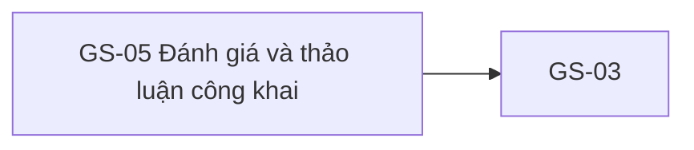

# GS-05 — Navigation

## 1. Route definition
- Current route in inventory: `/courses/:courseId?tab=reviews`
- Status: current GS03 route/query tab source-wired; GS05 is mounted as a child panel, not a separate route.
- Route params/types: `courseId` (type/validation: see source DD; CẦN_XÁC_NHẬN if absent)
- Query params/defaults: GS03 maps `tab=reviews`; missing/other values default to overview. GS05 page starts at 1 and keeps later page selection local, not in the URL.
- Route guards: see source DD/API contract; do not create role policy.

## 2. Điểm vào
| From screen/route | Trigger | Params | Guard / fallback |
|---|---|---|---|
| [GS-03](../GS-03-ChiTietKhoaHoc/00-overview.md) | Theo DD nguồn/inventory | Theo source; không suy diễn | Xem source DD; route chưa xác nhận runtime |

## 3. Điểm ra
| Destination | Trigger | Params | Điều kiện |
|---|---|---|---|
| [GS-03](../GS-03-ChiTietKhoaHoc/00-overview.md) | Source event/inventory navigation | Theo source DD | Expected links; runtime chưa verify |

## 4. Back / refresh / deep link
- Back behavior: xem source DD; không mặc định browser history.
- Preserve filters/scroll/form state: chỉ nếu source có nêu, nếu không `CẦN_XÁC_NHẬN`.
- Refresh/direct URL: GS03 loads #08 first; after a published course is ready, GS05 requests #10. T021 verifies local routing with a stub, not live deployment.
- Invalid/missing ID: GS03 #08 response controls course not-found; GS05 maps #10 HTTP 404 to not-found. No new client ID validation is added.
- Not authenticated/authorized: theo source role guard; xem [Business Rules](05-business-rules.md).

## 5. Diagram

## Source navigation and flow detail

### Trích từ DD nguồn: G. State và điều hướng

| State | Current Angular implementation | Verification/source boundary |
|---|---|---:|---|
| Loading | GS05 starts page request and displays a polite busy state. | GS05 component; Angular tests |
| Ready | Response items map to root/reply author names and content. | GS05 component; Angular tests and local stub browser render |
| Empty | Empty `items` maps to a response-bound empty state. | GS05 component; Angular test |
| Course/reviews not found | HTTP 404 maps to not-found. | GS03/GS05 components; Angular tests |
| Service error | Other HTTP/transport error maps to a safe alert; no retry control. | GS05 component; Angular test |
| Paginated page | Previous/next use response `page/total_pages`; selected page is local. | GS05 component; Angular test |

### Navigation and data handoff

- GS-03 → GS-05: current tab route is `/courses/:courseId?tab=reviews`; GS03 preserves the same string `courseId` and loads GS05 lazily after #08 success. AC-05 eager #08/#09/#10 + aggregate differs from F02 and current source; discrepancy remains.
- GS05 is embedded within GS03; there is no separate return route/CTA from the review panel. Changing tabs remains within the same course route.
- The original Stitch HTML header/footer use `#`; current Angular uses `GuestSiteLayout`. GS05 does not add authentication/session behavior.
- GS-05 does not write reviews/replies and does not open a separate discussion screen under the current inventory/source evidence.

### Trích từ DD nguồn: C. Luồng màn hình

### C.1 Expected flow — cần contract/UI wiring

1. Guest mở tab từ GS-03 với cùng `courseId` và route đề xuất `/courses/:courseId?tab=reviews`. Direct-entry không có GS-03/cache chưa có behavior được duyệt.
2. Inventory GS-05 yêu cầu reuse #08. Cache key, freshness, invalidation, cache miss, stale course và fallback #08 chưa được định nghĩa. #08 current source có thể xác nhận course PUBLISHED nếu request được thực hiện; không suy ra client sẽ tự gọi lại khi cache vắng.
3. Khi lấy reviews, F02 kỳ vọng lazy GET #10 khi chọn tab. AC-05 diagram mô tả #08 → #09 → #10 eager trước render; giữ hai yêu cầu như discrepancy, không tự chọn một luồng.
4. API #10 hiện chỉ là declared contract. Nếu được nối theo contract đã duyệt, request là public GET với `course_id` và `page` tùy chọn. `rating filter` có tên physical/semantics chưa xác nhận; không gửi query filter và không dựng rating UI từ thông tin hiện có.
5. Success 200 non-empty được kỳ vọng map review roots, authors và replies. Nhưng `title` là required trong Draft response mà thiếu data source; visibility `status='ACTIVE'` và parent/reply mapping là assumptions. Loaded card projection/design cần chốt trước implement.
6. Success 200 empty phải hiện empty state riêng, không biến thành course 404 hoặc API error. Copy hiện tại không gắn với response.
7. Course missing/unpublished 404 cần phân biệt với empty reviews. #10 Draft DD dự kiến tự gate PUBLISHED course; #08 current source cũng trả 404. No 403 contract is declared for #10.
8. Review data là read-only trên GS-05. Không thêm create/reply/report/reaction action; không có API/action source trong screen contract này.

### C.2 Current behavior có thể xác nhận (T021, 2026-11-17)

The current Angular route is GS03 `/courses/:courseId`; the reviews query tab becomes selected for `?tab=reviews`. #08 resolves before GS05 mounts. GS05 calls source-backed #10 with `page` only; page transitions use response metadata. A temporary in-memory local API stub was used for the desktop/mobile Chrome render because backend port 3003 was not running. Live API, live DB and deployment remain unverified. The Stitch `code.html` and images remain unchanged and describe a static prototype.
