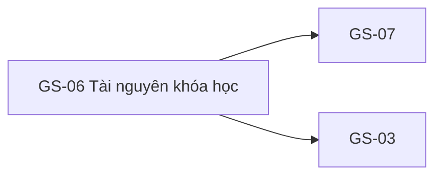

# GS-06 — Navigation

## 1. Route definition
- Current route in inventory: `/courses/:courseId?tab=resources`
- Status: candidate/design route; Study Web `UNWIRED` unless source code proves otherwise.
- Route params/types: `courseId` (type/validation: see source DD; CẦN_XÁC_NHẬN if absent)
- Query params/defaults: preserve the inventory route string; detailed parsing rules only from source DD.
- Route guards: see source DD/API contract; do not create role policy.

## 2. Điểm vào
| From screen/route | Trigger | Params | Guard / fallback |
|---|---|---|---|
| [GS-03](../GS-03-ChiTietKhoaHoc/00-overview.md), [GS-07](../GS-07-XemTaiTaiNguyen/00-overview.md) | Theo DD nguồn/inventory | Theo source; không suy diễn | Xem source DD; route chưa xác nhận runtime |

## 3. Điểm ra
| Destination | Trigger | Params | Điều kiện |
|---|---|---|---|
| [GS-07](../GS-07-XemTaiTaiNguyen/00-overview.md), [GS-03](../GS-03-ChiTietKhoaHoc/00-overview.md) | Source event/inventory navigation | Theo source DD | Expected links; runtime chưa verify |

## 4. Back / refresh / deep link
- Back behavior: xem source DD; không mặc định browser history.
- Preserve filters/scroll/form state: chỉ nếu source có nêu, nếu không `CẦN_XÁC_NHẬN`.
- Refresh/direct URL: route trong inventory không chứng minh runtime.
- Invalid/missing ID: theo source DD/backend contract; không tự tạo validation.
- Not authenticated/authorized: theo source role guard; xem [Business Rules](05-business-rules.md).

## 5. Diagram

## Source navigation and flow detail

### Trích từ DD nguồn: E. Ma trận trạng thái và điều hướng

| State | Điều kiện vào | Hiển thị/behavior | Trạng thái bằng chứng |
|---|---|---|---|
| `prototype-gated` | HTML/PNG hiện tại được mở | Gated headline, disabled download, API reference và state inventory. | **Current static asset**; không phải server response. |
| `loading` | #11 được gọi khi route/tab active. | Loading skeleton/spinner chưa có trong asset; nội dung/timeout chưa được thiết kế. | Expected implementation state; Study Web/API #11 chưa wired. |
| `contract-blocked` | API #11 không runnable hoặc trả shape không khớp collection consumer. | Không render resource giả; thông báo integration/unavailable cần copy được duyệt. Không map sang empty. | Current integration blocker; error code/display chưa có contract. |
| `empty` | Chỉ khi API đã duyệt trả collection thành công với zero items. | Empty message và action chưa được chốt; prototype gated copy không đủ để phân biệt rỗng thật. | Future state; không thể xác nhận bằng `ApiEnvelope<Resource>` singleton. |
| `list-ready` | API #11 trả collection schema đã duyệt. | Render từng item bằng fields có nguồn; chọn item → EV-02. Type grouping, order, paging, duplicate IDs chưa có contract. | Future state; data model/UI chưa hoàn thiện. |
| `resource-loading` | User chọn item và EV-03 gọi #12. | Progress state chưa có asset. | Future state; #12 source exists, UI not wired. |
| `resource-ready` | #12 200 và access policy/URL semantics đã xác nhận. | Handoff/open selected resource; destination GS-07 với `resourceId`. | #12 current source returns direct URL, nhưng AC-06 security requirement chưa được đáp ứng/approved. |
| `not-found-or-not-public` | #11/#12 404 theo catalog/source, gồm resource thiếu và parent lesson/course không đạt gate của current #12. | Không tự phân biệt các trường hợp cùng 404 hoặc tự điều hướng tới SH-06; destination/copy cần contract. | Status source-backed for #12; exact client copy/navigation not defined. |
| `forbidden` | Access denied theo AC-06 (403). | Không mở URL; có thể yêu cầu sign-in/permission only after product decides copy/path. | AC-06 only; API catalog/#12 source không khai báo 403. |
| `expired-link` | Signed URL hết hạn (prototype nêu 410). | Không dùng URL cũ; prototype nhắc tạo lại nhưng không có nút/endpoint thực tế. | No current signer, TTL, or 410 contract. |
| `request-error` | #11/#12 500 hoặc network failure. | Không chuyển lỗi thành empty; retry action/copy/policy chưa có nguồn. | API catalog/current #12 declares 500; client error UI is absent. |

### Điều hướng và dữ liệu bàn giao

- **GS-03 → GS-06:** truyền nguyên `courseId`, giữ tab `resources`; expected route query state, current tabs không đổi route.
- **GS-06 → GS-07:** chỉ sau chọn resource và xác nhận quyền; truyền `resourceId`; route inventory `/resources/:resourceId`. Current card/link để mở resource chưa tồn tại.
- **GS-06 → ST-12:** inventory liên kết tài liệu kèm bài học. ST-12 route dùng `lessonId` và API #26; không suy ra lesson resource semantics từ #11/#12. `lesson_id` trong #12 nullable model/current source; API #11 list mapping chưa có.
- **Back:** cần giữ `courseId`/tab và tránh reuse URL tạm hết hạn; router/cache policy chưa có.
- **Header/footer/auth links:** tất cả placeholder `href="#"` (trừ #9 fragment link); không suy ra route target hoặc auth requirement.

### Trích từ DD nguồn: B. Luồng hoạt động tổng thể

### Luồng dự kiến theo contract đã xác nhận được

1. GS-03 mở tab resource và chuyển cùng `courseId` vào route đề xuất. Current app không có route để kiểm chứng direct entry, query-state, back behavior hoặc auth/session.
2. Client cần xác nhận `courseId` có mặt trước khi tạo request. API #11 catalog yêu cầu `course_id:int64`, public/no Bearer, GET không body/query. Không có source implementation để xác định parser, validation response hay actual endpoint behavior.
3. Nếu gọi #11 theo design hiện có, response `data` được khai báo là một `Resource`. Do đó client không thể xác định collection rỗng, nhiều item, thứ tự hoặc tổng số. Không map response vào list; đánh dấu contract/config error và không hiển thị dữ liệu giả. Empty state chỉ hợp lệ khi API được sửa/duyệt trả một collection rỗng rõ ràng.
4. Khi collection contract được chốt và user chọn một item, lấy `resource.id` làm `resourceId`; không tự ghép URL từ ID hoặc đoán tên file.
5. Gọi #12 tại thời điểm user mở resource. API catalog là public GET không body/query; current backend đọc metadata và trả envelope. Current API không có visibility/access check hoặc storage signer, vì vậy không thể khẳng định 200 đồng nghĩa người dùng có quyền mở resource private.
6. Chỉ sau khi access policy, URL semantics và error contract được phê duyệt mới mở/tải `data.url`. Nếu thiếu URL, URL không hợp lệ, access bị từ chối hoặc mạng/API lỗi thì phải giữ nguyên state an toàn; exact copy/retry behavior cần product/API contract.
7. Khi được phép, điều hướng sang GS-07 với cùng `resourceId`; back trở lại GS-06 phải giữ `courseId` và tab. Cách lưu/restore state chưa được implement.

### Luồng hiện tại có thể xác nhận

- Browser chỉ có thể hiển thị ảnh/HTML tĩnh. Header, tabs và footer anchors phần lớn dùng `href="#"`; “Xem tài liệu tích hợp API” là anchor `#technical-contract-block`; nút tải có thuộc tính disabled. Không có API call hoặc JS handler trong HTML.
- API #11 chưa có executable route. API #12 là executable source, nhưng test chỉ được đọc, không chạy. Route/view evidence không chứng minh service đã deploy hoặc runtime end-to-end.
- Screenshot hiển thị “empty/gated” cùng lúc với giải thích contract đang chặn. Đây là design hand-off state, không chứng minh course thật không có resource. UI production phải phân biệt `empty collection` với `integration blocked/error`.
