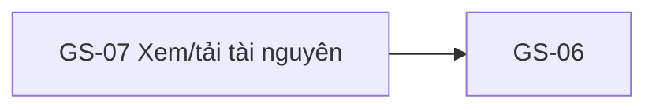

# GS-07 — Navigation

## 1. Route definition
- Current route in inventory: `/resources/:resourceId`
- Status: candidate/design route; Study Web `UNWIRED` unless source code proves otherwise.
- Route params/types: `resourceId` (type/validation: see source DD; CẦN_XÁC_NHẬN if absent)
- Query params/defaults: preserve the inventory route string; detailed parsing rules only from source DD.
- Route guards: see source DD/API contract; do not create role policy.

## 2. Điểm vào
| From screen/route | Trigger | Params | Guard / fallback |
|---|---|---|---|
| [GS-06](../GS-06-TaiNguyenKhoaHoc/00-overview.md), [ST-12](../ST-12-TaiLieuKemBaiHoc/00-overview.md) | Theo DD nguồn/inventory | Theo source; không suy diễn | Xem source DD; route chưa xác nhận runtime |

## 3. Điểm ra
| Destination | Trigger | Params | Điều kiện |
|---|---|---|---|
| [GS-06](../GS-06-TaiNguyenKhoaHoc/00-overview.md) | Source event/inventory navigation | Theo source DD | Expected links; runtime chưa verify |

## 4. Back / refresh / deep link
- Back behavior: xem source DD; không mặc định browser history.
- Preserve filters/scroll/form state: chỉ nếu source có nêu, nếu không `CẦN_XÁC_NHẬN`.
- Refresh/direct URL: route trong inventory không chứng minh runtime.
- Invalid/missing ID: theo source DD/backend contract; không tự tạo validation.
- Not authenticated/authorized: theo source role guard; xem [Business Rules](05-business-rules.md).

## 5. Diagram

## Source navigation and flow detail

### Trích từ DD nguồn: E. Ma trận trạng thái, điều hướng và khả năng tiếp cận

| State | Nguồn/điều kiện | UI xử lý có thể xác nhận / cần chốt |
|---|---|---|
| Initial/Gated | Initial screenshot/HTML | Viewer trống, controls disabled, `ACCESS_UNRESOLVED`; prototype-only. |
| Loading | State tab | Text mô tả shimmer/busy; không có skeleton thật, aria-busy runtime hoặc request. |
| Ready | State tab | Text mẫu 200/signed URL; không mở preview, không enable download. Cần access/URL/type policy trước khi triển khai. |
| Forbidden | State tab / AC-06 expected | Simulator 403; API #12 hiện không emit 403. UX/copy/login/recovery còn mở. |
| Not found | State tab / API source current | #12 404 `DESIGN_RESOURCE_NOT_FOUND`; simulator dùng code khác. Mapping SH-06/inline 404 chưa chốt. |
| Link expired | State tab / AC/prototype expected | Simulator 410/401; API #12 không có expiry field/status/refresh flow. |
| Internal/service error | API #12 current source | 500 `DESIGN_INTERNAL_ERROR`; prototype không có tab. Client display/retry behavior chưa được chỉ định. |
| Unsupported/null URL | Model allows nullable URL; type policy absent | Không có current UI state; không đoán preview, fallback hoặc copy. Cần contract. |

### Điều hướng và dữ liệu bàn giao

- **Entry:** GS-06 chọn resource → `resourceId`; ST-12 có thể gửi cùng ID kèm `lessonId`, nhưng ST-12/API #26 cardinality và return semantics còn mở. Route `resourceId` không thể hiện entry source.
- **Return:** mockup ghi GS-06; ST-12 context có thể cần quay lại bài học. Cần quyết định destination/history behavior và các ID được giữ.
- **404:** API #12 current 404 có nhiều nguyên nhân (invalid ID, resource missing, parent lesson/course check). SH-06 hiện gắn với #08; không điều hướng sang SH-06 cho #12 tới khi error ownership/copy được chốt.
- **URL:** `data.url` là direct URL theo source, không phải signed URL. Không ghi vào mock cache hoặc tự mở tab trước khi policy được xác nhận.

### Responsive, accessibility và riêng tư

- Screenshot là desktop prototype 1588×1600. Prototype tải font Plus Jakarta Sans và Tailwind CSS từ CDN, dùng cobalt `#004ac6/#2563eb` và max-width 1440px; Study Web guide yêu cầu Inter/system, không thêm remote font, semantic ocean tokens và content width khoảng 1120px.
- Header nav dùng `hidden md:flex` mà không có mobile-menu replacement. Zoom controls là 32×32px và disabled, trong khi guide yêu cầu controls tối thiểu 44px. Status dot có `animate-pulse`; prototype không có reduced-motion override.
- WCAG contrast badge và security copy là static claims. Contrast, focus-visible, keyboard order, reflow, browser zoom và touch targets chưa được audit theo composed states; đây là design discrepancy, không phải runtime measurement.
- Khi implement, yêu cầu keyboard focus, accessible names/status announcements, touch targets và contrast phải được đo theo `.agents/web-study/design.md`/accessibility policy hiện hành. Đây là điều kiện thiết kế, không phải kết quả hiện tại.
- Safe-release copy yêu cầu không lộ bucket/path/file size/expiry; current API trả `url` trực tiếp. Chưa thể xác nhận điều đó không tiết lộ storage origin; cần URL contract và allowlist.

### Trích từ DD nguồn: B. Luồng hoạt động tổng thể

### Luồng dự kiến sau khi contract được chốt

1. GS-06 hoặc ST-12 điều hướng tới route đã được duyệt, truyền `resourceId`; nếu cần giữ ngữ cảnh, nguồn cũng phải xác định `courseId`/`lessonId` và destination khi quay lại.
2. Client kiểm tra path param theo contract `resource_id:int64`. Không có client parser/route hiện tại để xác minh invalid-ID UX.
3. Hiển thị loading state và gọi #12 `GET /api/v1/resources/{resource_id}` theo catalog. Catalog khai báo public/no Bearer; thay đổi auth semantics cần được cập nhật trong hợp đồng trước khi triển khai.
4. Backend hiện kiểm tra ID dương signed-int64, truy vấn resource và, nếu `lesson_id` có giá trị, kiểm tra lesson không `DELETED` cùng course `PUBLISHED`. Thiếu row hoặc parent không hợp lệ trả 404. `lesson_id=null` bỏ qua parent check.
5. Backend hiện trả `id`, `name`, `type`, `url`, `lesson_id`; không kiểm tra access, visibility hoặc signer. Trước khi mở file cần product/backend/storage chốt liệu URL public hay signed, ai được truy cập, expiry và lỗi tương ứng. Hiện chưa đạt.
6. Sau khi policy và renderer được xác nhận: mở preview cho type/MIME được allowlist; fallback download khi download được phép. Trạng thái URL null, unsupported type, expiry, network failure, retry và URL safety chưa có contract.
7. Khi back, khôi phục đúng source (GS-06 hay ST-12) và context được xác nhận. Không mặc định luôn quay GS-06 chỉ từ prototype.

### Luồng hiện tại có thể xác nhận

- HTML render gated viewer tĩnh. Không có `iframe`, `video`, `object`, `embed`, fetch, XHR hoặc Axios. Không có resource metadata thật.
- Zoom in/out/fullscreen và download là disabled. Back, breadcrumb, header và footer anchors dùng `href="#"`; `data-path` không có router handler trong file.
- State simulator có thể đổi 6 tab và text của panel; không gọi API, render media, bật control, đổi permission hoặc lưu URL. Initial screenshot và code sau khi chọn tab Gated cũng có status copy khác nhau.
- Backend #12 có current route/view/query/validator/model và test source; các test được đọc nhưng không chạy. Không có bằng chứng runtime/deployment hoặc kết nối Study Web.
