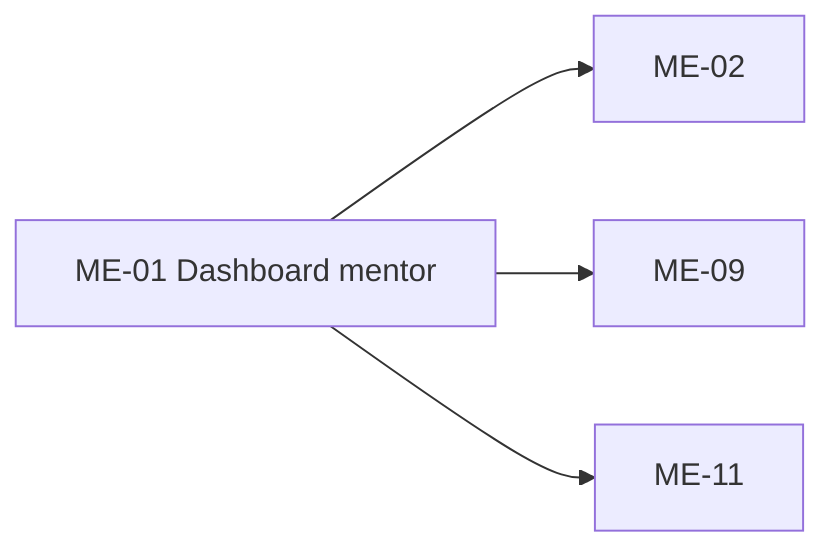

# ME-01 — Navigation

## 1. Route definition
- Current route in inventory: `/mentor`
- Status: candidate/design route; Study Web `UNWIRED` unless source code proves otherwise.
- Route params/types: Không có route param được biểu diễn trong inventory string; route runtime vẫn chưa xác minh.
- Query params/defaults: preserve the inventory route string; detailed parsing rules only from source DD.
- Route guards: see source DD/API contract; do not create role policy.

## 2. Điểm vào
| From screen/route | Trigger | Params | Guard / fallback |
|---|---|---|---|
| Không khai báo trong cột điều hướng inventory. | Theo DD nguồn/inventory | Theo source; không suy diễn | Xem source DD; route chưa xác nhận runtime |

## 3. Điểm ra
| Destination | Trigger | Params | Điều kiện |
|---|---|---|---|
| [ME-02](../ME-02-CacKhoaHocPhuTrach/00-overview.md), [ME-09](../ME-09-DanhSachBaiCanCham/00-overview.md), [ME-11](../ME-11-HopThuHoTroHocVien/00-overview.md) | Source event/inventory navigation | Theo source DD | Expected links; runtime chưa verify |

## 4. Back / refresh / deep link
- Back behavior: xem source DD; không mặc định browser history.
- Preserve filters/scroll/form state: chỉ nếu source có nêu, nếu không `CẦN_XÁC_NHẬN`.
- Refresh/direct URL: route trong inventory không chứng minh runtime.
- Invalid/missing ID: theo source DD/backend contract; không tự tạo validation.
- Not authenticated/authorized: theo source role guard; xem [Business Rules](05-business-rules.md).

## 5. Diagram

## Source navigation and flow detail

### Trích từ DD nguồn: 8. Điều hướng, quyền và dữ liệu truyền

| Từ | Đích dự kiến | Dữ liệu truyền | Điều kiện / trạng thái |
|---|---|---|---|
| Header/course “Tất cả lớp học” | ME-02 `/mentor/courses` | Không cần ID | Inventory link; route runtime `UNWIRED`. |
| Course “Workspace” | ME-03 `/mentor/courses/:courseId` | `Course.id` từ API #46 | Screenshot CTA; direct route cần được xác nhận; server vẫn phải kiểm ownership. |
| Course content-tree icon | ME-06 `/mentor/courses/:courseId/content` | `Course.id` từ #46 | Label “Xem cây nội dung”; target/flow chưa được link ở dòng ME-01 inventory. |
| Header/grading “Xem tất cả” | ME-09 `/mentor/submissions` | Không cần ID | Inventory link; route runtime `UNWIRED`. |
| Submission preview action | ME-10 `/mentor/submissions/:submissionId` hoặc ME-09 trước | `Submission.id` nếu direct | Asset cho ME-10; AC-23/list flow qua ME-09; `DISCREPANCY`, Product quyết định. |
| Header/support “Mở Workspace” | ME-11 `/mentor/support` | Không cần ID | Inventory link; route runtime `UNWIRED`. |
| Support preview action | ME-12 `/mentor/support/:requestId` hoặc ME-11 trước | `SupportRequest.id` nếu direct | Asset cho ME-12; AC-24/list flow qua ME-11; `DISCREPANCY`, Product quyết định. |
| Notifications, schedule, announcement, footer | Chưa xác định | Không truyền data từ sample | Không tạo route hoặc external link. |

Các API list kiểm soát owner/role ở server. Không xem ẩn menu hoặc parse role ở client là authorization. Không có xác nhận refresh/logout/return-to-route policy cho dashboard.

### Trích từ DD nguồn: 3. Luồng màn hình tổng quát

1. Browser yêu cầu route đề xuất `/mentor`. Study Web hiện không có route source, nên bước mount/guard chưa được xác minh.
2. Tiền điều kiện nghiệp vụ là Mentor đã đăng nhập. Khi request tới server, #46/#54/#58 tự kiểm Bearer JWT, claims số và role `MENTOR`. Không dùng API #04 để xác minh Mentor vì API #04 yêu cầu `STUDENT`; chưa có current Mentor `/me` endpoint trong client contract này.
3. Theo inventory, dashboard cần lấy dữ liệu từ #46/#54/#58. Các request là read-only, không phụ thuộc response lẫn nhau ở backend; thứ tự/concurrency, cache và retry của client chưa được xác nhận. Không tuyên bố đã có parallel fetch.
4. Từng response phải được phân tích theo envelope thật và map riêng cho widget. `200` với empty collection là trạng thái rỗng hợp lệ. Lỗi một API không được che thành lỗi toàn màn hình nếu giữ yêu cầu widget độc lập, nhưng cách hiển thị/retry cụ thể cần thiết kế.
5. Dữ liệu #46 có thể hỗ trợ course title/description/thumbnail/price/status/mentor và tổng pagination. #54/#58 hiện không đủ projection để tái tạo nguyên các hàng mẫu. Các widget rating/lịch/thông báo/shift/profile chưa có contract và phải được giải quyết trước khi mô tả như dữ liệu động.
6. Người dùng có thể chọn điều hướng đến course, submission hoặc support. Các đích là route đề xuất; link trong HTML không hoạt động. Direct CTA tới ME-10/ME-12 chưa thống nhất với AC list-first.
7. Khi rời dashboard, không có side effect được xác nhận. Mọi GET hiện tại là read-only; không ghi cache/session/analytics theo bằng chứng trong client checkout.
