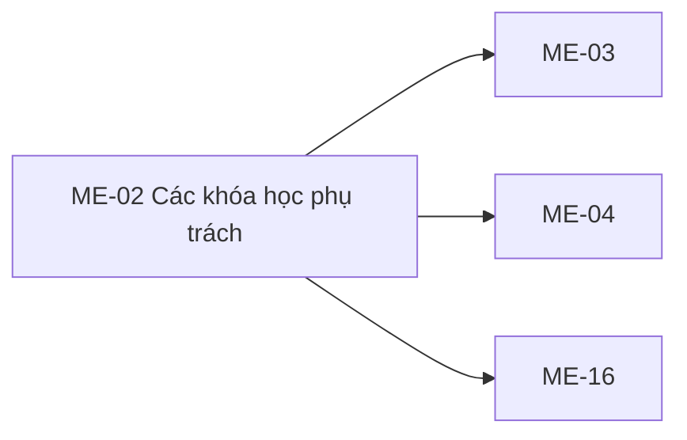

# ME-02 — Navigation

## 1. Route definition
- Current route in inventory: `/mentor/courses`
- Status: candidate/design route; Study Web `UNWIRED` unless source code proves otherwise.
- Route params/types: Không có route param được biểu diễn trong inventory string; route runtime vẫn chưa xác minh.
- Query params/defaults: preserve the inventory route string; detailed parsing rules only from source DD.
- Route guards: see source DD/API contract; do not create role policy.

## 2. Điểm vào
| From screen/route | Trigger | Params | Guard / fallback |
|---|---|---|---|
| [ME-01](../ME-01-DashboardMentor/00-overview.md) | Theo DD nguồn/inventory | Theo source; không suy diễn | Xem source DD; route chưa xác nhận runtime |

## 3. Điểm ra
| Destination | Trigger | Params | Điều kiện |
|---|---|---|---|
| [ME-03](../ME-03-WorkspaceKhoaHocCuaMentor/00-overview.md), [ME-04](../ME-04-TaiLenVaTaoBaiGiang/00-overview.md), [ME-16](../ME-16-TienDoToanKhoaHoc/00-overview.md) | Source event/inventory navigation | Theo source DD | Expected links; runtime chưa verify |

## 4. Back / refresh / deep link
- Back behavior: xem source DD; không mặc định browser history.
- Preserve filters/scroll/form state: chỉ nếu source có nêu, nếu không `CẦN_XÁC_NHẬN`.
- Refresh/direct URL: route trong inventory không chứng minh runtime.
- Invalid/missing ID: theo source DD/backend contract; không tự tạo validation.
- Not authenticated/authorized: theo source role guard; xem [Business Rules](05-business-rules.md).

## 5. Diagram


## Source navigation and flow detail

### Trích từ DD nguồn: 7. Navigation/data handoff

| Origin | Proposed destination | Data | Gate |
|---|---|---|---|
| ME-01 “Tất cả lớp học” / header “Khóa học phụ trách” | ME-02 `/mentor/courses` | No route parameter. | Inventory proposal; app route/session absent. |
| Each card Workspace CTA | ME-03 `/mentor/courses/:courseId` | Current #46 `Course.id`. | Inventory link; ensure server verifies exact access; direct-owner/assignment discrepancy remains. |
| Top “Tạo bài giảng mới” | ME-04 `/mentor/courses/:courseId/lectures/new` | Requires a course ID; current button supplies none. | Must choose a course or move action into a course card; product decision required. |
| Card manage content action | Prototype ME-06 `/mentor/courses/:courseId/content` | Course ID. | Inventory ME-02 link row does not include ME-06; resolve direct vs ME-03 first. |
| Card grading action | Prototype ME-09 `/mentor/submissions` | Potential course context, if destination supports it. | Not in ME-02 screen links; handoff query/route contract absent. |
| Card progress action | ME-16 `/mentor/courses/:courseId/progress` | Course ID. | Inventory-linked; #65 destination current source returns per-Student progress. |
| “Phân tích lớp học” / overall report | Candidate ME-18 per-course `/mentor/courses/:courseId/analytics`, or global report target unknown. | Per-course ID required by #66; global report has no identified API. | Do not choose target/aggregation from label alone. |
| Header nav | Dashboard, ME-02, ME-09, support and notifications proposals from inventory. | No query/path data for top-level routes. | HTML links all `#`; runtime route/role guard absent. |

### Trích từ DD nguồn: 2. Luồng tổng thể

1. Người dùng đi tới route đề xuất `/mentor/courses`. Route, token/session hydration và role-aware shell chưa tồn tại trong Study Web source hiện tại.
2. Khi client được triển khai, chỉ gửi Bearer access token theo auth boundary của app; không nhận `mentor_id` từ query hoặc form. Current #46 guard đọc và xác thực JWT claims, yêu cầu role `MENTOR`, rồi lấy numeric `sub` làm principal.
3. Gọi `GET /api/v1/mentor/courses` với query đã được quyết định. Không gửi search/level/sort/semester/status label của mockup khi chưa có mapping. Query defaults current: `page=1`, `size=20`, không có status filter.
4. #46 validate `status` thuộc `DRAFT|PUBLISHED`, page `>=1`, size `1..100` trước DB query. Nếu hợp lệ, count và page query cùng áp dụng owner/status predicate; SQL order cố định `courses.created_at DESC, courses.id ASC`; query chỉ đọc.
5. View kiểm tra count/projection, map từng row thành `Course`, tính `total_pages`, rồi trả success envelope `DESIGN_RESOURCE_RETRIEVED`. `items=[]` là 200 thành công; out-of-range page cũng có thể trả `items=[]` nhưng vẫn giữ `total`/`total_pages`.
6. Chỉ các field có trong Course response được coi là current source data. Không suy ra KPI, status label, course code, rating, module/lab count hay capability/assignment từ nội dung mẫu.
7. Chọn một card có thể điều hướng sang ME-03 với `Course.id` nếu route/ownership handoff được duyệt. Các action khác hiện là target đề xuất hoặc blocker trong §5 và §7.

### Source trace — API #46

```text
GET /api/v1/mentor/courses
  -> apps/study-server/app/api/v1.py:mentor_courses
  -> MentorCourseQuery(status, page, size)
  -> app.modules.mentor.api_46_mentor_courses.view.get_mentor_courses
  -> validate_current_user_request(role="MENTOR")
  -> validate status DRAFT|PUBLISHED, page>=1, size 1..100
  -> count_owned_courses / find_owned_courses
       -> COUNT + LIST SQL; courses.mentor_id = JWT sub; optional exact status
       -> LEFT JOIN users; ORDER BY created_at DESC, id ASC; LIMIT/OFFSET
  -> map_course -> CoursePage(items, pagination)
  -> ApiEnvelope success DESIGN_RESOURCE_RETRIEVED or safe error response
  -> test source covers auth/query/page/empty/error branches (read, not run)
```

`find_owned_courses` và `count_owned_courses` dùng cùng direct-owner predicate và status nếu có. GET không ghi dữ liệu, không commit và không có external side effect. Query/status validation diễn ra sau auth guard; sai role trả 403 trước query. Test source dùng fake DB session/rows, vì vậy không xác minh live schema, deployment hay PostgreSQL query execution. DB context ghi live schema là `NOT_VERIFIED`.

### API liên quan tới các chỉ số trong mockup

- **#62 `GET /api/v1/mentor/courses/{course_id}/students`:** current source kiểm tra trực tiếp `courses.mentor_id`, rồi trả danh sách `StudentSummary` distinct từ enrollment `ACTIVE`; response không có aggregate total, không pagination. Không chứng minh KPI tổng học viên toàn bộ course hoặc dedup giữa các course.
- **#65 `GET /api/v1/mentor/courses/{course_id}/progress`:** current source trả một row cho mỗi active Student gồm `completed_lessons`, `total_lessons`, `progress_percent` theo lesson `PUBLISHED`. `progress_percent` là per-Student; contract source không trả average course completion. Tự average/dedup thêm ở ME-02 chưa được duyệt.
- **#66 `GET /api/v1/mentor/courses/{course_id}/analytics`:** current source trả `tracked_lesson_accesses`, `students_with_activity`, `last_activity_at`; đây là activity proxy, không phải rating, Capstone pass rate hay completion KPI. API catalog/DD snapshot còn mô tả #65/#66 response là `Page<Course>`, khác model runtime source.
- Các API trên cần `course_id`; chúng không nằm trong API list của ME-02 row ngoại trừ CTA/ME-16 handoff. Không gọi chúng để tạo KPI mới nếu màn hình/API orchestration chưa được phê duyệt.
