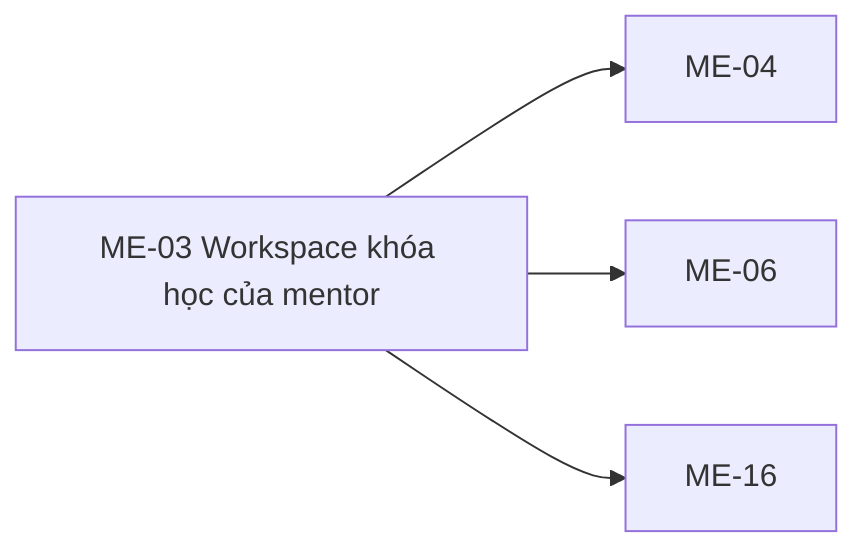

# ME-03 — Navigation

## 1. Route definition
- Current route in inventory: `/mentor/courses/:courseId`
- Status: candidate/design route; Study Web `UNWIRED` unless source code proves otherwise.
- Route params/types: `courseId` (type/validation: see source DD; CẦN_XÁC_NHẬN if absent)
- Query params/defaults: preserve the inventory route string; detailed parsing rules only from source DD.
- Route guards: see source DD/API contract; do not create role policy.

## 2. Điểm vào
| From screen/route | Trigger | Params | Guard / fallback |
|---|---|---|---|
| [ME-02](../ME-02-CacKhoaHocPhuTrach/00-overview.md), [ME-04](../ME-04-TaiLenVaTaoBaiGiang/00-overview.md), [ME-05](../ME-05-XemBaiGiangMentor/00-overview.md) | Theo DD nguồn/inventory | Theo source; không suy diễn | Xem source DD; route chưa xác nhận runtime |

## 3. Điểm ra
| Destination | Trigger | Params | Điều kiện |
|---|---|---|---|
| [ME-04](../ME-04-TaiLenVaTaoBaiGiang/00-overview.md), [ME-06](../ME-06-CayNoiDungKhoaHoc/00-overview.md), [ME-16](../ME-16-TienDoToanKhoaHoc/00-overview.md) | Source event/inventory navigation | Theo source DD | Expected links; runtime chưa verify |

## 4. Back / refresh / deep link
- Back behavior: xem source DD; không mặc định browser history.
- Preserve filters/scroll/form state: chỉ nếu source có nêu, nếu không `CẦN_XÁC_NHẬN`.
- Refresh/direct URL: route trong inventory không chứng minh runtime.
- Invalid/missing ID: theo source DD/backend contract; không tự tạo validation.
- Not authenticated/authorized: theo source role guard; xem [Business Rules](05-business-rules.md).

## 5. Diagram


## Source navigation and flow detail

### Trích từ DD nguồn: 6. Điều hướng và bảo mật

| From → To | Route/context | Trạng thái |
|---|---|---|
| ME-02 → ME-03 | `/mentor/courses/:courseId`; pass integer Course ID từ item đã chọn. | Route proposal; ME-02/#46 chỉ list trực tiếp owned courses hiện nay. Assignment semantics còn discrepancy. |
| ME-03 → ME-04 | `/mentor/courses/:courseId/lectures/new`. | Inventory link; target DD riêng. |
| ME-03 → ME-06 | `/mentor/courses/:courseId/content`. | Inventory link; target DD riêng. |
| ME-03 → ME-16 | `/mentor/courses/:courseId/progress`. | Inventory link; target DD riêng. |
| ME-03 → ME-09 / ME-14 / schedule / activity / repository / AI | Prototype labels/actions. | Chưa được ME-03 inventory xác nhận hoặc thiếu destination/data policy. |

- Không serialize JWT vào URL; không dùng `courseId` do client tự quyết để cấp quyền. Cả #49/#65 verify role và direct owner phía server.
- AC-22/AC-26 nêu quyền quản lý/xem analytics; current role guard chưa có fine-grained permission check. Cần quyết định role/permission matrix và assigned Mentor access trước implementation.
- #65 trả tên và optional avatar của từng Student; chính sách roster visibility, export, analytics logging, retention và privacy chưa được catalog xác nhận. Không log JWT, payload Content hoặc raw progress rows ở browser logs.
- Checked-in DDL/migrations là local source artifact. Không tuyên bố production schema/deployment hoặc roster freshness đã kiểm chứng.

### Trích từ DD nguồn: 2. Luồng tổng thể và ranh giới dữ liệu

```mermaid
flowchart TD
  A[ME-02 chọn course] -->|courseId, route đề xuất| B[ME-03 Workspace]
  B --> C[GET #49 Content[]]
  B --> D[GET #65 progress roster]
  C --> E[Cây Content phẳng]
  D --> F[Tiến độ tổng hợp từng Student]
  B --> G[ME-04 tạo lecture]
  B --> H[ME-06 quản lý content]
  B --> I[ME-16 báo cáo tiến độ]
```

ME-02/#46 là expected source nhận diện course; #49 và #65 đều tự xác thực Mentor và kiểm tra direct owner phía server. Không coi `courseId`, title hay permission trong client state là bằng chứng truy cập. #46 hiện cũng chỉ liệt kê course có `courses.mentor_id = JWT sub`; AC-21 nói course có thể được sở hữu **hoặc phân công**, nên assigned-course flow chưa được thể hiện trong các API hiện tại.

### 2.1 API #49 — cây Content

| Thành phần | Contract/source hiện tại |
|---|---|
| Route | `GET /api/v1/mentor/courses/{course_id}/content` |
| Auth | `Authorization: Bearer <JWT>`; shared guard yêu cầu `MENTOR`, lấy numeric JWT `sub`, chạy trước truy vấn. |
| Input | `course_id` path theo signed-int64; không query/body. Sai định dạng/range hoặc course không tồn tại → 404. |
| Access | Đọc `courses.id`, so `courses.mentor_id` với JWT `sub`; khác owner → 403. Quan hệ assignment không được kiểm tra. |
| Read | `contents` cùng course, `deleted_at IS NULL`, không lọc `status`, không phân trang; order `parent_id NULLS FIRST, content_order ASC, id ASC`. Không ghi/commit. |
| Response 200 | `businessCode=DESIGN_RESOURCE_RETRIEVED`; `data` là mảng phẳng. Mỗi item có `id:int64`, `course_id:int64`, `content_type:string`, `title:string`, `payload:object`, `status:string`, `parent_id?:int64`, `order:int32`. Root có `parent_id=null` bị omit. Empty tree vẫn 200 với `data: []`. |
| Mapping guard | Payload phải là JSON object; ID phải unique; mọi parent phải nằm trong response; course ID phải khớp; cycle/invalid projection làm hỏng toàn response. |
| Errors | 401 `DESIGN_AUTHENTICATION_REQUIRED`; 403 `DESIGN_ACCESS_DENIED`; 404 `DESIGN_RESOURCE_NOT_FOUND`; 500 `DESIGN_INTERNAL_ERROR`. SQL/projection/tree detail không trả cho client. |
| Giới hạn dùng cho ME-03 | Flat Content nodes không tự chứng minh cấu trúc `chapter/module/lesson`. `content_type`, `status`, payload subtype, revision và publish rules chưa chốt. Không suy số bài giảng đã duyệt từ status mẫu. |

### 2.2 API #65 — tiến độ toàn lớp

| Thành phần | Catalog trực tiếp | Current source cục bộ |
|---|---|---|
| Route | `GET /api/v1/mentor/courses/{course_id}/progress` | Đã đăng ký tại router và gọi module #65. |
| Auth/input | Bearer JWT, role Mentor; `course_id:int64!`; không query/body. | Shared Mentor guard; signed-int64 parser; direct owner check. |
| Response | `ApiEnvelope<Page<Course>>` theo [catalog #65](../../../../../docs/lists/list_api.md#L175). | `ApiEnvelope<Page<MentorStudentProgress>>`; local shape là DERIVED và đang DISCREPANCY. |
| Roster | Không có progress schema trong `Page<Course>`. | Distinct Student thuộc enrollment ACTIVE; người dùng phải có role `STUDENT`. Một item/Student. |
| Denominator | Không có lesson/progress rule trong catalog. | Chỉ `lessons.status='PUBLISHED'`; chọn progress row mới nhất theo `last_accessed_at DESC NULLS LAST, id DESC`. |
| Tính toán | Chưa định nghĩa. | `completed_lessons` đếm status `COMPLETED`; `progress_percent = floor(sum(progress_percent)/total_published_lessons)`. Không có lesson thì bằng 0. Missing row/percent được tính 0; projection với status/range không hợp lệ trả safe 500. |
| Pagination | Catalog không khai báo page/size input. | Trả toàn bộ roster: `page=1`, `size=total`, `total=total`, `total_pages=1` khi có item, nếu rỗng thì `size=0`, `total_pages=0`. Không có bound. |
| Errors | 401/403/404/500 theo catalog. | Cùng status/business code; direct-owner mismatch 403, course/path không tồn tại/sai 404. |
| Giới hạn dùng cho ME-03 | Catalog chưa biểu diễn tiến độ. | Course-wide theo từng Student; không có tiến độ từng module, event feed, risk flag, quiz/lab score, review/rating hoặc thời điểm gần nhất. Response, eligibility, formula và full-roster page phải chờ owner/schema approval. |

API #65 và API #49 cùng dùng legacy BIGINT source artifacts; DDL/migrations đã kiểm tra tĩnh, live schema/deployment chưa xác minh. `#65` không gọi `#66`/`#67` phía server. AC-26 liệt kê #65, #67, #66 cho class progress, selected-Student detail và analytics riêng; inventory ME-03 chỉ chỉ định #65.

### 2.3 Course summary và mockup data

API #46 hiện có `Course` gồm id/title/optional description/thumbnail/price/status/Mentor summary. Query #46 phân trang và chỉ giới hạn trực tiếp theo `courses.mentor_id`; nó không có `courseCode`, cohort/term, academic standard, enrollment count, last-content-updated, course-average progress, rating hay group/submission metrics. #49/#65 cũng không trả Course summary. Direct route/refresh vì vậy chưa có source ổn định cho phần hero.

| Nhóm mockup | #49/#65 cung cấp | Kết luận cho DD |
|---|---|---|
| Code/status/cohort/last updated/owner/standard | #49 chỉ có Content rows; #65 có Student progress; #46 chỉ có Course cơ bản và Mentor summary. | Code, cohort, standard, timestamp và enrollment count là sample; chưa có field mapping đầy đủ. |
| Course completion KPI | #65 trả progress từng Student; #49 trả Content nodes. | Không lấy trung bình các student progress thành card KPI nếu chưa duyệt công thức/roster/rounding. |
| Chương/module/lecture counts, approved/draft | #49 trả Content tree, status/type open string; lessons là model/table riêng. | Không suy chapter hoặc lecture counts/status từ Content node; mapping cần owner xác nhận. |
| Module completion, submissions và Capstone | #65 chỉ có toàn course/Student summary trên published lessons. | Module-level progress, submission totals, lab/capstone completion không có nguồn. |
| At-risk learners/reminder/scheduling | #65 không có risk status, streak, quiz/lab score hay scheduling field. | Ngưỡng `>7 ngày`, risk score, danh sách/count và 1:1 scheduling đều chưa có contract. |
| Weekly feed/learning velocity | #65 không có event list/time series; per-Student summary không biểu diễn activity chronology. | 142 activities/week/submissions and dates in image are sample; endpoint/source/destination chưa xác định. |
| Satisfaction/drop-off/reviews | #49/#65 không có rating/review/drop-off data. | 9.4/10, 98 reviews, 6% drop-off và satisfaction bar không có API mapping. |
| Repository/assets and AI | API #49 payload is generic object; response does not guarantee external resource URLs or AI results. | Git/Figma/Sandbox links và “12 logic errors” là sample; URL allowlist, safe link and AI contract absent. |
| Excel export | Không có export API/file contract trong inventory. | Không thể tuyên bố file tải xuống từ nút hiện tại. |
