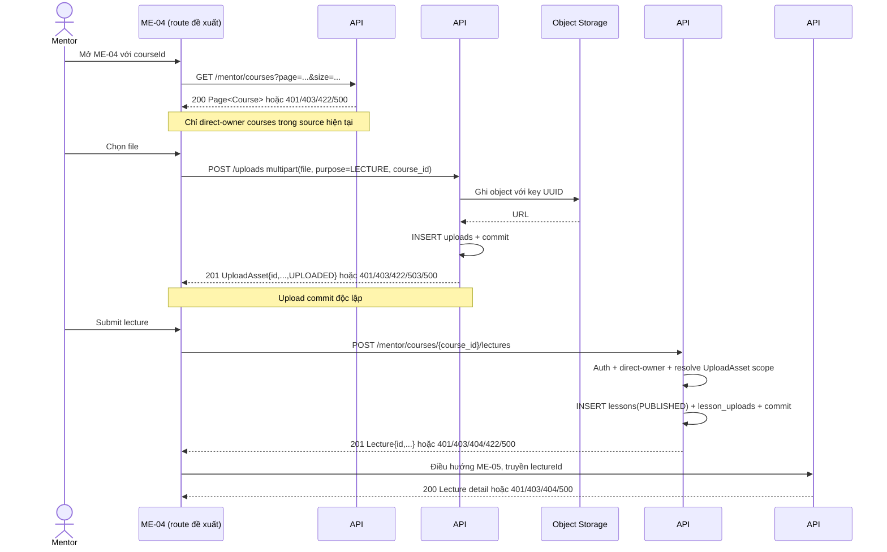

# ME-04 — Data Flow & State

## 1. Nguồn dữ liệu
| Field / object | Type | Source | Destination | Cập nhật khi |
|---|---|---|---|---|
| Chỉ liệt kê theo bằng chứng trong excerpt bên dưới | Theo DD/API source | API/inventory/design; status phải giữ nguyên | UI/state nêu ở DD nguồn | Theo event source |

## 2. State model

> Không tạo DTO/ViewModel mới khi chưa có contract. State, DTO và mapping được trích nguyên ngữ cảnh từ DD nguồn bên dưới.

## 3. API DTO → ViewModel mapping

### Trích từ DD nguồn: 2. Luồng tổng thể và ranh giới dữ liệu

### 2.1 Khởi tạo course context — API #46

- Source route: `GET /api/v1/mentor/courses`; Authorization `Bearer <JWT>`, role `MENTOR`.
- Query hiện hành: `status?: DRAFT|PUBLISHED`, `page=1`, `size=20`, `1≤size≤100`. Bỏ `status` để lấy cả trạng thái hiện có.
- Current view xác thực trước DB, count rồi list; SQL giới hạn `courses.mentor_id = JWT sub`, thứ tự `created_at DESC, id ASC`. Response là `ApiEnvelope<Page<Course>>`; Course có `id`, `title`, `description`, `thumbnail_url`, `price`, `status`, Mentor projection. Page rỗng là success.
- Lỗi: 401 `DESIGN_AUTHENTICATION_REQUIRED`; 403 `DESIGN_ACCESS_DENIED`; 422 `DESIGN_VALIDATION_ERROR`; 500 `DESIGN_INTERNAL_ERROR`.
- Không có endpoint detail theo `courseId`, module hierarchy, course code hay lecture order. Nếu ID không nằm trong trang hiện tại, quy tắc lấy trang tiếp/không tìm thấy chưa được inventory hoặc source xác định; không tự duyệt toàn bộ danh sách trong client.
- AC-21 cho phép Mentor được phân công; #46 chỉ lấy owner trực tiếp. Không coi course code `FE-REACT-ENT-2025` trên mockup là `courseId` số.

### 2.2 Tải từng asset — API #34

- Source route: `POST /api/v1/uploads`, `multipart/form-data`, required parts `file` và `purpose`, optional `course_id`.
- Đối với Mentor, `purpose=LECTURE` bắt buộc có signed-int64 `course_id`; current view kiểm tra `courses.mentor_id = JWT sub` trước khi gọi storage. Không có `owner_id` do client chọn.
- Current source không đặt MIME allowlist hoặc application size cap. Nó đo `size_bytes` từ file stream, filename rỗng thành `upload`, MIME rỗng thành `application/octet-stream`; tạo key server-side `uploads/<UUID>`.
- Upload provider tương thích S3, cấu hình qua environment; object được ghi trước, sau đó insert/commit hàng `uploads` với `UPLOADED`. Success HTTP 201 `DESIGN_RESOURCE_CREATED` trả `{id,name,url,content_type,size_bytes,status}`.
- Errors: 401 auth; 403 role/purpose/owner scope; 422 field/purpose/course validation; 503 `DESIGN_DEPENDENCY_UNAVAILABLE` khi storage lỗi; 500 `DESIGN_INTERNAL_ERROR` khi metadata/DB lỗi. DB failure có rollback và best-effort object delete; real provider chưa được chạy.
- Mỗi file upload là một transaction/request độc lập. Khi #34 thành công rồi người dùng hủy hoặc #47 lỗi, object và metadata #34 không nằm trong transaction #47. Không tìm thấy API delete upload trong route source; remove trên UI chỉ được mô tả là bỏ selection cục bộ cho tới khi có cleanup contract.

### 2.3 Tạo lecture — API #47

- Source route: `POST /api/v1/mentor/courses/{course_id}/lectures`; Bearer JWT role `MENTOR`; `Content-Type: application/json`; không có query.
- Strict body (extra fields bị từ chối):

| Field | Kiểu/constraint source | Current mapping |
|---|---|---|
| `title` | string required, tối đa 200 ký tự; không có min/trim rule | `lessons.name`; response `data.title` |
| `content` | signed int64 required | Lưu `str(content)` vào `lessons.content`; response là chuỗi thập phân. Không phải rich-text body. |
| `asset_refs` | string required chứa JSON array ordered unique signed-int64 IDs; `"[]"` hợp lệ | Resolve #34 uploads cùng owner, purpose `LECTURE`, course; response `assets` theo request order. |
| `order` | signed int32 required; source không đặt positivity rule | `lessons.sort_order`; response `data.order` |

- View: MENTOR JWT guard → path signed-int64 validation → parse `asset_refs` → SELECT course → check direct owner → resolve mọi asset → INSERT `lessons` với status `PUBLISHED` và `CURRENT_TIMESTAMP` → INSERT `lesson_uploads` theo thứ tự (nếu có) → commit → response `Lecture`.
- Course status không bị lọc; API có thể tạo lecture trên course DRAFT nếu Mentor sở hữu. API không tạo `resources`, không mutate upload metadata.
- Errors source-backed: 401; 403 course khác owner; 404 course thiếu hoặc asset ID thiếu/ngoài scope (asset dùng lỗi 404 chung); 422 sai path/body/range/title/asset_refs; 500 query/mapping/transaction. DB failure rollback phần #47.
- API #47 local DD ghi `Draft — Needs Confirmation` do target live schema/migration chưa xác minh. Q1/Q2 ở API DD ghi local wire decision cho `content:int64` và `asset_refs`, nhưng không tạo mapping editor rich-text cho ME-04.

### 2.4 Đọc sau khi tạo — API #48 / ME-05

- ME-05 route đề xuất `/mentor/lectures/:lectureId` dùng `GET /api/v1/mentor/lectures/{lecture_id}`; source kiểm tra MENTOR role, parse ID, xác minh direct owner qua lecture→course, rồi đọc các UploadAsset liên kết theo `asset_position`.
- Success 200 trả `Lecture` hiện lưu, có `status` và `assets`; errors 401/403/404/500. Đây là read-only; không thay thế kết quả POST #47.
- Route điều hướng phía Study Web vẫn chưa có source. Không mô tả UI success giả lập trong HTML như API result.

### Trích từ DD nguồn: 2. Luồng tổng thể và ranh giới dữ liệu

### 2.1 Khởi tạo course context — API #46

- Source route: `GET /api/v1/mentor/courses`; Authorization `Bearer <JWT>`, role `MENTOR`.
- Query hiện hành: `status?: DRAFT|PUBLISHED`, `page=1`, `size=20`, `1≤size≤100`. Bỏ `status` để lấy cả trạng thái hiện có.
- Current view xác thực trước DB, count rồi list; SQL giới hạn `courses.mentor_id = JWT sub`, thứ tự `created_at DESC, id ASC`. Response là `ApiEnvelope<Page<Course>>`; Course có `id`, `title`, `description`, `thumbnail_url`, `price`, `status`, Mentor projection. Page rỗng là success.
- Lỗi: 401 `DESIGN_AUTHENTICATION_REQUIRED`; 403 `DESIGN_ACCESS_DENIED`; 422 `DESIGN_VALIDATION_ERROR`; 500 `DESIGN_INTERNAL_ERROR`.
- Không có endpoint detail theo `courseId`, module hierarchy, course code hay lecture order. Nếu ID không nằm trong trang hiện tại, quy tắc lấy trang tiếp/không tìm thấy chưa được inventory hoặc source xác định; không tự duyệt toàn bộ danh sách trong client.
- AC-21 cho phép Mentor được phân công; #46 chỉ lấy owner trực tiếp. Không coi course code `FE-REACT-ENT-2025` trên mockup là `courseId` số.

### 2.2 Tải từng asset — API #34

- Source route: `POST /api/v1/uploads`, `multipart/form-data`, required parts `file` và `purpose`, optional `course_id`.
- Đối với Mentor, `purpose=LECTURE` bắt buộc có signed-int64 `course_id`; current view kiểm tra `courses.mentor_id = JWT sub` trước khi gọi storage. Không có `owner_id` do client chọn.
- Current source không đặt MIME allowlist hoặc application size cap. Nó đo `size_bytes` từ file stream, filename rỗng thành `upload`, MIME rỗng thành `application/octet-stream`; tạo key server-side `uploads/<UUID>`.
- Upload provider tương thích S3, cấu hình qua environment; object được ghi trước, sau đó insert/commit hàng `uploads` với `UPLOADED`. Success HTTP 201 `DESIGN_RESOURCE_CREATED` trả `{id,name,url,content_type,size_bytes,status}`.
- Errors: 401 auth; 403 role/purpose/owner scope; 422 field/purpose/course validation; 503 `DESIGN_DEPENDENCY_UNAVAILABLE` khi storage lỗi; 500 `DESIGN_INTERNAL_ERROR` khi metadata/DB lỗi. DB failure có rollback và best-effort object delete; real provider chưa được chạy.
- Mỗi file upload là một transaction/request độc lập. Khi #34 thành công rồi người dùng hủy hoặc #47 lỗi, object và metadata #34 không nằm trong transaction #47. Không tìm thấy API delete upload trong route source; remove trên UI chỉ được mô tả là bỏ selection cục bộ cho tới khi có cleanup contract.

### 2.3 Tạo lecture — API #47

- Source route: `POST /api/v1/mentor/courses/{course_id}/lectures`; Bearer JWT role `MENTOR`; `Content-Type: application/json`; không có query.
- Strict body (extra fields bị từ chối):

| Field | Kiểu/constraint source | Current mapping |
|---|---|---|
| `title` | string required, tối đa 200 ký tự; không có min/trim rule | `lessons.name`; response `data.title` |
| `content` | signed int64 required | Lưu `str(content)` vào `lessons.content`; response là chuỗi thập phân. Không phải rich-text body. |
| `asset_refs` | string required chứa JSON array ordered unique signed-int64 IDs; `"[]"` hợp lệ | Resolve #34 uploads cùng owner, purpose `LECTURE`, course; response `assets` theo request order. |
| `order` | signed int32 required; source không đặt positivity rule | `lessons.sort_order`; response `data.order` |

- View: MENTOR JWT guard → path signed-int64 validation → parse `asset_refs` → SELECT course → check direct owner → resolve mọi asset → INSERT `lessons` với status `PUBLISHED` và `CURRENT_TIMESTAMP` → INSERT `lesson_uploads` theo thứ tự (nếu có) → commit → response `Lecture`.
- Course status không bị lọc; API có thể tạo lecture trên course DRAFT nếu Mentor sở hữu. API không tạo `resources`, không mutate upload metadata.
- Errors source-backed: 401; 403 course khác owner; 404 course thiếu hoặc asset ID thiếu/ngoài scope (asset dùng lỗi 404 chung); 422 sai path/body/range/title/asset_refs; 500 query/mapping/transaction. DB failure rollback phần #47.
- API #47 local DD ghi `Draft — Needs Confirmation` do target live schema/migration chưa xác minh. Q1/Q2 ở API DD ghi local wire decision cho `content:int64` và `asset_refs`, nhưng không tạo mapping editor rich-text cho ME-04.

### 2.4 Đọc sau khi tạo — API #48 / ME-05

- ME-05 route đề xuất `/mentor/lectures/:lectureId` dùng `GET /api/v1/mentor/lectures/{lecture_id}`; source kiểm tra MENTOR role, parse ID, xác minh direct owner qua lecture→course, rồi đọc các UploadAsset liên kết theo `asset_position`.
- Success 200 trả `Lecture` hiện lưu, có `status` và `assets`; errors 401/403/404/500. Đây là read-only; không thay thế kết quả POST #47.
- Route điều hướng phía Study Web vẫn chưa có source. Không mô tả UI success giả lập trong HTML như API result.

### Trích từ DD nguồn: 3. Ma trận element

Tọa độ marker là pixel trên ảnh nguồn; `screen_annotated.png` xuất 2×. Element nhóm chỉ gộp các control con khi cùng vùng/chức năng; toolbar và editor vẫn liệt kê control con tại cột nội dung. Mọi ID dưới đây ánh xạ duy nhất tới marker cùng số.

Sau visual review, marker #3 và #25 được chuyển khỏi vùng nhãn/marker lân cận; JSON, SVG và annotated PNG được tạo lại sau bản tọa độ cuối trong `ME-04_PLAN.md` rồi xem lại.

| Element ID | Tên/loại/vị trí | Data, default, validation, hiển thị/trạng thái | Event |
|---|---|---|---|
| ME04-EL-01 | Logo/brand, global header | Static mockup; đích route không được wire. | EV-21 |
| ME04-EL-02 | Navigation Mentor | Dashboard, course list, grading, support, notifications trong mockup; tất cả `href="#"`. | EV-21 |
| ME04-EL-03 | Search input header | Mockup text; không có query source/API/handoff ở ME-04. | EV-21 |
| ME04-EL-04 | Notification icon + badge | Badge `3` là sample; API Mentor notification #63/#64 có trong backend source nhưng target/link của header chưa được xác định tại screen này. | EV-21 |
| ME04-EL-05 | Mentor identity/avatar | Tên/chức danh mẫu, không lấy từ #46 course list; không coi là authenticated profile runtime. | — |
| ME04-EL-06 | Link quay lại Workspace | Target đề xuất ME-03 với cùng `courseId`; chưa có browser route/history policy. | EV-20 |
| ME04-EL-07 | Breadcrumb tên course | Giá trị sample; nguồn có thể đối chiếu từ #46 `Course.title`, nhưng không có detail endpoint. | EV-01 |
| ME04-EL-08 | Course code sample | `FE-REACT-ENT-2025` không có trong Course projection #46; không phải route ID theo source. | EV-01 |
| ME04-EL-09 | Page title | Static title “Thêm bài giảng mới vào giáo trình”. | — |
| ME04-EL-10 | Badge Authoring | Static status badge; không biểu thị persisted draft/status. | — |
| ME04-EL-11 | Auto-save status label | Text “Đã tự động lưu…” nhưng HTML không có autosave timer/API. Không được hiển thị như persisted status. | — |
| ME04-EL-12 | Preview button | Không có preview API/state/route contract cho unsaved lecture. | EV-11 |
| ME04-EL-13 | Metadata section header | Section container; no backend object mapping. | — |
| ME04-EL-14 | Select chương/module | Sample options; #46 không trả module hierarchy, #47 không nhận module ID. | EV-02 |
| ME04-EL-15 | Bloom-Tech level text | Static classification; không có field/rule trong #46/#47. | — |
| ME04-EL-16 | Select order/lesson position | Sample `Bài số 16/48`; only #47 `order:int32`, no max/order lookup or positivity rule. | EV-02 |
| ME04-EL-17 | Input title | Mockup prefilled; #47 requires string ≤200, no minimum/trim rule. UI required marker is not runtime validation. | EV-03 |
| ME04-EL-18 | Character counter | `78/120` sample contradicts #47 max 200; needs approved UI limit. | EV-03 |
| ME04-EL-19 | Duration input | Text sample “35 phút”; no duration field in #47 request/response. | EV-03 |
| ME04-EL-20 | Difficulty indicator | Four-dot/“Senior Standard” sample; no #47 field or scoring formula. | — |
| ME04-EL-21 | Media section header | Group container for media actions. | — |
| ME04-EL-22 | `API #34 Upload CDN` chip | Static annotation, not upload status or provider guarantee. | EV-04/05 |
| ME04-EL-23 | Existing uploaded video card | Filename, length, codec, HLS and URL are mock data; current #34 response provides only UploadAsset metadata. | EV-04/05/06 |
| ME04-EL-24 | Video thumbnail | Static preview; no thumbnail generation/URL contract in #34 response. | EV-05 |
| ME04-EL-25 | File name/size/duration/encoding metadata | Only `name` and `size_bytes` map to #34 UploadAsset; duration and encoding/transcode state have no source. | EV-05 |
| ME04-EL-26 | Progress/completion indicator | “100% Hoàn tất” sample. #34 source returns after upload completion; streaming progress events are not part of response. | EV-04/05 |
| ME04-EL-27 | Preview media button | Mockup control; preview source and modal/player behavior unspecified. | EV-11 |
| ME04-EL-28 | Replace media button | No replace endpoint; a new #34 upload would create another persisted asset. | EV-06 |
| ME04-EL-29 | Remove media button | No upload delete route; client-only deselection is not remote cleanup. | EV-07 |
| ME04-EL-30 | Drag/drop/select zone | Mockup has no `<input type=file>`, form, drop handler or click handler. API #34 needs multipart binary. | EV-04 |
| ME04-EL-31 | File type/size guidance | Mockup claims MP4/WebM/MOV, codecs, 2 GB; #34 source has no MIME allowlist or app size cap. | EV-04 |
| ME04-EL-32 | Stream URL input | URL sample; #47 has no `video_url` field and #34 uploads file bytes only. | EV-08 |
| ME04-EL-33 | Summary/editor header | Static heading; no persisted editor schema in current API. | — |
| ME04-EL-34 | Markdown toggle | Mockup button only; no client state handler/editor library. | EV-09 |
| ME04-EL-35 | WYSIWYG toggle | Mockup button only; no client state handler/editor library. | EV-09 |
| ME04-EL-36 | Formatting toolbar composite | Child actions B/I/U/H2/H3/list/quote/code/image; grouped marker; HTML has buttons but no listeners. | EV-09 |
| ME04-EL-37 | Rich-text/code content surface | Sample paragraphs/code; HTML has no textarea/contenteditable. #47 accepts `content:int64` then stores decimal string. | EV-03/09 |
| ME04-EL-38 | Attachment section heading | Static label “Tài liệu đính kèm & Mã nguồn mẫu”. | EV-10 |
| ME04-EL-39 | Add attachment control | No listener/file picker in HTML. Future upload must use #34 then retain asset ID. | EV-04/10 |
| ME04-EL-40 | PDF attachment card | `name/size` sample; #47 can return linked UploadAsset once ID resolved. | EV-10 |
| ME04-EL-41 | Remove PDF control | No server delete. Removing ID locally after upload leaves the #34 record/object. | EV-07 |
| ME04-EL-42 | ZIP attachment card | Same source boundary as PDF card. | EV-10 |
| ME04-EL-43 | Remove ZIP control | No server delete. | EV-07 |
| ME04-EL-44 | Publish configuration header | Static section, not API state. | — |
| ME04-EL-45 | Radio “Video bài giảng chính” | One of three static types; #47 has no type field. | EV-12 |
| ME04-EL-46 | Radio “Bài đọc chuyên sâu” | Same unsupported type field. | EV-12 |
| ME04-EL-47 | Radio “Hướng dẫn thực hành Lab” | Same unsupported type field. | EV-12 |
| ME04-EL-48 | Guest Preview toggle | No API #47 field or guest-access policy. | EV-13 |
| ME04-EL-49 | Prerequisite toggle | No prerequisite field, relationship, or validation endpoint. | EV-14 |
| ME04-EL-50 | Radio “Lưu nháp” | #47 always persists `PUBLISHED`; no draft endpoint. | EV-15/16 |
| ME04-EL-51 | Radio “Gửi duyệt (Publish)” | Label conflicts with #47 immediate `PUBLISHED` insertion; no review state in response. | EV-15/17 |
| ME04-EL-52 | QA panel heading | Mock quality panel, no QA API. | — |
| ME04-EL-53 | “100% Đạt” badge | Unsupported calculated result; no rule/evidence source. | — |
| ME04-EL-54 | QA explanatory copy | Claims conditions/policy not returned by #47. | — |
| ME04-EL-55 | QA checklist group | SEO, video codec, code snippet, microlearning rules are mockup-only; no validation service/formula. | — |
| ME04-EL-56 | Primary create/submit button | Current HTML fake handler only; intended future action is #47 after uploads and approved data mapping. | EV-17/18/19 |
| ME04-EL-57 | “Lưu bản nháp” button | No API to persist draft; do not call #47 because that publishes. | EV-16 |
| ME04-EL-58 | Cancel button | Intended return ME-03; dirty-state confirmation/upload cleanup not specified. | EV-20 |
| ME04-EL-59 | ISO/EduTrust/AC reference note | Static copy; not a validation/certification response. | — |
| ME04-EL-60 | Footer links/content | Static `span`/copy and placeholder targets; route destinations not established. | EV-21 |

### Trích từ DD nguồn: 5. Ma trận trạng thái

| State | Điều kiện vào | Hành vi/thoát | Current vs expected |
|---|---|---|---|
| `route-loading` | Enter proposed route | Parse `courseId`; load/validate #46 context. | Expected only; route absent. |
| `course-ready` | Matching authorized course context | Bind course title and allow approved form fields. | Blocked by assigned owner/detail lookup gap. |
| `course-not-found-or-out-of-page` | No matching row/page | Show not-found only after lookup policy known. | Current #46 page can be empty; direct detail endpoint absent. |
| `access-denied` | #46/#34/#47 returns 403 | Stop course-dependent actions; retain safe message. | Backend source-backed locally; assigned-course discrepancy. |
| `form-pristine` | Course context ready | Static/default values are not trusted sample data. | No client state implementation. |
| `form-dirty` | User changes input | Keep local state until persistence contract exists. | Draft persistence unresolved. |
| `uploading` | #34 request in flight | Per-file pending/progress; disable relevant controls. | Inventory expected; no client wiring; progress contract absent. |
| `upload-complete` | #34 returns 201 | Store UploadAsset ID/order and render response fields. | Backend local source exists; live storage unverified. |
| `upload-error` | #34 401/403/422/503/500 or transport failure | Show safe error; retry only with approved ambiguity policy. | No UI wiring; no idempotency/reconciliation. |
| `creating` | #47 request in flight | Prevent concurrent duplicate request. | Expected; no UI wiring. |
| `create-error` | #47 401/403/404/422/500 | Retain form values; distinguish field errors and safe summary. | API source-backed locally; uploaded assets remain committed. |
| `created-published` | #47 returns 201 | Use returned ID and move to ME-05/#48. | API creates PUBLISHED; browser navigation unverified. |
| `draft` | User chooses Save Draft | No transition is supportable with current API. | BLOCKED. |
| `preview` | User chooses Preview | No unsaved preview contract/route. | BLOCKED. |
| `session-expired` | API returns 401 | Use approved auth expiry flow; do not invent refresh/session behavior. | Study Web auth client is absent. |
| `cancelled` | User leaves form | Preserve or discard local state only under approved policy; server uploads remain. | Confirmation and cleanup policy unresolved. |

### Trích từ DD nguồn: 6. Điều hướng, bảo mật và dữ liệu

- **Route input:** `courseId` is expected to be a signed-int64 numeric DB/API ID. The screenshot's alphanumeric code is unsupported in current #46/#47 schemas.
- **Authorization:** rely on server MENTOR guard. Client-only role or course selection cannot authorize access. Current #46/#34/#47 use direct owner; AC assignment path is not supported by those predicates.
- **Asset isolation:** never accept `owner_id`, URL, `content_type`, `size_bytes` or `status` from the client as authoritative #47 asset metadata. Upload via #34 and submit returned IDs only; server re-resolves owner/purpose/course.
- **Side effects:** #34 object+metadata persist before #47. #47 atomically writes lesson and relation rows locally. These are not one cross-request transaction.
- **Sensitive files:** API #34 currently returns a URL from configured public base; link access semantics/expiry and actual storage policy were not verified. Do not claim private/signed playback from screenshot text.
- **No synthetic values:** do not save sample module/order, duration, rating/QA, course code, encoding status, preview/prerequisite or Draft status until their source/contract exists.

## 4. Luồng đọc (Read)
- Orchestration từ inventory: GET #46 xác minh course context → POST #34 cho asset → POST #47; không nhận content:int64 như rich-text nếu chưa chốt.
- Chi tiết current/source mapping: xem [API Integration](04-api-integration.md) và DD nguồn.

## 5. Luồng ghi (Write)
- Chỉ mô tả mutation được DD/API source nêu; không thêm endpoint hoặc side effect.
- Source trace: [ME-04](../../screen_stitch/04_mentor/ME-04_tai-len-va-tao-bai-giang/ME-04.md)

## 6. Cache / concurrency / lifecycle
- Cache, race, cleanup, pagination: xem các section source bên dưới; nếu không có bằng chứng thì để `CẦN_XÁC_NHẬN`.

## 7. Data errors & security
- Theo error/security/source-status section của DD nguồn; không coi state trong mockup là runtime behavior.

## 8. Trace
[Events](02-events.md) · [API](04-api-integration.md) · [Rules](05-business-rules.md)
