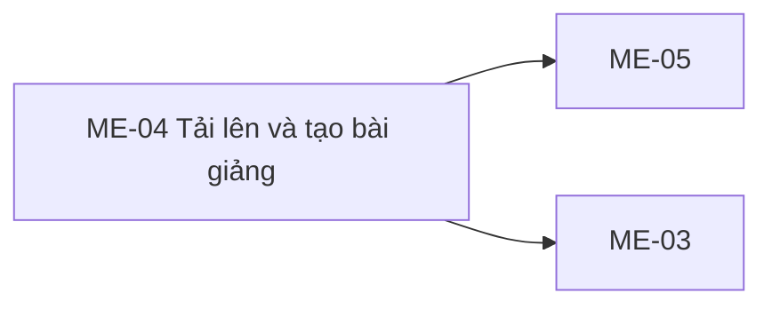
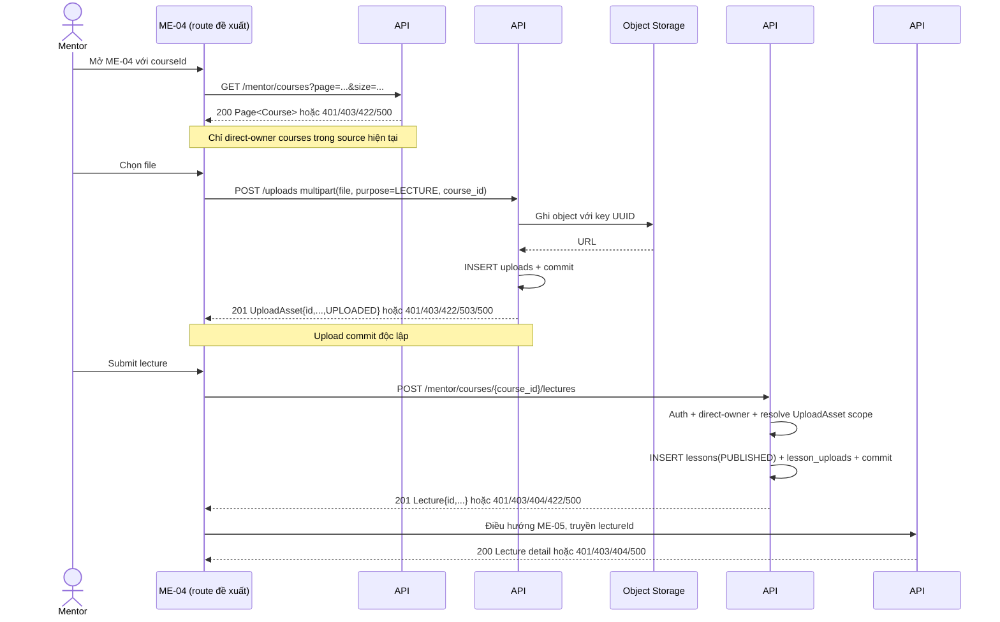

# ME-04 — Navigation

## 1. Route definition
- Current route in inventory: `/mentor/courses/:courseId/lectures/new`
- Status: candidate/design route; Study Web `UNWIRED` unless source code proves otherwise.
- Route params/types: `courseId` (type/validation: see source DD; CẦN_XÁC_NHẬN if absent)
- Query params/defaults: preserve the inventory route string; detailed parsing rules only from source DD.
- Route guards: see source DD/API contract; do not create role policy.

## 2. Điểm vào
| From screen/route | Trigger | Params | Guard / fallback |
|---|---|---|---|
| [ME-02](../ME-02-CacKhoaHocPhuTrach/00-overview.md), [ME-03](../ME-03-WorkspaceKhoaHocCuaMentor/00-overview.md) | Theo DD nguồn/inventory | Theo source; không suy diễn | Xem source DD; route chưa xác nhận runtime |

## 3. Điểm ra
| Destination | Trigger | Params | Điều kiện |
|---|---|---|---|
| [ME-05](../ME-05-XemBaiGiangMentor/00-overview.md), [ME-03](../ME-03-WorkspaceKhoaHocCuaMentor/00-overview.md) | Source event/inventory navigation | Theo source DD | Expected links; runtime chưa verify |

## 4. Back / refresh / deep link
- Back behavior: xem source DD; không mặc định browser history.
- Preserve filters/scroll/form state: chỉ nếu source có nêu, nếu không `CẦN_XÁC_NHẬN`.
- Refresh/direct URL: route trong inventory không chứng minh runtime.
- Invalid/missing ID: theo source DD/backend contract; không tự tạo validation.
- Not authenticated/authorized: theo source role guard; xem [Business Rules](05-business-rules.md).

## 5. Diagram

## Source navigation and flow detail

### Trích từ DD nguồn: 6. Điều hướng, bảo mật và dữ liệu

- **Route input:** `courseId` is expected to be a signed-int64 numeric DB/API ID. The screenshot's alphanumeric code is unsupported in current #46/#47 schemas.
- **Authorization:** rely on server MENTOR guard. Client-only role or course selection cannot authorize access. Current #46/#34/#47 use direct owner; AC assignment path is not supported by those predicates.
- **Asset isolation:** never accept `owner_id`, URL, `content_type`, `size_bytes` or `status` from the client as authoritative #47 asset metadata. Upload via #34 and submit returned IDs only; server re-resolves owner/purpose/course.
- **Side effects:** #34 object+metadata persist before #47. #47 atomically writes lesson and relation rows locally. These are not one cross-request transaction.
- **Sensitive files:** API #34 currently returns a URL from configured public base; link access semantics/expiry and actual storage policy were not verified. Do not claim private/signed playback from screenshot text.
- **No synthetic values:** do not save sample module/order, duration, rating/QA, course code, encoding status, preview/prerequisite or Draft status until their source/contract exists.

### Trích từ DD nguồn: 2. Luồng tổng thể và ranh giới dữ liệu

### 2.1 Khởi tạo course context — API #46

- Source route: `GET /api/v1/mentor/courses`; Authorization `Bearer <JWT>`, role `MENTOR`.
- Query hiện hành: `status?: DRAFT|PUBLISHED`, `page=1`, `size=20`, `1≤size≤100`. Bỏ `status` để lấy cả trạng thái hiện có.
- Current view xác thực trước DB, count rồi list; SQL giới hạn `courses.mentor_id = JWT sub`, thứ tự `created_at DESC, id ASC`. Response là `ApiEnvelope<Page<Course>>`; Course có `id`, `title`, `description`, `thumbnail_url`, `price`, `status`, Mentor projection. Page rỗng là success.
- Lỗi: 401 `DESIGN_AUTHENTICATION_REQUIRED`; 403 `DESIGN_ACCESS_DENIED`; 422 `DESIGN_VALIDATION_ERROR`; 500 `DESIGN_INTERNAL_ERROR`.
- Không có endpoint detail theo `courseId`, module hierarchy, course code hay lecture order. Nếu ID không nằm trong trang hiện tại, quy tắc lấy trang tiếp/không tìm thấy chưa được inventory hoặc source xác định; không tự duyệt toàn bộ danh sách trong client.
- AC-21 cho phép Mentor được phân công; #46 chỉ lấy owner trực tiếp. Không coi course code `FE-REACT-ENT-2025` trên mockup là `courseId` số.

### 2.2 Tải từng asset — API #34

- Source route: `POST /api/v1/uploads`, `multipart/form-data`, required parts `file` và `purpose`, optional `course_id`.
- Đối với Mentor, `purpose=LECTURE` bắt buộc có signed-int64 `course_id`; current view kiểm tra `courses.mentor_id = JWT sub` trước khi gọi storage. Không có `owner_id` do client chọn.
- Current source không đặt MIME allowlist hoặc application size cap. Nó đo `size_bytes` từ file stream, filename rỗng thành `upload`, MIME rỗng thành `application/octet-stream`; tạo key server-side `uploads/<UUID>`.
- Upload provider tương thích S3, cấu hình qua environment; object được ghi trước, sau đó insert/commit hàng `uploads` với `UPLOADED`. Success HTTP 201 `DESIGN_RESOURCE_CREATED` trả `{id,name,url,content_type,size_bytes,status}`.
- Errors: 401 auth; 403 role/purpose/owner scope; 422 field/purpose/course validation; 503 `DESIGN_DEPENDENCY_UNAVAILABLE` khi storage lỗi; 500 `DESIGN_INTERNAL_ERROR` khi metadata/DB lỗi. DB failure có rollback và best-effort object delete; real provider chưa được chạy.
- Mỗi file upload là một transaction/request độc lập. Khi #34 thành công rồi người dùng hủy hoặc #47 lỗi, object và metadata #34 không nằm trong transaction #47. Không tìm thấy API delete upload trong route source; remove trên UI chỉ được mô tả là bỏ selection cục bộ cho tới khi có cleanup contract.

### 2.3 Tạo lecture — API #47

- Source route: `POST /api/v1/mentor/courses/{course_id}/lectures`; Bearer JWT role `MENTOR`; `Content-Type: application/json`; không có query.
- Strict body (extra fields bị từ chối):

| Field | Kiểu/constraint source | Current mapping |
|---|---|---|
| `title` | string required, tối đa 200 ký tự; không có min/trim rule | `lessons.name`; response `data.title` |
| `content` | signed int64 required | Lưu `str(content)` vào `lessons.content`; response là chuỗi thập phân. Không phải rich-text body. |
| `asset_refs` | string required chứa JSON array ordered unique signed-int64 IDs; `"[]"` hợp lệ | Resolve #34 uploads cùng owner, purpose `LECTURE`, course; response `assets` theo request order. |
| `order` | signed int32 required; source không đặt positivity rule | `lessons.sort_order`; response `data.order` |

- View: MENTOR JWT guard → path signed-int64 validation → parse `asset_refs` → SELECT course → check direct owner → resolve mọi asset → INSERT `lessons` với status `PUBLISHED` và `CURRENT_TIMESTAMP` → INSERT `lesson_uploads` theo thứ tự (nếu có) → commit → response `Lecture`.
- Course status không bị lọc; API có thể tạo lecture trên course DRAFT nếu Mentor sở hữu. API không tạo `resources`, không mutate upload metadata.
- Errors source-backed: 401; 403 course khác owner; 404 course thiếu hoặc asset ID thiếu/ngoài scope (asset dùng lỗi 404 chung); 422 sai path/body/range/title/asset_refs; 500 query/mapping/transaction. DB failure rollback phần #47.
- API #47 local DD ghi `Draft — Needs Confirmation` do target live schema/migration chưa xác minh. Q1/Q2 ở API DD ghi local wire decision cho `content:int64` và `asset_refs`, nhưng không tạo mapping editor rich-text cho ME-04.

### 2.4 Đọc sau khi tạo — API #48 / ME-05

- ME-05 route đề xuất `/mentor/lectures/:lectureId` dùng `GET /api/v1/mentor/lectures/{lecture_id}`; source kiểm tra MENTOR role, parse ID, xác minh direct owner qua lecture→course, rồi đọc các UploadAsset liên kết theo `asset_position`.
- Success 200 trả `Lecture` hiện lưu, có `status` và `assets`; errors 401/403/404/500. Đây là read-only; không thay thế kết quả POST #47.
- Route điều hướng phía Study Web vẫn chưa có source. Không mô tả UI success giả lập trong HTML như API result.
