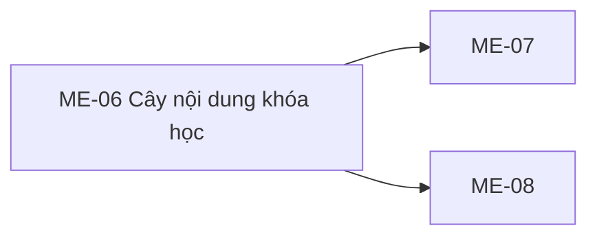

# ME-06 — Navigation

## 1. Route definition
- Current route in inventory: `/mentor/courses/:courseId/content`
- Status: candidate/design route; Study Web `UNWIRED` unless source code proves otherwise.
- Route params/types: `courseId` (type/validation: see source DD; CẦN_XÁC_NHẬN if absent)
- Query params/defaults: preserve the inventory route string; detailed parsing rules only from source DD.
- Route guards: see source DD/API contract; do not create role policy.

## 2. Điểm vào
| From screen/route | Trigger | Params | Guard / fallback |
|---|---|---|---|
| [ME-03](../ME-03-WorkspaceKhoaHocCuaMentor/00-overview.md), [ME-05](../ME-05-XemBaiGiangMentor/00-overview.md), [ME-07](../ME-07-TaoChinhSuaNoiDung/00-overview.md), [ME-08](../ME-08-XuatBanXoaNoiDung/00-overview.md) | Theo DD nguồn/inventory | Theo source; không suy diễn | Xem source DD; route chưa xác nhận runtime |

## 3. Điểm ra
| Destination | Trigger | Params | Điều kiện |
|---|---|---|---|
| [ME-07](../ME-07-TaoChinhSuaNoiDung/00-overview.md), [ME-08](../ME-08-XuatBanXoaNoiDung/00-overview.md) | Source event/inventory navigation | Theo source DD | Expected links; runtime chưa verify |

## 4. Back / refresh / deep link
- Back behavior: xem source DD; không mặc định browser history.
- Preserve filters/scroll/form state: chỉ nếu source có nêu, nếu không `CẦN_XÁC_NHẬN`.
- Refresh/direct URL: route trong inventory không chứng minh runtime.
- Invalid/missing ID: theo source DD/backend contract; không tự tạo validation.
- Not authenticated/authorized: theo source role guard; xem [Business Rules](05-business-rules.md).

## 5. Diagram

## Source navigation and flow detail

### Trích từ DD nguồn: 3. Handoff mutation #50–#53

| API | Current source | Ảnh hưởng đến ME-06 / trạng thái |
|---|---|---|
| #50 create | `POST /api/v1/mentor/content`; body strict `{course_id, content_type, title, payload}`; tạo root `parent_id=NULL`, order kế tiếp cho root, status `PENDING_REVIEW`; success 201 `DESIGN_RESOURCE_CREATED`. | Có thể là candidate cho root Content sau khi type/payload được chốt. Request không có `parent_id`, nên không tạo node con trong chapter. Unknown type/payload validation và direct-owner policy là blocker. |
| #51 update | `PUT /api/v1/mentor/content/{content_id}`; body `{content_type,title,payload}`; snapshot row hiện tại sang `content_versions`, thay 3 fields và đặt status `PENDING_REVIEW`; giữ parent/order; success 200 `DESIGN_RESOURCE_UPDATED`. | Candidate edit qua ME-07; không reorder hoặc move node. Version được archive nhưng response #49 không nêu version nào đang hiển thị. |
| #52 publish | `PATCH /api/v1/mentor/content/{content_id}/publish`; body `{published:boolean}`; `APPROVED→PUBLISHED` khi true, `PUBLISHED→APPROVED` khi false; same-target retry idempotent; source state khác trả 422. | Không phải reorder API. Draft/PENDING_REVIEW không thể publish trực tiếp theo source; CTA “Xuất bản ngay” trên row nháp chưa tương thích. Readiness payload không được kiểm chứng; `APPROVED` là điều kiện hiện có. |
| #53 delete | `DELETE /api/v1/mentor/content/{content_id}`; soft-delete `deleted_at`; từ chối node `PUBLISHED` và node có active children bằng 422; success 200 `DESIGN_RESOURCE_DELETED` cùng `DeleteResult`. | Sau khi xóa, GET #49 loại node. Dialog/cảnh báo xác nhận/refresh cache do ME-08 chịu trách nhiệm theo inventory; chưa có client code. |

Các endpoint #50–#53 cũng xác thực MENTOR và direct owner theo source hiện tại. Course assignment, content enum/payload, lifecycle/version owner approval và live schema còn mở.
