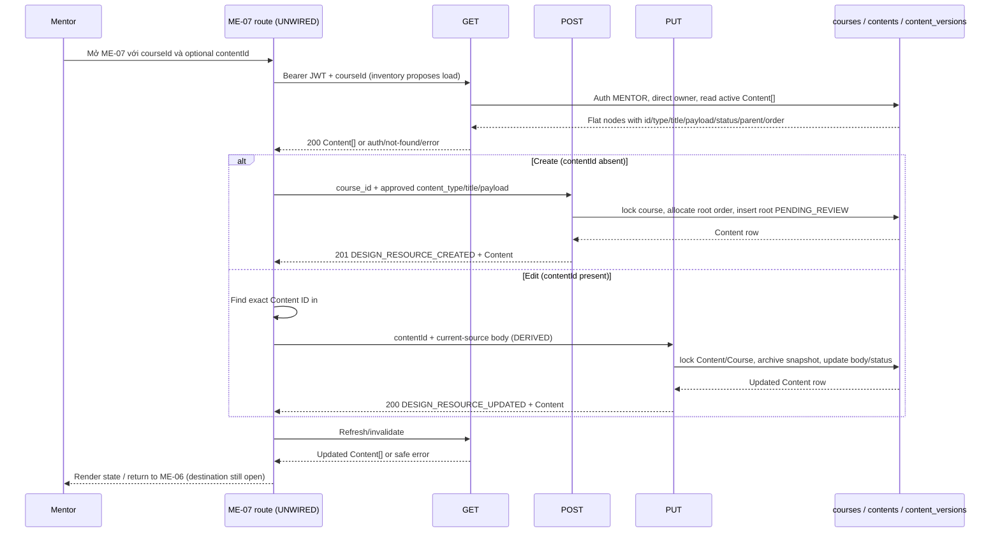

# ME-07 — Data Flow & State

## 1. Nguồn dữ liệu
| Field / object | Type | Source | Destination | Cập nhật khi |
|---|---|---|---|---|
| Chỉ liệt kê theo bằng chứng trong excerpt bên dưới | Theo DD/API source | API/inventory/design; status phải giữ nguyên | UI/state nêu ở DD nguồn | Theo event source |

## 2. State model

> Không tạo DTO/ViewModel mới khi chưa có contract. State, DTO và mapping được trích nguyên ngữ cảnh từ DD nguồn bên dưới.

## 3. API DTO → ViewModel mapping

### Trích từ DD nguồn: 2. End-to-end flow and source trace

The diagram separates expected client choreography from current server behavior. The server routes/modules are local source, but the client lane and runtime are not wired.

### Read/hydrate: API #49

1. Route input is proposed `courseId:int64` and optional `contentId:int64`. Current route does not exist in Study Web. The inventory proposes GET #49 to find existing Content; if create mode also requires this fetch, that purpose is not specified beyond the course tree/context.
2. Route `GET /api/v1/mentor/courses/{course_id}/content` delegates to `get_course_contents`. Shared guard validates Bearer JWT and role `MENTOR` before DB. The handler parses signed int64; malformed/out-of-range course ID maps to 404.
3. Query `FIND_MENTOR_COURSE` reads `courses.id, mentor_id`. Missing course is 404; a principal other than `courses.mentor_id` is 403. AC-22 says “có quyền quản lý course”; current source has no assigned/co-owner relation.
4. Query `LIST_COURSE_CONTENTS` reads all nodes for that course with `deleted_at IS NULL`, ordered by `parent_id NULLS FIRST, content_order ASC, id ASC`. The response is a flat `Content[]`; there is no single-content detail endpoint in this screen’s inventory.
5. Current projection is `{id:int64, course_id:int64, content_type:string, title:string, payload:object, status:string, parent_id:int64|null, order:int32}`. It has no version field. The view validates mapping, same-course IDs, unique IDs, parents and cycles; invalid/DB projection returns safe 500 with rollback; no partial collection.
6. Empty collection is 200 `DESIGN_RESOURCE_RETRIEVED` with `data:[]`. The client should treat `contentId` absent as candidate create mode; if present, find exact ID in the collection and verify its `course_id` equals route `courseId`. Missing ID in result is an expected UI not-found state, not evidence of a new API status.

### Create: API #50 current source

| Request | Current contract |
|---|---|
| Method/path | `POST /api/v1/mentor/content` |
| Headers | `Authorization: Bearer <token>`; shared current-user guard requires role `MENTOR`. |
| Body | Strict `{course_id:int64, content_type:string, title:string, payload:object}`; extra fields forbidden. No `parent_id` or `order`. |
| Validation | Pydantic enforces presence/basic types and signed int64 for `course_id`; source does not validate content-type enum, payload subtype, title nonempty/length, or order. Framework/body validation maps to 422 `DESIGN_VALIDATION_ERROR`. |
| Success | 201 `DESIGN_RESOURCE_CREATED`; `data` is shared Content projection. |
| Errors | 401 auth; 403 role/course absent/direct-owner mismatch; 422 request validation; 500 safe DB/projection/commit failure. Missing course currently is not a 404 for #50. |

Current caller/callee/side effect: route in `app/api/v1.py` → `create_content` → auth guard → `LOCK_MENTOR_COURSE FOR UPDATE` → owner check → `NEXT_ROOT_CONTENT_ORDER` over active roots → `INSERT_CONTENT` with `parent_id=NULL`, generated order, and `status=PENDING_REVIEW` → projection validation → commit → success envelope. First root order is 0; concurrent creates serialize on course row. Any SQL/mapping/commit error rolls back safely. The request cannot place a node beneath a parent or choose the displayed order.

### Update: API #51 current source vs catalog

| Request | Current source | Catalog/approval |
|---|---|---|
| Method/path | `PUT /api/v1/mentor/content/{content_id}` | Same method/path. |
| Path | Raw content ID parsed as signed int64 in view; malformed/out-of-range → 404. | Catalog declares required int64 path. |
| Headers | Bearer JWT; role `MENTOR`. | Bearer JWT; Mentor. |
| Body | Strict full replacement `{content_type:string, title:string, payload:object}`; extra fields forbidden. | [Catalog #51](../../../../../docs/lists/list_api.md#L161) records path only; no body schema. API DD labels body as DERIVED from #50 and not approved. |
| Success | 200 `DESIGN_RESOURCE_UPDATED`; returns shared Content projection. | `ApiEnvelope<Content>` and same code. |
| Errors | 401; missing/deleted ID 404; non-owner 403; framework body error 422; DB/snapshot/mapping/commit 500. No 409 branch or version precondition in current source. | Catalog lists 401/403/404/422/500, not 409. |

Current transaction: route → `update_content` → auth → parse ID → lock `contents` + `courses` → check direct owner → archive all current row fields in `content_versions` with `version_no=MAX+1` and `archived_by=mentor_id` → update `content_type/title/payload`, set current status `PENDING_REVIEW`, preserve `course_id/parent_id/content_order` → validate mapping → commit → response. `contents` current revision has no explicit version number, and response has no version token. The row lock serializes updates through this endpoint, but does not provide optimistic conflict detection or tell the editor that its local form was stale.

### Persistence / source status

- Checked-in legacy `DB.sql` defines `contents` and `content_versions`; migrations 006/007 define the same candidate tables. These are local artifacts only; no live database probe occurred. UUID V1-PILOT `content_blocks` is a different model and must not be substituted.
- Local route/module/test source exists for #49–#51. Test source covers auth, ownership, create order, #51 snapshot/update, body validation, rollback and OpenAPI. It was read/inspected, not executed. Fake DB tests do not prove PostgreSQL schema, migration rollout or deployed route.
- API DD [#50](../../../../study-server/docs/dd/50_mentor_content_create/02_Overview.md) and [#51](../../../../study-server/docs/dd/51_mentor_content_update/02_Overview.md) remain `Draft — Needs Confirmation`; #51 body, history model, lifecycle and identity are DERIVED/open.

### Trích từ DD nguồn: 3. Data mapping and field rules

### Form field mapping

| Field/UI | Create source | Edit source | Request/validation status |
|---|---|---|---|
| `courseId` route | From ME-06 route/context candidate | Same | #50 body requires `course_id`; #51 has no course field. Server derives content’s course for authorization. Route syntax/client parsing is not implemented. |
| `contentId` route | Absent → candidate create mode | Required for candidate edit mode | #49 collection must contain this exact ID and same route course before enabling edit. #51 path takes it; never submit it in body. |
| `title` | Blank form value | From `Content.title` | #50/#51 require a string. Blank/whitespace and max-length rules are not enforced by current model; screenshot indicates required but does not define normalization/limit. |
| `content_type` | Blank select | From `Content.content_type` | APIs require a string but leave it open. HTML option values `theory/reading/practice` are sample values without enum approval. |
| `payload` | No source UI value; must be a JSON object | Current `Content.payload` object from #49 | Required by #50/#51; subtype/schema/editor/asset URI rules are `OPEN`. Placeholder is not payload data. |
| `sort_order` UI / `order` response | #50 generates root order | #49 returns int32 `order`; #51 preserves current order | UI’s positive-number field cannot be written through #50/#51. Create starts at root order 0; reordering/update order needs contract/API. Disable or remove the editable field until approved. |
| `parent_id` | #50 always writes `NULL` | #51 preserves current value | Not in either mutation request. Cannot choose/change parent from this form. |
| `status` / “Lưu bản nháp” | #50 sets `PENDING_REVIEW` | #51 resets current row to `PENDING_REVIEW` | No status field in body. “Draft” label is not a current approved enum mapping. |
| `version` | No initial version returned | #51 writes a prior-state snapshot | No version number/current-version pointer in #49/#50/#51 response; no concurrency token. |

### Error and side-effect boundary

- Do not merge API #50 or #51 into one route. Select method using create/edit mode and `contentId`, then invalidate/reload #49 only after server success.
- Do not pass UI `sort_order`, `parent_id`, session progress, owner, status or version in either request; current Pydantic models forbid undeclared body fields.
- #50 success creates exactly one root Content with server-derived order/status. #51 success creates a version-history snapshot and changes current status/content. Both commit internally in current implementation and return one Content item.
- There is no idempotency key. If a POST times out after the server may have committed, automatic retry can create a duplicate root. A client must not blindly retry ambiguous create failures; the UI retry/resolution policy is open.
- #51’s row lock prevents simultaneous #51 transactions from updating at once but has no optimistic token/409. Do not show a server-backed `conflict` outcome as current behavior; any stale-form warning requires a version/concurrency contract.

### Trích từ DD nguồn: 6. State, security and accessibility matrix

| State | Entry condition | Required UI behavior / evidence |
|---|---|---|
| `create-ready` | No `contentId`; course context available | Blank fields. Save remains disabled until body contract exists; source API can only create a root PENDING_REVIEW Content. |
| `edit-loading` | `contentId` present, #49 in flight | Do not show fixture values as loaded form data. |
| `ready` | #49 contains matching Content | Map current fields; preserve raw status/order/parent/ID. Payload editor is unavailable until subtype contract. |
| `empty` | #49 returns `data:[]` in create context | Treat as valid collection; edit mode resolves to not-found. |
| `dirty` | Any editable field changes | Client state candidate only; current static HTML has no dirty tracking. Cancel/discard behavior is open. |
| `validating` | User attempts save | Validate only approved field/type/payload rules; current client/server do not define all rules. |
| `saving-create` | POST #50 pending | Prevent repeat submit; no automatic retry after ambiguous timeout. |
| `saving-update` | PUT #51 pending | No version precondition; no server 409 conflict semantics. |
| `saved-await-refresh` | #50/#51 success before #49 refresh | Keep response visible; invalidate/reload #49 per inventory. Exact route destination open. |
| `denied` | 401/403 | Distinguish authentication from course ownership; no protected form/save action. Source authorization is direct owner, not assignment. |
| `not-found` | #49 course missing/invalid or edit ID not in result; #51 Content missing | Do not populate sample form; `#51` malformed/missing ID maps 404. |
| `validation-error` | #50/#51 body 422 | Keep local input where safe; field-level error contract and copy not defined. |
| `error` | API 500/network error | Show retry/leave state without claiming save succeeded. Safe backend error has no internal SQL details. |
| `conflict` | Inventory state only | Not source-backed: #51 has no version token/409. Do not claim conflict detection exists until API contract changes. |
| `current-mock-disabled` | Existing code.html | Save has `disabled` and `aria-disabled=true`; this is current static state, not an authorization result. |

Security and accessibility notes:

- Do not rely on `courseId`, UI badge or session-progress panel as access control; #50/#51 perform server checks, currently direct owner. Do not transmit JWT in query strings.
- Treat `payload` as untrusted JSON. Define subtype validation and safe rendering before allowing rich HTML, Markdown, asset URLs or external links.
- The editor header currently has no associated form control; future editor needs a programmatic label, keyboard support, focus order and validation/error association. Input controls should retain visible labels and focus state.
- Current `img` uses `data-alt` rather than `alt`; progress is a plain `div` without progressbar semantics/value. The mockup imports remote Plus Jakarta Sans while the Study Web guide says not to add remote font imports and targets responsive layout/visible focus/44px controls. These are design-source gaps, not runtime claims.

## 4. Luồng đọc (Read)
- Orchestration từ inventory: GET #49 tìm content hiện hữu → POST #50 hoặc PUT #51 → refresh #49.
- Chi tiết current/source mapping: xem [API Integration](04-api-integration.md) và DD nguồn.

## 5. Luồng ghi (Write)
- Chỉ mô tả mutation được DD/API source nêu; không thêm endpoint hoặc side effect.
- Source trace: [ME-07](../../screen_stitch/04_mentor/ME-07_tao-chinh-sua-noi-dung/ME-07.md)

## 6. Cache / concurrency / lifecycle
- Cache, race, cleanup, pagination: xem các section source bên dưới; nếu không có bằng chứng thì để `CẦN_XÁC_NHẬN`.

## 7. Data errors & security
- Theo error/security/source-status section của DD nguồn; không coi state trong mockup là runtime behavior.

## 8. Trace
[Events](02-events.md) · [API](04-api-integration.md) · [Rules](05-business-rules.md)
