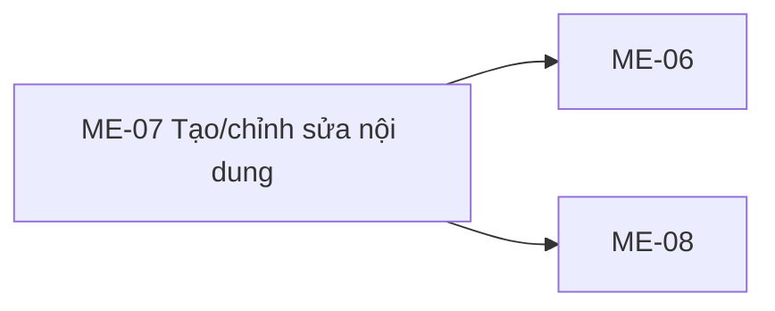
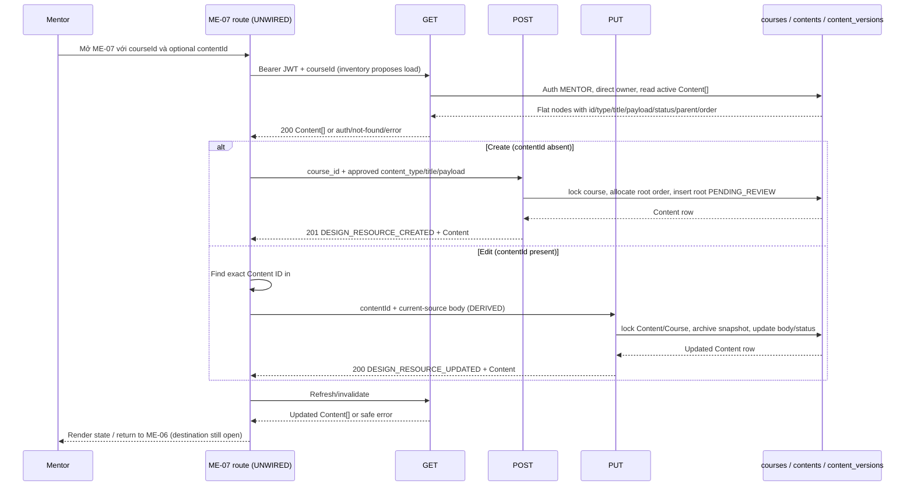

# ME-07 — Navigation

## 1. Route definition
- Current route in inventory: `/mentor/courses/:courseId/content/:contentId?`
- Status: candidate/design route; Study Web `UNWIRED` unless source code proves otherwise.
- Route params/types: `courseId` (type/validation: see source DD; CẦN_XÁC_NHẬN if absent), `contentId` (type/validation: see source DD; CẦN_XÁC_NHẬN if absent)
- Query params/defaults: preserve the inventory route string; detailed parsing rules only from source DD.
- Route guards: see source DD/API contract; do not create role policy.

## 2. Điểm vào
| From screen/route | Trigger | Params | Guard / fallback |
|---|---|---|---|
| [ME-06](../ME-06-CayNoiDungKhoaHoc/00-overview.md) | Theo DD nguồn/inventory | Theo source; không suy diễn | Xem source DD; route chưa xác nhận runtime |

## 3. Điểm ra
| Destination | Trigger | Params | Điều kiện |
|---|---|---|---|
| [ME-06](../ME-06-CayNoiDungKhoaHoc/00-overview.md), [ME-08](../ME-08-XuatBanXoaNoiDung/00-overview.md) | Source event/inventory navigation | Theo source DD | Expected links; runtime chưa verify |

## 4. Back / refresh / deep link
- Back behavior: xem source DD; không mặc định browser history.
- Preserve filters/scroll/form state: chỉ nếu source có nêu, nếu không `CẦN_XÁC_NHẬN`.
- Refresh/direct URL: route trong inventory không chứng minh runtime.
- Invalid/missing ID: theo source DD/backend contract; không tự tạo validation.
- Not authenticated/authorized: theo source role guard; xem [Business Rules](05-business-rules.md).

## 5. Diagram

## Source navigation and flow detail

### Trích từ DD nguồn: 2. End-to-end flow and source trace

The diagram separates expected client choreography from current server behavior. The server routes/modules are local source, but the client lane and runtime are not wired.

### Read/hydrate: API #49

1. Route input is proposed `courseId:int64` and optional `contentId:int64`. Current route does not exist in Study Web. The inventory proposes GET #49 to find existing Content; if create mode also requires this fetch, that purpose is not specified beyond the course tree/context.
2. Route `GET /api/v1/mentor/courses/{course_id}/content` delegates to `get_course_contents`. Shared guard validates Bearer JWT and role `MENTOR` before DB. The handler parses signed int64; malformed/out-of-range course ID maps to 404.
3. Query `FIND_MENTOR_COURSE` reads `courses.id, mentor_id`. Missing course is 404; a principal other than `courses.mentor_id` is 403. AC-22 says “có quyền quản lý course”; current source has no assigned/co-owner relation.
4. Query `LIST_COURSE_CONTENTS` reads all nodes for that course with `deleted_at IS NULL`, ordered by `parent_id NULLS FIRST, content_order ASC, id ASC`. The response is a flat `Content[]`; there is no single-content detail endpoint in this screen’s inventory.
5. Current projection is `{id:int64, course_id:int64, content_type:string, title:string, payload:object, status:string, parent_id:int64|null, order:int32}`. It has no version field. The view validates mapping, same-course IDs, unique IDs, parents and cycles; invalid/DB projection returns safe 500 with rollback; no partial collection.
6. Empty collection is 200 `DESIGN_RESOURCE_RETRIEVED` with `data:[]`. The client should treat `contentId` absent as candidate create mode; if present, find exact ID in the collection and verify its `course_id` equals route `courseId`. Missing ID in result is an expected UI not-found state, not evidence of a new API status.

### Create: API #50 current source

| Request | Current contract |
|---|---|
| Method/path | `POST /api/v1/mentor/content` |
| Headers | `Authorization: Bearer <token>`; shared current-user guard requires role `MENTOR`. |
| Body | Strict `{course_id:int64, content_type:string, title:string, payload:object}`; extra fields forbidden. No `parent_id` or `order`. |
| Validation | Pydantic enforces presence/basic types and signed int64 for `course_id`; source does not validate content-type enum, payload subtype, title nonempty/length, or order. Framework/body validation maps to 422 `DESIGN_VALIDATION_ERROR`. |
| Success | 201 `DESIGN_RESOURCE_CREATED`; `data` is shared Content projection. |
| Errors | 401 auth; 403 role/course absent/direct-owner mismatch; 422 request validation; 500 safe DB/projection/commit failure. Missing course currently is not a 404 for #50. |

Current caller/callee/side effect: route in `app/api/v1.py` → `create_content` → auth guard → `LOCK_MENTOR_COURSE FOR UPDATE` → owner check → `NEXT_ROOT_CONTENT_ORDER` over active roots → `INSERT_CONTENT` with `parent_id=NULL`, generated order, and `status=PENDING_REVIEW` → projection validation → commit → success envelope. First root order is 0; concurrent creates serialize on course row. Any SQL/mapping/commit error rolls back safely. The request cannot place a node beneath a parent or choose the displayed order.

### Update: API #51 current source vs catalog

| Request | Current source | Catalog/approval |
|---|---|---|
| Method/path | `PUT /api/v1/mentor/content/{content_id}` | Same method/path. |
| Path | Raw content ID parsed as signed int64 in view; malformed/out-of-range → 404. | Catalog declares required int64 path. |
| Headers | Bearer JWT; role `MENTOR`. | Bearer JWT; Mentor. |
| Body | Strict full replacement `{content_type:string, title:string, payload:object}`; extra fields forbidden. | [Catalog #51](../../../../../docs/lists/list_api.md#L161) records path only; no body schema. API DD labels body as DERIVED from #50 and not approved. |
| Success | 200 `DESIGN_RESOURCE_UPDATED`; returns shared Content projection. | `ApiEnvelope<Content>` and same code. |
| Errors | 401; missing/deleted ID 404; non-owner 403; framework body error 422; DB/snapshot/mapping/commit 500. No 409 branch or version precondition in current source. | Catalog lists 401/403/404/422/500, not 409. |

Current transaction: route → `update_content` → auth → parse ID → lock `contents` + `courses` → check direct owner → archive all current row fields in `content_versions` with `version_no=MAX+1` and `archived_by=mentor_id` → update `content_type/title/payload`, set current status `PENDING_REVIEW`, preserve `course_id/parent_id/content_order` → validate mapping → commit → response. `contents` current revision has no explicit version number, and response has no version token. The row lock serializes updates through this endpoint, but does not provide optimistic conflict detection or tell the editor that its local form was stale.

### Persistence / source status

- Checked-in legacy `DB.sql` defines `contents` and `content_versions`; migrations 006/007 define the same candidate tables. These are local artifacts only; no live database probe occurred. UUID V1-PILOT `content_blocks` is a different model and must not be substituted.
- Local route/module/test source exists for #49–#51. Test source covers auth, ownership, create order, #51 snapshot/update, body validation, rollback and OpenAPI. It was read/inspected, not executed. Fake DB tests do not prove PostgreSQL schema, migration rollout or deployed route.
- API DD [#50](../../../../study-server/docs/dd/50_mentor_content_create/02_Overview.md) and [#51](../../../../study-server/docs/dd/51_mentor_content_update/02_Overview.md) remain `Draft — Needs Confirmation`; #51 body, history model, lifecycle and identity are DERIVED/open.
