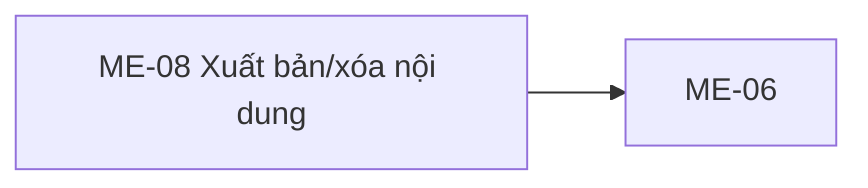

# ME-08 — Navigation

## 1. Route definition
- Current route in inventory: `/mentor/content/:contentId/actions`
- Status: route/page source wired; current caller is #49 only; mutations gated; runtime NOT VERIFIED.
- Route params/types: `contentId` is validated as a positive safe Mentor ID. The required `courseId` comes from the ME-06 router history state; both values are checked before #49 is called. Route-param changes cancel stale reads.
- Query params/defaults: preserve the inventory route string; detailed parsing rules only from source DD.
- Route guards: see source DD/API contract; do not create role policy.

## 2. Điểm vào
| From screen/route | Trigger | Params | Guard / fallback |
|---|---|---|---|
| [ME-06](../ME-06-CayNoiDungKhoaHoc/00-overview.md) | Current tree handoff | `contentId` path + `courseId` history state | Missing/invalid context blocks hydration; runtime chưa verify |

## 3. Điểm ra
| Destination | Trigger | Params | Điều kiện |
|---|---|---|---|
| [ME-06](../ME-06-CayNoiDungKhoaHoc/00-overview.md) | Source event/inventory navigation | Theo source DD | Expected links; runtime chưa verify |

## 4. Back / refresh / deep link
- Back behavior: xem source DD; không mặc định browser history.
- Preserve filters/scroll/form state: chỉ nếu source có nêu, nếu không `CẦN_XÁC_NHẬN`.
- Refresh/direct URL: navigation state may not be present on direct entry; the page shows the invalid-context state and links to the course list. Browser/runtime is not verified.
- Invalid/missing ID: missing or malformed `contentId`/`courseId` blocks hydration; an ID absent from the current #49 collection shows not-found.
- Not authenticated/authorized: theo source role guard; xem [Business Rules](05-business-rules.md).

## 5. Diagram

## Source navigation and flow detail

> CẦN_XÁC_NHẬN: DD nguồn không có section navigation riêng; inventory links dưới đây là expected links, chưa chứng minh router runtime.
