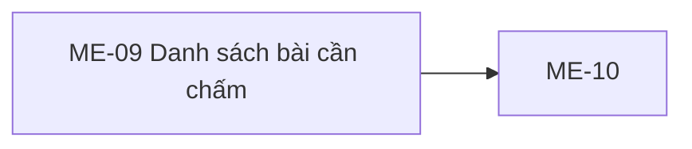

# ME-09 — Navigation

## 1. Route definition
- Current route in inventory: `/mentor/submissions`
- Status: candidate/design route; Study Web `UNWIRED` unless source code proves otherwise.
- Route params/types: Không có route param được biểu diễn trong inventory string; route runtime vẫn chưa xác minh.
- Query params/defaults: preserve the inventory route string; detailed parsing rules only from source DD.
- Route guards: see source DD/API contract; do not create role policy.

## 2. Điểm vào
| From screen/route | Trigger | Params | Guard / fallback |
|---|---|---|---|
| [ME-01](../ME-01-DashboardMentor/00-overview.md), [ME-10](../ME-10-ChamDiemVaPhanHoi/00-overview.md) | Theo DD nguồn/inventory | Theo source; không suy diễn | Xem source DD; route chưa xác nhận runtime |

## 3. Điểm ra
| Destination | Trigger | Params | Điều kiện |
|---|---|---|---|
| [ME-10](../ME-10-ChamDiemVaPhanHoi/00-overview.md) | Source event/inventory navigation | Theo source DD | Expected links; runtime chưa verify |

## 4. Back / refresh / deep link
- Back behavior: xem source DD; không mặc định browser history.
- Preserve filters/scroll/form state: chỉ nếu source có nêu, nếu không `CẦN_XÁC_NHẬN`.
- Refresh/direct URL: route trong inventory không chứng minh runtime.
- Invalid/missing ID: theo source DD/backend contract; không tự tạo validation.
- Not authenticated/authorized: theo source role guard; xem [Business Rules](05-business-rules.md).

## 5. Diagram


## Source navigation and flow detail

### Trích từ DD nguồn: F. Điều hướng và tiêu chí nghiệm thu

### F.1. Điều hướng và dữ liệu truyền

| Từ/đến | Hành vi expected | Current evidence / giới hạn |
|---|---|---|
| ME-01 → ME-09 | Mở danh sách từ Mentor dashboard. | Inventory link; dashboard widget không xác nhận route runtime. |
| ME-09 → ME-10 | Chọn submission và truyền submission ID. | Current #54 trả item `id`; #55 nhận `submission_id` path. Loaded row và router chưa có. |
| ME-10 → ME-09 | Quay lại danh sách sau detail/grade/feedback. | ME-10 inventory liên kết ngược; refresh/invalidation/cache behavior chưa được xác định ở ME-09. |
| Header/footer links | Điều hướng tới Mentor pages/policy/support. | Tất cả anchor trong HTML là `#`; destination chưa được xác nhận. |

### F.2. Blockers cần quyết định

| Blocker | Cần xác nhận | Nguồn/ảnh hưởng |
|---|---|---|
| ME09-B01 — response cardinality | API/schema owner chấp thuận `Page<Submission>` hay giữ singular `Submission`; đồng bộ inventory/API DD/catalog/diagram. | [inventory](../../list_screen.md#L169), [AC-23 diagram](../../../../study-server/docs/diagrams/AC_UNICA/AC_03_MENTOR_TEACHING.drawio), [API #54 DD](../../../../study-server/docs/dd/54_mentor_submissions_list/02_Overview.md), current route/model. |
| ME09-B02 — loaded row design/fields | Duyệt row layout, deadline source, owner/student display field, course/assignment title, file display and pagination controls. | Inventory yêu cầu deadline/owner; #54 không trả due date/name/title; ảnh/HTML chỉ empty. |
| ME09-B03 — filters | Xác định course-option source và selected numeric ID; status enum/valid values/default mapping; hành vi page reset. | HTML options static; #54 query exact status và int64 course_id; status lifecycle/409 còn mở trong API DD. |
| ME09-B04 — search | Bỏ/disable search hoặc định nghĩa field/index/query endpoint tương thích. | #54 không có search param, assignment title; HTML input không có event. |
| ME09-B05 — refresh/claims | Quyết định refresh action, polling/auto-sync, 48-hour SLA, rubric and support destination. | HTML claims không được API #54 hoặc #55 current source chứng minh. |
| ME09-B06 — server contract | Chốt file URL producer #35, assigned-Mentor access, status lifecycle/409, nullable relations/timezone/live schema và error catalog. | [API #54 open questions](../../../../study-server/docs/dd/54_mentor_submissions_list/OPEN_QUESTIONS.md). |
| ME09-B07 — frontend runtime | Bổ sung editable Study Web source/router/auth/API integration trước khi triển khai và xác minh screen. | [Study Web context](../../../../../.agents/web-work/study/AGENTS.md) xác nhận `UNWIRED`. |

### F.3. Checklist nghiệm thu tài liệu

- [x] Ảnh gốc và HTML được bảo toàn; hai hash ghi trong plan/worklog.
- [x] Có ảnh chú thích 2× và 27 marker duy nhất, tuần tự; JSON/SVG/element IDs ánh xạ một-một.
- [x] Expected behavior và current source tách biệt; API #54 được trace route → guard/view → SQL → model/response → test source.
- [x] Tất cả visible element trong PNG/HTML được nhận diện; controls và navigation thiếu handler/route được nêu rõ.
- [x] Events, states, error/business code và ME-10 handoff được mô tả; loaded-state row được đánh dấu thiếu thay vì bịa.
- [ ] Contract cardinality, loaded row fields, filter/search semantics, API/schema open questions và Study Web wiring được duyệt/hoàn tất.
- [ ] Có thể khẳng định lập trình viên triển khai mà không cần tự quyết nghiệp vụ/API còn mở.

**Kết quả:** checklist artifact và source trace đạt cho phiên này; hai mục cuối chưa đạt nên ME-09 chưa phải `DD READY`. `IMPLEMENTATION BLOCKED` và `RUNTIME NOT VERIFIED` là các trạng thái độc lập, không được suy từ việc đã tạo ảnh/DD.

### Trích từ DD nguồn: B. Luồng hoạt động tổng thể

### B.1. Luồng tải màn hình dự kiến

1. Người dùng vào route đề xuất `/mentor/submissions`. Study Web route chưa tồn tại; guard, token source và fallback phiên hết hạn chưa được triển khai.
2. Client cần gửi Bearer token cho #54. Server kiểm tra chữ ký/subject/role MENTOR trước mọi DB access. Client role label không thay thế authorization của server.
3. Khi contract đã duyệt, client gọi #54 với filter defaults được xác nhận. API hiện chấp nhận query `course_id`, `status`, `page`; không gửi `size`, `q` hoặc sort.
4. Server count/list giới hạn dữ liệu đến course có `mentor_id` bằng authenticated JWT subject; response được sắp mới nhất trước theo `submitted_at`, sau đó `id` giảm dần.
5. Client phải phân biệt `items=[]` (empty success) với HTTP/network error. API #54 không trả partial result.
6. Khi có `items`, client cần render theo row layout đã được phê duyệt. Hiện không có screenshot/HTML loaded state để quyết định trường hiển thị, deadline, owner/course label hay link file.
7. Khi chọn row, chuyển `data.items[].id` sang ME-10 path `submission_id`; #55 mới tải chi tiết. Chấm điểm #56 và feedback #57 chỉ diễn ra ở ME-10.

### B.2. Handoff ME-09 → ME-10

```mermaid
flowchart LR
  ME09[ME-09 danh sách] -->|GET #54: Page<Submission>, current source| LIST[(data.items)]
  LIST -->|chọn data.items[].id| ME10[ME-10 chi tiết]
  ME10 -->|GET #55| DETAIL[(Submission detail)]
  ME10 -->|POST #56 grade; độc lập| GRADE[(Score/status)]
  ME10 -->|POST #57 feedback; độc lập| FEEDBACK[(Feedback)]
```

Sơ đồ trên nối expected screen flow với current API source. Nó không chứng minh frontend navigation hoặc cache đã được wired. API #55 source hiện đọc submission trực tiếp theo ID và áp dụng direct-owner Mentor policy; nó không trả rubric trong current response. Không suy luận dữ liệu hoặc thao tác #55–#57 trên ME-09.
