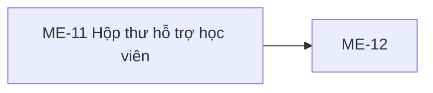

# ME-11 — Navigation

## 1. Route definition
- Current route in inventory: `/mentor/support`
- Status: candidate/design route; Study Web `UNWIRED` unless source code proves otherwise.
- Route params/types: Không có route param được biểu diễn trong inventory string; route runtime vẫn chưa xác minh.
- Query params/defaults: preserve the inventory route string; detailed parsing rules only from source DD.
- Route guards: see source DD/API contract; do not create role policy.

## 2. Điểm vào
| From screen/route | Trigger | Params | Guard / fallback |
|---|---|---|---|
| [ME-01](../ME-01-DashboardMentor/00-overview.md), [ME-12](../ME-12-TraoDoiVaDongYeuCau/00-overview.md) | Theo DD nguồn/inventory | Theo source; không suy diễn | Xem source DD; route chưa xác nhận runtime |

## 3. Điểm ra
| Destination | Trigger | Params | Điều kiện |
|---|---|---|---|
| [ME-12](../ME-12-TraoDoiVaDongYeuCau/00-overview.md) | Source event/inventory navigation | Theo source DD | Expected links; runtime chưa verify |

## 4. Back / refresh / deep link
- Back behavior: xem source DD; không mặc định browser history.
- Preserve filters/scroll/form state: chỉ nếu source có nêu, nếu không `CẦN_XÁC_NHẬN`.
- Refresh/direct URL: route trong inventory không chứng minh runtime.
- Invalid/missing ID: theo source DD/backend contract; không tự tạo validation.
- Not authenticated/authorized: theo source role guard; xem [Business Rules](05-business-rules.md).

## 5. Diagram


## Source navigation and flow detail

### Trích từ DD nguồn: E. Ma trận trạng thái và điều hướng

### E.1. State matrix

| State | Entry/condition | UI/data rule | Exit |
|---|---|---|---|
| `route-unwired` | Current checkout, no Study Web route/source. | Không có runtime UI; tài liệu/ảnh không chứng nhận route. | Frontend app wiring task. |
| `auth-check` | Future route entry. | Resolve approved session/role before protected data load. | Authenticated Mentor → loading; missing/expired → shared auth state. |
| `loading` | #58 in flight. | Không hiển thị mockup counters/content như dữ liệu thật; disable refresh/filter action behavior per approved UX. | 200 → empty/ready; 401/403/422/500/network → error states. |
| `empty` | #58 200 and `data=[]`. | Empty state copy/illustration; counts cannot be inferred from collection. | Filter or refresh after behavior contract confirmed. |
| `ready` | #58 200 and `data.length>0`. | DD BLOCKED: no row layout, field grouping, sort label, paging or row action design. | Selected request → ME-12 after design. |
| `status-filtered` | User selects tab after mapping approval. | Query/local filtering and count semantics unresolved. | Success → empty/ready; failure → prior state. |
| `course-filtered` | User selects an owned course option after ID source approval. | Send valid int64; no slug mapping available. | Success → empty/ready; 403/422/error → corresponding state. |
| `refreshing` | E04 future API call. | Prototype spinner only proves local animation. Keep prior list if already loaded, subject to UX approval. | Success → empty/ready; failure → stale/error. |
| `auth-required` | #58 401 or session gate failure. | Clear/expire session per shared auth contract; avoid showing protected prior data after logout. | Approved login/recovery route. |
| `access-denied` | #58 403 for Mentor role/scope. | Show shared denied state; do not reveal other Mentor’s course/request details. | Back/authorized destination. |
| `invalid-filter` | #58 422 for invalid `course_id`. | Indicates client mapping defect or invalid direct query; preserve safe UI state and log trace ID only. | Correct selection/retry after mapping fixed. |
| `list-error` | #58 500, network or timeout. | Safe error; do not expose SQL/stack or assume empty. | Manual refresh/retry policy pending. |
| `stale-after-refresh-error` | Refresh fails while prior successful data exists. | Preserve last good data only if approved; show freshness accurately. | Successful #58 or leave route. |
| `no-match` | Valid exact status/course filter yields `data=[]`. | Distinguish from no requests overall only if confirmed copy/UX exists. | Change filter/refresh. |
| `opening-me12` | User activates approved request row. | Pass `data[].id`; no row action is currently specified. | ME-12 owns detail load/error/back behavior. |

### E.2. Screen links and handoff

```text
ME-01 -- expected navigation --> ME-11 -- select data[].id --> ME-12
                                             #58 collection     #59 detail → #60 reply → #61 resolve (ME-12)
```

- F09 explicitly relates ME-11 → ME-12. ME-11 expected handoff is one positive-int64 `requestId` from `data[].id`; exact UI route/query encoding remains to be confirmed with frontend routing.
- ME-11 uses GET #58 only. #59/#60/#61 ownership remains ME-12. No student-create route is currently found, and no Student CTA is specified here.
- Browser Back, return filters/page, header route destinations, footer links, and notification route remain unverified. Route guards/session expiry policy belong to shared Study Web shell that is not in checkout.

### E.3. Privacy, accessibility and responsive behavior

- **Privacy/access:** server-side Mentor role and `courses.mentor_id` scope are the access boundary. UI filters are not authorization. Display only response fields needed by an approved row design; avoid logging message content, student avatar URLs, or attachment URLs. Attachment link eligibility is validated by API projection (author, course, purpose, uploaded state); frontend must not construct or broaden URLs.
- **Rendering:** treat message `content` as untrusted text unless a separately approved safe-rendering contract exists; do not interpret arbitrary HTML. Restrict external image/link behavior for avatar/attachment according to the Study security policy when available.
- **Accessibility:** prototype uses tab roles/`aria-selected`, label-to-select association and a button. Keyboard arrow/focus management, focus-visible ring for tabs, live region for refresh/error/empty results, and announce-count behavior are not established. WCAG 2.1 AA footer text is a claim, not an audit result.
- **Responsive:** HTML uses Tailwind breakpoints (`md`, `lg`, `sm`) and can stack controls; rendered PNG is one desktop composition. Mobile/tablet wrapping, navigation collapse, touch target, scrolling and zoom behavior need viewport-specific approved design and runtime check.
- **Visual system:** `.agents/web-study/design.md` is design guidance; current mockup's blue palette differs. Tailwind CDN and Google Fonts links are external dependencies in `code.html`, not a production dependency decision.

### Trích từ DD nguồn: B. Luồng hoạt động tổng thể

1. **Khởi tạo route:** route đề xuất `/mentor/support`. Frontend hiện chưa có route. Khi có app, session/role gate phải xác nhận Mentor; UI không được lấy role từ tên/avatar mẫu.
2. **Tải collection:** expected call là `GET /api/v1/mentor/support/requests` với Authorization Bearer. Không tự thêm `course_id`/`status` mặc định hay gọi #46 cho tới khi dependency/options được duyệt. Loading state cần được thể hiện.
3. **Xác thực request ở server:** FastAPI kiểm tra query shape; sau đó view gọi shared guard cho Bearer/JWT/role `MENTOR` trước DB access. Với `course_id`, view lookup course; course tồn tại nhưng owner khác trả 403, course không tồn tại tiếp tục trả collection rỗng. Sau đó SQL luôn lọc `courses.mentor_id` theo principal và ghép optional course/status bằng AND.
4. **Response thành công:** server sắp xếp request `created_at DESC, id DESC`, tải mọi thread theo `created_at ASC, id ASC` khi collection không rỗng, xác thực projection/envelope và trả 200 `DESIGN_RESOURCE_RETRIEVED`. `data: []` là kết quả rỗng hợp lệ; `meta` rỗng, không có pagination.
5. **Ánh xạ dữ liệu:** UI chỉ được dùng field được trả: `id`, `course_id`, `student{id,full_name,avatar_url?}`, `status`, `messages[]`, `created_at`, `resolved_at?`; message gồm author, content, attachments và `created_at`. Response không trả course title, unread flag, SLA deadline, count facets, contact/email hoặc last-update value. Loaded-state layout cần được duyệt trước khi chọn trường hiển thị.
6. **Lọc:** prototype All/Open/Resolved và course select hiện là controls tĩnh. Chỉ gửi filter sau khi owner xác nhận exact status grouping và option ID source. Giá trị status lạ hiện trả `[]`; `course_id` ngoài miền positive-int64 trả 422.
7. **Refresh:** prototype refresh không fetch. Future refresh nếu được duyệt sẽ lặp #58 với filters đã chọn; khi thất gại nên giữ dữ liệu trước đó cùng trạng thái lỗi/stale được duyệt. Retry/backoff/timeout chưa có contract.
8. **Mở request:** expected khi chọn row đã thiết kế là truyền request ID `data[].id` sang ME-12. Không có row trong screenshot nên thao tác và row fields chưa được hiện thực hóa; ME-12 owns #59/#60/#61.
9. **Rời trang:** nav/header/footer anchors trong HTML đều `href="#"`. Destination, back/filter retention và notification route cần wiring riêng; không có data mutation khi rời ME-11.

### B.1. API #58 — request, response và lỗi

| Mục | Contract hiện có |
|---|---|
| API ID / method | #58 — `GET` |
| Endpoint | `/api/v1/mentor/support/requests` |
| Authentication | `Authorization: Bearer <token>`; shared current-user guard yêu cầu role `MENTOR`. |
| Query | `course_id?: int64`, `1 ≤ value ≤ 2^63−1`; `status?: string` tùy chọn, không enum-validate. Không có path params/body. |
| Ownership | Request luôn lọt qua `courses.mentor_id = mentor_id`; nếu filter course tồn tại nhưng thuộc mentor khác → 403. Course ID không tồn tại không lỗi, collection rỗng. |
| Filter semantics | Optional `course_id` và `status` kết hợp AND; status exact match. Giá trị status lạ không có match → 200 `data: []`. |
| Ordering | Requests `created_at DESC, id DESC`; messages `created_at ASC, id ASC`; attachment order theo `asset_position`. Không có pagination, cursor hoặc page size. |
| Success | 200, `success=true`, `businessCode=DESIGN_RESOURCE_RETRIEVED`, `message` là `Support requests retrieved.` hoặc `No support requests found.`, `data: SupportRequest[]`, `meta:{}`, `traceId`. |
| Errors | 401 `DESIGN_AUTHENTICATION_REQUIRED`; 403 `DESIGN_ACCESS_DENIED`; 422 `DESIGN_VALIDATION_ERROR` cho query `course_id` invalid; 500 `DESIGN_INTERNAL_ERROR` cho DB/projection/envelope failure. Error envelope dùng `data:null`; không lộ stack/raw nội bộ. |
| Transaction | GET không commit. SQL/projection/attachment mapping lỗi gọi rollback an toàn trước 500. Course owner mismatch cũng rollback trước 403. |
| Response field mapping | Request: `id`, `course_id`, `student`, `status`, full `messages[]`, `created_at`, optional `resolved_at`. Student/author summary: `id`, `full_name`, optional `avatar_url`. Message: `id`, `author`, `content`, `attachments[]`, `created_at`. UploadAsset chỉ được ghép khi upload ID/author/course/role-purpose/`UPLOADED` match. Optional null fields bị loại khỏi JSON. |
| Giới hạn projection | Không có `course_title`, count, unread state, last activity, SLA timestamp, student contact data, pagination hoặc summary-only thread. Payload toàn bộ messages có thể lớn. |

**Source trace:** [#58 route](../../../../study-server/app/api/v1.py) → [view/auth/query orchestration](../../../../study-server/app/modules/mentor/api_58_mentor_support_requests/view.py) → [SQL](../../../../study-server/app/modules/mentor/api_58_mentor_support_requests/query.py) → [models](../../../../study-server/app/modules/mentor/api_58_mentor_support_requests/models.py). API DD [verification](../../../../study-server/docs/dd/58_mentor_support_requests/VERIFICATION_REPORT.md) reports route/module/model/test source wired, while retaining Draft status and derived local fallback decisions. Historical focused tests are recorded there; they use fake sessions and do not verify live DB/migration deployment.
