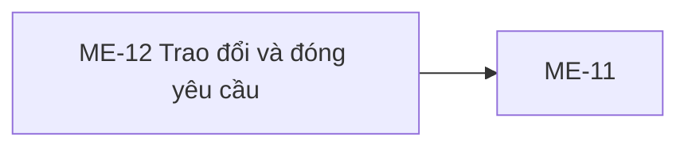

# ME-12 — Navigation

## 1. Route definition
- Current route in inventory: `/mentor/support/:requestId`
- Status: candidate/design route; Study Web `UNWIRED` unless source code proves otherwise.
- Route params/types: `requestId` (type/validation: see source DD; CẦN_XÁC_NHẬN if absent)
- Query params/defaults: preserve the inventory route string; detailed parsing rules only from source DD.
- Route guards: see source DD/API contract; do not create role policy.

## 2. Điểm vào
| From screen/route | Trigger | Params | Guard / fallback |
|---|---|---|---|
| [ME-11](../ME-11-HopThuHoTroHocVien/00-overview.md) | Theo DD nguồn/inventory | Theo source; không suy diễn | Xem source DD; route chưa xác nhận runtime |

## 3. Điểm ra
| Destination | Trigger | Params | Điều kiện |
|---|---|---|---|
| [ME-11](../ME-11-HopThuHoTroHocVien/00-overview.md) | Source event/inventory navigation | Theo source DD | Expected links; runtime chưa verify |

## 4. Back / refresh / deep link
- Back behavior: xem source DD; không mặc định browser history.
- Preserve filters/scroll/form state: chỉ nếu source có nêu, nếu không `CẦN_XÁC_NHẬN`.
- Refresh/direct URL: route trong inventory không chứng minh runtime.
- Invalid/missing ID: theo source DD/backend contract; không tự tạo validation.
- Not authenticated/authorized: theo source role guard; xem [Business Rules](05-business-rules.md).

## 5. Diagram

## Source navigation and flow detail

### Trích từ DD nguồn: E. Ma trận trạng thái và điều hướng

### E.1. Screen and operation states

| State | Entry condition | Visible behavior/data | Exit |
|---|---|---|---|
| loading | Valid route entry before #59 resolves | Loading treatment is required by flow; current asset has no loader. | #59 result or transport failure. |
| ready-empty | #59 200 and messages=[] | Request metadata plus approved empty-thread UI. Does not mean request does not exist. | E03/E04/E05, back, refresh. |
| ready-with-thread | #59 200 and messages nonempty | Render full ordered thread/attachments. Layout and large-thread behavior are unresolved. | E03/E04/E05, back, refresh. |
| forbidden | #59 returns 403 | Do not expose request/student/thread information. | Back to list or shared access-denied route after router policy exists. |
| not-found | #59 returns 404 | Distinct from valid empty thread. Do not expose data. | Back or retry after correcting route. |
| session-error | API returns 401 or shared auth expires | Use shared auth/session-expiry behavior; not implemented in Study Web. | Reauthenticate or leave according to shared policy. |
| error | #59 500 or network failure | Show a safe error/retry state from common UI when defined. | User-initiated GET retry or back. |
| replying | #60 pending | Disable #27; preserve draft. Prevent accidental duplicate click. | Successful response then refresh, or mapped failure. |
| resolving | #61 pending | Disable #32 and conflicting actions. | Resolve response or mapped failure. |
| resolved | #61 returns RESOLVED | Show server status/timestamp. Whether reply remains enabled is blocked because #60 currently accepts post-resolve reply. | Back to list; reply policy needs approval. |

No current UI/runtime implements these states. The screenshot only provides the initial empty-thread visual and disabled controls.

### E.2. State transitions

| From | Trigger/condition | To | Notes |
|---|---|---|---|
| route entry | Mentor auth + #59 pending | loading | No call without valid route/session. |
| loading | #59 200 with messages=[] | ready-empty | Existing request with no messages. |
| loading | #59 200 with messages | ready-with-thread | Exact loaded-thread design is open. |
| loading | #59 401/403/404/500/network | session-error / forbidden / not-found / error | Keep each outcome separate. |
| ready-empty or ready-with-thread | valid draft, E04 submit | replying | #60 POST once. |
| replying | #60 success | ready-with-thread, then #59 refresh | If refresh fails, retain POST success. |
| replying | validation/API/network error | prior ready state | Preserve draft; no automatic POST retry. |
| ready state | approved resolve intent, E05 | resolving | Only after confirmation/gate policy is approved. |
| resolving | #61 success | resolved | Map server data; no settlement/survey assumption. |
| resolving | #61 422/other failure | prior ready state or error | Show API outcome safely. |
| any non-pending state | E02 | ME-11 | Route /mentor/support; list restoration unspecified. |

### E.3. Data handoff and authorization

- Inbound identifier: expected numeric data[].id from ME-11 #58; ME-11 current design and route handoff are not an implemented runtime contract.
- Route: /mentor/support/:requestId is proposed. Preserve requestId on refresh/deep link; verify returned data.id matches route value.
- Response owner is the server. Do not derive or trust student identity, status, message author or attachment metadata from URL/local mock data.
- API #59–#61 use Mentor authorization and course-owner checks. On 403/404, do not display prior cached details for the requested ID.
- Outbound navigation returns to ME-11. No route is defined for a post-resolution survey in this flow.

### Trích từ DD nguồn: B. Mô tả luồng hoạt động tổng thể

### B.1. Entry and read

1. The user selects a support request in ME-11. Expected handoff is the numeric data[].id from #58. The current static ME-11/ME-12 assets do not execute this navigation.
2. A future route reads requestId and obtains the Mentor session through the shared application auth boundary. If route ID is absent or malformed, do not call the API. The exact redirect/session-expiry behavior awaits a Study Web router/auth implementation.
3. On route entry, show the loading state and call GET #59 once with the requestId and Authorization: Bearer token. The API has no query parameters or body. X-Trace-Id is optional when supplied by middleware/client policy.
4. On 200, validate/map the single SupportRequest object in data. Use returned id, course_id, student, status, created_at, resolved_at and messages. Do not derive status, course name, SLA, survey state, socket status or resolution reason from client assumptions.
5. Render messages in response order. For each message use id, author summary, content, attachments and created_at. For each attachment use only returned UploadAsset metadata (id, name, url, content_type, size_bytes, status); do not expose an unreturned storage path or infer a downloadable URL.
6. messages: [] is a valid empty thread for an existing request. This differs from request not found and from the inventory/AC precondition that a request exists.
7. A 401 follows the shared session-expiry behavior once that exists; 403 and 404 must not render another Mentor's request data; 500/network errors enter an error state. Retry should be user initiated unless a shared client policy is later documented.

### B.2. Reply

1. The Mentor enters a message. Preserve the draft locally while the page remains open. The prototype shows 0 / 2000, but API #60 has no maximum; do not enforce a hard-coded maximum as an accepted rule until approved.
2. Before submit, reject whitespace-only content as #60 does. Keep the original message text for the request because source validation strips only to test emptiness and stores the provided text.
3. Build the strict JSON body with message and attachment_refs. In the current UI there is no attachment picker, so the only source-supported no-attachment value is the JSON string "[]". Do not send an array in place of the required string.
4. POST #60 once. Disable the submit control during the in-flight request to limit accidental double clicks. The API has no idempotency key; never automatically retry a POST after an ambiguous transport failure.
5. On 200 DESIGN_RESOURCE_UPDATED, treat the returned full SupportRequest as evidence that the reply was committed. Then perform the inventory-required GET #59 refresh. If refresh fails after the POST succeeded, keep the success result and show a stale-refresh condition when a confirmed UI pattern exists; do not resend the reply.
6. Map #60 401/403/404/422/500 distinctly by business code. Preserve the draft on validation/network failure unless a product-approved retention rule says otherwise. Exact messages/toast/modal are not present in the asset.

### B.3. Resolve

1. The screenshot's resolve button is disabled and says it unlocks after one valid exchange. The #61 API does not enforce that minimum, and AC-24 describes the satisfied/unsatisfied decision without defining a confirmation component.
2. Until BA/BE confirms the gate and confirmation interaction, keep resolve blocked in implementation. A future allowed action sends PATCH #61 with requestId, Mentor Bearer authorization and no body/query.
3. On 200 DESIGN_RESOURCE_UPDATED, map returned status and resolved_at. Source transitions OPEN, IN_PROGRESS or WAITING_LEARNER to RESOLVED. A RESOLVED retry is idempotent. A CANCELLED or unsupported state returns 422 STATE_NOT_RESOLVABLE.
4. #61 already returns the full SupportRequest; whether to issue an additional GET after resolve is not specified in inventory and must be decided consistently with cache policy.
5. Do not claim automatic settlement or survey delivery from resolve success. Neither behavior is represented by #61 response or side effects.

### B.4. Exit and exceptions

- Back to list returns to the ME-11 route when navigation is implemented. Do not fabricate restored filters, list query state or a list refresh policy.
- Route deep-link/refresh behavior requires the same Mentor auth guard and a new #59 read; a client-cached thread is not an authorization substitute.
- #59 path parsing differs from #60/#61: invalid/out-of-range ID maps to 404 for #59 and 422 for #60/#61. #58 list model uses positive Int64 IDs; #59–#61 local path parsers accept signed int64 syntax and rely on lookup for absent/nonpositive IDs.
- For #60, framework body-model validation can return 422 before the route/view authentication guard is reached. Do not assume auth error always takes precedence for malformed body.
- No API in this screen establishes WebSocket connection, message push/reconnect behavior, SLA clock, file upload, payment settlement, survey, or source-guide destination.
