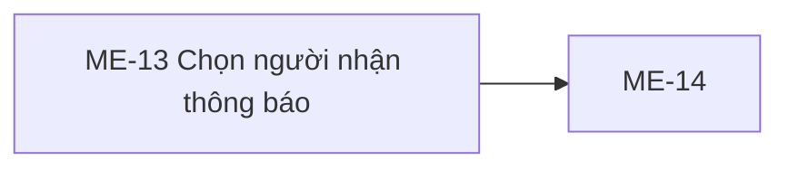

# ME-13 — Navigation

## 1. Route definition
- Current route in inventory: `/mentor/notifications/new/recipients`
- Status: candidate/design route; Study Web `UNWIRED` unless source code proves otherwise.
- Route params/types: Không có route param được biểu diễn trong inventory string; route runtime vẫn chưa xác minh.
- Query params/defaults: preserve the inventory route string; detailed parsing rules only from source DD.
- Route guards: see source DD/API contract; do not create role policy.

## 2. Điểm vào
| From screen/route | Trigger | Params | Guard / fallback |
|---|---|---|---|
| Không khai báo trong cột điều hướng inventory. | Theo DD nguồn/inventory | Theo source; không suy diễn | Xem source DD; route chưa xác nhận runtime |

## 3. Điểm ra
| Destination | Trigger | Params | Điều kiện |
|---|---|---|---|
| [ME-14](../ME-14-SoanThongBaoMentor/00-overview.md) | Source event/inventory navigation | Theo source DD | Expected links; runtime chưa verify |

## 4. Back / refresh / deep link
- Back behavior: xem source DD; không mặc định browser history.
- Preserve filters/scroll/form state: chỉ nếu source có nêu, nếu không `CẦN_XÁC_NHẬN`.
- Refresh/direct URL: route trong inventory không chứng minh runtime.
- Invalid/missing ID: theo source DD/backend contract; không tự tạo validation.
- Not authenticated/authorized: theo source role guard; xem [Business Rules](05-business-rules.md).

## 5. Diagram

## Source navigation and flow detail

### Trích từ DD nguồn: E. Ma trận trạng thái và điều hướng

| State | Entry/condition | UI/data | Allowed transitions |
|---|---|---|---|
| session-check | Enter proposed route | No protected request until Mentor auth is known | authenticated → courses-loading; unauthenticated/role denied → app auth state |
| courses-loading | E01 #46 pending | Course selector loading; Continue disabled | success-nonempty → course-ready; success-empty → courses-empty; error → courses-error |
| courses-empty | #46 returns items=[] | No course option; empty copy needs design | reload → courses-loading; leave → confirmed destination |
| courses-ready | #46 returns one or more pages | Course options with source IDs/titles | select → roster-loading |
| roster-loading | E02 #62 pending | Selected course; clear previous roster/IDs; Continue disabled | data[] → roster-ready; [] → roster-empty; 401/403/404/500/network → roster-error |
| roster-empty | #62 data=[] | Empty roster; count 0; Continue disabled | choose another course → roster-loading; leave → confirmed destination |
| roster-ready-none | Roster loaded, no selected IDs | Show approved rows; count 0 | all → selected-all; specific row toggles → selected-some; support scope remains blocked |
| selected-all | IDs equal all loaded roster IDs | Count equals roster length; specific only after explicit product decision | deselect/scope change → roster-ready-none or selected-some; continue → handoff-pending |
| selected-some | Explicit subset selected | Count equals unique selected IDs | select/deselect → selected-some/none; continue → handoff-pending |
| support-scope-blocked | support_needed selected | No derived IDs; explain only approved blocker | choose all/specific → roster-ready state |
| courses-error / roster-error | API/network failure | Keep safe course context; no stale rows; show shared error state | retry under shared client policy; choose other course; leave |
| handoff-pending | E05 after validated nonempty IDs | Disable repeated activation while transition occurs | success → ME-14; failure → selected state with error |

### Navigation/data handoff

- Entry: inventory proposes /mentor/notifications/new/recipients; parent path and route registration are not found because Study Web is UNWIRED.
- Next: ME-14 at proposed /mentor/notifications/new. Logical handoff requires selected student IDs; exact state carrier is a blocker. Do not pass names instead of IDs.
- Back/cancel: no approved destination or restore semantics. Do not preserve in local/session storage by assumption.
- #63 sends only in ME-14; #63 returns operation UUID and notification IDs, neither should be introduced as ME-13 selection state. #18 and #64 belong downstream to ME-15.
- Session expiry and denied access must use approved global auth/error routes. No redirect target is specified here.

### Trích từ DD nguồn: B. Mô tả luồng hoạt động tổng thể

1. **Entry/auth.** Khi Study Web được triển khai, route đề xuất phải nằm trong Mentor-authenticated shell. Nếu chưa có session/role MENTOR, không gọi #46/#62/#63. Current source chỉ chứng minh backend Bearer/role guards; client redirect và session refresh chưa có contract.
2. **Khởi tạo.** Đặt course selection rỗng, roster rỗng, selected IDs rỗng, loading/error state phù hợp. Ảnh tĩnh cho thấy radio all được chọn trực quan nhưng chưa chọn course; xác nhận đây là default nghiệp vụ trước khi dùng làm runtime default.
3. **Tải course.** Gọi #46. Dùng data.items để render course title và gắn value bằng data.items[].id int64. Theo data.pagination tải thêm page nếu cần để danh sách đủ. Không chuyển HTML slug sang int64 bằng suy luận. #46 rỗng → course-empty state; response lỗi → giữ retry/leave action theo app-wide policy.
4. **Chọn course và tải roster.** Khi chọn một course ID hợp lệ, reset roster/selection thuộc course cũ rồi gọi #62 theo path course_id. Chỉ áp dụng response nếu nó thuộc course selection mới nhất; tránh response chậm của course cũ thay state hiện tại. 200 [] → roster-empty state. 200 data[] → map id, full_name, avatar_url; không tự tạo các cột/email/progress.
5. **Chọn recipients.** all chọn toàn bộ IDs từ response #62; specific yêu cầu chọn từng ID trên UI đã được thiết kế; support-needed không thể tính từ #62. Giữ IDs unique; đổi course thì xóa lựa chọn của course trước. Cách giữ/tạo selection khi chuyển giữa radio scopes cần product xác nhận.
6. **Continue.** Không gọi API #63 tại ME-13. Chỉ chuyển ME-14 khi có course context hợp lệ và tập recipients khác rỗng; API #63 hiện từ chối recipients rỗng. Truyền IDs nguyên dạng numeric int64 qua cơ chế được xác nhận. Route state, query, persistence, selection all expansion và serial hóa sang CSV ở ME-14 chưa chốt.
7. **Rời màn hình.** Cancel, breadcrumb, header/footer destinations hiện là href="#". Không tuyên bố navigation hiện hành. AC-25 tiếp tục qua ME-14; ME-14 mới soạn title/content/channels và gọi #63 nếu payload contract được duyệt. Operation UUID, notification_ids, #18 polling và #64 status không thuộc state của ME-13.
8. **Lỗi và ngoại lệ.** 401 cần chuyển vào auth/session flow đã được xác nhận; 403 course/recipient denied; 404 course/path không tồn tại hoặc slug sai; 422 query/body validation; 500 internal; transport/offline xử lý theo shared client policy. Không tự retry POST #63. API #46/#62 là GET nhưng retry/backoff vẫn theo app-wide policy chưa được xác minh.
