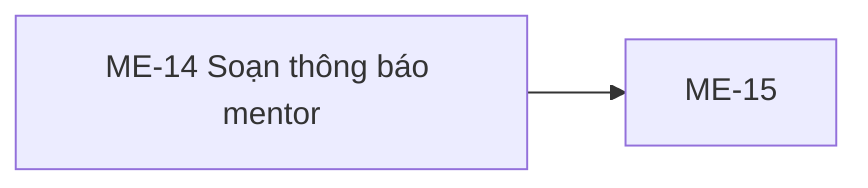

# ME-14 — Navigation

## 1. Route definition
- Current route in inventory: `/mentor/notifications/new`
- Status: candidate/design route; Study Web `UNWIRED` unless source code proves otherwise.
- Route params/types: Không có route param được biểu diễn trong inventory string; route runtime vẫn chưa xác minh.
- Query params/defaults: preserve the inventory route string; detailed parsing rules only from source DD.
- Route guards: see source DD/API contract; do not create role policy.

## 2. Điểm vào
| From screen/route | Trigger | Params | Guard / fallback |
|---|---|---|---|
| [ME-13](../ME-13-ChonNguoiNhanThongBao/00-overview.md), [ME-15](../ME-15-TheoDoiGuiThongBao/00-overview.md) | Theo DD nguồn/inventory | Theo source; không suy diễn | Xem source DD; route chưa xác nhận runtime |

## 3. Điểm ra
| Destination | Trigger | Params | Điều kiện |
|---|---|---|---|
| [ME-15](../ME-15-TheoDoiGuiThongBao/00-overview.md) | Source event/inventory navigation | Theo source DD | Expected links; runtime chưa verify |

## 4. Back / refresh / deep link
- Back behavior: xem source DD; không mặc định browser history.
- Preserve filters/scroll/form state: chỉ nếu source có nêu, nếu không `CẦN_XÁC_NHẬN`.
- Refresh/direct URL: route trong inventory không chứng minh runtime.
- Invalid/missing ID: theo source DD/backend contract; không tự tạo validation.
- Not authenticated/authorized: theo source role guard; xem [Business Rules](05-business-rules.md).

## 5. Diagram

## Source navigation and flow detail

### Trích từ DD nguồn: E. Điều hướng và state giữa màn hình

| Handoff | Dữ liệu cần giữ | Current evidence | Quyết định cần có |
|---|---|---|---|
| ME-13 → ME-14 | Course identity và danh sách unique Student int64 IDs; có thể có draft text khi quay lại. | ME-13 DD giữ nguyên ID nhưng carrier/course binding chưa chốt. ME-14 HTML không nhận state. | Phê duyệt carrier nội bộ, duplicate handling, expiry và behavior khi refresh; không đặt IDs trên URL nếu chưa quyết định. |
| ME-14 → accepted send | Title, content, recipients, channels; attachment nếu hỗ trợ. | #63 chỉ khớp title/recipients/channels một phần; body `int64` và không có attachment. | Chốt contract/API before enabling send. |
| Accepted → ME-15 | Mỗi notification int64 ID cho #64; Operation UUID là ID khác. | #63 local source đặt `meta.notification_ids[]`; #64 đọc từng notification; #18 vẫn UNWIRED, AC-25 không có edge. | ME-15 phải dùng #64 cho notification IDs theo approved contract; generic operation polling cần contract riêng. ME-15 không thuộc phiên này. |

### Ma trận state

| State | Nguồn | Đặc tả |
|---|---|---|
| `draft` | `list_screen.md` expected state | Không được lưu/khôi phục trong source hiện tại. |
| `validating` | `list_screen.md` expected state | Không có validator/loading state trong HTML. |
| `sending` | `list_screen.md` expected state | Không có submit handler; nút send disabled. |
| `accepted` | `list_screen.md` và API #63 | Theo local API source, chỉ sau transaction commit; 202 nghĩa queued, không phải delivered. |
| `error` | `list_screen.md`; #63 error set | UI error panel/toast/retry state chưa được source định nghĩa. Backend status/code được giữ nguyên ở E09. |
| `QUEUED`/`SENT`/`FAILED` | #64 local projection | Trạng thái dispatch API theo từng notification; mapping từ delivery counts là `DERIVED`, worker chưa wired. |

### Trích từ DD nguồn: B. Luồng hoạt động tổng thể

### Luồng hiện tại của artifact

1. Mở `code.html` tĩnh. Không có router/auth guard hoặc gọi dữ liệu.
2. DOM khởi tạo với title/body trống, In-app checked, Email disabled, selection chưa xác thực, send disabled và preview placeholder.
3. Khi title đổi, script hiển thị raw character count `value.length`; preview dùng `trim()` để chọn placeholder hoặc nội dung. Preview được gán bằng `textContent`.
4. Khi body đổi, script đếm các từ sau `trim().split(/\s+/)`; preview được cập nhật bằng `textContent`. Không có markdown/rich text parsing.
5. Toolbar, kênh, đính kèm, lưu nháp, gửi, breadcrumb, navigation, help và footer không có handler/router/API. Anchor dùng `href="#"`; `data-path` là nhãn tĩnh.
6. Không có state persistence. Refresh sẽ trở về giá trị ban đầu của HTML.

### Luồng dự kiến theo AC-25 và giới hạn nguồn hiện tại

1. ME-13 chọn course và Student từ roster #62. ME-13 handoff IDs/course sang ME-14 đang mở; phải thống nhất carrier, ID type và course binding trước khi code.
2. ME-14 nhận title, content, recipients và channels; hiện HTML không có state nhận từ ME-13, validation audience hoặc quy tắc sản phẩm đã được nối.
3. Khi có contract đã duyệt, client cần tạo request #63 theo schema chính xác. Hiện chưa thể ánh xạ `body text → content:int64`, `In-app → PUSH`, hoặc attachment vì source không định nghĩa mapping.
4. #63 strict-validates request model; malformed/missing/type/extra-field input có thể bị framework trả 422 trước khi handler chạy. Với body parse thành công, Mentor auth chạy trước CSV parsing/DB. Sau đó source kiểm tra recipient scope, thực hiện transaction và chỉ trả 202 sau khi tất cả notification/outbox rows commit.
5. Response #63 có một Operation UUID trong `data.id`, cùng các notification int64 IDs trong `meta.notification_ids`. Đây là hai định danh khác mục đích.
6. API #64 đọc status cho từng notification ID. Source tổng hợp `QUEUED` nếu còn delivery queued; nếu không và có failed thì `FAILED`; nếu tất cả sent thì `SENT`. Đây là mapping local `DERIVED`; worker/provider chưa wired nên không đảm bảo chuyển khỏi `QUEUED`.
7. API #18 không có Study route và AC-25 không kết nối endpoint này vào luồng. Không gọi #18 theo `operation_id` ở ME-14.

### Trạng thái giao diện và lỗi

| Trạng thái | Hiện có trong prototype | Hành vi/ghi chú |
|---|---|---|
| Initial/empty | Có | Selection/title/body rỗng; preview dùng placeholder. |
| Recipient blocked | Có | Badge chưa xác thực; Send disabled. |
| Editing title/body | Có | DOM preview/counter được cập nhật. |
| Channel selected/disabled | Có | In-app checked; Email disabled. Không có onChange handler. |
| Uploading/saving/sending/loading | Không | Không có async handler hoặc spinner. |
| Validation error | Không | Dấu `*` là copy; input không có `required`, form hoặc validator. |
| API success/error | Không | Không có fetch/client error mapping. HTTP/API outcomes chỉ mô tả ở E09 để phục vụ tích hợp sau khi blockers được giải quyết. |
| Session expired/unauthorized | Không | Chưa có auth/runtime; nếu tích hợp #63, 401 theo API contract cần xử lý ở app shell. |
